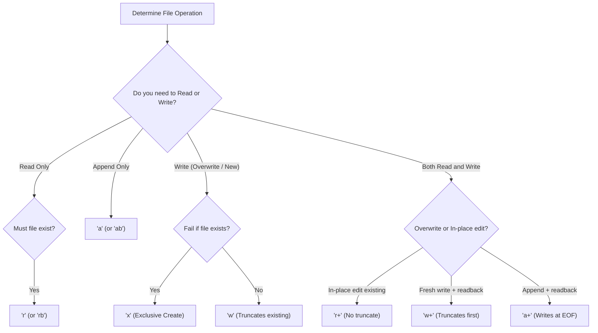
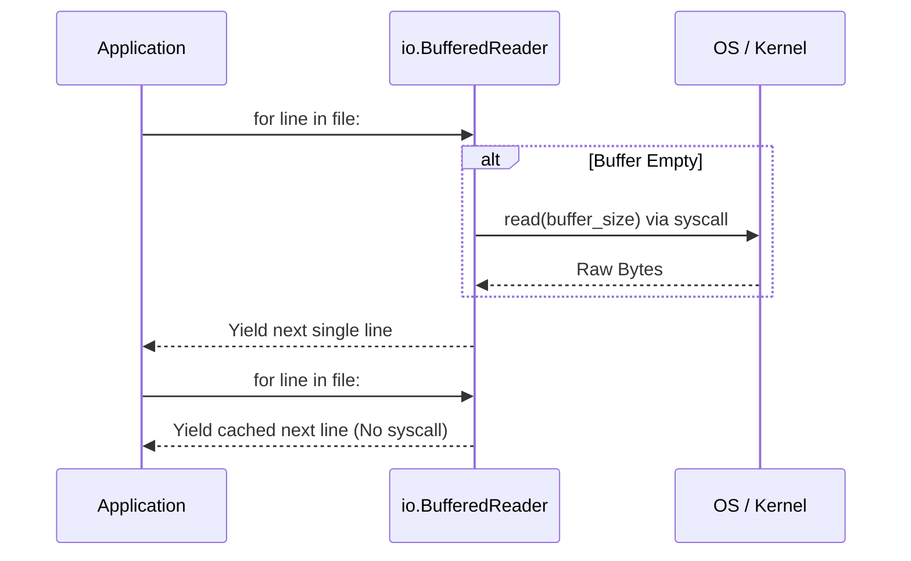
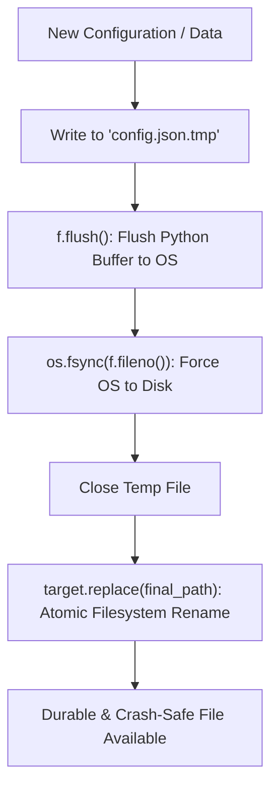
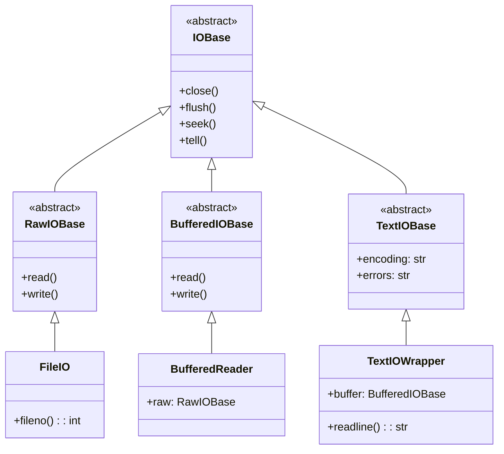

# Python File I/O Mechanisms and Modes

| Metadata      | Value                      |
| ------------- | -------------------------- |
| Author        | Lyzander Marciano Andrylie |
| Creation Date | Nov 7, 2026                |
| Last Updated  | Nov 8, 2026                |

## References

- [Python Built-in open() Function](https://docs.python.org/3/library/functions.html#open): Specification for file opening, modes, buffering, and encoding
- [PEP 3116 – New I/O – The io Module](https://peps.python.org/pep-3116/): Three-tier Python I/O stack specification (Raw, Buffered, Text)
- [Python io Module Documentation](https://docs.python.org/3/library/io.html): Concrete classes and abstract base classes for stream handling
- [file_descriptors.md](../linux/file_descriptors.md): Linux kernel file descriptor architecture, lifecycle syscalls, and stream redirection
- [inodes.md](../linux/inodes.md): Filesystem inode metadata layout, link counting, and storage allocation
- [pathlib.md](../../lib/python/pathlib.md): Object-oriented filesystem path operations and integrated I/O helpers
- [plotly.md](../../lib/python/plotly.md): Declarative interactive charting library with figure export and file serialization

## Description

Python file input/output (I/O) provides mechanisms to interface with operating system filesystems, manage system file descriptors, and manipulate byte or text streams. This guide details file opening modes, cursor behavior, stream reading/writing mechanisms, the underlying `io` subsystem architecture, and patterns for crash-safe atomic persistence.

## Concepts

### 1. File Access Modes and Mode Matrix

File open modes define stream direction (reading, writing, or appending), data representation (text or binary), and file existence requirements. Modes are supplied as a short string to `open(filename, mode=...)` or `Path.open(mode=...)`.

- **Primary Directions**:
  - `'r'`: Read (default). Opens existing file. Raises `FileNotFoundError` if file does not exist.
  - `'w'`: Write. Creates file if missing. **Truncates (clears)** file to 0 bytes if it already exists.
  - `'a'`: Append. Creates file if missing. Leaves existing data intact; cursor is positioned at end-of-file (EOF). Subsequent writes always append to EOF regardless of prior seeks on most platforms.
  - `'x'`: Exclusive creation. Creates new file for writing. Raises `FileExistsError` if file already exists, preventing overwrite race conditions.
- **Modifiers**:
  - `'t'`: Text mode (default). Reads/writes `str`. Automatically encodes/decodes text via specified `encoding` and translates line endings.
  - `'b'`: Binary mode. Reads/writes raw `bytes`. Bypasses encoding and newline translation. Required for images, serialized binaries, archives, and network payloads.
  - `'+'`: Update (Read + Write). Allows both read and write operations on a single stream (`r+`, `w+`, `a+`, `x+`).
- **Gotchas**:
  - `w+` immediately truncates the file before you can read anything.
  - `r+` does not truncate; writing in `r+` overwrites existing bytes in-place at the current cursor offset rather than inserting bytes.
  - In `a+`, reads can be repositioned using `seek()`, but any write operation immediately jumps to EOF.

#### Mode Capabilities Matrix

| Mode             | Read? | Write? |           Create if missing?            |  Truncates on open?   | Initial Cursor Position    |
| :--------------- | :---: | :----: | :-------------------------------------: | :-------------------: | :------------------------- |
| `'r'` / `'rt'`   |  Yes  |   No   |     No (raises `FileNotFoundError`)     |          No           | Start (0)                  |
| `'w'` / `'wt'`   |  No   |  Yes   |                   Yes                   | **Yes** (clears file) | Start (0)                  |
| `'a'` / `'at'`   |  No   |  Yes   |                   Yes                   |          No           | End (EOF)                  |
| `'x'` / `'xt'`   |  No   |  Yes   | **Yes only** (raises `FileExistsError`) |          No           | Start (0)                  |
| `'r+'` / `'r+b'` |  Yes  |  Yes   |     No (raises `FileNotFoundError`)     |          No           | Start (0)                  |
| `'w+'` / `'w+b'` |  Yes  |  Yes   |                   Yes                   | **Yes** (clears file) | Start (0)                  |
| `'a+'` / `'a+b'` |  Yes  |  Yes   |                   Yes                   |          No           | End (writes forced to EOF) |
| `'x+'` / `'x+b'` |  Yes  |  Yes   | **Yes only** (raises `FileExistsError`) |          No           | Start (0)                  |

#### Interaction



```python
from pathlib import Path

target = Path("sample.txt")

# Safe exclusive creation (prevents overwriting existing logs/data)
try:
    with target.open(mode="x", encoding="utf-8") as f:
        f.write("New session started\n")
except FileExistsError:
    # Fall back to append if file was already created
    with target.open(mode="a", encoding="utf-8") as f:
        f.write("Session resumed\n")
```

---

### 2. File Reading Mechanisms

Python provides several reading paradigms ranging from complete memory loads to lazy, buffered streams.

- **Full Memory Reads (`f.read()`, `f.readlines()`)**:
  - `f.read()` reads entire stream into a single `str` (or `bytes`).
  - `f.readlines()` parses all lines into a `list[str]`.
  - _Trade-off_: Easy to inspect, but causes out-of-memory (OOM) failures on large files.
- **Line-by-Line Lazy Iteration (`for line in f:`)**:
  - Utilizes internal C-level read-ahead buffers (`io.BufferedReader`).
  - Memory usage is constant $O(1)$ regardless of total file size.
  - Leaves trailing newline characters (`\n` or `\r\n`) intact on each line.
- **Chunked Binary/Block Reading (`iter(lambda: f.read(size), b"")`)**:
  - Reads fixed-size byte buffers (e.g., 64 KiB) per iteration.
  - Optimal for processing binaries, hash calculations (SHA-256), or network uploads.
- **Cursor Repositioning (`seek` and `tell`)**:
  - `f.tell()` returns the current integer position in the file.
  - `f.seek(offset, whence)` adjusts the position:
    - `whence=0` (`os.SEEK_SET`): Offset from start of file.
    - `whence=1` (`os.SEEK_CUR`): Offset relative to current position.
    - `whence=2` (`os.SEEK_END`): Offset relative to end of file.
  - _Gotcha in Text Mode_: Only `whence=0` with arbitrary offsets or values returned by previous `tell()` calls are valid. Arbitrary relative offsets (`whence=1` or `2`) raise an `OSError` or yield invalid surrogate decodings in text mode.

#### Interaction



```python
import hashlib
from pathlib import Path

data_path = Path("large_dataset.csv")

# 1. Line-by-line streaming (O(1) memory)
with data_path.open(mode="r", encoding="utf-8") as stream:
    for line_num, line in enumerate(stream, start=1):
        clean_row = line.rstrip("\r\n")
        # Process row without loading whole file

# 2. Fixed-size chunked binary processing (e.g. SHA-256 hashing)
hasher = hashlib.sha256()
chunk_size = 64 * 1024  # 64 KiB

with data_path.open(mode="rb") as binary_stream:
    while chunk := binary_stream.read(chunk_size):
        hasher.update(chunk)

print(f"Dataset SHA256: {hasher.hexdigest()}")
```

---

### 3. File Writing Mechanisms and Durability

Writing data involves multiple intermediate caching layers between application variables and physical storage disks.

- **Writing Methods**:
  - `f.write(content)`: Writes string or byte payload to the internal application buffer. Returns number of characters/bytes written.
  - `f.writelines(sequence)`: Iterates through sequence and writes each item. Does **not** insert newline characters automatically.
- **Buffering & Flush Levels**:
  1. **Python Runtime Buffer**: Flushed automatically on buffer saturation, `f.close()`, or manual `f.flush()`.
  2. **OS Page Cache (Kernel)**: `f.flush()` sends data to the operating system, but does not guarantee the drive controller wrote it to persistent flash/disk.
  3. **Physical Storage**: `os.fsync(f.fileno())` forces the OS kernel to flush its dirty pages directly to the non-volatile hardware storage.
- **The Atomic Write Pattern**:
  - Directly writing to an existing file with mode `'w'` exposes readers to empty or partially written files if the application crashes or runs out of disk space mid-write.
  - _Solution_: Write to a temporary sibling file, execute `flush()` + `os.fsync()`, then atomically rename via `os.replace()` or `Path.replace()`.

#### Interaction



```python
import os
import tempfile
from pathlib import Path

def write_atomic(dest_path: Path, content: str, encoding: str = "utf-8") -> None:
    """Writes content atomically to prevent partial writes during crashes."""
    dest_path = dest_path.resolve()
    parent_dir = dest_path.parent
    parent_dir.mkdir(parents=True, exist_ok=True)

    # Create temporary file in same filesystem directory
    with tempfile.NamedTemporaryFile(
        mode="w",
        dir=parent_dir,
        encoding=encoding,
        delete=False
    ) as temp_file:
        temp_file.write(content)
        temp_file.flush()
        # Force OS write to physical storage
        os.fsync(temp_file.fileno())
        temp_name = temp_file.name

    # Atomic rename replaces destination without window of corruption
    Path(temp_name).replace(dest_path)

# Usage
target_cfg = Path("config/app_config.json")
write_atomic(target_cfg, '{"status": "active", "workers": 4}')
```

---

### 4. The Python `io` Architecture and Context Management

The Python `io` module (PEP 3116) implements a layered hierarchy separating raw byte access, buffering, and text encoding/decoding.

- **The Three-Tier I/O Stack**:
  1. **Raw I/O (`io.RawIOBase`, e.g., `io.FileIO`)**: Unbuffered low-level OS system calls (`read`, `write`). Operates exclusively on bytes.
  2. **Buffered I/O (`io.BufferedIOBase`, e.g., `io.BufferedReader`, `io.BufferedWriter`)**: Wraps Raw I/O with an in-memory byte buffer (typically 8 KiB). Reduces expensive OS system call frequency.
  3. **Text I/O (`io.TextIOBase`, e.g., `io.TextIOWrapper`)**: Wraps Buffered I/O. Handles character conversions via `codecs`, manages `newline` translation, and decodes byte buffers into Python Unicode strings (`str`).
- **In-Memory Streams**:
  - `io.StringIO`: In-memory text stream behaving like an open text file.
  - `io.BytesIO`: In-memory byte stream behaving like an open binary file.
  - _Use Case_: Fast unit testing without touching disk, or serializing data into memory buffers before sending across a network.
- **Context Managers (`with` Statement)**:
  - Guarantees execution of `__enter__` and `__exit__`.
  - Closes the file descriptor, flushes pending data buffers, and releases operating system locks even if an unhandled exception occurs inside the block.
- **Encoding & Newline Parameters**:
  - `encoding="utf-8"`: Always specify explicit encoding to prevent platform-dependent decoding bugs (Windows defaults to CP-1252/locale encoding if omitted).
  - `newline=""`: Prevents automatic newline translation. Mandatory when reading/writing CSV files via Python's `csv` module to preserve RFC 4180 compliance.

#### Interaction



```python
import io

# In-memory text stream demonstration
virtual_file = io.StringIO()
virtual_file.write("header_col1,header_col2\n")
virtual_file.write("alpha,100\n")

# Reposition cursor to start for reading
virtual_file.seek(0)
print(virtual_file.read())

virtual_file.close()
```
