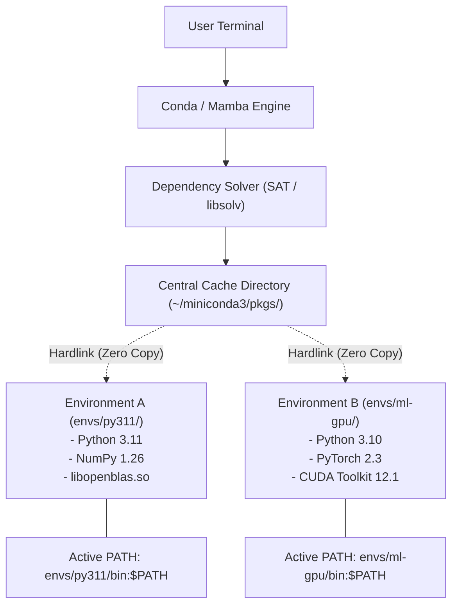
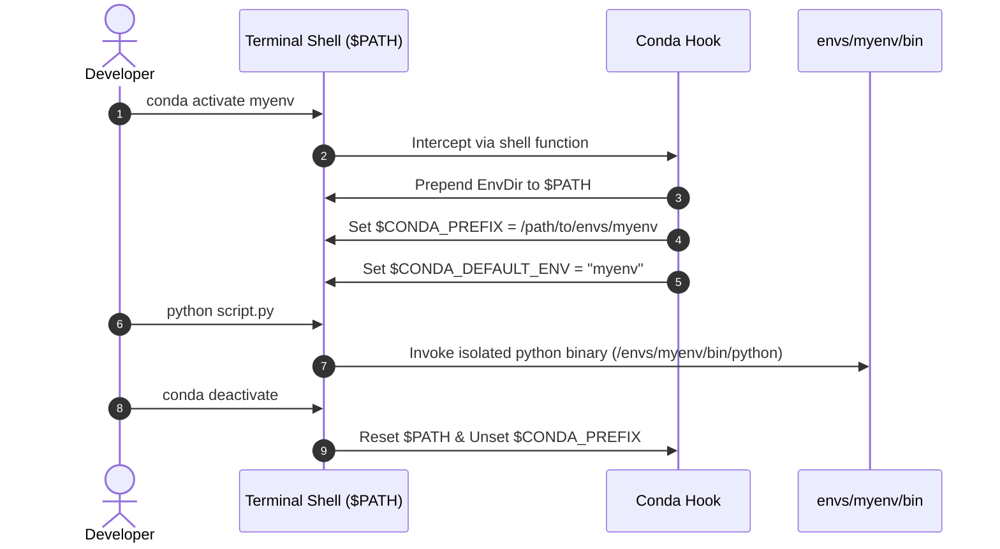
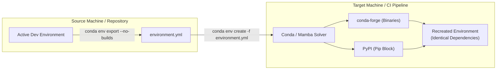

# Conda: Package and Environment Management

| Metadata      | Value                      |
| ------------- | -------------------------- |
| Author        | Lyzander Marciano Andrylie |
| Creation Date | Nov 3, 2026                |
| Last Updated  | Nov 3, 2026                |

## References

- [Conda Documentation](https://docs.conda.io/projects/conda/en/latest/) — Official documentation covering installation, configuration, command reference, and release notes.
- [Conda User Guide & Cheat Sheet](https://docs.conda.io/projects/conda/en/latest/user-guide/cheatsheet.html) — Quick-reference syntax for everyday environment and package management commands.
- [conda-forge Community Channel](https://conda-forge.org/) — Community-driven package repository providing maintained, compatible builds for thousands of software packages.
- [directory_structure.md](../../linux/directory_structure.md) — Linux filesystem hierarchy detailing binary execution paths, user directories, and environment paths.

## Description

Conda is an open-source, cross-platform package and environment management system that installs, runs, and isolates software packages and their binary dependencies across language ecosystems (including Python, R, C/C++, and Fortran). It solves environment contamination and version conflict issues by compiling and linking non-Python system-level libraries into isolated user-space sandboxes without requiring root privileges.

## Concepts

### 1. Core Architecture & Ecosystem: Language-Agnostic Binary Isolation

Unlike language-bound package managers like `pip` (which compiles or fetches Python wheels against system shared libraries), Conda is a language-agnostic binary manager that encapsulates interpreters, compiled C/C++ libraries (e.g., BLAS, LAPACK, CUDA), and system headers directly inside isolated environment directories.

- **Dual Responsibility**: Functions simultaneously as an **environment manager** (similar to `venv` or `pyenv`) and a **binary package manager** (similar to `apt` or `brew`, but operating without root permissions).
- **Hardlink Mechanism**: Packages are downloaded and extracted once into a central cache directory (`~/miniconda3/pkgs/` or `~/miniforge3/pkgs/`). When installed into an environment, Conda hardlinks files into `envs/<env_name>/` rather than duplicating files on disk, saving storage and speeding up environment creation.
- **Flavors & Distributions**:
  - **Miniconda**: Minimal installer providing only Python, Conda, and their core runtime dependencies (~100 MB).
  - **Miniforge**: Minimal installer preconfigured with `conda-forge` as the default channel and powered by `mamba` out of the box.
  - **Anaconda**: Large scientific distribution bundling 1,500+ pre-installed data science packages (~3 GB).
  - **Mamba / Micromamba**: High-speed C++ reimplementation of Conda utilizing `libsolv` for multi-threaded package downloads and SAT-based dependency resolution.

| Feature / Aspect          | `pip` + `venv`                           | `conda`                                   | `mamba` / `micromamba`                  |
| :------------------------ | :--------------------------------------- | :---------------------------------------- | :-------------------------------------- |
| **Scope**                 | Python packages only                     | Any language, binary libraries, CUDA, C++ | Any language, binary libraries, CUDA    |
| **Interpreter Isolation** | Uses host Python version                 | Installs arbitrary Python/R versions      | Installs arbitrary Python/R versions    |
| **System Dependencies**   | Relies on host OS (`apt`, `brew`)        | Bundles compiled shared objects (`.so`)   | Bundles compiled shared objects (`.so`) |
| **Resolver Engine**       | Backtracking resolver (Pip `resolvelib`) | SAT solver (Boolean satisfiability)       | High-performance C++ `libsolv` engine   |
| **Disk Storage**          | Duplicates packages per venv             | Hardlinks from central package cache      | Hardlinks from central package cache    |
| **Execution Speed**       | Fast for pure Python packages            | Can be slow during complex resolution     | 5x–10x faster resolution and download   |

#### Interaction



---

### 2. Environment Lifecycle Management: Creating, Activating, and Destroying Sandboxes

Every Conda environment is an isolated directory tree located in `~/miniconda3/envs/<env-name>` containing its own `bin/`, `lib/`, `include/`, and `lib/pythonX.X/site-packages/` directories.

- **Path Manipulation on Activation**: Running `conda activate <env-name>` prepends `~/miniconda3/envs/<env-name>/bin` to the system `$PATH` and sets `$CONDA_PREFIX`. Deactivating reverts `$PATH` to the previous state.
- **Shell Hook Requirement**: Conda modifies shell startup files (`~/.bashrc`, `~/.zshrc`) via `conda init` to define the shell function `conda` responsible for modifying active shell environment variables.
- **Auto-Activation Control**: The default `base` environment activates automatically on new terminal sessions unless disabled via configuration.

```shell
# Initialize Conda for current shell (run once after installation)
conda init bash

# Prevent Conda base environment from activating automatically on shell startup
conda config --set auto_activate_base false

# Create an empty environment with a specific Python version
conda create -y --name myenv python=3.11

# Activate the target environment
conda activate myenv

# Verify active environment and binary paths
which python
python --version
echo "$CONDA_PREFIX"

# Deactivate current environment (returns to base or system shell)
conda deactivate

# List all local environments
conda env list
# or: conda info --envs

# Delete an environment and all installed packages within it
conda env remove -y --name myenv
```

#### Interaction



---

### 3. Package and Channel Management: Multi-Source Repository Resolution

Conda fetches compiled package archives (`.tar.bz2` or `.conda`) from remote directories known as **channels**.

- **Default Channels vs. conda-forge**:
  - `defaults` (Anaconda repository): Maintained by Anaconda Inc.; subject to licensing terms for large commercial organizations.
  - `conda-forge`: Open community-maintained channel with broad platform coverage, rapid security patches, and modern package releases.
- **Channel Priority**:
  - `strict`: Conda prioritizes packages from the highest-priority channel regardless of whether a higher version exists in a lower-priority channel. This prevents mixing incompatible binary runtimes (e.g., mixing ABI builds from `defaults` and `conda-forge`).
  - `flexible`: Conda may pull dependencies from lower-priority channels to satisfy constraints.
- **Safe Mixing Rules with `pip` / `uv pip`**:
  - Always install all binary and C-extension dependencies via `conda` first.
  - Run `pip install` (or `uv pip install` for significantly faster resolution and downloads) only inside the activated Conda environment as a secondary step for packages unavailable in `conda-forge`.
  - Avoid running `conda install` after running `pip` or `uv pip` in the same environment to prevent overriding pip-managed packages.

| Task                          | Command Syntax                               | Description                                        |
| :---------------------------- | :------------------------------------------- | :------------------------------------------------- |
| **Search Package**            | `conda search <pkg_name>`                    | Queries configured channels for available versions |
| **Install with Channel**      | `conda install -c conda-forge <pkg_name>`    | Installs package explicitly from `conda-forge`     |
| **Install Exact Version**     | `conda install python=3.11.8 numpy=1.26.4`   | Pins specific versions for installation            |
| **List Installed Packages**   | `conda list`                                 | Displays packages, versions, builds, and channels  |
| **List with Explicit Search** | `conda list "^py"`                           | Regex search over installed packages               |
| **Update Single Package**     | `conda update <pkg_name>`                    | Updates package to latest compatible version       |
| **Remove Package**            | `conda remove <pkg_name>`                    | Uninstalls package and unneeded dependencies       |
| **Add Channel Globally**      | `conda config --add channels conda-forge`    | Prepends channel with highest search priority      |
| **Enforce Strict Priority**   | `conda config --set channel_priority strict` | Enforces deterministic single-channel ABI builds   |

```shell
# Configure conda-forge as primary channel with strict priority
conda config --add channels conda-forge
conda config --set channel_priority strict

# Search for available versions of a library
conda search pandas

# Install packages with pinned versions
conda install -y pandas=2.2.1 scikit-learn=1.4.1

# Inspect channel origin and build string of installed packages
conda list | grep -E "pandas|numpy|scikit-learn"
```

---

### 4. Environment Portability & Reproducibility: Declarative Configuration Files

Reproducing Conda environments across developer machines and CI/CD pipelines relies on declarative YAML configuration files (`environment.yml`).

- **Full Export vs. History Export**:
  - `conda env export`: Dumps the full resolved tree with exact platform-specific build hashes (e.g., `numpy=1.26.4=py311h64a2203_0`). This guarantees byte-for-byte reproducibility on the **same OS/architecture**, but fails across different platforms (e.g., macOS ARM64 to Linux x86_64).
  - `conda env export --no-builds`: Dumps package names and version numbers while omitting platform-specific hash strings.
  - `conda env export --from-history`: Dumps only packages explicitly requested by the user during `conda install`, letting Conda re-resolve sub-dependencies natively on target operating systems.
- **Dual-Manager Declarations**: An `environment.yml` can specify both native Conda packages and a nested `pip` block for packages missing from Conda channels.

```yaml
# environment.yml: Declarative project specification
name: data-pipeline
channels:
  - conda-forge
  - nodefaults
dependencies:
  - python=3.11.*
  - numpy>=1.26,<2.0
  - pandas=2.2.*
  - pyarrow
  - pydantic>=2.6
  - pip
  - pip:
      - structlog>=24.1.0
      - custom-private-package==1.0.0
```

```shell
# Export environment with version pins but without architecture-specific build hashes
conda env export --no-builds > environment.yml

# Export strictly user-requested packages (best for cross-platform portability)
conda env export --from-history > environment.yml

# Recreate environment from configuration file
conda env create -f environment.yml

# Update existing environment to match modified environment.yml and prune removed packages
conda env update -f environment.yml --prune
```

#### Interaction



---

### 5. Maintenance, Storage Optimization & Mamba Acceleration

Because Conda caches downloaded tarballs and unpackaged binaries indefinitely, unmanaged Conda installations accumulate tens of gigabytes of stale assets.

- **Package Cache Bloat**: The `pkgs/` directory caches every version ever downloaded. If an environment is deleted, the downloaded tarballs and unzipped source files remain in cache unless explicitly cleaned.
- **Cache Eviction**: `conda clean --all` purges unused cached packages, leftover temporary files, and downloaded tarballs without damaging existing environments (since existing environments retain their hardlinks or copies).
- **Mamba High-Speed Drop-in Replacement**:
  - `mamba` is a drop-in replacement for `conda` that executes identical subcommands (`mamba create`, `mamba install`, `mamba activate`).
  - Utilizes parallel HTTP multi-downloads and a C++ SAT solver to reduce environment resolution time from minutes to seconds.

```shell
# Check disk usage of Conda cache and environments
conda info

# Remove unused packages and cached tarballs to reclaim disk space
conda clean -y --all

# Remove only unused cached package folders without deleting tarballs
conda clean -y --packages

# Remove index cache files (useful when channel metadata gets corrupted)
conda clean -y --index-cache

# Install Mamba into base environment using conda-forge
conda install -y -n base -c conda-forge mamba

# Fast environment creation using Mamba
mamba create -y -n fast-env python=3.11 scipy pandas
```

| Issue / Failure Mode                   | Root Cause                                                  | Concrete Remediation                                                      |
| :------------------------------------- | :---------------------------------------------------------- | :------------------------------------------------------------------------ |
| **Endless "Solving environment..."**   | Conflicting channel priorities or circular dependencies     | Use `mamba`, add `--strict-channel-priority`, or pin explicit versions    |
| **`ImportError: libGL.so.1 missing`**  | Missing non-Python system dependency                        | Run `conda install -c conda-forge mesalib` or install system package      |
| **`PackagesNotFoundError`**            | Package does not exist in active channels                   | Check spelling, add channel (`-c conda-forge`), or fallback to `pip`      |
| **`Pip overwriting Conda package`**    | Invoking `pip` before `conda` or mixing incompatible builds | Recreate environment; install all conda binaries first, pip packages last |
| **Corrupted local index / hash error** | Truncated package download or stale channel repodata        | Run `conda clean --all -y` and rerun installation                         |
