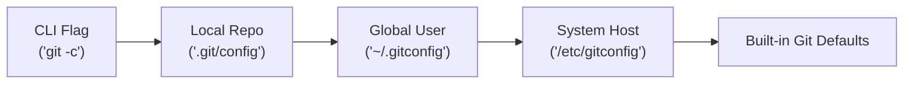
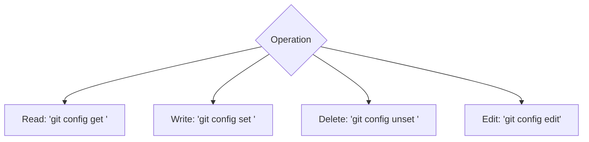
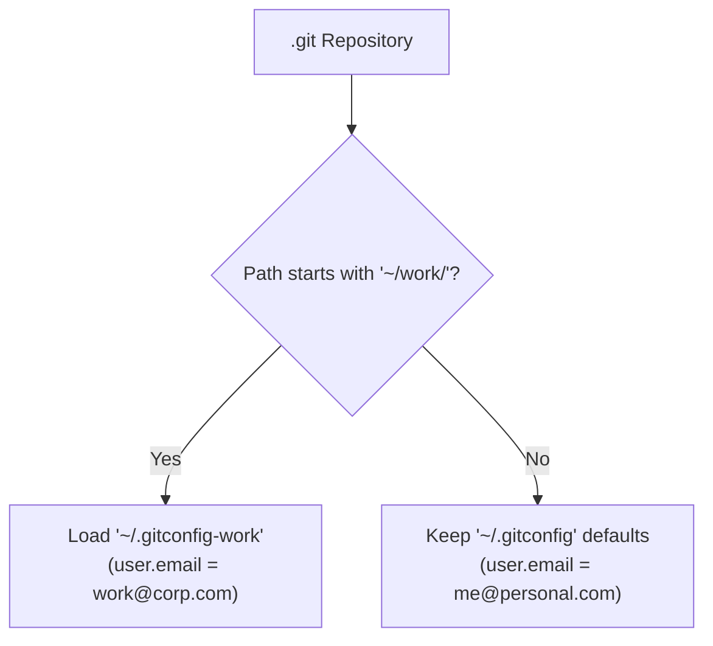

# Git Config: Essential Concepts & Quick-Reference Cheatsheet

| Metadata      | Value                      |
| ------------- | -------------------------- |
| Author        | Lyzander Marciano Andrylie |
| Creation Date | Nov 7, 2026                |
| Last Updated  | Nov 7, 2026                |

## References

- [Git Config Manual](https://git-scm.com/docs/git-config) — Official reference for `git config` subcommands, file syntax, and options.
- [Pro Git: Customizing Git](https://git-scm.com/book/en/v2/Customizing-Git-Git-Configuration) — Practical guide to scopes, identity attribution, and formatting.
- [tasks.md](../vscode/tasks.md) — Automating developer tasks and Git workflows inside Visual Studio Code.

## Description

`git config` manages Git operational defaults, author identity, and developer tooling across tiered configuration files. It resolves conflicting settings through cascading precedence where narrow scopes override wider scopes (`CLI` > `local` > `global` > `system`).

## Concepts

### 1. Scope Hierarchy: Local Overrides Global Overrides System

Git reads settings across discrete configuration files in order of increasing specificity; narrower scopes immediately override broader scopes.

- **`--system`**: `/etc/gitconfig` — Host-wide settings applied to all users and repositories.
- **`--global`**: `~/.gitconfig` (or `~/.config/git/config`) — User-level defaults applied across all your repositories.
- **`--local`**: `.git/config` — Repository-specific settings; default target for all write operations.
- **`--worktree`**: `.git/config.worktree` — Settings isolated to a linked worktree (requires `extensions.worktreeConfig`).
- **`git -c <key>=<value>`**: In-memory flag that overrides any configuration for a single command execution without writing to disk.

| Scope | Flag | File Path | Precedence | Best Used For |
| :---- | :--- | :-------- | :--------- | :------------ |
| **CLI** | `git -c k=v` | None (ephemeral) | 1 (Highest) | One-off overrides (e.g., temporary author or CI flag) |
| **Worktree** | `--worktree` | `.git/config.worktree` | 2 | Worktree-specific sparse checkout or branches |
| **Local** | `--local` | `.git/config` | 3 | Remote URLs, branch tracking, project-specific keys |
| **Global** | `--global` | `~/.gitconfig` | 4 | User identity (`name`, `email`), diff tools, global aliases |
| **System** | `--system` | `/etc/gitconfig` | 5 (Lowest) | Shared machine or enterprise defaults |

#### Interaction



```shell
# Inspect all resolved configs with their source file and scope
git config list --show-origin --show-scope

# Read a specific key from a specific scope
git config --global user.email
git config --local remote.origin.url

# Run a one-off command with an ephemeral config override
git -c user.email="ci@example.com" commit -m "Automated build"
```

---

### 2. Everyday Operations: Modern Subcommands Cheatsheet

Modern Git provides dedicated subcommands (`get`, `set`, `unset`, `list`, `edit`) that replace ambiguous positional syntax.

- **Read Operations**: Query keys using `get`, find patterns using `--regexp`, or supply a fallback default using `--default`.
- **Write Operations**: Set scalar values using `set`, append array entries using `--append`, or overwrite all matches using `--all`.
- **Deletions & Edits**: Delete keys via `unset`, or launch `$EDITOR` directly with `edit`.

| Task | Modern Command (Git 2.43+) | Legacy Equivalent |
| :--- | :------------------------- | :---------------- |
| **List all settings** | `git config list` | `git config -l` |
| **List with origin file** | `git config list --show-origin` | `git config -l --show-origin` |
| **Read a single key** | `git config get <key>` | `git config <key>` |
| **Read with fallback** | `git config get --default="main" <key>` | `git config <key> \|\| echo "main"` |
| **Search keys by regex** | `git config get --regexp "^alias\."` | `git config --get-regexp "^alias\."` |
| **Set a key** | `git config set [--global] <key> <val>` | `git config [--global] <key> <val>` |
| **Append array value** | `git config set --append <key> <val>` | `git config --add <key> <val>` |
| **Unset a key** | `git config unset [--global] <key>` | `git config --unset [--global] <key>` |
| **Open config in editor**| `git config edit [--global]` | `git config -e [--global]` |

#### Interaction



```shell
# Read operations
git config get user.name
git config get --default="main" init.defaultBranch
git config get --regexp "^alias\."

# Write operations
git config set --global user.name "Your Name"
git config set --global user.email "you@example.com"
git config set --global init.defaultBranch main

# Multi-value array append (e.g. extra fetch refspec)
git config set --local --append remote.origin.fetch "+refs/tags/*:refs/tags/*"

# Delete and edit
git config unset --local branch.old-branch.remote
git config edit --global
```

---

### 3. Multi-Account Profile Switching (`includeIf`)

`includeIf` automatically switches Git identities, emails, and SSH keys based on the directory where a repository resides, eliminating accidental commits with personal emails on work projects.

- **`gitdir:<pattern>`**: Activates the included file when the repository's path matches the glob.
- **Trailing `/**`**: Ensures recursive matching for any repository inside the specified directory.
- **Order Dependency**: Put `includeIf` directives **after** baseline defaults in `~/.gitconfig` so the included file overrides them.

| Match Pattern | Trigger Condition | Common Use Case |
| :------------ | :---------------- | :-------------- |
| **`gitdir:~/work/**`** | Repo path is inside `~/work/` | Company email, work SSH key, corporate GPG sign |
| **`gitdir:~/personal/**`** | Repo path is inside `~/personal/` | Personal email, personal SSH key |
| **`onbranch:main`** | Active branch is `main` | Strict commit signing on protected branches |

#### Interaction



```text
# ~/.gitconfig (Base Global Config)
[user]
    name = Lyzander Marciano Andrylie
    email = me@personal.com

# Automatically load work profile for any repo inside ~/work/
[includeIf "gitdir:~/work/**"]
    path = ~/.gitconfig-work
```

```text
# ~/.gitconfig-work (Work Overrides)
[user]
    email = lyzander@corporate.com
    signingkey = ~/.ssh/id_ed25519_corp.pub

[core]
    sshCommand = ssh -i ~/.ssh/id_ed25519_corp
```

---

### 4. Essential Production Settings & Aliases

The most critical, high-impact configuration keys and productivity aliases for clean commit histories, safe pulls, and faster conflict resolution.

- **Branching & Pull Safety**: Set `pull.rebase = true` to prevent messy merge bubbles on every pull, and `push.autoSetupRemote = true` to skip `--set-upstream`.
- **Conflict Resolution**: `merge.conflictStyle = zdiff3` exposes the common ancestor base in conflict markers, and `rerere.enabled = true` remembers and re-applies conflict solutions automatically.
- **Diff Quality**: `diff.algorithm = histogram` generates significantly cleaner diffs for moved or refactored code.

| Configuration Key | Recommended Value | Impact / Why You Want It |
| :---------------- | :---------------- | :----------------------- |
| **`init.defaultBranch`** | `main` | Standardizes default initial branch name |
| **`pull.rebase`** | `true` | Pulls rebase local commits instead of creating merge bubbles |
| **`push.autoSetupRemote`**| `true` | Automatically sets `--set-upstream origin <branch>` on first push |
| **`fetch.prune`** | `true` | Automatically deletes stale local references to deleted remote branches |
| **`merge.conflictStyle`** | `zdiff3` | Shows ancestor code block in conflict markers (`||||||| base`) |
| **`rerere.enabled`** | `true` | Automatically remembers and applies merge conflict resolutions |
| **`diff.algorithm`** | `histogram` | Superior diff output for restructured code and moved blocks |
| **`core.autocrlf`** | `input` (macOS/Linux) / `true` (Win) | Normalizes line endings to LF and prevents OS line ending churn |

#### Production `~/.gitconfig` Cheatsheet

```text
[user]
    name = Lyzander Marciano Andrylie
    email = lyzander@example.com

[init]
    defaultBranch = main

[core]
    editor = nvim
    autocrlf = input

[pull]
    rebase = true

[push]
    autoSetupRemote = true
    default = current

[fetch]
    prune = true
    pruneTags = true

[merge]
    conflictStyle = zdiff3

[diff]
    algorithm = histogram
    colorMoved = default

[rerere]
    enabled = true
    autoupdate = true

[alias]
    # Fast status and branching
    st = status -sb
    co = checkout
    br = branch -vv
    
    # Clean decorated one-line history
    lg = log --graph --oneline --decorate --all
    
    # Undo and amends
    unstage = reset HEAD --
    undo = reset --soft HEAD~1
    amend = commit --amend --no-edit

    # Purge local branches deleted on remote
    prune-branches = !git fetch -p && git branch -vv | awk '/: gone\\]/{print $1}' | xargs -r git branch -D
```
