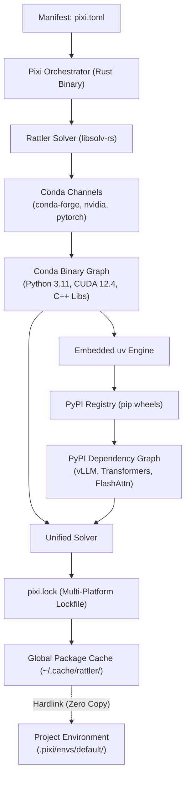
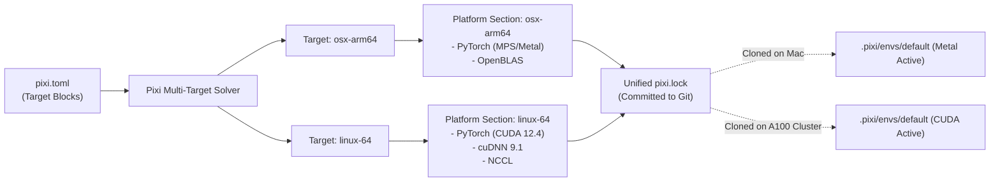

# Pixi: High-Performance Package Management and Multi-Ecosystem Orchestration with Conda and uv

| Metadata      | Value                      |
| ------------- | -------------------------- |
| Author        | Lyzander Marciano Andrylie |
| Creation Date | Nov 7, 2026                |
| Last Updated  | Nov 7, 2026                |

## References

- [Pixi Documentation](https://pixi.sh/) — Official documentation covering installation, project schema, multi-environment targets, and task execution.
- [Pixi GitHub Repository](https://github.com/prefix-dev/pixi) — Official open-source repository for Pixi.
- [Conda Rattler Engine](https://github.com/conda/rattler) — Rust library ecosystem powering Pixi's Conda package resolution, downloading, and prefix generation.
- [Astral uv Documentation](https://docs.astral.sh/uv/) — High-performance Python package installer and resolver embedded in Pixi for PyPI dependencies.
- [conda.md](../conda/conda.md) — Package and environment management for Python, binary libraries, and toolchains.

## Description

Pixi is a fast, cross-platform package management and workflow automation tool built in Rust by Prefix.dev. It bridges the Conda ecosystem (for system-level, C/C++, and GPU binary dependencies) and the PyPI ecosystem (via embedded `uv` for Python wheels) under a single declarative project manifest (`pixi.toml`) and unified lockfile (`pixi.lock`).

## Concepts

### 1. Multi-Ecosystem Architecture: Rattler Engine and Embedded uv

Pixi replaces the fragmented Python packaging landscape by merging binary package management with language-specific wheel management inside a single standalone executable.

- **Dual-Ecosystem Solver Architecture**:
  - **Conda Domain (via Rattler)**: Built using `rattler` and `libsolv-rs` (a Rust port of the RPM/Mamba SAT solver). It resolves pre-compiled shared libraries, compilers (GCC, Clang), CUDA toolkits, and non-Python runtimes from channels like `conda-forge` and `nvidia`.
  - **PyPI Domain (via Embedded `uv`)**: Integrates Astral's `uv` engine directly into the binary. It resolves pure Python wheels and source distributions from PyPI, respecting constraints established by the Conda environment.
- **Standalone Binary**: Distributed as a single compiled Rust binary with zero external dependencies. It does not require a pre-installed Python interpreter, Conda base installation, or root permissions.
- **Project-Local Prefixes**: Unlike traditional Conda (which stores environments globally in `~/miniconda3/envs/`), Pixi isolates environments per repository inside `.pixi/envs/<environment-name>/`.
- **Global Package Cache**: Downloads are deduplicated across projects via hardlinks from a central cache (`~/.cache/rattler/cache`), minimizing disk usage.

| Feature / Dimension             | Classic `conda`         | `conda-lock`          | `uv` alone            | `pixi`                             |
| :------------------------------ | :---------------------- | :-------------------- | :-------------------- | :--------------------------------- |
| **Binary Packages (CUDA, C++)** | Yes                     | Yes                   | No (PyPI only)        | **Yes (via Conda channels)**       |
| **PyPI Packages & Wheels**      | Fragile / Secondary     | Fragile               | Native / Primary      | **Native (Embedded `uv`)**         |
| **Lockfile Generation**         | None (manual export)    | Manual command        | Automatic (`uv.lock`) | **Automatic (`pixi.lock`)**        |
| **Host Prerequisites**          | Python + Conda runtime  | Python + Conda + pip  | Standalone binary     | **Standalone binary**              |
| **Built-in Task Runner**        | No (requires Make/Just) | No                    | No                    | **Yes (`pixi run`)**               |
| **Resolution Speed**            | Slow (Python SAT)       | Slow (invokes solver) | Ultra-fast (Rust)     | **Ultra-fast (Rust `libsolv-rs`)** |

#### Interaction



---

### 2. Declarative Manifest (`pixi.toml`) and Multi-Platform Locking (`pixi.lock`)

Pixi eliminates floating, unpinned dependencies by maintaining a cryptographically locked, cross-platform lockfile that records the exact SHA256 hashes, URLs, and package versions for all targeted architectures.

- **Manifest Schema (`pixi.toml`)**:
  - `[workspace]`: Defines workspace channels, supported OS platforms, and metadata.
  - `[dependencies]`: Declares packages resolved from Conda channels.
  - `[pypi-dependencies]`: Declares packages resolved from PyPI via `uv`.
  - `[tasks]`: Defines reproducible automation targets.
- **Atomic Synchronization**: Any invocation of `pixi add`, `pixi remove`, `pixi install`, or `pixi run` checks whether `pixi.toml` and `pixi.lock` are in sync and updates the locked graph automatically.
- **Legacy Migration**: Translates an existing `environment.yml` into a fully locked Pixi workspace via `pixi init --import environment.yml`.

```toml
# pixi.toml
[workspace]
name = "ai-service"
version = "0.1.0"
channels = ["conda-forge", "nvidia"]
platforms = ["linux-64", "osx-arm64"]

[dependencies]
python = "3.11.*"
cuda-toolkit = "12.4.*"
cmake = ">=3.28"
ninja = "*"

[pypi-dependencies]
torch = { version = "==2.4.0", index = "https://download.pytorch.org/whl/cu124" }
vllm = ">=0.6.0"
flash-attn = { version = "*", no-build-isolation = true }
transformers = { git = "https://github.com/huggingface/transformers.git" }
```

```shell
# Initialize a new Pixi workspace
pixi init my-project

# Add a Conda dependency
pixi add python=3.11 numpy=1.26

# Add a PyPI dependency via embedded uv
pixi add --pypi "vllm>=0.6.0"

# Install all locked dependencies into .pixi/envs/default
pixi install

# Spawn a shell inside the isolated environment
pixi shell
```

---

### 3. Hardware & Multi-Target Matrixing: Local Laptops vs Cloud GPU Clusters

AI/ML workflows frequently encounter platform divergence: development occurs on macOS (Apple Silicon / MPS), whereas training and production inference occur on Linux with NVIDIA GPUs (CUDA). Pixi resolves this with target-specific dependency blocks and multi-environment matrixing in a single manifest.

- **Target Overrides (`[target.<platform>.dependencies]`)**: Modifies dependencies based on the host operating system and CPU architecture without branching Git repositories.
- **Environment Matrixing (`[environments]`)**: Combines feature sets into distinct isolated sandboxes (e.g., a lightweight `cpu` environment for CI test suites alongside a full `cuda12` environment for model training).

| Target Configuration    | Active Environment | Platform      | Included Packages                                    |
| :---------------------- | :----------------- | :------------ | :--------------------------------------------------- |
| **`target.osx-arm64`**  | `default`          | Apple Silicon | CPU PyTorch, Metal acceleration, Apple MPS support   |
| **`target.linux-64`**   | `default`          | Linux x86_64  | CUDA Toolkit 12.4, cuDNN, Triton compiler            |
| **`environments.test`** | `test`             | Any           | Pytest, Flake8, Coverage (omits heavy CUDA binaries) |

#### Interaction



```toml
# Hardware targeting within pixi.toml
[dependencies]
python = "3.11.*"
numpy = ">=1.26"

# Packages installed strictly on macOS Apple Silicon
[target.osx-arm64.dependencies]
pytorch = { version = "*", channel = "conda-forge" }

# Packages installed strictly on Linux x86_64 GPU nodes
[target.linux-64.dependencies]
pytorch-gpu = { version = "*", channel = "conda-forge" }
cuda-toolkit = "12.4.*"

# Feature matrixing for lightweight CI vs GPU training
[feature.test.dependencies]
pytest = ">=8.0"

[environments]
default = { solve-group = "default" }
ci = { features = ["test"], solve-group = "default" }
```

---

### 4. Integrated Task Runner & Lifecycle Orchestration

Pixi embeds a task runner that executes shell commands and complex pipelines inside the exact project environment, eliminating the need for external `Makefile` or `justfile` configurations.

- **Automatic Environment Injection**: Tasks defined under `[tasks]` execute with `.pixi/envs/<env>/bin` prepended to `$PATH`. No manual `conda activate` is required.
- **Cross-Platform Shell Compatibility**: Uses `deno_task_shell` internally, allowing POSIX-like commands (e.g., `&&`, `export`, variables) to run consistently across Linux, macOS, and Windows.
- **Task Chaining (`depends-on`)**: Sequences prerequisite targets to assemble multi-stage pipelines.

```toml
# Task configuration in pixi.toml
[tasks]
format = "ruff format ."
lint = { cmd = "ruff check .", depends-on = ["format"] }
test = { cmd = "pytest -v tests/", depends-on = ["lint"] }

# Training task passing hardware flags
train = { cmd = "python -m src.train --epochs 50 --batch-size 32", env = { OMP_NUM_THREADS = "8" } }

# Export environment for legacy deployment
export-conda = "conda env export --from-history | grep -v '^prefix: ' > environment.yml"
```

```shell
# Execute task and its prerequisite dependencies (format -> lint -> test)
pixi run test

# Execute training directly inside the isolated environment
pixi run train
```

---

### 5. Deployment Across HPC, Containers, Google Colab, and Kaggle

Pixi provides deployment parity across cloud VMs, supercomputing clusters (Slurm), and hosted Jupyter notebook runtimes.

- **HPC / Slurm Clusters**: Supercomputing compute nodes often restrict root permissions and provide outdated host Conda modules. Because Pixi is a single binary, users download it to `~/.local/bin/pixi` and execute batch jobs without host pollution:
  ```shell
  # Slurm job script (submit.sh)
  #!/bin/bash
  #SBATCH --gres=gpu:a100:1
  #SBATCH --cpus-per-task=8

  ~/.local/bin/pixi run train
  ```
- **Container Parity**: Multi-stage Docker builds copy the pre-resolved `.pixi/envs/default` directly into minimal runtime images, bypassing Python build tooling entirely in production containers.
- **Hosted Notebooks (Google Colab / Kaggle)**: Hosted notebook platforms execute within pre-warmed virtual machines with pre-allocated Python runtimes. Pixi adapts to both standalone script execution and interactive cell evaluation.

#### a. Hardware & PyTorch Driver Compatibility on Hosted Notebooks

Hosted platforms like Google Colab and Kaggle ship with fixed kernel drivers and pre-warmed system site-packages. Pixi ensures compatibility through process and filesystem isolation:

- **Kernel Driver vs. User-Space Runtime**:
  - **Host Role**: Supplies only the kernel-level NVIDIA display driver (`libcuda.so.1`).
  - **Pixi Role**: Bundles its own isolated user-space CUDA runtime (`libcudart.so`, cuDNN, cuBLAS) and PyTorch binaries inside `.pixi/envs/default/`.
  - **Forward Compatibility**: Any user-space CUDA version supported by the host driver executes cleanly without hardware conflicts.
- **Upstream Version Isolation**:
  - Bypasses host system site-packages (`/usr/local/lib/pythonX.X/dist-packages/`).
  - Prevents breakage from unannounced cloud provider updates to default Python or PyTorch runtimes.
  - Guarantees execution against the exact locked dependency versions recorded in `pixi.lock`.
- **Hardware Constraint Validation (`[system-requirements]`)**:
  - Enforces minimum host GPU driver requirements directly in `pixi.toml`.
  - Inspects `/usr/lib64/libcuda.so` or `/usr/lib/x86_64-linux-gnu/libcuda.so` on container boot.
  - Fails fast with a clear diagnostic if the instance driver cannot support the requested CUDA release:
    ```toml
    [system-requirements]
    cuda = "12.0"
    ```
- **Download vs. Reproducibility Trade-Off**:
  - Downloads locked PyTorch binaries on initial setup (~1–2 GB in ~15–25 seconds over datacenter networks).
  - Trades initial setup time for 100% bit-for-bit parity across local workstations, Slurm clusters, and hosted notebooks.

| Execution Mode                    | Target Runtime             | Mechanism                                                                             | Trade-Off                                                           |
| :-------------------------------- | :------------------------- | :------------------------------------------------------------------------------------ | :------------------------------------------------------------------ |
| **Script Execution (`pixi run`)** | Colab / Kaggle shell       | `!curl -fsSL https://pixi.sh/install.sh \| bash`<br/>`!pixi run python train.py`      | 100% reproducible; identical to local machine execution             |
| **Interactive Cell Import**       | Colab notebook cells       | Install `ipykernel` in Pixi and register kernel, or prepend `sys.path.insert(0, ...)` | Allows interactive `import` in notebook cells using locked packages |
| **Ephemeral Quick-Test**          | Colab pre-installed Python | `!pip install uv && uv pip install --system <pkg>`                                    | Fast startup, but mutates shared host Python state                  |

```python
# Setup snippet for Google Colab or Kaggle Notebook cells

# 1. Install Pixi binary in user space (takes ~2 seconds)
!curl -fsSL https://pixi.sh/install.sh | bash
import os
os.environ["PATH"] += ":/root/.pixi/bin"

# 2. Clone project repository
!git clone https://github.com/example-org/ai-research.git
%cd ai-research

# 3. Option A: Run pipeline directly via Pixi task runner
!pixi run train

# 4. Option B: Expose locked packages to interactive Colab notebook cells
import sys, glob
site_packages = glob.glob(os.path.abspath(".pixi/envs/default/lib/python*/site-packages"))[0]
if site_packages not in sys.path:
    sys.path.insert(0, site_packages)
```
