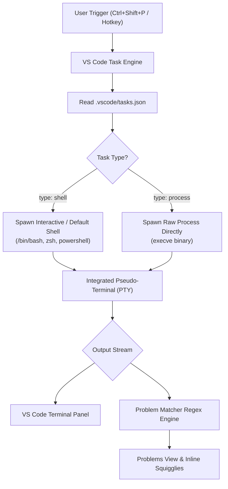
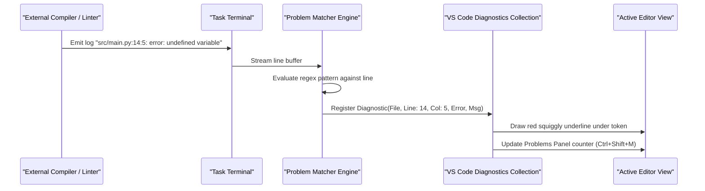
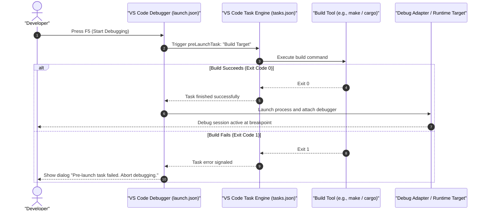

# VS Code Tasks: Automated Task Runner and Tool Integration

| Metadata      | Value                      |
| ------------- | -------------------------- |
| Author        | Lyzander Marciano Andrylie |
| Creation Date | Nov 6, 2026                |
| Last Updated  | Nov 8, 2026                |

## References

- [Visual Studio Code Tasks Documentation](https://code.visualstudio.com/docs/editor/tasks): Official guide to configuring tasks, problem matchers, task runners, and schema specifications.
- [Visual Studio Code Variables Reference](https://code.visualstudio.com/docs/editor/variables-reference): Predefined workspace, path, and interactive input variables for task and debug configurations.
- [conda.md](../conda/conda.md): Package and environment management for Python, binary libraries, and toolchains.
- [config.md](../git/config.md): Git configuration scopes, identity settings, and custom aliases.

## Description

VS Code Tasks (`tasks.json`) is an integrated task runner and workspace automation framework embedded within Visual Studio Code. It allows developers to configure, execute, and monitor external build tools, linters, test harnesses, and environment scripts directly from editor interfaces, keyboard shortcuts, and pre-launch debugging pipelines without manually typing command-line arguments.

## Concepts

### 1. Task Execution Architecture & Schema (`tasks.json`)

Tasks are defined declaratively in `.vscode/tasks.json` at the root of a workspace (or globally in user settings). VS Code executes tasks by either invoking an external shell or spawning a direct operating system process.

- **Workspace Scoping**: Workspace tasks in `.vscode/tasks.json` are committed to version control so all team members share reproducible commands. User-level tasks (`tasks.json` in user data) persist globally across all projects.
- **Execution Mechanism**:
  - `type: "shell"`: Executes the command inside the user's default shell (such as Bash, Zsh, or PowerShell). Enables shell built-ins, pipes (`|`), output redirection (`>`), and shell variable expansion (`$VAR`).
  - `type: "process"`: Executes the target binary directly via the operating system's `execve` call. Faster and immune to shell escaping bugs, but cannot use shell redirection or piping.
- **Top-Level Schema Structure**:
  - `version`: Must be set to `"2.0.0"`.
  - `tasks`: Array of task definitions.
  - `inputs`: Optional array of interactive user prompt definitions.

| Execution Mode (`type`) | Process Spawn Method                      | Shell Feature Support (`\|`, `>`, `&&`) | Best Used For                                                         |
| :---------------------- | :---------------------------------------- | :-------------------------------------- | :-------------------------------------------------------------------- |
| **`shell`**             | Spawned within shell (`/bin/bash -c ...`) | Full support                            | Complex scripts, compound pipelines, redirects, environment setup     |
| **`process`**           | Direct OS binary call (`execve`)          | None (arguments passed as array)        | Direct compiler invocations (`gcc`, `tsc`, `rustc`), strict CLI tools |

#### Interaction



#### a. Command Composition: Single `command` String vs. `command` + `args` Array

Developers can formulate task commands either as a single combined string in `"command"` or by splitting the binary and its parameters into `"command"` and an `"args"` array.

- **Compound Pipelines Require Single `command`**: When using shell operators such as pipes (`|`), redirections (`>`, `>>`), or conditional execution (`&&`, `||`, `;`), the entire command pipeline must be supplied as a single string in `"command"`.
- **The Split Quoting Trap**: If shell operators (`|`, `>`) are placed into the `"args"` array, VS Code passes them as literal string arguments to the binary via CLI escaping. The target binary will fail with unrecognized argument errors because the shell never interprets them as syntax tokens.
- **Single Commands Benefit from `command` + `args`**: For standard tool invocations, splitting parameters into `"args"` prevents path-escaping bugs when file paths contain spaces (`${file}`), ensures cross-platform consistency between Windows (`cmd`/PowerShell) and POSIX shells (`bash`/`zsh`), and is mandatory when using `type: "process"`.

| Scenario                                 | Recommended Format           | Example Pattern                                                      | Rationale                                                                             |
| :--------------------------------------- | :--------------------------- | :------------------------------------------------------------------- | :------------------------------------------------------------------------------------ |
| **Pipes & Redirects (`\|`, `>`, `>>`)**  | **Single `command` string**  | `"command": "conda env export ... \| grep -v '^prefix: ' > env.yml"` | Shell operators must be evaluated by the shell parser, not passed as binary arguments |
| **Command Chaining (`&&`, `\|\|`, `;`)** | **Single `command` string**  | `"command": "npm run build && npm test"`                             | Sequences subshells and controls execution flow based on exit codes                   |
| **Paths with Spaces (`${file}`)**        | **`command` + `args` array** | `"command": "pytest", "args": ["${file}"]`                           | VS Code automatically quotes space-delimited paths without manual quote-escaping      |
| **Direct Binary (`type: "process"`)**    | **`command` + `args` array** | `"command": "gcc", "args": ["-Wall", "main.c"]`                      | Process mode bypasses shell interpreter; requires separate binary and argument vector |

```json
{
  "version": "2.0.0",
  "tasks": [
    {
      "label": "Pipeline: Export Clean Conda Environment",
      "type": "shell",
      "command": "conda env export --name ai-playground --from-history | grep -v '^prefix: ' > environment.yml",
      "options": {
        "cwd": "${workspaceFolder}"
      },
      "problemMatcher": []
    },
    {
      "label": "Standard Invocation: Pytest Single File",
      "type": "shell",
      "command": "pytest",
      "args": ["-v", "--maxfail=1", "${file}"],
      "options": {
        "cwd": "${workspaceFolder}"
      },
      "problemMatcher": []
    }
  ]
}
```

---

### 2. Core Task Configuration & Presentation Controls

The `presentation` property controls how VS Code allocates and reveals terminal panels for task execution, preventing screen clutter and unwanted terminal switching.

- **Presentation Options**:
  - `reveal`: Dictates when the terminal panel opens (`"always"`, `"silent"` to reveal only on non-zero exit codes, or `"never"`).
  - `panel`: Dictates terminal instance reuse:
    - `"shared"`: All tasks configured with this value reuse a single terminal instance.
    - `"dedicated"`: Allocates a dedicated terminal pane specifically for this task, reused on subsequent runs.
    - `"new"`: Spawns an independent terminal instance for every invocation.
  - `focus`: Whether focus shifts from the editor to the terminal window when the task starts.
  - `clear`: Clears existing terminal buffer text before executing the task.
  - `close`: Closes the terminal panel automatically when the command exits.
- **Working Directory and Environment**: Configured under the `options` block using `cwd` and `env`.

| Presentation Panel | Behavior Across Runs                                 | Terminal Clutter | Best Used For                                           |
| :----------------- | :--------------------------------------------------- | :--------------- | :------------------------------------------------------ |
| **`shared`**       | Reuses a single shared task terminal                 | Lowest           | Quick one-off scripts, lint checks, environment exports |
| **`dedicated`**    | Reuses one dedicated terminal for this specific task | Medium           | Compilers, continuous test runs                         |
| **`new`**          | Spawns a brand new terminal tab every execution      | Highest          | Parallel background services, ad-hoc independent runs   |

```json
{
  "version": "2.0.0",
  "tasks": [
    {
      "label": "Run Tests: Pytest",
      "type": "shell",
      "command": "pytest",
      "args": ["-v", "--maxfail=1"],
      "options": {
        "cwd": "${workspaceFolder}",
        "env": {
          "PYTHONPATH": "${workspaceFolder}/src",
          "ENVIRONMENT": "test"
        }
      },
      "presentation": {
        "reveal": "always",
        "panel": "dedicated",
        "focus": false,
        "clear": true,
        "showReuseMessage": false
      },
      "problemMatcher": []
    }
  ]
}
```

---

### 3. Problem Matchers: Output Parsing & Inline Diagnostics

A `problemMatcher` intercepts `stdout` and `stderr` streams, parses compiler or linter diagnostics with regular expressions, and injects findings directly into the VS Code **Problems panel** (`Ctrl + Shift + M`) and the code editor as inline colored squigglies.

- **Predefined Matchers**: VS Code includes built-in matchers for common tools:
  - `$tsc` / `$tsc-watch`: TypeScript compiler output.
  - `$gcc`: GCC and Clang compiler diagnostic formats.
  - `$eslint-compact` / `$eslint-stylish`: ESLint output.
  - `$msCompile`: Microsoft C++ / C# build outputs.
- **Custom Pattern Extraction**: Custom matchers define a regex pattern that extracts:
  - `file`: Path to the source file (relative or absolute).
  - `line`: Line number of the diagnostic.
  - `column`: Character offset on the line.
  - `severity`: Error level (`"error"`, `"warning"`, or `"info"`).
  - `message`: Diagnostic description displayed to the developer.
  - `code`: Error code or rule identifier (e.g., `E501`).
- **Background / Watching Tasks**: For continuous compilers or dev servers (`tsc -w`, `npm run dev`), the `isBackground: true` property combined with `background.beginsPattern` and `background.endsPattern` informs VS Code when an iterative compilation cycle starts and finishes.

#### Interaction



```json
{
  "version": "2.0.0",
  "tasks": [
    {
      "label": "Lint: Flake8",
      "type": "shell",
      "command": "flake8",
      "args": ["${file}"],
      "problemMatcher": {
        "owner": "python",
        "fileLocation": ["relative", "${workspaceFolder}"],
        "pattern": {
          "regexp": "^(.*):(\\d+):(\\d+):\\s+([A-Z]\\d+)\\s+(.*)$",
          "file": 1,
          "line": 2,
          "column": 3,
          "code": 4,
          "message": 5
        }
      }
    }
  ]
}
```

---

### 4. Task Categorization, Orchestration & Debugger Integration

Tasks integrate natively into VS Code's build system, test discovery, and debugging lifecycle.

- **Task Groups**: Assigning a task to a semantic `group` maps it to global editor actions:
  - `"kind": "build"`: Binds the task to the **Run Build Task** menu (`Ctrl + Shift + B`). Setting `"isDefault": true` allows direct execution without menu selection.
  - `"kind": "test"`: Binds the task to **Tasks: Run Test Task**.
- **Task Orchestration (`dependsOn` and `dependsOrder`)**:
  - `dependsOn`: Lists prerequisite task labels that must execute.
  - `dependsOrder: "parallel"` (default): Executes prerequisite tasks concurrently.
  - `dependsOrder: "sequence"`: Executes prerequisite tasks in strict linear order.
- **Debugger Pre-Launch Hook (`preLaunchTask`)**: Configured in `.vscode/launch.json` to guarantee binaries or environment exports are prepared before the debugger attaches. If the task exits with a non-zero exit code, VS Code cancels debug launch.

#### Interaction



```json
{
  "version": "2.0.0",
  "tasks": [
    {
      "label": "Build: Compile Binary",
      "type": "shell",
      "command": "make",
      "args": ["build"],
      "group": {
        "kind": "build",
        "isDefault": true
      },
      "problemMatcher": ["$gcc"]
    },
    {
      "label": "Full CI Pipeline",
      "dependsOrder": "sequence",
      "dependsOn": [
        "Conda: Export Environment",
        "Lint: Flake8",
        "Build: Compile Binary"
      ],
      "problemMatcher": []
    }
  ]
}
```

---

### 5. Dynamic Variable Substitution, Interactive Inputs & Auto-Run

Tasks support dynamic context variables, parameter prompts, and background triggers to eliminate hardcoded paths and manual user input.

- **Predefined Context Variables**:
  - `${workspaceFolder}`: The primary directory open in the workspace.
  - `${file}`: Absolute path to the currently focused editor file.
  - `${fileDirname}` / `${fileBasename}`: Directory or filename of the active file.
  - `${fileBasenameNoExtension}`: Filename stripped of extension (ideal for single-file compilation).
  - `${env:NAME}`: Resolves system environment variable `$NAME`.
  - `${config:editor.fontSize}`: Reads values from VS Code settings.
- **Interactive Inputs (`inputs`)**: Prompts the user before task execution:
  - `promptString`: Displays an input box for arbitrary text (e.g., branch names, commit messages).
  - `pickString`: Displays a searchable Quick Pick dropdown menu with predefined options.
- **Folder Open Automation (`runOptions.runOn`)**:
  - Setting `"runOptions": { "runOn": "folderOpen" }` triggers background services, watch processes, or environment sanity checks automatically whenever the folder is opened in VS Code.

| Variable / Input Type     | Resolution Mechanism        | Example Value                   | Common Use Case                                  |
| :------------------------ | :-------------------------- | :------------------------------ | :----------------------------------------------- |
| **`${workspaceFolder}`**  | Path of root directory      | `/home/user/project`            | Anchoring commands to repository root            |
| **`${file}`**             | Currently active tab        | `/home/user/project/test.py`    | Running linters/tests on current file            |
| **`${env:CONDA_PREFIX}`** | Current process environment | `/home/user/miniconda3/envs/ml` | Locating active virtual environment paths        |
| **`pickString`**          | Quick Pick modal list       | User selects from array         | Choosing deployment environments (`dev`, `prod`) |
| **`promptString`**        | Text input field            | User types arbitrary string     | Passing custom flags or target URLs              |

```json
{
  "version": "2.0.0",
  "tasks": [
    {
      "label": "Conda: Switch and Export",
      "type": "shell",
      "command": "conda env export --name ${input:targetEnv} --from-history > ${workspaceFolder}/environment.yml",
      "problemMatcher": []
    },
    {
      "label": "Start Dev Watcher",
      "type": "shell",
      "command": "npm run watch",
      "isBackground": true,
      "runOptions": {
        "runOn": "folderOpen"
      },
      "problemMatcher": ["$tsc-watch"]
    }
  ],
  "inputs": [
    {
      "id": "targetEnv",
      "type": "pickString",
      "description": "Select the Conda environment to export:",
      "options": ["repo-env", "repo-env-dev", "repo-env-cuda"],
      "default": "repo-env"
    }
  ]
}
```
