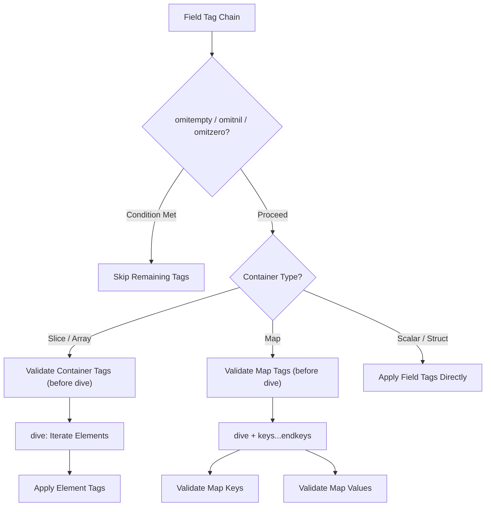
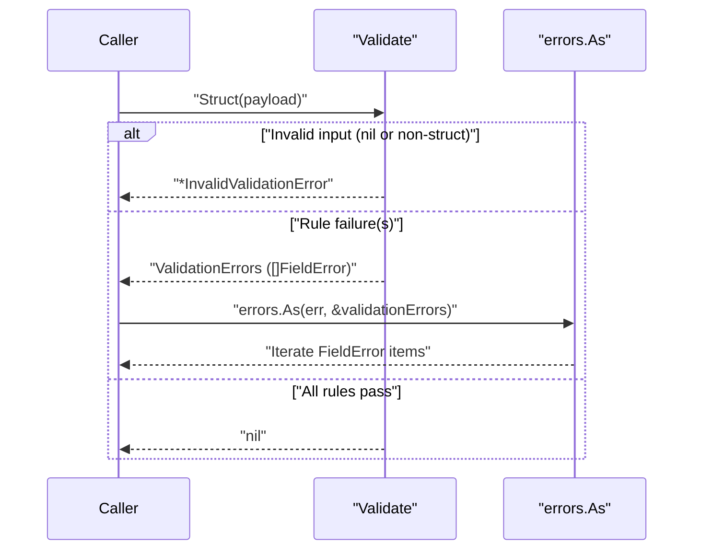

# go-playground/validator (v10)

| Metadata      | Value                                                                               |
| ------------- | ----------------------------------------------------------------------------------- |
| Author        | Lyzander Marciano Andrylie                                                          |
| Creation Date | Nov 15, 2026                                                                        |
| Last Updated  | Nov 15, 2026                                                                        |
| Repositories  | [go-playground/validator](https://github.com/go-playground/validator) (v10.30.6, `19397f2`) |

## References

- [validator v10 Package Documentation](https://pkg.go.dev/github.com/go-playground/validator/v10): Official Go API reference, built-in tag catalog, and usage notes
- [go-playground/validator Repository](https://github.com/go-playground/validator): Source repository, README, benchmarks, and `_examples/` programs
- [validator_instance.go](https://github.com/go-playground/validator/blob/v10.30.6/validator_instance.go): Public `Validate` type, `New` constructor, registration methods, and `Struct`/`Var`/`ValidateMap` entry points
- [options.go](https://github.com/go-playground/validator/blob/v10.30.6/options.go): Functional `Option` builders (`WithRequiredStructEnabled`, `WithPrivateFieldValidation`, `WithTagNameFuncBlankOmit`)
- [validator.go](https://github.com/go-playground/validator/blob/v10.30.6/validator.go): Core reflection traversal engine (`validateStruct`, `traverseField`)
- [cache.go](https://github.com/go-playground/validator/blob/v10.30.6/cache.go): Lock-protected `atomic.Value` caches for parsed struct metadata (`structCache`) and tag chains (`tagCache`)
- [baked_in.go](https://github.com/go-playground/validator/blob/v10.30.6/baked_in.go): Built-in validation functions (`bakedInValidators`) and aliases (`bakedInAliases`)
- [errors.go](https://github.com/go-playground/validator/blob/v10.30.6/errors.go): `InvalidValidationError`, `ValidationErrors`, `FieldError` interface, and `Translate` helpers
- [field_level.go](https://github.com/go-playground/validator/blob/v10.30.6/field_level.go): `FieldLevel` interface passed to custom field validators
- [struct_level.go](https://github.com/go-playground/validator/blob/v10.30.6/struct_level.go): `StructLevel` interface and `ReportError` for cross-field struct rules

## Description

`github.com/go-playground/validator/v10` is a Go library that validates structs, individual variables, and maps using declarative struct tags and custom validation functions. Built on Go's `reflect` package with cached struct/tag metadata and pooled validation state, it eliminates boilerplate validation code across HTTP APIs (including Gin as its default validator), CLI tools, and domain services.

### Instance Lifecycle, Options, and Caching

Creates and configures the singleton `*validator.Validate` instance, compiles struct fields and tag chains once on first use, and stores parsed metadata in lock-free-read `atomic.Value` maps alongside a `sync.Pool` of per-call scratch state.

- [validator_instance.go](https://github.com/go-playground/validator/blob/v10.30.6/validator_instance.go): Defines `Validate`, `New(options ...Option)`, `SetTagName`, and all validation/registration methods
- [options.go](https://github.com/go-playground/validator/blob/v10.30.6/options.go): Defines initialization options (`WithRequiredStructEnabled`, `WithPrivateFieldValidation`, `WithTagNameFuncBlankOmit`)
- [cache.go](https://github.com/go-playground/validator/blob/v10.30.6/cache.go): Implements `structCache` (`reflect.Type` -> `*cStruct`) and `tagCache` (`string` -> `*cTag`)

### Tag-Based Validation Engine

Traverses structs, pointers, interfaces, slices, arrays, and maps recursively, applying built-in or user-registered tag rules in declaration order.

- [validator.go](https://github.com/go-playground/validator/blob/v10.30.6/validator.go): Implements `validateStruct` and `traverseField` for recursive type unwrapping and tag evaluation
- [baked_in.go](https://github.com/go-playground/validator/blob/v10.30.6/baked_in.go): Registers built-in field, string, network, format, comparison, conditional, and cross-field validators

### Extensibility (Field, Struct-Level, and Custom Types)

Allows domain-specific validation logic via custom field tags, struct-level callbacks, tag aliases, and custom type unwrappers (such as `sql.NullString` or generic wrapper types).

- [field_level.go](https://github.com/go-playground/validator/blob/v10.30.6/field_level.go): Exposes `FieldLevel` (`Field()`, `Parent()`, `Top()`, `Param()`, `GetStructFieldOK2()`) to custom `Func`/`FuncCtx` validators
- [struct_level.go](https://github.com/go-playground/validator/blob/v10.30.6/struct_level.go): Exposes `StructLevel` (`Current()`, `ReportError()`, `ReportValidationErrors()`) to `StructLevelFunc`/`StructLevelFuncCtx`

### Error Reporting and i18n Translations

Returns structured `ValidationErrors` (a slice of `FieldError`) or `InvalidValidationError`, with optional field-name remapping (`RegisterTagNameFunc`) and locale-aware translation via `universal-translator`.

- [errors.go](https://github.com/go-playground/validator/blob/v10.30.6/errors.go): Defines `FieldError`, `ValidationErrors`, `InvalidValidationError`, and `ValidationErrors.Translate`
- [translations.go](https://github.com/go-playground/validator/blob/v10.30.6/translations.go): Declares `RegisterTranslationsFunc` and `TranslationFunc` used by `translations/<locale>` subpackages

---

## Features

### 1. Installation and Singleton Initialization

`validator.New` returns a thread-safe `*validator.Validate` designed to be reused as a package-level or dependency-injected singleton.

- **Install**: `go get github.com/go-playground/validator/v10`
- **Caching**: First validation of a struct type caches its field metadata and parsed tags; creating a new `*Validate` per request discards this cache and degrades throughput.
- **Registration Timing**: `RegisterValidation`, `RegisterAlias`, `RegisterStructValidation`, `RegisterStructValidationMapRules`, `RegisterCustomTypeFunc`, and `RegisterTagNameFunc` are **not thread-safe**; call them once during startup before any concurrent validation.
- **Custom Struct Tag Key**: Call `validate.SetTagName("binding")` at startup to read a struct tag other than `validate`.

| Option                         | Default | Effect                                                                                                                               |
| :----------------------------- | :------ | :----------------------------------------------------------------------------------------------------------------------------------- |
| `WithRequiredStructEnabled()`  | `false` | Enables `required` on non-pointer struct fields (recommended for new code; becomes default in v11+)                                  |
| `WithPrivateFieldValidation()` | `false` | Validates unexported struct fields using `unsafe`                                                                                    |
| `WithTagNameFuncBlankOmit()`   | `false` | Omits the field segment from `FieldError.Namespace()` when `RegisterTagNameFunc` returns `""`, instead of falling back to field name |

> [!TIP]
> Initialize with `validator.New(validator.WithRequiredStructEnabled())` on new projects so non-pointer nested structs respect `required` tags consistently with v11+ defaults.

#### Example

```go
package main

import (
	"fmt"

	"github.com/go-playground/validator/v10"
)

// Reuse a single Validate instance across goroutines.
var validate = validator.New(validator.WithRequiredStructEnabled())

func main() {
	type Config struct {
		Port int `validate:"required,gte=1,lte=65535"`
	}

	err := validate.Struct(Config{Port: 8080})
	fmt.Println("valid:", err == nil)
	// Output: valid: true
}
```

---

### 2. Struct Tags and Common Built-In Validators

Validation rules are declared in `validate:"..."` struct tags and evaluated strictly from left to right.

- **AND Operator (`,`)**: All comma-separated tags must pass (e.g., `validate:"required,email"`).
- **OR Operator (`|`)**: Passes if any pipe-separated branch passes; can be combined with `,` (e.g., `validate:"omitempty,hexcolor|rgb"`).
- **Skip (`-`)**: Ignores the field completely, including embedded structs (`validate:"-"`).
- **Escaping Special Characters**: Use UTF-8 hex `0x2C` for `,` and `0x7C` for `|` inside tag parameters (e.g., `excludesall=0x2C`).

| Category          | Common Tags                                                                      | Notes                                                                    |
| :---------------- | :------------------------------------------------------------------------------- | :----------------------------------------------------------------------- |
| **Presence**      | `required`, `isdefault`, `omitempty`, `omitnil`, `omitzero`                      | `required` checks non-zero value; `omitempty` skips remaining tags if empty |
| **Comparisons**   | `eq`, `ne`, `gt`, `gte`, `lt`, `lte`, `min`, `max`, `len`                        | Numbers compare value; strings compare rune/char count; slices/maps compare len |
| **Enums**         | `oneof=a b`, `oneofci=a b`, `noneof=a b`, `noneofci=a b`, `unique`               | Space-separated items; quote multi-word values with single quotes (`'a b'`) |
| **Strings**       | `alpha`, `alphanum`, `numeric`, `lowercase`, `uppercase`, `contains`, `startswith`, `endswith` | Also includes `ascii`, `printascii`, `excludes`, `excludesall`           |
| **Formats**       | `email`, `uuid`, `uuid4`, `ulid`, `json`, `jwt`, `semver`, `datetime=2006-01-02`, `duration` | `datetime` accepts a Go time layout string                               |
| **Network**       | `url`, `http_url`, `https_url`, `uri`, `ip`, `ipv4`, `ipv6`, `cidr`, `hostname`, `port` | `http_url` and `https_url` enforce HTTP(S) schemes                       |
| **Cross-Field**   | `eqfield`, `nefield`, `gtfield`, `gtefield`, `ltfield`, `ltefield`               | Compares against a sibling field on the same struct (e.g., `eqfield=Password`) |
| **Aliases**       | `iscolor`, `country_code`, `eu_country_code`                                     | Built-in aliases expanding to `hexcolor\|rgb\|...` or ISO 3166-1 tags    |

#### Example

```go
package main

import (
	"fmt"

	"github.com/go-playground/validator/v10"
)

type SignupRequest struct {
	Username string `validate:"required,alphanum,min=3,max=20"`
	Email    string `validate:"required,email"`
	Age      uint8  `validate:"gte=18,lte=120"`
	Role     string `validate:"oneof=member admin"`
	Bio      string `validate:"omitempty,max=160"`
}

func main() {
	v := validator.New(validator.WithRequiredStructEnabled())

	req := SignupRequest{
		Username: "alice01",
		Email:    "alice@example.com",
		Age:      25,
		Role:     "member",
	}

	fmt.Println("err:", v.Struct(req))
	// Output: err: <nil>
}
```

---

### 3. Nested Structs, Collection Diving, and Conditional Tags

`validator` validates nested structs automatically and uses `dive`, `keys`/`endkeys`, and conditional tags to express rules over collections and interdependent fields.

- **Nested Structs**:
  - Validated automatically unless tagged with `-`, `structonly` (runs struct-level validation only, skips fields), or `nostructlevel` (skips struct-level validation).
- **Collection Diving (`dive`)**:
  - Applies tags before `dive` to the container itself (e.g., `min=1`), and tags after `dive` to each element (`validate:"min=1,dive,required,email"`).
  - Chain multiple `dive` tags for multidimensional slices (`[][]string` -> `validate:"gt=0,dive,gt=0,dive,required"`).
- **Map Keys & Values (`keys` ... `endkeys`)**:
  - **Tag Structure**: `validate:"<map-rules>,dive,keys,<key-rules>,endkeys,<value-rules>"`.
  - **Evaluation Order**: Rules before `dive` check the map itself (`required`, `min=1`); rules between `keys` and `endkeys` check every map key; rules after `endkeys` check every map value.
  - **Values-Only vs. Keys-Only**:
    - Omit `keys ... endkeys` to validate only map values (`validate:"dive,required,email"`).
    - Leave `<value-rules>` empty (`validate:"dive,keys,alphanum,endkeys"`) to validate only keys; if map values are structs (or `*Struct`), their inner struct tags still run automatically.
  - **Nested Diving**: Place another `dive` inside `keys ... endkeys` for composite keys like arrays (`map[[2]string]string` -> `validate:"dive,keys,dive,alpha,endkeys,required"`), or after `endkeys` for slice/map values (`map[string][]int` -> `validate:"dive,keys,alpha,endkeys,dive,gt=0"`).
  - **Gotchas**:
    - `keys` must appear **immediately** after `dive`, and every `endkeys` must pair with a `keys` tag—misplacing either panics when the struct tag is first parsed.
    - Both key and value failures report the entry key in `FieldError.Namespace()` using bracket notation (e.g., `Order.Attributes[bad-key]`).
- **Omission Modifiers**:
  - `omitempty`: Skips validation on zero values (empty string, `0`, `nil`, empty slice/map).
  - `omitnil`: Skips validation only when the value is `nil`.
  - `omitzero`: Skips when a pointer is `nil` or points to a zero value, a slice/map is `nil` or empty, or a value is zero.
- **Conditional Tags**:
  - Presence requirements: `required_if`, `required_unless`, `required_with`, `required_with_all`, `required_without`, `required_without_all`.
  - Exclusion constraints: `excluded_if`, `excluded_unless`, `excluded_with`, `excluded_with_all`, `excluded_without`, `excluded_without_all`.
  - Cross-struct relative fields: `eqcsfield=Nested.Field`, `gtcsfield=Nested.Field` (navigates relative to the top-level struct passed to `Struct`).

#### Interaction



#### Example

```go
package main

import (
	"fmt"

	"github.com/go-playground/validator/v10"
)

type Order struct {
	DeliveryMethod string              `validate:"oneof=pickup shipping"`
	ShippingCity   string              `validate:"required_if=DeliveryMethod shipping"`
	Tags           []string            `validate:"min=1,dive,required,alpha"`
	Attributes     map[string]string   `validate:"required,min=1,dive,keys,alphanum,min=2,endkeys,required"`
	Labels         map[string][]string `validate:"dive,keys,alpha,endkeys,min=1,dive,required"`
}

func main() {
	v := validator.New(validator.WithRequiredStructEnabled())

	order := Order{
		DeliveryMethod: "shipping",
		ShippingCity:   "", // fails required_if
		Tags:           []string{"urgent", "123"}, // "123" fails alpha
		Attributes:     map[string]string{"color": "blue", "bad-key": ""}, // key fails alphanum, value fails required
		Labels:         map[string][]string{"env": {"prod"}},
	}

	if err := v.Struct(order); err != nil {
		fmt.Println(err)
	}
}
```

---

### 4. Error Inspection and Custom Field Names

Validation methods return `error` (never a typed `nil` slice) so `err != nil` checks always work as expected in Go.

- **Two Error Types**:
  - `*validator.InvalidValidationError`: Returned when bad input is passed (e.g., `nil`, a non-struct passed to `Struct`, or a `time.Time` passed directly to `Struct`).
  - `validator.ValidationErrors`: A `[]FieldError` slice listing every failed constraint. Always unwrap with `errors.As(err, &errs)`.
- **Custom Field Names (`RegisterTagNameFunc`)**:
  - **Purpose & Signature**: Registers `func(field reflect.StructField) string` to override the field name shown in `FieldError.Field()`, `FieldError.Namespace()`, `FieldLevel.FieldName()`, and translated error messages (commonly extracting `json`, `form`, or `yaml` struct tags).
  - **Go Names Preserved**: Original Go identifiers remain accessible via `FieldError.StructField()` and `FieldError.StructNamespace()`, and partial helpers (`StructPartial`, `StructExcept`) always match Go field names rather than extracted tag names.
  - **Parsing Comma/Dash Tags**: Because serialization tags carry options (e.g., `json:"email,omitempty"` or `json:"-"`), split on the first comma (`strings.SplitN(fld.Tag.Get("json"), ",", 2)[0]`) and return `""` when the tag is `"-"`. Returning `"-"` literally would name the field `"-"` in errors, and `json:"-"` does **not** skip validation (only `validate:"-"` skips validation).
  - **Blank Return (`""`) Behavior**:
    - **Default**: Returning `""` falls back to the Go struct field name (`fld.Name`).
    - **With `WithTagNameFuncBlankOmit()`**: Returning `""` (for example, on embedded/anonymous structs) omits that segment from the error namespace instead of falling back to `fld.Name` (default in v11+).
  - **Caching & Timing**: `TagNameFunc` runs **once per field** when a struct type is first added to `structCache`; call `RegisterTagNameFunc` at startup before validating any structs.

| `FieldError` Method | Example (`json:"email"`) | Description                                                           |
| :------------------ | :----------------------- | :-------------------------------------------------------------------- |
| `Namespace()`       | `"User.email"`           | Full dot-path using `TagNameFunc` name (falls back to struct name)    |
| `StructNamespace()` | `"User.Email"`           | Full dot-path using Go struct field names                             |
| `Field()`           | `"email"`                | Leaf field name from `TagNameFunc` (or Go field name if unregistered) |
| `StructField()`     | `"Email"`                | Leaf Go struct field name                                             |
| `Tag()`             | `"iscolor"`              | Failed tag or alias name                                              |
| `ActualTag()`       | `"hexcolor\|rgb\|..."`   | Underlying rule that failed (expands aliases)                         |
| `Param()`           | `"18"`                   | Parameter passed to the tag (e.g., `18` for `gte=18`)                 |
| `Value()`           | `"bad-email"`            | Actual runtime value of the field                                     |

#### Interaction



#### Example

```go
package main

import (
	"errors"
	"fmt"
	"reflect"
	"strings"

	"github.com/go-playground/validator/v10"
)

type LoginInput struct {
	Email    string `json:"email,omitempty" validate:"required,email"`
	Password string `json:"password" validate:"required,min=8"`
	TraceID  string `json:"-" validate:"required"` // still validated; falls back to "TraceID" by default
}

func main() {
	v := validator.New(validator.WithRequiredStructEnabled())
	v.RegisterTagNameFunc(func(fld reflect.StructField) string {
		// Input (fld.Tag.Get("json")) -> Output (name):
		//   "email,omitempty" -> "email"
		//   "password"        -> "password"
		//   "-"               -> "-" (mapped to "" below, falling back to "TraceID")
		//   "" (no json tag)  -> ""  (falls back to Go field name)
		name := strings.SplitN(fld.Tag.Get("json"), ",", 2)[0]
		if name == "-" {
			return ""
		}
		return name
	})

	err := v.Struct(LoginInput{Email: "not-an-email", Password: "123"})
	var valErrs validator.ValidationErrors
	if errors.As(err, &valErrs) {
		for _, fe := range valErrs {
			fmt.Printf("ns=%s field=%s structField=%s tag=%s param=%s\n",
				fe.Namespace(), fe.Field(), fe.StructField(), fe.Tag(), fe.Param())
		}
	}
	// Output:
	// ns=LoginInput.email field=email structField=Email tag=email param=
	// ns=LoginInput.password field=password structField=Password tag=min param=8
	// ns=LoginInput.TraceID field=TraceID structField=TraceID tag=required param=
}
```

---

### 5. Custom Validators, Struct-Level Rules, Custom Types, and Partial/Var Validation

Beyond built-in tags, `validator` supports custom tag predicates, multi-field struct callbacks, wrapper types, standalone variables, and dynamic maps.

- **Custom Field Tags**:
  - `RegisterValidation(tag, fn, callValidationEvenIfNull...)` (or `RegisterValidationCtx` for `context.Context`): Register a `func(fl validator.FieldLevel) bool`.
  - Pass `true` as the optional third argument if the validator should still run when a pointer/interface is `nil`.
- **Aliases**:
  - `RegisterAlias(alias, tags)` maps a single readable tag name to a compound rule (e.g., `v.RegisterAlias("strong_pw", "min=12,containsany=!@#$%")`).
- **Struct-Level Validation**:
  - `RegisterStructValidation(fn, types...)` (or `RegisterStructValidationCtx`) runs after field tags and receives a `validator.StructLevel` to inspect multiple fields and call `sl.ReportError(...)`.
  - Pass a zero-value struct (e.g., `User{}`) — pointer variants are dereferenced automatically.
- **Custom Wrapper Types (`Valuer` & `RegisterCustomTypeFunc`)**:
  - Implement `ValidatorValue() interface{}` (`validator.Valuer`) on generic or domain wrapper types, or register `CustomTypeFunc` (e.g., for `sql.NullString`) so `validator` extracts the underlying value before checking tags.
- **Standalone & Partial Validation**:
  - `Var(val, tag)` / `VarWithKey(key, val, tag)` / `VarWithValue(val, other, tag)` validate single variables without a struct.
  - `ValidateMap(data, rules)` validates `map[string]any` payloads against `map[string]any` rule definitions.
  - `StructPartial(s, fields...)`, `StructExcept(s, fields...)`, and `StructFiltered(s, fn)` validate subsets of struct fields.

#### Example

```go
package main

import (
	"errors"
	"fmt"
	"strings"

	"github.com/go-playground/validator/v10"
)

type Nullable[T any] struct {
	Valid bool
	Value T
}

// Implement validator.Valuer so tags run against Value (or nil if !Valid).
func (n Nullable[T]) ValidatorValue() any {
	if !n.Valid {
		return nil
	}
	return n.Value
}

type DateRange struct {
	Code  string           `validate:"notblank"`
	Label Nullable[string] `validate:"omitempty,min=3"`
	Start int              `validate:"gte=0"`
	End   int              `validate:"gte=0"`
}

func main() {
	v := validator.New(validator.WithRequiredStructEnabled())

	// Custom field tag
	_ = v.RegisterValidation("notblank", func(fl validator.FieldLevel) bool {
		return strings.TrimSpace(fl.Field().String()) != ""
	})

	// Struct-level rule
	v.RegisterStructValidation(func(sl validator.StructLevel) {
		dr := sl.Current().Interface().(DateRange)
		if dr.End < dr.Start {
			sl.ReportError(dr.End, "End", "End", "gtefield", "Start")
		}
	}, DateRange{})

	err := v.Struct(DateRange{
		Code:  "  ",
		Label: Nullable[string]{Valid: true, Value: "ab"},
		Start: 10,
		End:   5,
	})

	var valErrs validator.ValidationErrors
	if errors.As(err, &valErrs) {
		for _, fe := range valErrs {
			fmt.Println(fe.Field(), "failed", fe.Tag())
		}
	}
	// Standalone variable check
	fmt.Println("var err:", v.Var("bad-email", "required,email") != nil)
}
```

---

### 6. Human-Readable Error Translations (i18n)

`validator` separates validation mechanics from user-facing messages by integrating with `github.com/go-playground/locales` and `github.com/go-playground/universal-translator`.

- **Built-In Locale Packages**: Under `github.com/go-playground/validator/v10/translations/<locale>` (including `en`, `es`, `fr`, `de`, `id`, `ja`, `ko`, `pt_BR`, `zh`, and more).
- **Setup Flow**:
  1. Construct a `universal-translator.UniversalTranslator` with one or more `locales` translators.
  2. Call `<locale>_translations.RegisterDefaultTranslations(validate, trans)`.
  3. Call `errs.Translate(trans)` (returns `map[string]string` keyed by `Namespace()`) or `fe.Translate(trans)` per error.
- **Custom Overrides**: Call `validate.RegisterTranslation(tag, trans, registerFn, translationFn)` to customize messages for built-in or custom tags.

#### Example

```go
package main

import (
	"errors"
	"fmt"

	"github.com/go-playground/locales/en"
	ut "github.com/go-playground/universal-translator"
	"github.com/go-playground/validator/v10"
	en_translations "github.com/go-playground/validator/v10/translations/en"
)

type Account struct {
	Email string `validate:"required,email"`
	Age   int    `validate:"gte=18"`
}

func main() {
	enLocale := en.New()
	uni := ut.New(enLocale, enLocale)
	trans, _ := uni.GetTranslator("en")

	v := validator.New(validator.WithRequiredStructEnabled())
	_ = en_translations.RegisterDefaultTranslations(v, trans)

	err := v.Struct(Account{Email: "invalid", Age: 15})
	var valErrs validator.ValidationErrors
	if errors.As(err, &valErrs) {
		for field, msg := range valErrs.Translate(trans) {
			fmt.Printf("%s: %s\n", field, msg)
		}
	}
	// Output:
	// Account.Email: Email must be a valid email address
	// Account.Age: Age must be 18 or greater
}
```
