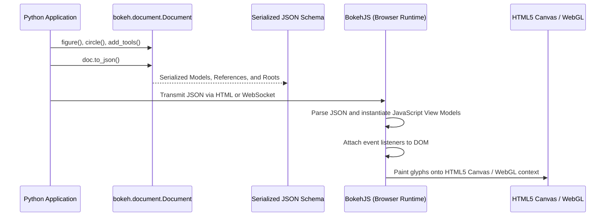
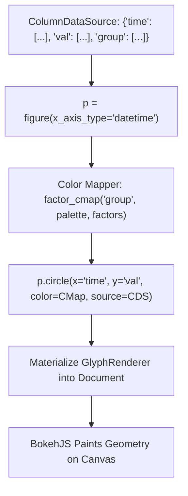
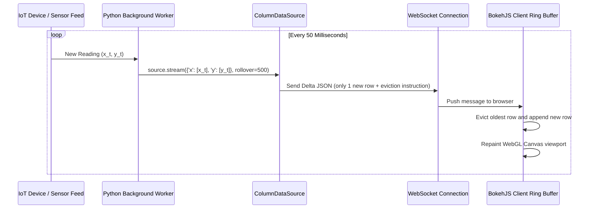
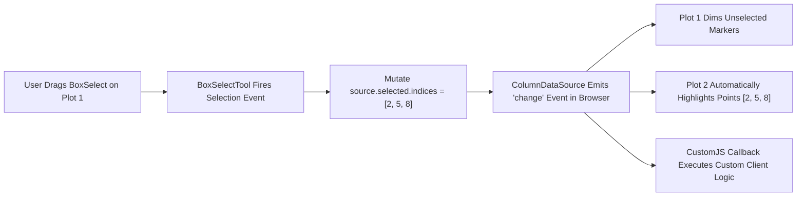
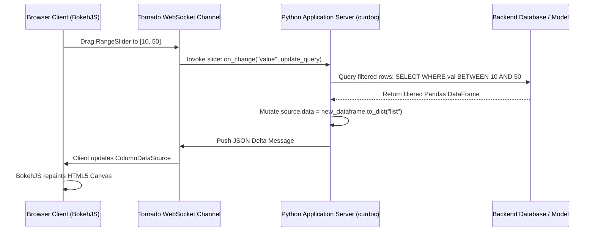
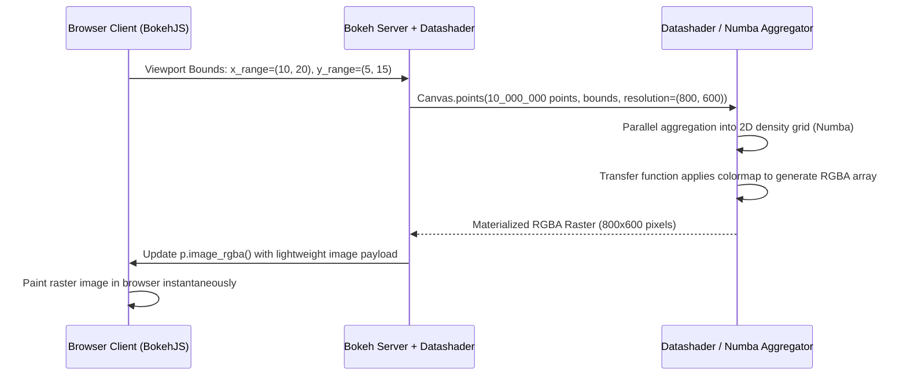

# Bokeh

| Metadata      | Value                                                        |
| ------------- | ------------------------------------------------------------ |
| Author        | Lyzander Marciano Andrylie                                   |
| Creation Date | Nov 8, 2026                                                  |
| Last Updated  | Nov 8, 2026                                                  |
| Repositories  | [bokeh/bokeh](https://github.com/bokeh/bokeh) (`src/bokeh/`) |

## References

- [Bokeh Documentation](https://docs.bokeh.org/en/latest/): Official user guide, gallery, and Python API reference
- [BokehJS Architecture Guide](https://docs.bokeh.org/en/latest/docs/dev_guide/bokehjs.html): Specification of Python model serialization and the BokehJS client runtime
- [Bokeh Server Architecture](https://docs.bokeh.org/en/latest/docs/user_guide/server.html): Real-time bi-directional synchronization between Python backends and browser DOM
- [ColumnDataSource and Data Handling](https://docs.bokeh.org/en/latest/docs/user_guide/basic/data.html): Tabular columnar data structures, streaming ring buffers, and patching
- [matplotlib.md](./matplotlib.md): Foundational static and publication-quality plotting engine
- [seaborn.md](./seaborn.md): High-level statistical visualization library built on Matplotlib
- [plotly.md](./plotly.md): Declarative interactive web graphing alternative powered by Plotly.js

## Description

`bokeh` is an interactive data visualization library for Python targeting modern web browsers. It compiles declarative Python scene graphs into a serialized JSON document model that is unpacked and rendered client-side by BokehJS via HTML5 Canvas or WebGL, and powers real-time, event-driven analytical web dashboards via the bi-directional WebSocket protocol of the Bokeh Server.

### Low-Level Model and Glyph Hierarchy (`bokeh.models`)

The foundational object-relational model defining every visual and non-visual component in a visualization. All elements subclass `Model`, assigning unique identifiers (UUIDs) and property descriptors that serialize into JSON documents consumable by BokehJS.

- [bokeh.models](https://docs.bokeh.org/en/latest/docs/reference/models.html): Core models including `Plot`, `GlyphRenderer`, `Axis`, `Grid`, `Tool`, and `ColumnDataSource`

### Mid-Level Plotting Interface (`bokeh.plotting`)

The primary programmatic interface centered around the `figure` class. It exposes declarative glyph-addition methods (`circle`, `line`, `vbar`, `patches`) that automatically wire up default coordinate ranges, axes, grids, and interaction tools.

- [bokeh.plotting](https://docs.bokeh.org/en/latest/docs/reference/plotting.html): Helper factories including `figure()`, `show()`, `save()`, and `output_file()`

### Columnar Data Engine (`bokeh.models.sources`)

The data ingestion and memory management subsystem centered around `ColumnDataSource`. It enables zero-copy column lookups, client-side data binding, streaming appending to bounded ring buffers, and in-place cell patching over active WebSocket connections.

- [bokeh.models.sources](https://docs.bokeh.org/en/latest/docs/reference/models/sources.html): Columnar data models, including `ColumnDataSource`, `WebDataSource`, and `ServerSentDataSource`

### UI Layouts, Toolbars, and Interactive Widgets (`bokeh.layouts`, `bokeh.models.widgets`)

The spatial partition and UI control subsystem for constructing dashboard layouts. It manages responsive grid alignments (`row`, `column`, `gridplot`), cursor interaction tools (Pan, WheelZoom, HoverTool, BoxSelect), and HTML form controls (Sliders, Selectors, RadioButtons).

- [bokeh.layouts](https://docs.bokeh.org/en/latest/docs/reference/layouts.html): Grid layout managers and sizing modes
- [bokeh.models.widgets](https://docs.bokeh.org/en/latest/docs/reference/models/widgets.html): HTML5 input controls and interactive widget definitions

### Client-Side Engine and Callbacks (`bokeh.models.callbacks`, BokehJS)

Enables complex client-side interactivity without a running Python backend by injecting JavaScript callbacks (`CustomJS`) directly into the document tree.

- [bokeh.models.callbacks](https://docs.bokeh.org/en/latest/docs/reference/models/callbacks.html): Client-side JavaScript action dispatchers attached to widget inputs or selection events

### Reactive Server Subsystem (`bokeh.server`)

A Tornado-powered bi-directional WebSocket application server. It coordinates real-time state synchronization between Python computational threads and browser DOM sessions, running pure Python event handlers on client interactions.

- [bokeh.server](https://docs.bokeh.org/en/latest/docs/reference/server.html): WebSocket session managers, protocol handlers, and deployment hooks

---

## Features

### 1. Document Architecture and the BokehJS Serialization Bridge

Every Bokeh visualization is structured as a `Document` holding a directed acyclic graph of `Model` objects.

- **Scene Graph Serialization**: When exporting or serving a visualization, the Python runtime walks the `Document` tree, serializing every model's type, UUID, and properties into an explicit JSON payload.
- **BokehJS Client Execution**: The client browser downloads `bokeh.min.js`, parses the JSON document, instantiates corresponding JavaScript Backbone-like view classes, and paints visual elements onto an HTML5 Canvas or WebGL surface.
- **Decoupled Architecture**: Python code never generates raw HTML or SVG tags directly; it solely manipulates the declarative model graph.
- **Standalone Embedding Options**:
  - `file_html()`: Serializes a complete, standalone `.html` file with embedded or CDN-hosted JavaScript bundles.
  - `components()`: Returns a standalone `<script>` and `<div>` pair for embedding into web frameworks (Flask, Django, FastAPI).
  - `json_item()`: Serializes a figure into a JSON object consumable by arbitrary JavaScript applications (React, Vue, Svelte) via `Bokeh.embed.embed_item()`.

#### Core Model Classes in the Hierarchy

| Model Class        | Category    | Parent       | Primary Responsibility                                                |
| :----------------- | :---------- | :----------- | :-------------------------------------------------------------------- |
| `Document`         | Container   | N/A          | Root document holding all plots, models, themes, and server callbacks |
| `Plot`             | Container   | `LayoutDOM`  | Low-level canvas container holding renderers, axes, titles, and tools |
| `GlyphRenderer`    | Renderer    | `Renderer`   | Binds a visual `Glyph` to a `ColumnDataSource` and coordinate space   |
| `Glyph`            | Primitive   | `Model`      | Atomic geometry definition (`Circle`, `Rect`, `MultiLine`, `Patches`) |
| `ColumnDataSource` | Data Source | `DataSource` | Columnar dictionary of arrays supplying coordinates and attributes    |
| `Tool`             | Controller  | `Model`      | User interaction controller (`PanTool`, `WheelZoomTool`, `HoverTool`) |

#### Interaction



```python
from bokeh.embed import components
from bokeh.models import ColumnDataSource, HoverTool
from bokeh.plotting import figure
from bokeh.resources import CDN

# Construct data source
source = ColumnDataSource(
    data={
        "x": [1, 2, 3, 4, 5],
        "y": [6, 7, 2, 4, 8],
        "label": ["Node A", "Node B", "Node C", "Node D", "Node E"],
    }
)

# Instantiate figure model
p = figure(
    title="Bokeh Architecture Demo",
    width=600,
    height=350,
    tools="pan,wheel_zoom,reset",
    background_fill_color="#fafafa",
)

# Add visual glyph
renderer = p.circle(
    x="x",
    y="y",
    source=source,
    size=12,
    color="#2b5c8f",
    alpha=0.8,
    hover_fill_color="#d32f2f",
)

# Attach dedicated inspection tool
p.add_tools(HoverTool(renderers=[renderer], tooltips=[("Name", "@label"), ("Value", "(@x, @y)")]))

# Extract embeddable JavaScript and HTML snippet for web templates
script, div = components(p, CDN)
assert "<script" in script
assert "<div" in div
```

---

### 2. Glyph-Based Composition Engine (`bokeh.plotting.figure`)

Bokeh strictly separates visual geometry (**Glyphs**) from data values. Unlike Seaborn, Bokeh does not perform automated statistical modeling; all coordinates must be provided explicitly.

- **Explicit Coordinate Mapping**: Glyphs are added via methods like `p.circle()`, `p.line()`, `p.vbar()`, `p.multi_line()`, and `p.patches()`.
- **Property Specifications**: Glyph attributes accept:
  - **Literal values**: Fixed styling applied uniformly to all marks (e.g., `color="blue"`, `alpha=0.5`).
  - **Field names**: String lookups referencing columns inside the bound `ColumnDataSource` (e.g., `x="timestamp"`, `size="magnitude"`).
  - **Transform pipelines**: Color mappers and categorical factors (`linear_cmap`, `factor_cmap`, `log_cmap`) that compute per-datum visual values dynamically.
- **Categorical Factors & Multi-Level Axes**: Supports discrete factor coordinates (e.g., `x_range=["North", "South", "West"]` or hierarchical tuples `[("2025", "Q1"), ("2025", "Q2")]`).
- **Gotcha**: If you provide a literal string for a color that matches a column name in your `ColumnDataSource`, Bokeh treats it as a column lookup rather than a color value.

#### Common Glyph Methods on `figure`

| Glyph Method            | Geometric Shape            | Primary Keyword Arguments                              | Primary Use Case                                   |
| :---------------------- | :------------------------- | :----------------------------------------------------- | :------------------------------------------------- |
| `p.circle()`            | 2D Points / Bubbles        | `x`, `y`, `size`, `radius`, `fill_color`, `line_color` | Scatter plots, bubble charts, map overlays         |
| `p.line()`              | Continuous Polyline        | `x`, `y`, `line_width`, `line_dash`, `line_color`      | Time series, continuous trajectories               |
| `p.vbar()` / `p.hbar()` | Vertical / Horizontal Bars | `x`, `top`, `bottom`, `width`, `fill_color`            | Bar charts, histograms, Gantt timelines            |
| `p.rect()`              | Rotatable Rectangles       | `x`, `y`, `width`, `height`, `angle`, `dilate`         | Heatmaps, raster grids, treemaps                   |
| `p.multi_line()`        | Disjoint Polylines         | `xs` (`list[list]`), `ys` (`list[list]`), `line_color` | Dendrogram trees, network graphs, contour isolines |
| `p.patches()`           | Multi-Polygon Areas        | `xs` (`list[list]`), `ys` (`list[list]`), `fill_color` | Geographic choropleths, violin plot envelopes      |

#### Interaction



```python
from bokeh.io import output_file, save
from bokeh.models import ColumnDataSource
from bokeh.plotting import figure
from bokeh.transform import factor_cmap

# Prepare categorical sample data
categories = ["Hardware", "Software", "Services"]
source = ColumnDataSource(
    data={
        "dept": categories,
        "q1_rev": [45.2, 88.4, 62.1],
        "target": [50.0, 80.0, 60.0],
    }
)

# Initialize categorical coordinate system
p = figure(
    x_range=categories,
    title="Quarterly Department Performance",
    width=650,
    height=400,
    toolbar_location="right",
)

# Apply dynamic categorical color palette
palette = ["#1e88e5", "#43a047", "#fb8c00"]
color_mapping = factor_cmap("dept", palette=palette, factors=categories)

# Render categorical vertical bars
p.vbar(x="dept", top="q1_rev", width=0.5, source=source, fill_color=color_mapping, line_color="white")

# Overlay horizontal performance target lines
p.segment(
    x0=["Hardware", "Software", "Services"],
    x1=["Hardware", "Software", "Services"],
    y0="target",
    y1="target",
    source=source,
    line_width=3,
    line_color="#d32f2f",
    line_dash="dashed",
)

p.y_range.start = 0
p.yaxis.axis_label = "Revenue ($ Millions)"

output_file("categorical_bars.html")
save(p)
```

---

### 3. High-Performance Data Streaming and Patching (`ColumnDataSource`)

The `ColumnDataSource` (CDS) powers high-throughput updates without serializing the full dataset across the wire.

- **Streaming Ring Buffers (`.stream()`)**:
  - Appends new streaming batches to the existing client-side dataset.
  - The `rollover=N` argument caps the maximum number of items retained in the buffer. When length exceeds $N$, older data points are evicted from the head, implementing a constant-memory FIFO ring buffer ideal for real-time telemetry.
- **In-Place Patching (`.patch()`)**:
  - Mutates individual slice ranges or discrete cells in place (e.g., updating a single matrix row or scalar KPI) without transmitting unmodified data.
- **WebGL Acceleration**:
  - Setting `output_backend="webgl"` shifts line and marker rendering from the 2D Canvas CPU context to GPU hardware acceleration, allowing smooth 60 FPS panning and zooming over $10^5$ data points.

#### ColumnDataSource Mutation Capabilities

| Method                                | Payload Shape                            | Network Overhead                  | Primary Use Case                                   |
| :------------------------------------ | :--------------------------------------- | :-------------------------------- | :------------------------------------------------- |
| `source.data = new_dict`              | Full dictionary of columns               | High ($O(N)$ full payload)        | Complete dataset reset or filter swap              |
| `source.stream(new_data, rollover=N)` | Dictionary of new rows                   | Minimal ($O(M)$ new rows only)    | Real-time sensor telemetry, live financial tickers |
| `source.patch(patches)`               | Dict mapping columns to `(index, value)` | Ultra-low ($O(K)$ modified cells) | Sparse matrix updates, single-cell edits           |

#### Interaction



```python
import numpy as np
from bokeh.models import ColumnDataSource
from bokeh.plotting import figure

# Configure high-performance WebGL backend
p = figure(
    title="Real-Time Telemetry Stream",
    width=700,
    height=350,
    output_backend="webgl",
    x_axis_label="Timestamp (s)",
    y_axis_label="Voltage (mV)",
)

# Seed with initial observations
source = ColumnDataSource(data={"time": [0.0], "voltage": [0.0]})
p.line(x="time", y="voltage", source=source, line_width=2, color="#00897b")

# Simulated streaming step (called inside Bokeh server periodic callback)
def update_telemetry(current_step: int):
    new_point = {
        "time": [current_step * 0.1],
        "voltage": [np.sin(current_step * 0.1) + np.random.normal(0, 0.1)],
    }
    # Append point and cap memory buffer to the last 100 observations
    source.stream(new_point, rollover=100)

for step in range(1, 10):
    update_telemetry(step)

assert len(source.data["time"]) == 10
```

---

### 4. Client-Side Interactivity without a Server (`CustomJS` and Linked Selection)

Bokeh generates standalone HTML files capable of complex cross-filtering and synchronized interaction without requiring an active Python server.

- **Linked Brushing (Shared Data Source)**: When two or more plots reference the **same** `ColumnDataSource` instance, selection events in one plot automatically highlight corresponding observations in all other plots.
- **Linked Panning & Zooming (Shared Range)**: Assigning one figure's range to another (`p2.x_range = p1.x_range`) locks their zoom and pan movements together.
- **Client-Side Callbacks (`CustomJS`)**: Injects raw JavaScript executed directly within the browser runtime upon widget input changes, hover events, or selection updates.

#### Built-in Interactive Tools

| Tool Name         | Tool Identifier  | Mechanism            | Interaction                                                    |
| :---------------- | :--------------- | :------------------- | :------------------------------------------------------------- |
| `BoxSelectTool`   | `"box_select"`   | Geometry selection   | Drags bounding box; updates `source.selected.indices`          |
| `LassoSelectTool` | `"lasso_select"` | Arbitrary polygon    | Freehand trace; highlights enclosed points across linked plots |
| `HoverTool`       | `"hover"`        | Proximity inspection | Displays HTML tooltips and highlights hovered glyph            |
| `WheelZoomTool`   | `"wheel_zoom"`   | Scroll wheel zoom    | Expands or contracts axes range limits                         |
| `CrosshairTool`   | `"crosshair"`    | Cursor tracking      | Draws synchronized horizontal and vertical coordinate lines    |

#### Interaction



```python
from bokeh.io import output_file, save
from bokeh.layouts import row
from bokeh.models import ColumnDataSource, CustomJS
from bokeh.plotting import figure

# Shared data source enables linked selection
source = ColumnDataSource(
    data={
        "x": [1, 2, 3, 4, 5, 6, 7, 8],
        "y1": [10, 24, 15, 32, 28, 45, 39, 50],
        "y2": [100, 150, 130, 210, 190, 260, 230, 300],
    }
)

# Plot 1: Scatter view
p1 = figure(title="Scatter Matrix View", width=350, height=350, tools="box_select,lasso_select,reset")
p1.circle(x="x", y="y1", source=source, size=10, color="#1565c0", selection_color="#d32f2f")

# Plot 2: Metric correlation view (linked to source)
p2 = figure(title="Linked Metric View", width=350, height=350, tools="box_select,lasso_select,reset")
p2.circle(x="x", y="y2", source=source, size=10, color="#2e7d32", selection_color="#d32f2f")

# Pure JavaScript client-side callback executed on selection changes
source.selected.js_on_change(
    "indices",
    CustomJS(
        args=dict(src=source),
        code="""
        const indices = src.selected.indices;
        console.log(`User selected ${indices.length} points: [${indices.join(', ')}]`);
    """,
    ),
)

layout = row(p1, p2)
output_file("linked_brushing.html")
save(layout)
```

---

### 5. Reactive Python Applications with Bokeh Server (`bokeh serve`)

The Bokeh Server (`bokeh.server`) synchronizes Python objects with browser DOM elements in real time over a persistent WebSocket connection.

- **Bi-Directional Synchronization Protocol**:
  - User actions in the browser (e.g., sliding a widget or selecting points) serialize as protocol events pushed over the WebSocket to the Python server.
  - The Python server runs application callback logic in response, updating Python data models (`source.data`, axis ranges, titles).
  - The server automatically calculates the JSON difference (**delta**) and streams it back to the client, causing BokehJS to repaint the affected view elements without reloading the page.
- **Python Event Hooks**:
  - `widget.on_change("value", python_callback)`: Fires when an input control changes.
  - `curdoc().add_periodic_callback(callback, period_ms)`: Schedules recurring background updates (e.g., polling a database or streaming live metrics).
  - `curdoc().add_next_tick_callback(callback)`: Thread-safe callback dispatching asynchronous worker results back onto the Bokeh Tornado event loop.
- **Execution Model**: Launched via CLI: `bokeh serve app.py --port 5006`.

#### Bokeh Execution Modes Comparison

| Deployment Mode     | Python Runtime Required?        | Communication Channel            | Data Handling Capability                     |
| :------------------ | :------------------------------ | :------------------------------- | :------------------------------------------- |
| **Standalone HTML** | No (Static web hosting)         | None (Self-contained JavaScript) | Static or client-side JavaScript transforms  |
| **Bokeh Server**    | Yes (Persistent Tornado daemon) | Bi-directional WebSocket         | Full Python ecosystem (Pandas, PyTorch, SQL) |
| **Jupyter Server**  | Yes (Active notebook kernel)    | Jupyter Comms / WebSocket        | Interactive cell exploration and prototyping |

#### Interaction



```python
"""
Standalone Bokeh Server Application Script
Run via terminal:
    bokeh serve --show app.py
"""
import numpy as np
from bokeh.io import curdoc
from bokeh.layouts import column
from bokeh.models import ColumnDataSource, Slider
from bokeh.plotting import figure

# Generate initial waveform
x = np.linspace(0, 10, 500)
source = ColumnDataSource(data={"x": x, "y": np.sin(x)})

# Create figure
p = figure(title="Dynamic Sine Wave Synthesizer", width=700, height=350, y_range=(-3, 3))
p.line("x", "y", source=source, line_width=2.5, color="#512da8")

# Create interactive slider widget
frequency_slider = Slider(start=0.5, end=5.0, value=1.0, step=0.1, title="Frequency (Hz)")

# Pure Python reactive callback
def update_frequency(attr, old, new):
    freq = frequency_slider.value
    # Mutate source in Python; delta is automatically pushed over WebSocket
    source.data = {"x": x, "y": np.sin(freq * x)}

# Attach change listener
frequency_slider.on_change("value", update_frequency)

# Register layout onto the server document root
layout = column(frequency_slider, p)
curdoc().add_root(layout)
curdoc().title = "Reactive Bokeh Application"
```

---

### 6. Big Data Acceleration with Datashader Integration

When plotting massive datasets ($10^6$ to $10^9$ points), rendering raw geometry into browser Canvas/WebGL crashes client memory. Bokeh integrates with **Datashader** to bypass client rendering limitations entirely.

- **Server-Side Rasterization**: Rather than transmitting millions of coordinates to BokehJS, Datashader aggregates the raw coordinates into a 2D histogram/density matrix on the Python server using optimized C/Numba code.
- **Dynamic Image Tile Streaming**: The resulting density matrix is colormapped into a fixed-resolution RGBA image raster and sent to Bokeh as an image glyph (`p.image_rgba()`).
- **Interactive Re-Aggregation**: As the user zooms or pans in the Bokeh browser window, Bokeh's viewport coordinates are sent back to Datashader, which re-rasterizes the data at the new zoom level in milliseconds.

#### Visual Scaling Strategies by Point Volume

| Data Size (Rows)   | Recommended Technology              | Bottleneck / Consideration                                         |
| :----------------- | :---------------------------------- | :----------------------------------------------------------------- |
| **$< 10^4$**       | Standard Bokeh HTML5 Canvas         | Zero lag; full DOM tooltips on every single point                  |
| **$10^4 – 10^5$**  | Bokeh with `output_backend="webgl"` | Hardware GPU acceleration; smooth 60 FPS interactions              |
| **$10^5 – 10^9+$** | **Datashader + Bokeh Server**       | Canvas cannot handle coordinate payloads; server rasterizes pixels |

#### Interaction



```python
"""
Datashader + Bokeh Integration Pipeline
Demonstrates rendering millions of points without client memory saturation.
"""
from bokeh.plotting import figure
import numpy as np
import pandas as pd

# Synthesize large dataset: 1,000,000 observations
n_points = 1_000_000
df = pd.DataFrame(
    {
        "x": np.random.normal(0, 1, n_points),
        "y": np.random.normal(0, 1, n_points),
    }
)

# Standard Bokeh canvas configured to receive dynamic raster layers
p = figure(
    title="Datashader Accelerated View (1 Million Points)",
    width=700,
    height=500,
    tools="pan,wheel_zoom,reset",
    x_range=(-3, 3),
    y_range=(-3, 3),
)

# In production applications, datashader.bokeh_ext.InteractiveImage
# or holoviews automatically binds the dynamic re-aggregation loop:
#
# import holoviews as hv
# from holoviews.operation.datashader import datashade
# points = hv.Points(df, ['x', 'y'])
# interactive_plot = hv.render(datashade(points), backend='bokeh')

assert len(df) == 1_000_000
```
