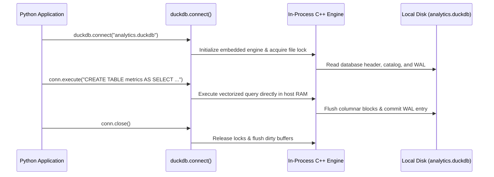
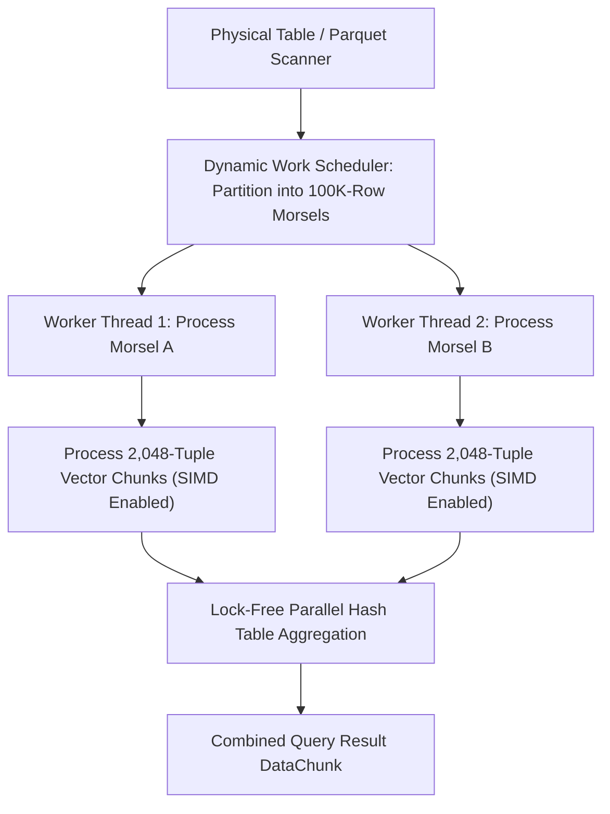
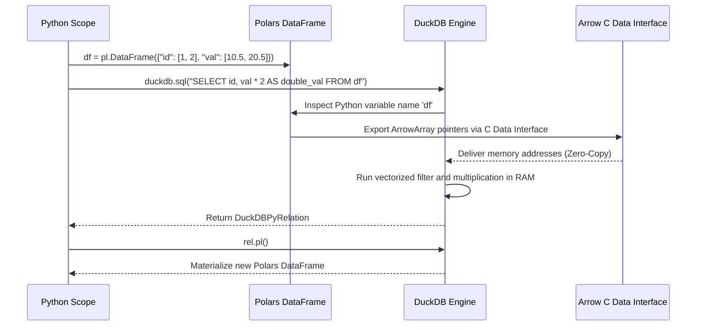
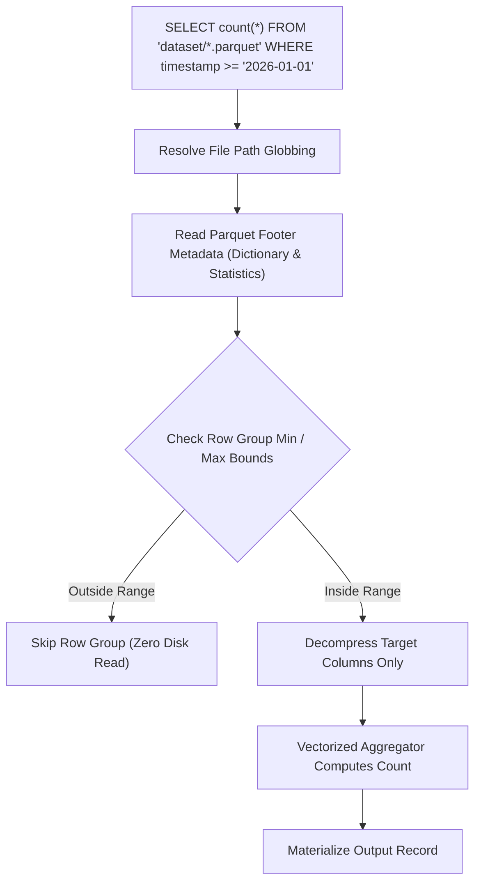
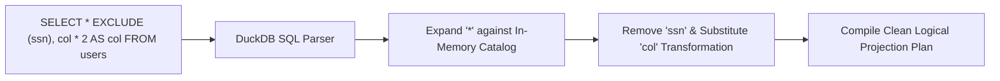
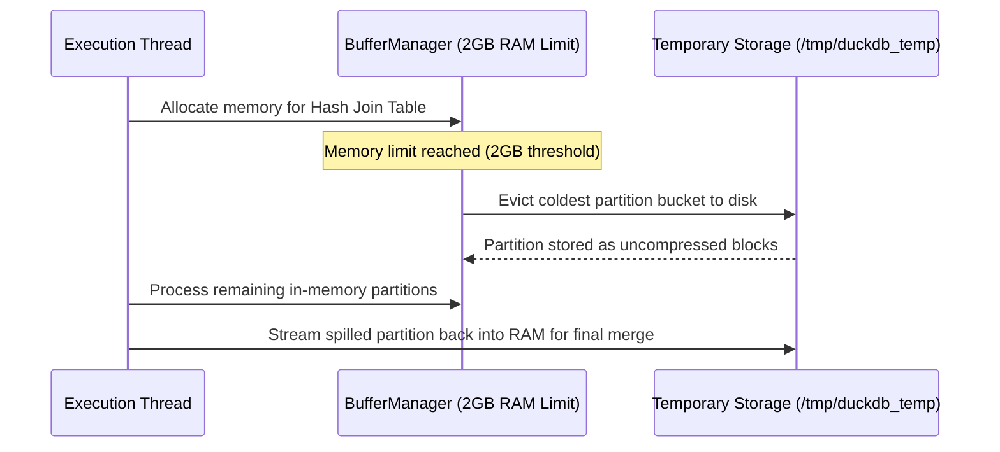

# DuckDB

| Metadata      | Value                                                                  |
| ------------- | ---------------------------------------------------------------------- |
| Author        | Lyzander Marciano Andrylie                                             |
| Creation Date | Nov 8, 2026                                                            |
| Last Updated  | Nov 8, 2026                                                            |
| Repositories  | [duckdb/duckdb](https://github.com/duckdb/duckdb) (`tools/pythonpkg/`) |

## References

- [DuckDB Documentation](https://duckdb.org/docs/): Official documentation, guides, and SQL reference manual
- [DuckDB Architecture and Internals](https://duckdb.org/docs/internals/overview): Overview of the vectorized execution engine, parser, planner, and storage manager
- [DuckDB Python API Guide](https://duckdb.org/docs/api/python/overview): Reference for in-process database connections, relation objects, and cursor management
- [pandas.md](./pandas.md): Classical Python DataFrame library with zero-copy DuckDB query integration
- [polars.md](./polars.md): Vectorized Arrow DataFrame library interoperable with DuckDB relations
- [pathlib.md](./pathlib.md): Object-oriented filesystem path operations used in database file and Parquet resolution
- [plotly.md](./plotly.md): Declarative interactive web graphing alternative accepting DuckDB query outputs
- [matplotlib.md](./matplotlib.md): Foundational 2D/3D plotting engine
- [seaborn.md](./seaborn.md): Statistical visualization library

## Description

`duckdb` is an open-source, embedded, in-process columnar SQL Online Analytical Processing (OLAP) database management system. It operates directly inside the host application process without requiring a client-server network protocol or external daemon service. It exists to provide fast, vectorized analytical query execution across local data structures, Apache Parquet files, CSVs, and remote cloud object storage with zero-copy interoperability across the Python data ecosystem.

### Vectorized Query Execution Engine (`src/execution`, `duckdb.query`)

The core analytical runtime executing queries via a vectorized Volcano iterator model. It processes columnar data in chunks of 2,048 values (**DataChunks**), maximizing CPU L1/L2 cache locality and enabling SIMD hardware instruction vectorization.

- [src/execution](https://github.com/duckdb/duckdb/tree/main/src/execution): Physical execution operators, including vectorized hash joins, grouped aggregations, and window evaluators

### Relational Parser and Query Optimizer (`src/parser`, `src/planner`, `src/optimizer`)

Translates SQL statements adhering to the PostgreSQL dialect into validated logical expression trees, applying rule-based and cost-based optimizations before physical plan generation.

- [src/optimizer](https://github.com/duckdb/duckdb/tree/main/src/optimizer): Optimization passes, including predicate pushdown, projection pushdown, join order optimization, and common subexpression elimination

### In-Process Storage and Buffer Manager (`src/storage`)

Coordinates single-file ACID-compliant persistence (`.duckdb`) and transient in-memory databases (`:memory:`). It features fine-grained columnar compression and Multi-Version Concurrency Control (MVCC).

- [src/storage](https://github.com/duckdb/duckdb/tree/main/src/storage): Columnar disk serialization, Write-Ahead Logging (WAL), block compression, and out-of-core memory management

### External File Engine and Object Storage Scanners (`src/execution/operator/scan`)

Direct zero-copy scanners capable of reading and filtering external file formats (Parquet, CSV, JSON, Arrow IPC) on local filesystems or remote object stores (S3, GCS, Azure Blob) without ingestion or duplication.

- [duckdb.read_parquet](https://duckdb.org/docs/data/parquet/overview): Metadata-driven parallel file scanner supporting globbing and Hive partitioning

### Python Client and Zero-Copy Bridge (`tools/pythonpkg`)

The C-ABI Python extension layer exposing DuckDB connection objects, relation pipelines, and zero-copy bridges to Pandas, Polars, PyArrow, and NumPy.

- [duckdb.connect](https://duckdb.org/docs/api/python/overview): Python entry points, cursor dispatchers, and type converters

### Pluggable Extension Architecture (`src/extension`)

Dynamic extension loader allowing runtime installation and autoloading of optional analytical capabilities.

- [src/extension](https://github.com/duckdb/duckdb/tree/main/src/extension): Official extensions including `httpfs` (remote cloud I/O), `spatial` (GIS analytics), `iceberg`, `delta`, and external database scanners (`postgres_scanner`, `sqlite_scanner`)

---

## Features

### 1. In-Process Architecture and Embedded Database Lifecycle

DuckDB is designed to run embedded within the host process memory space, operating as a library rather than an external client-server database daemon.

- **Zero Network Overhead**: Queries execute directly against in-memory buffers or local disk files without socket communication, serialization/deserialization penalties, or inter-process communication (IPC) latencies.
- **Embedded Lifecycle**: The database engine is instantiated when the host application imports and initializes the module, and terminates cleanly when the application exits.
- **Database Modes**:
  - **In-Memory (`:memory:`)**: Transient database held entirely in RAM. Ideal for ad-hoc transformation pipelines, tests, and temporary analytics.
  - **Single-File Persistent (`path.duckdb`)**: Fully self-contained ACID-compliant database stored in a single binary file on disk.
- **Concurrency & Locking Rules**:
  - **Multi-Reader, Single-Writer**: A persistent DuckDB database file allows multiple concurrent read connections across processes, but only a single process can hold a write lock at any time.
  - **Thread-Safe In-Process Cursors**: Multiple threads within the **same** host process can execute concurrent queries safely by spawning independent cursor objects via `conn.cursor()`.

#### DuckDB Connection Modes

| Mode                        | Connection Syntax                               | Persistence          | Concurrency Limit                     | Best Use Case                                 |
| :-------------------------- | :---------------------------------------------- | :------------------- | :------------------------------------ | :-------------------------------------------- |
| **In-Memory**               | `duckdb.connect(":memory:")`                    | Transient (RAM only) | Unrestricted within host process      | Ad-hoc analytics, data wrangling, unit tests  |
| **Persistent (Read-Write)** | `duckdb.connect("data.duckdb")`                 | Single file on disk  | Exclusive single-process write access | Local data warehouses, analytical persistence |
| **Persistent (Read-Only)**  | `duckdb.connect("data.duckdb", read_only=True)` | Single file on disk  | Multiple concurrent processes         | Shared reporting, multi-worker model serving  |

#### Interaction



#### Example

```python
import duckdb
from pathlib import Path

db_path = Path("telemetry.duckdb")

# 1. Establish persistent single-file database connection
conn = duckdb.connect(str(db_path))

# Configure engine resource limits
conn.execute("SET threads TO 4;")
conn.execute("SET max_memory = '2GB';")

# Execute schema creation and batch insert
conn.execute(
    """
    CREATE TABLE IF NOT EXISTS device_readings (
        device_id VARCHAR,
        reading DOUBLE,
        recorded_at TIMESTAMP
    );
"""
)

conn.execute(
    """
    INSERT INTO device_readings VALUES
    ('dev-01', 23.4, '2026-01-01 10:00:00'),
    ('dev-02', 19.8, '2026-01-01 10:05:00'),
    ('dev-01', 24.1, '2026-01-01 10:10:00');
"""
)

# Spawn independent thread-safe cursor for read operations
cursor = conn.cursor()
result = cursor.execute("SELECT device_id, AVG(reading) FROM device_readings GROUP BY device_id;").fetchall()
print(result)  # Output: [('dev-01', 23.75), ('dev-02', 19.8)]

conn.close()
db_path.unlink()
```

---

### 2. Vectorized Columnar Execution Engine and Morsel-Driven Parallelism

DuckDB relies on a **Vectorized Volcano Iterator Model** combined with **Morsel-Driven Parallelism** to execute analytical queries at hardware saturation speeds.

- **Vectorized Execution**: Rather than processing one row at a time (traditional OLTP tuple-at-a-time model) or materializing entire columns in memory at once (column-at-a-time), DuckDB processes data in uniform horizontal slices of columns called **DataChunks**.
  - A `DataChunk` contains multiple vectors, each holding up to **2,048 values**.
  - Processing 2,048 values at a time ensures that vectors fit comfortably within the CPU's fast L1/L2 data cache, avoiding cache misses.
  - Loops over vectors are simple contiguous arrays, enabling compilers to emit SIMD instructions automatically.
- **Morsel-Driven Parallelism**:
  - The query plan is broken into a pipeline of tasks.
  - Workloads are divided into small dynamic batches of rows (**morsels**, typically 100,000 tuples).
  - Worker threads pull morsels from a centralized scheduler queue as they finish previous tasks, ensuring linear multicore CPU scaling without straggler bottlenecks.

#### Execution Paradigms Comparison

| Paradigm               | Unit of Processing                 | Cache Efficiency                            | Memory Footprint     | Primary Proponent         |
| :--------------------- | :--------------------------------- | :------------------------------------------ | :------------------- | :------------------------ |
| **Tuple-at-a-time**    | 1 single row across operators      | Low (heavy CPU instruction cache thrashing) | Minimal              | PostgreSQL, SQLite, MySQL |
| **Column-at-a-time**   | Entire column materialized at once | Moderate (exceeds CPU cache limits)         | Very High (OOM risk) | Early MonetDB             |
| **Vectorized Volcano** | Chunks of 2,048 columnar values    | **Optimal** (fits precisely in L1/L2 cache) | **Low & Bounded**    | **DuckDB**, Snowflake     |

#### Interaction



#### Example

```python
import duckdb

conn = duckdb.connect(":memory:")

# Generate synthetic table of 1,000,000 numbers directly in memory
conn.execute("CREATE TABLE numbers AS SELECT range AS id, random() AS val FROM range(1_000_000);")

# Profile query execution plan and hardware vector metrics
profile_query = """
    EXPLAIN ANALYZE
    SELECT
        (id % 10) AS bucket,
        AVG(val) AS avg_val,
        SUM(val) AS total_val
    FROM numbers
    GROUP BY bucket;
"""

plan_result = conn.execute(profile_query).fetchall()
plan_text = plan_result[0][1]

# Verify vectorized operators are present in the physical plan
print("HASH_GROUP_BY" in plan_text)  # Output: True
```

---

### 3. Native Zero-Copy Interoperability with Arrow, Pandas, and Polars

DuckDB features a zero-copy integration engine that reads from and writes to Python in-memory data structures via the **Apache Arrow C Data Interface**.

- **Direct Variable Querying**: The SQL parser detects Python variable names referenced inside SQL statements:
  ```python
  import pandas as pd
  my_df = pd.DataFrame({"a": [1, 2, 3]})
  duckdb.sql("SELECT * FROM my_df WHERE a > 1")
  ```
  DuckDB treats `my_df` as a virtual table without copying data into the database engine.
- **Zero-Copy Arrow Scanning**: When querying Polars DataFrames or PyArrow Tables, DuckDB scans the underlying 64-byte aligned Arrow buffers directly using pointers, eliminating serialization and memory duplication.
- **Polyglot Materialization**: DuckDB queries return a `DuckDBPyRelation`, which can be converted to any target data structure:
  - `.df()`: Converts result to a Pandas DataFrame.
  - `.pl()`: Converts result to a Polars DataFrame.
  - `.arrow()`: Converts result to an Apache Arrow Table.
  - `.fetchnumpy()`: Converts columns directly into NumPy dictionary arrays.

#### Python Data Interoperability Matrix

| Source / Target      | Ingestion Mechanism                          | Extraction Method  | Zero-Copy Supported?                       |
| :------------------- | :------------------------------------------- | :----------------- | :----------------------------------------- |
| **Pandas DataFrame** | Automatic scope binding (`SELECT * FROM df`) | `rel.df()`         | Yes (Zero-copy for Arrow-backed columns)   |
| **Polars DataFrame** | Automatic Arrow C interface scan             | `rel.pl()`         | **Yes (100% zero-copy)**                   |
| **PyArrow Table**    | Direct Arrow memory chunk mapping            | `rel.arrow()`      | **Yes (100% zero-copy)**                   |
| **NumPy Arrays**     | Virtual columnar array scan                  | `rel.fetchnumpy()` | Yes (For non-string contiguous primitives) |

#### Interaction



#### Example

```python
import duckdb
import pandas as pd
import polars as pl

# 1. Define source dataframes in distinct libraries
pandas_df = pd.DataFrame({"customer_id": [1, 2, 3], "tier": ["Gold", "Silver", "Platinum"]})
polars_df = pl.DataFrame({"customer_id": [1, 2, 3], "spend": [1500.0, 450.0, 3200.0]})

# 2. Query across heterogeneous memory structures directly in standard SQL
relation = duckdb.sql(
    """
    SELECT
        p.customer_id,
        p.tier,
        s.spend,
        s.spend * 0.10 AS reward_points
    FROM pandas_df p
    INNER JOIN polars_df s ON p.customer_id = s.customer_id
    WHERE s.spend > 500
"""
)

# 3. Seamless zero-copy materialization back to Polars
final_polars = relation.pl()
print(final_polars)
```

---

### 4. Direct Parquet, CSV, and Cloud Object Scanning

DuckDB can query external file formats directly on disk or cloud storage without importing them into database tables first.

- **Metadata-Driven Parquet Scanning**: When evaluating `SELECT ... FROM 'data.parquet'`, DuckDB inspects the Parquet footer metadata first:
  - **Projection Pushdown**: Only reads the exact byte ranges corresponding to referenced columns, skipping unqueried columns entirely.
  - **Predicate Pushdown**: Evaluates `WHERE` predicates against column chunk min/max statistics in the footer, skipping entire row groups without decompressing page data.
- **Multi-File Globbing**: Scans thousands of files matching wildcard paths concurrently (`'s3://bucket/logs/*/*/*.parquet'`).
- **Hive Partitioning**: Automatically extracts directory names as typed SQL columns when paths follow Hive conventions (`.../year=2026/month=03/data.parquet`).
- **Unified Schemas (`union_by_name`)**: Resolves schema evolution across files where columns appear in different orders or are added over time.

#### External File Reader Functions

| SQL Function        | Supported Formats        | Primary Arguments                               | Key Capabilities                                           |
| :------------------ | :----------------------- | :---------------------------------------------- | :--------------------------------------------------------- |
| `read_parquet(...)` | Apache Parquet           | `union_by_name`, `hive_partitioning`, `columns` | Row group skipping, projection pushdown, dictionary filter |
| `read_csv(...)`     | CSV, TSV, delimited text | `header`, `delim`, `auto_detect`, `sample_size` | Multi-threaded speculative parallel parsing                |
| `read_json(...)`    | JSON, NDJSON, JSON lines | `format`, `auto_detect`, `records`              | Automatic schema inference across nested JSON objects      |

#### Interaction



#### Example

```python
import duckdb
from pathlib import Path

# Create directory structure mimicking Hive-partitioned telemetry data
base_dir = Path("lakehouse_data")
p1 = base_dir / "region=us_east"
p2 = base_dir / "region=us_west"
p1.mkdir(parents=True, exist_ok=True)
p2.mkdir(parents=True, exist_ok=True)

# Write sample Parquet files
duckdb.sql("COPY (SELECT 'dev-A' AS device, 100 AS metric) TO 'lakehouse_data/region=us_east/data.parquet' (FORMAT PARQUET);")
duckdb.sql("COPY (SELECT 'dev-B' AS device, 200 AS metric) TO 'lakehouse_data/region=us_west/data.parquet' (FORMAT PARQUET);")

# Scan multi-file dataset with Hive partitioning enabled
result = duckdb.sql(
    """
    SELECT
        region,
        device,
        metric
    FROM read_parquet('lakehouse_data/**/*.parquet', hive_partitioning = true)
    WHERE region = 'us_east';
"""
).fetchall()

print(result)  # Output: [('us_east', 'dev-A', 100)]

# Teardown
import shutil
shutil.rmtree(base_dir)
```

---

### 5. Advanced Analytical SQL Dialect and Modern Quality-of-Life Syntax

DuckDB supports a rich SQL dialect based on PostgreSQL syntax, augmented with modern analytical productivity features.

- **`GROUP BY ALL`**: Automatically groups by all non-aggregate columns declared in the `SELECT` list, eliminating repetitive manual grouping clauses.
- **Column Exclusions & Replacements**:
  - `SELECT * EXCLUDE (pii_column, password)`: Selects all columns while removing specified fields.
  - `SELECT * REPLACE (amount * 100 AS amount)`: Modifies specific columns in-flight while preserving all other column definitions.
- **Native Pivot and Unpivot**:
  - `PIVOT tbl ON year USING SUM(revenue)`: Transposes long rows into wide analytical columns directly in SQL.
  - `UNPIVOT tbl ON (q1, q2, q3, q4) INTO NAME quarter VALUE revenue`: Reshapes wide matrices into tidy rows.
- **`QUALIFY` Clause**: Filters window functions directly without requiring nested subqueries or Common Table Expressions (CTEs):
  ```sql
  SELECT * FROM transactions
  QUALIFY ROW_NUMBER() OVER (PARTITION BY user_id ORDER BY tx_date DESC) = 1;
  ```
- **As-Of Joins (`ASOF JOIN`)**: Joins tables matching on timestamp proximity within tolerance bounds, ideal for financial tick feeds and IoT event alignment.

#### Modern SQL Syntax Enhancements

| Feature                | DuckDB SQL Syntax                     | Equivalent Standard SQL           | Benefit                                    |
| :--------------------- | :------------------------------------ | :-------------------------------- | :----------------------------------------- |
| **Group By All**       | `GROUP BY ALL`                        | `GROUP BY col1, col2, col3, ...`  | Eliminates manual column enumeration       |
| **Exclude Columns**    | `SELECT * EXCLUDE (col_a)`            | Explicitly list all $N-1$ columns | Safe projection without schema duplication |
| **Replace Columns**    | `SELECT * REPLACE (col / 100 AS col)` | Explicitly rewrite all columns    | Simplifies inline column scaling           |
| **Window Filtering**   | `QUALIFY row_number() OVER (...) = 1` | Subquery with `WHERE rn = 1`      | Eliminates boilerplates CTEs               |
| **Positional Columns** | `SELECT #1, #2 FROM table`            | `SELECT col_name_1, col_name_2`   | Quick CLI exploratory queries              |

#### Interaction



#### Example

```python
import duckdb

conn = duckdb.connect(":memory:")

conn.execute(
    """
    CREATE TABLE sales_records AS SELECT * FROM (VALUES
        ('2026-01-01', 'Electronics', 'Alice', 500, 'Secret_SSN_1'),
        ('2026-01-01', 'Electronics', 'Alice', 700, 'Secret_SSN_1'),
        ('2026-01-02', 'Clothing', 'Bob', 200, 'Secret_SSN_2'),
        ('2026-01-02', 'Electronics', 'Bob', 150, 'Secret_SSN_2')
    ) AS t(sale_date, department, salesperson, revenue, ssn);
"""
)

# Leverage EXCLUDE, REPLACE, and GROUP BY ALL in a single query
query = """
    SELECT
        * EXCLUDE (ssn),
        COUNT(*) AS transaction_count,
        SUM(revenue) AS total_revenue
    FROM sales_records
    GROUP BY ALL
    QUALIFY ROW_NUMBER() OVER (PARTITION BY department ORDER BY total_revenue DESC) = 1;
"""

top_dept_sales = conn.execute(query).df()
print(top_dept_sales)
```

---

### 6. Transactional Storage, Compression, and Out-of-Core Processing

DuckDB combines ACID transaction guarantees with high-performance columnar compression algorithms and out-of-core memory spilling.

- **Storage Compression Engine**: DuckDB automatically evaluates multiple lightweight compression algorithms per column chunk, selecting the scheme yielding the smallest physical storage footprint without sacrificing decompression speed:
  - **BitPacking**: Compresses integers based on the minimum bits required to represent values.
  - **Dictionary Encoding**: Compacts low-cardinality strings and categorical factors.
  - **FSST (Fast Static Symbol Table)**: Compresses string columns in-place, enabling string operations directly on compressed data.
  - **RLE (Run-Length Encoding)**: Compresses consecutive repeated sequences.
  - **Roaring Bitmaps**: Compresses boolean columns and null masks.
- **Out-of-Core Execution**:
  - Allows querying datasets that far exceed physical RAM capacity.
  - If query execution exceeds `max_memory`, DuckDB gracefully spills intermediate hash tables, join buckets, and sorting blocks to a temporary disk directory (`temp_directory`), preventing Out-Of-Memory (OOM) crashes.
- **ACID Transactions**: Supported via Multi-Version Concurrency Control (MVCC) and Write-Ahead Logging (WAL), guaranteeing consistency even across abnormal process terminations.

#### Columnar Compression Algorithms in DuckDB

| Algorithm         | Primary Data Types                         | Compression Mechanism                       | Direct Querying Supported?               |
| :---------------- | :----------------------------------------- | :------------------------------------------ | :--------------------------------------- |
| **BitPacking**    | Integers, Timestamps                       | Truncates unused high-order bits            | Yes (SIMD unpack)                        |
| **FSST**          | High-cardinality Strings                   | Symbol table with 1-byte code substitutions | Yes (Direct substring/equality matching) |
| **Dictionary**    | Low-cardinality Strings                    | Replaces strings with integer offset keys   | Yes (Operates on dictionary keys)        |
| **RLE**           | Repetitive / Sorted data                   | Stores `(value, count)` pairs               | Yes (Skips runs during aggregation)      |
| **Chimp / Patas** | Floating point numbers (`float`, `double`) | Leading and trailing zero XOR encoding      | Yes                                      |

#### Interaction



#### Example

```python
import duckdb
from pathlib import Path

temp_dir = Path("duckdb_spill_dir")
temp_dir.mkdir(parents=True, exist_ok=True)

conn = duckdb.connect(":memory:")

# Configure strict memory envelope to force out-of-core disk spilling
conn.execute("SET max_memory = '256MB';")
conn.execute(f"SET temp_directory = '{temp_dir}';")

# Execute intensive memory aggregation over 5,000,000 synthetic records
query = """
    SELECT
        (range % 1000) AS group_key,
        COUNT(*),
        AVG(range * 1.5)
    FROM range(5_000_000)
    GROUP BY group_key;
"""

result = conn.execute(query).fetchall()
print(f"Aggregated groups: {len(result)}")  # Output: Aggregated groups: 1000

conn.close()

import shutil
shutil.rmtree(temp_dir)
```
