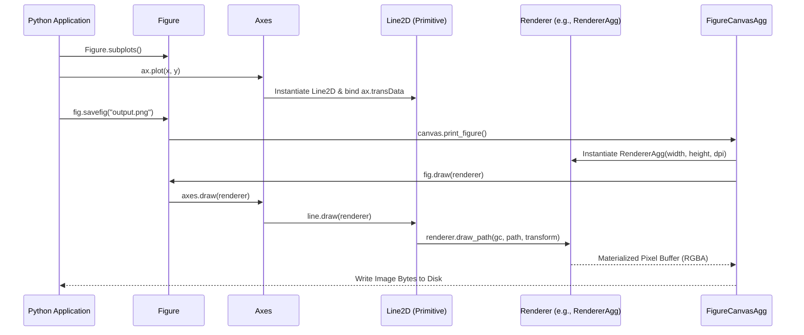
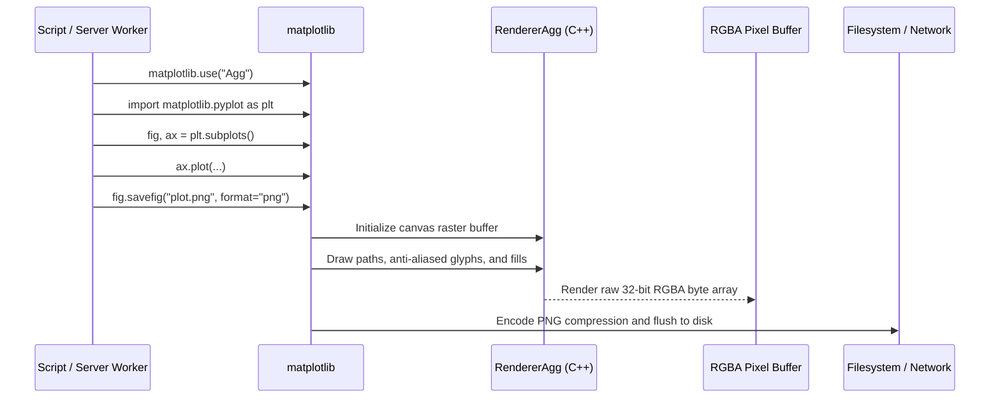
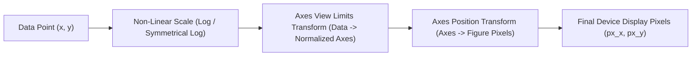
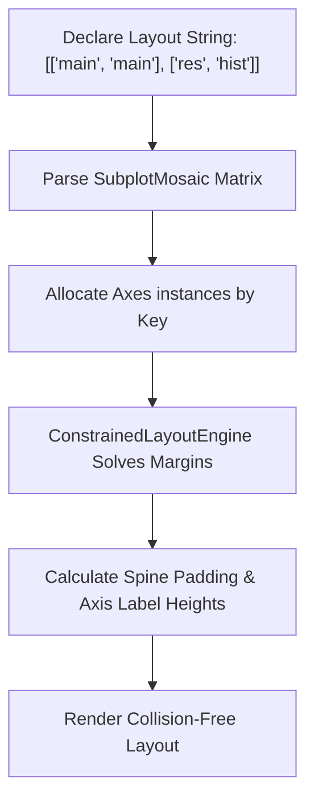
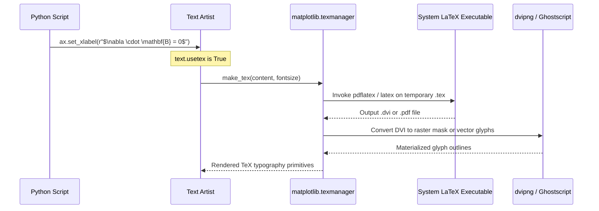

```mermaid
flowchart TD
    subgraph StateMachine["Pyplot Procedural State Machine"]
        P1["plt.figure()"] --> P2["Global State: Gcf.set_active()"]
        P2 --> P3["plt.plot(...)"]
        P3 --> P4["Implicit Lookup: gca().plot(...)"]
        P4 --> P5["plt.title(...)"]
        P5 --> P6["Implicit Lookup: gca().set_title(...)"]
    end

    subgraph ObjectOriented["Explicit Object-Oriented API"]
        O1["fig, ax = plt.subplots()"] --> O2["Direct Instance References"]
        O2 --> O3["ax.plot(...)"]
        O3 --> O4["ax.set_title(...)"]
        O4 --> O5["fig.savefig(...)"]
        O5 --> O6["plt.close(fig)"]
    end
```

# Matplotlib

| Metadata      | Value                                                                                 |
| ------------- | ------------------------------------------------------------------------------------- |
| Author        | Lyzander Marciano Andrylie                                                            |
| Creation Date | Nov 8, 2026                                                                           |
| Last Updated  | Nov 8, 2026                                                                           |
| Repositories  | [matplotlib/matplotlib](https://github.com/matplotlib/matplotlib) (`lib/matplotlib/`) |

## References

- [Matplotlib Documentation](https://matplotlib.org/stable/): Official user guide, tutorials, and comprehensive API reference
- [Matplotlib Architecture Guide](https://matplotlib.org/stable/users/explain/core/architecture.html): Structural overview of the Artist, Canvas, and Renderer hierarchy
- [Transforms Tutorial](https://matplotlib.org/stable/users/explain/artists/transforms_tutorial.html): Geometric transformation pipeline across data, axes, and display coordinate systems
- [Customizing Matplotlib with Style Sheets and rcParams](https://matplotlib.org/stable/users/explain/customizing.html): Global configuration engine, styling defaults, and typography
- [seaborn.md](./seaborn.md): High-level statistical visualization library built directly on top of Matplotlib
- [plotly.md](./plotly.md): Declarative interactive web graphing alternative powered by Plotly.js
- [bokeh.md](./bokeh.md): Interactive browser-based visualization engine utilizing HTML5 Canvas and WebGL
- [pandas.md](./pandas.md): Tabular data structures with built-in plotting wrappers delegating to Matplotlib
- [polars.md](./polars.md): Multi-threaded columnar DataFrame library with fast NumPy and Matplotlib export

## Description

`matplotlib` is the foundational, object-oriented 2D and 3D data visualization library for Python. It abstracts low-level GUI toolkits and vector graphics formats into an extensible, tree-structured Artist hierarchy, providing computational scientists, data engineers, and downstream plotting libraries (including Seaborn, Pandas, and Cartopy) with deterministic, pixel-level layout control and publication-quality figure rendering across headless servers and interactive desktop windows.

### Artist Object Hierarchy (`matplotlib.artist`, `matplotlib.figure`, `matplotlib.axes`)

The foundational visual tree representing every visible element on a canvas. It organizes graphical primitives into container objects that govern coordinate transformations, visual clipping, layer ordering (`zorder`), and recursive rendering passes.

- [matplotlib.artist](https://matplotlib.org/stable/api/artist_api.html): Abstract base class governing property management, bounding boxes, transforms, and draw callbacks
- [matplotlib.figure](https://matplotlib.org/stable/api/figure_api.html): Top-level container representing the whole canvas, coordinating subplots, colorbars, legends, and layout engines
- [matplotlib.axes](https://matplotlib.org/stable/api/axes_api.html): Primary coordinate area encapsulating data plotting methods, axis ticks, grid lines, and data limits

### Procedural State Machine (`matplotlib.pyplot`)

A stateful, MATLAB-like procedural facade (`plt`) that tracks the current active figure and axes implicitly. It provides convenient entry points for rapid scripting, interactive shell exploration, and automatic figure lifecycle management.

- [matplotlib.pyplot](https://matplotlib.org/stable/api/pyplot_summary.html): Procedural dispatch interface managing global state, figure creation, and display loops

### Rendering Engine and GUI Backends (`matplotlib.backends`)

An abstraction layer decoupling high-level plotting instructions from concrete output targets. It routes drawing commands through a standardized Renderer interface to either headless file export drivers (`Agg`, `PDF`, `SVG`, `PS`) or interactive windowing toolkits (`Qt`, `Tk`, `GTK`, `macOS`, `WebAgg`).

- [matplotlib.backend_bases](https://matplotlib.org/stable/api/backend_bases_api.html): Abstract definitions for `RendererBase`, `GraphicsContextBase`, and `FigureCanvasBase`
- [matplotlib.backends](https://matplotlib.org/stable/api/index_backend_api.html): Concrete driver implementations across file formats and GUI frameworks

### Coordinate Transformations and Scales (`matplotlib.transforms`, `matplotlib.scale`)

A geometric pipeline that projects arbitrary data points through non-linear mathematical mappings (linear, logarithmic, logit, symmetrical log) and affine transformations into device display coordinates (pixels).

- [matplotlib.transforms](https://matplotlib.org/stable/api/transformations.html): Affine and non-affine geometric transforms, coordinate blending, and bounding box algebra
- [matplotlib.scale](https://matplotlib.org/stable/api/scale_api.html): Mathematical axis scaling rules and tick position locators

### Layout Management and Subplot Organization (`matplotlib.gridspec`, `matplotlib.layout_engine`)

The spatial partition engine responsible for allocating figure surface area across multiple axes, handling colorbar placements, and executing collision-avoidance algorithms to prevent overlapping axis labels, titles, and ticks.

- [matplotlib.gridspec](https://matplotlib.org/stable/api/gridspec_api.html): Flexible grid geometry specifying fractional row/column subplot divisions
- [matplotlib.layout_engine](https://matplotlib.org/stable/api/layout_engine_api.html): Automated layout optimizers, including `ConstrainedLayoutEngine` and `TightLayoutEngine`

---

## Features

### 1. The Artist Hierarchy and Canvas Architecture

Every visual component within a Matplotlib figure subclasses `matplotlib.artist.Artist`. The architecture divides artists into two categories: **Primitives** (atomic geometric entities like lines, polygons, and text) and **Containers** (structural nodes holding other artists, such as `Figure`, `Axes`, and `Axis`).

- **Tree Traversal**: When rendering a figure, the top-level `FigureCanvas` invokes `Figure.draw(renderer)`, which recursively invokes `.draw(renderer)` on all child artists in ascending `zorder` sequence.
- **Layer Stacking (`zorder`)**: Dictates drawing order along the depth axis. Lower `zorder` values are painted first (background); higher values are painted on top (foreground).
- **Clipping**: Artists attached to an `Axes` have their `clip_box` locked to the axes rectangle by default (`clip_on=True`), preventing data lines or markers from bleeding into margins.
- **Properties Protocol**: Every artist supports inspection and mutation via standardized getter and setter methods (`get_*()`, `set_*()`), as well as batch configuration via `artist.set(**kwargs)`.
- **Gotcha**: Adding an artist directly to `ax.artists` or `ax.lines` without using public helper methods (e.g., `ax.add_line()`, `ax.add_patch()`) skips transform binding, resulting in missing or misaligned elements.

#### Core Artist Classes in the Hierarchy

| Artist Class | Category  | Parent            | Primary Responsibility                                                                     |
| :----------- | :-------- | :---------------- | :----------------------------------------------------------------------------------------- |
| `Figure`     | Container | `FigureCanvas`    | Root container; holds canvas dimensions, figure-level titles, subplots, and legends        |
| `Axes`       | Container | `Figure`          | Coordinate space bounded by spines; holds plotted data primitives and manages axis limits  |
| `Axis`       | Container | `Axes`            | 1D scale representation (`xaxis`, `yaxis`); manages tick marks, tick labels, and gridlines |
| `Spine`      | Primitive | `Axes`            | Boundary line framing the axes data area; can be hidden, shifted, or colored               |
| `Line2D`     | Primitive | `Axes`            | Renders continuous poly-lines, markers, and error bars                                     |
| `Patch`      | Primitive | `Axes`            | 2D vector shapes with fill and stroke (`Rectangle`, `Circle`, `Polygon`, `Wedge`)          |
| `Text`       | Primitive | `Figure` / `Axes` | Typography rendering for titles, labels, tick text, and mathematical annotations           |

#### Interaction



```python
import matplotlib.pyplot as plt
import numpy as np

# Pure Object-Oriented creation: instantiate Figure and child Axes explicitly
fig, ax = plt.subplots(figsize=(8, 4.5), dpi=100)

x = np.linspace(0, 10, 200)
y = np.sin(x)

# High-level method returns a list of Line2D primitive artists
(line,) = ax.plot(x, y, color="#2b5c8f", linewidth=2.5, label="sin(x)", zorder=3)

# Mutate artist properties via standardized getters and setters
line.set_linestyle("--")
line.set_alpha(0.85)

# Configure axes containers and child spines
ax.set_title("Harmonic Oscillator", fontsize=14, pad=12)
ax.set_xlabel("Time (s)", fontsize=11)
ax.set_ylabel("Amplitude", fontsize=11)
ax.grid(True, linestyle=":", alpha=0.6, zorder=1)
ax.spines["top"].set_visible(False)
ax.spines["right"].set_visible(False)
ax.legend(frameon=True, facecolor="white", edgecolor="none")

# Explicit cleanup when done
plt.close(fig)
```

---

### 2. Pyplot Procedural State Machine vs. Object-Oriented Interface

Matplotlib provides two distinct development paradigms: the **Procedural Pyplot State Machine** (`plt.*`) and the **Explicit Object-Oriented (OO) API** (`fig, ax = plt.subplots()`).

- **Global State Registry (`_pylab_helpers.Gcf`)**: The Pyplot module internally maintains a registry of active figures and routes calls like `plt.plot()` or `plt.title()` to the Current Axes (`gca()`) of the Current Figure (`gcf()`).
- **Concurrency & Thread Safety**: The stateful `plt` interface is **not thread-safe**. Concurrent threads invoking `plt` commands will mutate each other's active figure pointers, leading to race conditions and cross-contaminated charts.
- **Memory Lifecycle**: Figures created via `plt` remain registered in the global `Gcf` manager until explicitly destroyed via `plt.close(fig)`. Forgetting to close figures in batch processing loops causes severe process memory leaks.
- **Architectural Best Practice**: Use `plt.subplots()` solely to instantiate the initial `Figure` and `Axes` references, then use only object-oriented methods (`ax.plot()`, `ax.set_xlabel()`) on those instances.

#### Pyplot State Functions vs. Object-Oriented Equivalents

| Action            | Pyplot State Machine (`plt.*`)       | Explicit Object-Oriented Method (`ax.*` / `fig.*`)  |
| :---------------- | :----------------------------------- | :-------------------------------------------------- |
| Set Chart Title   | `plt.title("Title")`                 | `ax.set_title("Title")` / `fig.suptitle("Title")`   |
| Set Axis Label    | `plt.xlabel("X")`, `plt.ylabel("Y")` | `ax.set_xlabel("X")`, `ax.set_ylabel("Y")`          |
| Set Axis Limits   | `plt.xlim(0, 10)`, `plt.ylim(-1, 1)` | `ax.set_xlim(0, 10)`, `ax.set_ylim(-1, 1)`          |
| Toggle Grid Lines | `plt.grid(True)`                     | `ax.grid(True)`                                     |
| Add Legend        | `plt.legend()`                       | `ax.legend()` / `fig.legend()`                      |
| Adjust Layout     | `plt.tight_layout()`                 | `fig.tight_layout()` / `fig.set_layout_engine(...)` |
| Save Figure       | `plt.savefig("chart.png")`           | `fig.savefig("chart.png")`                          |

#### Interaction



```python
import matplotlib.pyplot as plt
import numpy as np

# Recommended OO Pattern: Single entry point to spawn figure and axes
fig, ax = plt.subplots(figsize=(6, 4))

categories = ["Cluster A", "Cluster B", "Cluster C"]
values = [42.5, 78.1, 55.3]

bars = ax.bar(categories, values, color="#388e3c", width=0.6)

# Direct method invocations ensure deterministic target assignment
ax.bar_label(bars, fmt="%.1f", padding=3)
ax.set_ylabel("Throughput (req/s)")
ax.set_ylim(0, 100)
ax.set_title("Server Cluster Benchmark")

# Save directly through the Figure instance
fig.savefig("benchmark.png", dpi=300, bbox_inches="tight")

# Always close explicitly to deregister from Gcf memory tracker
plt.close(fig)
```

---

### 3. Rendering Pipeline and Backend Subsystems

Matplotlib decouples drawing commands from output drivers via **Backends**. A backend implements three core abstractions: `FigureCanvasBase` (the surface/window), `RendererBase` (the drawing operations), and `GraphicsContextBase` (brush/line/color state).

- **Non-Interactive Backends (Headless / Application Servers)**:
  - `Agg` (Anti-Grain Geometry): Renders high-fidelity raster graphics (PNG, JPEG, TIFF) entirely in memory via C++ without an X11, Wayland, or Quartz display server.
  - `PDF`: Generates vector PDF documents with embedded TrueType/Type42 fonts.
  - `SVG`: Produces scalable vector graphics directly inspectable and stylable in web browsers.
  - `PS` / `EPS`: PostScript driver widely used in academic typesetting.
- **Interactive Backends (Desktop GUI / IDEs)**:
  - `qtagg`: Integrates Qt widgets with the Agg raster renderer.
  - `tkagg`: Integrates with standard Python Tkinter windows.
  - `macosx`: Native macOS Cocoa framework integration.
  - `webagg`: Starts an internal Tornado web server streaming interactive figures to any browser.
- **Backend Selection Hierarchy**: Matplotlib resolves its active backend in order:
  1. Programmatic override via `matplotlib.use("Agg")` (must precede importing `pyplot`).
  2. The `MPLBACKEND` operating system environment variable.
  3. The `backend` parameter inside a local or user `matplotlibrc` configuration file.
  4. Automatic runtime fallback (detects display availability; falls back to `Agg` on headless servers).

#### Common Built-in Backends

| Backend Name | Class Type      | Output Target                    | Display Server Required?              |
| :----------- | :-------------- | :------------------------------- | :------------------------------------ |
| `Agg`        | Non-Interactive | Raster images (PNG, WebP)        | No (Headless safe)                    |
| `PDF`        | Non-Interactive | Vector documents (PDF)           | No (Headless safe)                    |
| `SVG`        | Non-Interactive | Vector XML (SVG)                 | No (Headless safe)                    |
| `PS`         | Non-Interactive | PostScript / Encapsulated PS     | No (Headless safe)                    |
| `QtAgg`      | Interactive     | Desktop Window (PyQt6 / PySide6) | Yes (X11 / Wayland / Windows / macOS) |
| `TkAgg`      | Interactive     | Desktop Window (Tkinter)         | Yes                                   |
| `WebAgg`     | Interactive     | Web Browser (WebSocket stream)   | No (Runs web server)                  |

#### Interaction



```python
import os

# Guarantee headless execution on CI/CD runners or Docker containers
os.environ["MPLBACKEND"] = "Agg"

import matplotlib

# Verify backend configuration programmatically
assert matplotlib.get_backend().lower() == "agg"

import matplotlib.pyplot as plt
import numpy as np

fig, ax = plt.subplots(figsize=(6, 4))
ax.plot(np.random.randn(100).cumsum(), color="#d32f2f", lw=1.5)
ax.set_title("Headless Continuous Integration Plot")

# Save as vector SVG and raster PNG simultaneously
fig.savefig("ci_output.svg", format="svg")
fig.savefig("ci_output.png", format="png", dpi=200)

plt.close(fig)
```

---

### 4. Coordinate Transformation Pipeline and Projections

Matplotlib relies on a modular transformation tree where every artist is associated with a `Transform` object that converts coordinates from its local frame into display pixels.

- **The Four Fundamental Coordinate Systems**:
  1. **Data Coordinates (`ax.transData`)**: User data space defined by `ax.set_xlim()` and `ax.set_ylim()`. Changes whenever axes limits or zoom levels change.
  2. **Axes Coordinates (`ax.transAxes`)**: Normalized coordinate space of the axes box where `(0, 0)` is bottom-left and `(1, 1)` is top-right. Ideal for placing inset text, watermarks, or corner annotations.
  3. **Figure Coordinates (`fig.transFigure`)**: Normalized space of the entire figure canvas `(0, 0)` to `(1, 1)`. Used for overarching suptitles or cross-axes annotations.
  4. **Display Coordinates (`None` / Identity)**: Physical pixel space where `(0, 0)` is the bottom-left pixel and `(width_px, height_px)` is the top-right pixel.
- **Blended Transformations (`blended_transform_factory`)**: Allows combining different systems along axes (e.g., using `ax.transData` for the X-axis coordinate while locking the Y-axis to `ax.transAxes` for span annotations).
- **Non-Linear Scales**: Transforms can be non-linear pipelines (`LogTransform`, `SymmetricalLogTransform`, `LogitTransform`). Data coordinates pass through the scale transform before reaching the affine display transform.

#### Fundamental Coordinate Spaces

| Coordinate System | Transformation Object | Domain Range                      | Primary Use Case                                                |
| :---------------- | :-------------------- | :-------------------------------- | :-------------------------------------------------------------- |
| **Data**          | `ax.transData`        | `[xmin, xmax]`, `[ymin, ymax]`    | Plotting lines, points, patches, and data-bound markers         |
| **Axes**          | `ax.transAxes`        | `[0.0, 1.0]`, `[0.0, 1.0]`        | Subplot labels, legends, corner annotations, and bounding boxes |
| **Figure**        | `fig.transFigure`     | `[0.0, 1.0]`, `[0.0, 1.0]`        | Suptitles, canvas watermarks, multi-axes connecting lines       |
| **Display**       | `IdentityTransform`   | `[0, width_px]`, `[0, height_px]` | Low-level event hit-testing and physical pixel positioning      |

#### Interaction



```python
import matplotlib.pyplot as plt
import matplotlib.transforms as mtransforms
import numpy as np

fig, ax = plt.subplots(figsize=(7, 4))
x = np.linspace(0.1, 100, 500)
y = np.log10(x)

ax.plot(x, y, color="#7b1fa2", lw=2)
ax.set_xscale("log")
ax.set_xlabel("Frequency (Hz) [Log Scale]")
ax.set_ylabel("Log Magnitude")

# Blended Transform: X in Data Coordinates, Y locked to normalized Axes (0 to 1)
blended_trans = mtransforms.blended_transform_factory(ax.transData, ax.transAxes)

# Place a vertical threshold marker at x=10 spanning full height regardless of Y limits
ax.axvline(x=10, color="gray", linestyle="--")
ax.text(
    10.5,
    0.92,
    "Cutoff Frequency (10 Hz)",
    transform=blended_trans,
    color="gray",
    fontweight="bold",
    va="top",
)

# Text placed strictly in Axes coordinate space (bottom-right corner)
ax.text(
    0.98,
    0.05,
    "Axes-relative watermark",
    transform=ax.transAxes,
    ha="right",
    va="bottom",
    fontsize=9,
    color="blue",
    alpha=0.5,
)

plt.close(fig)
```

---

### 5. Multi-Subplot Spatial Allocation and Composition

Matplotlib manages complex figure partitions using `GridSpec` geometry and the high-level `subplot_mosaic` declarative layout syntax.

- **`subplot_mosaic`**: A declarative visual layout engine that accepts ASCII art strings or nested 2D lists of identifiers to construct heterogeneous grids with asymmetric spans.
- **Layout Engines**: Replace manual spacing adjustments (`plt.subplots_adjust()`) with automated collision-avoidance solvers:
  - `constrained`: Dynamically evaluates text bounding boxes and spine paddings, guaranteeing that titles, axis labels, colorbars, and tick labels never collide.
  - `tight`: Post-processes subplot boundaries once before drawing, but does not handle complex dynamic resizing as effectively as constrained layout.
- **Shared Axes (`sharex`, `sharey`)**: Synchronizes view limits and pan/zoom events across multiple subplots while automatically hiding redundant interior tick labels.

#### Built-in Layout Engines (`fig.set_layout_engine(...)`)

| Engine Name     | Mechanism                                            | Speed         | Handling of Colorbars & Legends                     |
| :-------------- | :--------------------------------------------------- | :------------ | :-------------------------------------------------- |
| `"none"`        | Manual fixed positioning (`subplots_adjust`)         | Instantaneous | Manual allocation required; prone to clipping       |
| `"tight"`       | One-time bounding box calculation (`tight_layout`)   | Fast          | May clip complex colorbars or nested legends        |
| `"constrained"` | Constraint-satisfaction solver across all artists    | Moderate      | Automatically allocates space for colorbars/legends |
| `"compressed"`  | Specialized constrained layout for fixed-aspect axes | Moderate      | Ideal for equal-aspect imagery and geographic maps  |

#### Interaction



```python
import matplotlib.pyplot as plt
import numpy as np

# Declarative asymmetric layout definition via ASCII string
layout = """
AAB
AAC
"""

fig, ax_dict = plt.subplot_mosaic(layout, figsize=(8, 5), layout="constrained")

time = np.linspace(0, 10, 100)
signal = np.sin(time)
noise = np.random.normal(0, 0.2, 100)

# Main signal viewport
ax_dict["A"].plot(time, signal + noise, color="#0288d1", label="Signal + Noise")
ax_dict["A"].plot(time, signal, color="#d32f2f", lw=2, label="Clean Ground Truth")
ax_dict["A"].set_title("Sensor Feed Tracking")
ax_dict["A"].legend(loc="upper right")

# Top-right diagnostic viewport
ax_dict["B"].plot(time, noise, color="gray", lw=1)
ax_dict["B"].set_title("Extracted Residuals")

# Bottom-right histogram diagnostic
ax_dict["C"].hist(noise, bins=15, color="#388e3c", orientation="horizontal", edgecolor="white")
ax_dict["C"].set_title("Noise Distribution")

fig.savefig("sensor_dashboard.png", dpi=300)
plt.close(fig)
```

---

### 6. Publication Styling, Typography, and TeX Typesetting

Matplotlib provides comprehensive control over publication styling via the `rcParams` configuration registry and native $\LaTeX$ rendering.

- **Configuration Hierarchy (`rcParams`)**: A global key-value store governing hundreds of default styling parameters (fonts, line widths, colors, tick directions, DPI).
- **Style Sheets (`plt.style.use`)**: Reusable `.mplstyle` files that bundle collections of `rcParams` overrides without altering user code.
- **Mathematical Typography (`mathtext`)**: Matplotlib ships with an internal math parser supporting a subset of TeX math syntax without requiring an external TeX distribution (e.g., `ax.set_title(r"$\alpha_i \cdot \sum_{j=1}^N x_{ij}$")`).
- **External $\LaTeX$ Engine (`text.usetex=True`)**: Routes all text rendering through the local system's actual $\LaTeX$ installation (via `latex`, `dvipng`, and Ghostscript), enabling exact matching of academic journal font specifications (Computer Modern, Times New Roman, Palatino).
- **Gotcha**: Enabling `text.usetex=True` significantly slows down rendering because each text fragment generates an external $\LaTeX$ compilation process. Reserve it for final publication manuscript exports.

#### Essential rcParams Categories

| Parameter Name    | Type            | Default        | Description                                                   |
| :---------------- | :-------------- | :------------- | :------------------------------------------------------------ |
| `font.family`     | `str` / `list`  | `'sans-serif'` | Base font family (`'serif'`, `'sans-serif'`, `'monospace'`)   |
| `font.size`       | `float`         | `10.0`         | Default typography scale in points                            |
| `axes.edgecolor`  | `color`         | `'black'`      | Spine border color                                            |
| `axes.linewidth`  | `float`         | `0.8`          | Spine border thickness                                        |
| `lines.linewidth` | `float`         | `1.5`          | Default stroke width for 2D line artists                      |
| `figure.dpi`      | `float`         | `100.0`        | Display resolution in dots per inch                           |
| `savefig.dpi`     | `str` / `float` | `'figure'`     | Output resolution for `fig.savefig()` (e.g., `300` for print) |
| `text.usetex`     | `bool`          | `False`        | Renders typography via system LaTeX executable                |

#### Interaction



```python
import matplotlib.pyplot as plt
import numpy as np

# Configure publication-grade styling parameters programmatically
publication_rc = {
    "font.family": "serif",
    "font.size": 10,
    "axes.labelsize": 10,
    "axes.titlesize": 11,
    "xtick.labelsize": 9,
    "ytick.labelsize": 9,
    "lines.linewidth": 1.5,
    "figure.dpi": 300,
    "savefig.dpi": 300,
    "axes.spines.top": False,
    "axes.spines.right": False,
    "mathtext.fontset": "cm",  # Computer Modern font matching LaTeX documents
}

plt.rcParams.update(publication_rc)

fig, ax = plt.subplots(figsize=(5.5, 3.5))

x = np.linspace(-3, 3, 300)
gaussian = (1 / np.sqrt(2 * np.pi)) * np.exp(-0.5 * (x**2))

ax.plot(x, gaussian, color="#1a237e", lw=1.8, label=r"$\mathcal{N}(\mu=0, \sigma^2=1)$")
ax.fill_between(x, gaussian, color="#1a237e", alpha=0.15)

ax.set_title(r"Probability Density Function: $f(x) = \frac{1}{\sigma \sqrt{2\pi}} e^{-\frac{1}{2}\left(\frac{x-\mu}{\sigma}\right)^2}$")
ax.set_xlabel(r"Standard Deviations ($z$-score)")
ax.set_ylabel("Probability Density")
ax.legend(loc="upper right", frameon=False)

fig.savefig("gaussian_distribution.pdf", format="pdf", bbox_inches="tight")
plt.close(fig)
```
