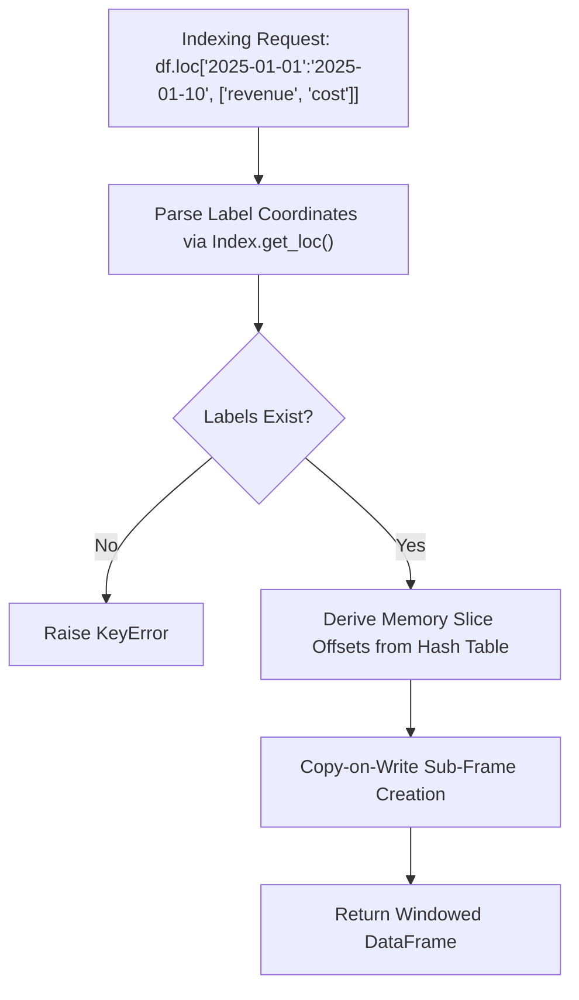
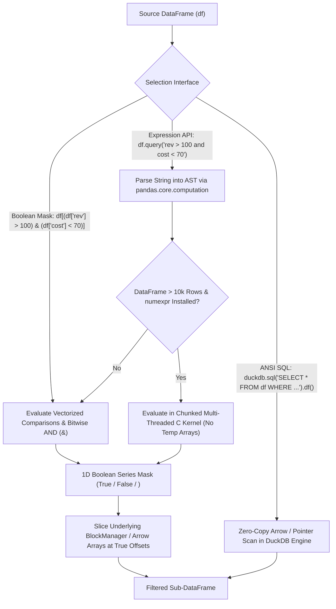
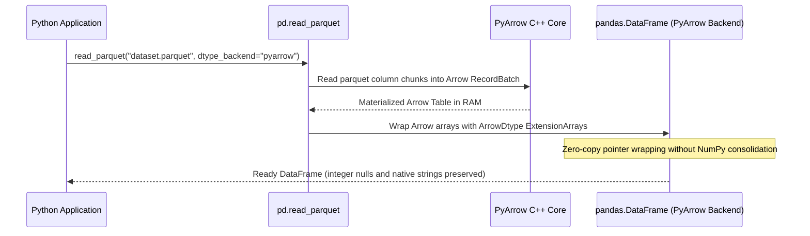
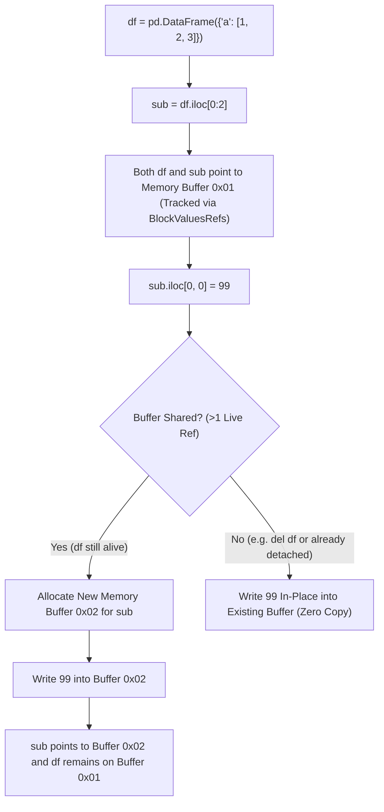
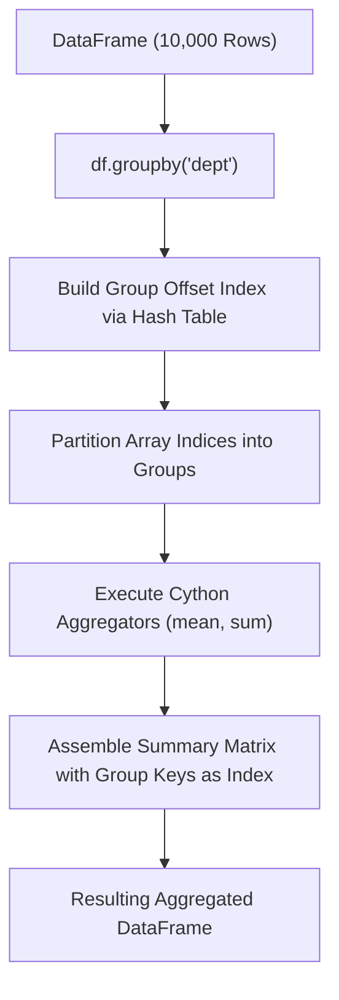
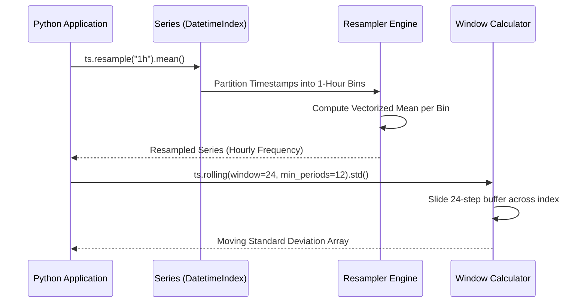

# Pandas

| Metadata      | Value                                                                 |
| ------------- | --------------------------------------------------------------------- |
| Author        | Lyzander Marciano Andrylie                                            |
| Creation Date | Nov 8, 2026                                                           |
| Last Updated  | Nov 10, 2026                                                          |
| Repositories  | [pandas-dev/pandas](https://github.com/pandas-dev/pandas) (`pandas/`) |

## References

- [Pandas Documentation](https://pandas.pydata.org/docs/): Official user guide, tutorials, and API reference
- [Pandas Internals and Architecture](https://pandas.pydata.org/docs/development/internals.html): Structural overview of BlockManager, ExtensionArrays, and series indexing
- [PyArrow Backend Integration](https://pandas.pydata.org/docs/user_guide/pyarrow.html): Apache Arrow memory structures, ArrowDtype, and zero-copy semantics
- [polars.md](./polars.md): Multi-threaded, vectorized DataFrame library written in Rust and Apache Arrow
- [duckdb.md](./duckdb.md): Embedded in-process columnar SQL OLAP database with zero-copy Pandas integration
- [pathlib.md](./pathlib.md): Object-oriented filesystem path operations used in DataFrame serialization and file I/O
- [matplotlib.md](./matplotlib.md): Foundational object-oriented 2D/3D plotting engine with native Pandas integration
- [seaborn.md](./seaborn.md): Statistical visualization library accepting tidy Pandas DataFrames
- [plotly.md](./plotly.md): Declarative interactive web graphing alternative accepting Pandas tabular structures

## Description

`pandas` is the foundational, open-source data manipulation and analysis library for Python. It provides high-performance, labeled, heterogeneous tabular data structures (`DataFrame`, `Series`) built on top of NumPy, Cython, and Apache Arrow. It exists to provide an expressive, indexed data manipulation layer for computational statistics, financial modeling, machine learning preprocessing, and ad-hoc exploratory analytics across the PyData ecosystem.

### Tabular Data Structures and Indexing Engine (`pandas.core.frame`, `pandas.core.series`, `pandas.core.indexes`, `pandas.core.computation`)

The primary container layer providing 2D `DataFrame` and 1D `Series` objects. It coordinates label-based (`loc`), position-based (`iloc`), boolean mask (`df[mask]`), and AST expression-parsed (`query`, `eval`) data selection, hierarchical indexing (`MultiIndex`), and automatic index alignment across operations.

- [pandas.core.frame](https://pandas.pydata.org/docs/reference/api/pandas.DataFrame.html): The two-dimensional, size-mutable, potentially heterogeneous tabular data structure
- [pandas.core.series](https://pandas.pydata.org/docs/reference/api/pandas.Series.html): One-dimensional labeled array capable of holding any data type
- [pandas.core.indexes](https://pandas.pydata.org/docs/reference/indexing.html): Immutable coordinate systems managing row/column axis labels and fast hash lookups
- [pandas.core.computation](https://pandas.pydata.org/docs/user_guide/enhancingperf.html#expression-evaluation-via-eval): AST-based string expression evaluator powering `df.query()` and `pd.eval()`

### Memory Storage and Block Management (`pandas.core.internals.managers`, `pandas.core.arrays`)

The underlying memory allocation and column tracking engine. It transitions between NumPy-backed 2D homogeneous memory slabs (`BlockManager`) and modern 1D Arrow-backed `ExtensionArray` interfaces supporting native missing data masks.

- [pandas.core.internals](https://pandas.pydata.org/docs/development/internals.html): Memory layout manager coordinating blocks, slicing, and Copy-on-Write (CoW)
- [pandas.core.arrays](https://pandas.pydata.org/docs/reference/extensions.html): Abstractions for non-NumPy types (Arrow strings, nullable booleans, categorical data)

### Data Ingestion and Serialization Pipeline (`pandas.io`)

High-throughput parsers and writers bridging in-memory DataFrames with persistent storage formats, cloud stores, and relational databases.

- [pandas.io](https://pandas.pydata.org/docs/reference/io.html): Readers and writers for Parquet, CSV, SQL, Feather, JSON, Excel, and HDF5

### Relational Algebra and Reshaping (`pandas.core.reshape`, `pandas.core.groupby`)

The relational manipulation layer executing split-apply-combine aggregations, SQL-style joins, merges, and matrix pivot transformations.

- [pandas.core.groupby](https://pandas.pydata.org/docs/reference/groupby.html): Split-apply-combine aggregation engine supporting parallel groupings and custom reductions
- [pandas.core.reshape](https://pandas.pydata.org/docs/reference/reshaping.html): Reshaping utilities including `merge`, `concat`, `pivot_table`, `melt`, and `crosstab`

### Time Series and Temporal Arithmetic (`pandas._libs.tslibs`, `pandas.core.dtypes.dtypes`)

A high-precision time series engine providing nanosecond-to-second timestamp resolution, calendar offsets, timezone normalization, and rolling window computations.

- [pandas.tseries](https://pandas.pydata.org/docs/user_guide/timeseries.html): Frequency generators, timezone localization, and rolling/expanding statistical windows

## Features

### 1. Dual Indexing Architecture and Alignment Mechanics (`loc` vs `iloc`)

Pandas enforces a dual-coordinate paradigm for data access: **Label-based** indexing (`loc`) and **Integer-positional** indexing (`iloc`). In a 2D `DataFrame`, coordinates span two axes: **row labels** (`df.index`, Axis 0) and **column names** (`df.columns`, Axis 1). In a 1D `Series`, `s.index` represents row labels (not column names).

| Accessor       | Coordinate System                 | Slice Inclusivity                    | Missing Key Handling | Example Call                     | Output Summary                                          |
| :------------- | :-------------------------------- | :----------------------------------- | :------------------- | :------------------------------- | :------------------------------------------------------ |
| `df.loc[...]`  | Axis labels / strings             | **Inclusive** of both start and stop | Raises `KeyError`    | `df.loc["r1":"r2", ["revenue"]]` | Sub-frame with rows `"r1"` & `"r2"` (both included)     |
| `df.iloc[...]` | 0-based integer positions         | **Half-open** `[start, stop)`        | Raises `IndexError`  | `df.iloc[0:2, [0]]`              | Sub-frame with rows `0` & `1` (offset `2` excluded)     |
| `df[...]`      | Column labels or row boolean mask | Half-open if integer slice           | Raises `KeyError`    | `df["revenue"]`                  | 1D `Series` containing all values of column `"revenue"` |
| `df.at[...]`   | Single label coordinate           | N/A (Scalar only)                    | Raises `KeyError`    | `df.at["r1", "revenue"]`         | Scalar value `100.5` (optimized fast lookup)            |
| `df.iat[...]`  | Single integer coordinate         | N/A (Scalar only)                    | Raises `IndexError`  | `df.iat[0, 0]`                   | Scalar value `100.5` (optimized fast lookup)            |

#### Interaction



#### a. Automatic Index Alignment

When executing binary operations between two `Series` or `DataFrame` instances (e.g., `s1 + s2`), Pandas automatically performs an outer join on their indices before computing values. Unmatched indices produce missing values (`NaN` or `<NA>`) rather than failing.

##### Example

```python
s1 = pd.Series([10, 20], index=["a", "b"])  # Row labels: 'a', 'b'
s2 = pd.Series([100, 200], index=["b", "c"])  # Row labels: 'b', 'c'
s1 + s2
# a      NaN
# b    120.0
# c      NaN
# dtype: float64
```

#### b. Label-Based vs. Position-Based Selection (`loc`, `iloc`, `at`, `iat`)

- **Label-Based Indexing (`loc`)**: Selects data using explicit row and column labels. Slices include **both endpoints** (`df.loc["r1":"r2", "revenue":"cost"]` includes both `"r2"` and `"cost"`).
- **Position-Based Indexing (`iloc`)**: Selects data using 0-based integer offsets conforming to standard Python slicing semantics. Slices are **half-open** (`[start, stop)`, excluding the stop boundary).
- **Direct Bracket Selection (`df[...]`)**: Selects columns when passed a column name or list of column names (`df[["revenue"]]`), or filters rows when passed a boolean mask or integer slice.
- **Scalar Fast-Paths (`at`, `iat`)**: Bypass sub-frame and Series indexing overhead when accessing or mutating a single cell by label (`df.at`) or integer offset (`df.iat`).
- **Gotcha (Chained Assignment)**: Writing `df['a']['b'] = 1` evaluates two distinct `getitem` operations, which may return a temporary copy instead of a view. In earlier Pandas versions, this raised `SettingWithCopyWarning`; under modern Copy-on-Write, it raises `ChainedAssignmentError` or has no effect on the original frame. Always use atomic assignment (`df.loc[row_idx, 'b'] = 1`).

##### Example

```python
df = pd.DataFrame(
    {"revenue": [100.5, 120.0, 85.2], "cost": [60.0, 70.5, 50.0]},
    index=["r1", "r2", "r3"],  # Row labels (df.index, Axis 0); Columns (df.columns, Axis 1)
)

# 1. Label slicing (loc): inclusive of both endpoints ("r1" through "r2")
df.loc["r1":"r2", ["revenue", "cost"]]

# 2. Position slicing (iloc): half-open [0, 2) -> rows 0 and 1 (excludes row 2)
df.iloc[0:2, 0:2]

# 3. Direct column selection: returns sub-frame with "revenue" across all rows
df[["revenue"]]

# 4. Fast scalar lookups: returns 100.5 directly
df.at["r1", "revenue"]  # -> 100.5
df.iat[0, 0]            # -> 100.5

# 5. Safe atomic mutation (avoids ChainedAssignmentError from df["revenue"]["r1"] = 99.0)
df.loc["r1", "revenue"] = 99.0
```

| Index (`df.index`) | `revenue` (Initial) | `cost` | Included in `df.loc["r1":"r2"]` & `df.iloc[0:2]`? |
| :----------------- | ------------------: | -----: | :------------------------------------------------ |
| `r1` (offset `0`)  |               100.5 |   60.0 | Yes                                               |
| `r2` (offset `1`)  |               120.0 |   70.5 | Yes (`loc` includes stop; `iloc` includes `1`)    |
| `r3` (offset `2`)  |                85.2 |   50.0 | No (`iloc[0:2]` stops before offset `2`)          |

#### c. MultiIndex Memory Layout and Constructors (`levels`, `codes`, `from_*`)

Hierarchical indexing (`MultiIndex`) encapsulates multiple categorical dimensions into a single axis coordinate, mapping $N$-dimensional data structures onto 2D DataFrames or 1D Series without losing relational coordinates.

- **Memory Layout (`levels` & `codes`)**: Rather than storing duplicate string labels across millions of rows, a `MultiIndex` stores unique labels in `levels` and compressed integer pointers in `codes`.
- **`pd.MultiIndex.from_product`**: Builds the full Cartesian product of all category combinations.
- **`pd.MultiIndex.from_tuples`**: Builds an index from explicit coordinate tuples (ideal for irregular or sparse coordinate sets).
- **`pd.MultiIndex.from_frame`**: Promotes multiple columns from a flat DataFrame into a multi-level index (equivalent to `flat.set_index(["Region", "Quarter"])`).

##### Example

```python
# 1. Cartesian product constructor & internal memory layout (levels + codes)
midx = pd.MultiIndex.from_product(
    [["East", "West"], ["Q1", "Q2"]], names=["Region", "Quarter"]
)
df = pd.DataFrame(
    {"Revenue": [100.5, 120.0, 85.2, 95.8], "Cost": [60.0, 70.5, 50.0, 55.2]},
    index=midx,
)
# df.index.levels -> [['East', 'West'], ['Q1', 'Q2']]
# df.index.codes  -> [[0, 0, 1, 1], [0, 1, 0, 1]]

# 2. Explicit tuples constructor (irregular coordinate sets)
tuples = [("East", "Q1"), ("East", "Q2"), ("West", "Q1")]
midx_tup = pd.MultiIndex.from_tuples(tuples, names=["Region", "Quarter"])
df_tup = pd.DataFrame({"Revenue": [100.5, 120.0, 85.2]}, index=midx_tup)

# 3. Flat DataFrame constructor
flat = pd.DataFrame(
    {
        "Region": ["East", "East", "West", "West"],
        "Quarter": ["Q1", "Q2", "Q1", "Q2"],
        "Revenue": [100.5, 120.0, 85.2, 95.8],
    }
)
midx_frame = pd.MultiIndex.from_frame(flat[["Region", "Quarter"]])
df_frame = flat[["Revenue"]].set_axis(midx_frame, axis=0)
```

| Row Offset | Region Level (`0`="East", `1`="West") | Quarter Level (`0`="Q1", `1`="Q2") | Resolved MultiIndex Coordinate | `Revenue` | `Cost` |
| :--------- | :------------------------------------ | :--------------------------------- | :----------------------------- | --------: | -----: |
| 0          | `0` ("East")                          | `0` ("Q1")                         | `("East", "Q1")`               |     100.5 |   60.0 |
| 1          | `0` ("East")                          | `1` ("Q2")                         | `("East", "Q2")`               |     120.0 |   70.5 |
| 2          | `1` ("West")                          | `0` ("Q1")                         | `("West", "Q1")`               |      85.2 |   50.0 |
| 3          | `1` ("West")                          | `1` ("Q2")                         | `("West", "Q2")`               |      95.8 |   55.2 |

#### d. MultiIndex Selection and Slicing (`loc`, `IndexSlice`, `xs`)

- **Exact Coordinate Lookup**: Passing a full coordinate tuple `("East", "Q1")` with a column name returns the scalar cell value (`100.5`).
- **Outer-Level Reduction**: Passing only the outer level (`df.loc["East"]`) selects all matching rows and drops the `"Region"` level from the resulting index.
- **Multi-Axis Wildcard Slicing (`pd.IndexSlice`)**: Python does not permit slice syntax inside regular tuples (e.g., `df.loc[(:, "Q1")]` raises `SyntaxError`). `pd.IndexSlice` provides a bracket-accessible helper that converts slice syntax into `slice(None)` objects; aliasing `idx = pd.IndexSlice` is a conventional shorthand.
- **Cross-Section Method (`df.xs`)**: Isolates an inner level (e.g., `"Q1"` on `level="Quarter"`) and drops that level coordinate from the output.
- **Gotcha (`UnsortedIndexError`)**: Range slicing on a `MultiIndex` requires the index to be lexicographically sorted via `df.sort_index()`. Slicing an unsorted `MultiIndex` raises `UnsortedIndexError`.

##### Example

```python
# 1. Exact coordinate lookup -> scalar 100.5
val = df.loc[("East", "Q1"), "Revenue"]

# 2. Outer-level reduction -> drops "Region" level, keeps "Quarter" ("Q1", "Q2")
east_df = df.loc["East"]

# 3. Inner-level wildcard slice via IndexSlice -> keeps both "Region" and "Quarter" levels
idx = pd.IndexSlice
q1_slice = df.loc[idx[:, "Q1"], :]  # Equivalent inline: df.loc[pd.IndexSlice[:, "Q1"], :]

# 4. Cross-section on inner level -> drops "Quarter" level, keeps "Region" ("East", "West")
q1_xs = df.xs("Q1", level="Quarter")

# 5. Sorting before range slicing to avoid UnsortedIndexError
unsorted_idx = pd.MultiIndex.from_tuples([("West", "Q2"), ("East", "Q1")])
bad_df = pd.DataFrame({"Revenue": [95.8, 100.5]}, index=unsorted_idx)
# bad_df.loc[idx["East":"West", :], :]  # Raises UnsortedIndexError
sorted_df = bad_df.sort_index()
sorted_df.loc[idx["East":"West", :], :]
```

| Operation                           | Retained Index Levels         | Matching Rows Returned               |
| :---------------------------------- | :---------------------------- | :----------------------------------- |
| `df.loc[("East", "Q1"), "Revenue"]` | None (Scalar `100.5`)         | Single cell `("East", "Q1")`         |
| `df.loc["East"]`                    | `Quarter` (`["Q1", "Q2"]`)    | East Q1 (`100.5`), East Q2 (`120.0`) |
| `df.loc[idx[:, "Q1"], :]`           | `Region`, `Quarter`           | East Q1 (`100.5`), West Q1 (`85.2`)  |
| `df.xs("Q1", level="Quarter")`      | `Region` (`["East", "West"]`) | East (`100.5`), West (`85.2`)        |

### 2. Conditional Filtering, Boolean Masking, and SQL-Style Querying (`df[mask]`, `query`, `duckdb.sql`)

Pandas provides multiple interfaces to filter rows satisfying specific conditions, ranging from vectorized boolean masks (`df[df["col"] > 1]`) and SQL-like string expressions (`df.query()`) to zero-copy ANSI SQL queries (`duckdb.sql()`).

| Interface                           | SQL Equivalent                              | Evaluation Engine                 | Example Call                                      | Primary Use Case                                         |
| :---------------------------------- | :------------------------------------------ | :-------------------------------- | :------------------------------------------------ | :------------------------------------------------------- |
| `df[df["col"] > 1]`                 | `SELECT * FROM df WHERE col > 1`            | Vectorized NumPy / Arrow bitmask  | `df[(df["rev"] > 100) & (df["cost"] < 70)]`       | Standard row filtering across all columns                |
| `df.loc[mask, ["c1", "c2"]]`        | `SELECT c1, c2 FROM df WHERE ...`           | Boolean mask + label projection   | `df.loc[df["rev"] > 100, ["region", "rev"]]`      | Combined row filtering, column selection, or mutation    |
| `df[lambda x: x["col"] > 1]`        | `WHERE` inside CTE / pipeline               | Deferred callable on current `df` | `df.assign(net=...).loc[lambda x: x["net"] > 50]` | Method chaining without intermediate DataFrame variables |
| `df.query("...")`                   | Native SQL-like `WHERE` clause              | Python AST or `numexpr` bytecode  | `df.query("rev > @min_rev and region == 'East'")` | Readable multi-condition filtering without bracket noise |
| `s.isin([...])` / `s.between(a, b)` | `WHERE col IN (...)` / `BETWEEN a AND b`    | Hash-table lookup / dual bound    | `df[df["region"].isin(["East", "West"])]`         | Set membership and inclusive range predicates            |
| `df.where(cond, other)`             | `CASE WHEN cond THEN val ELSE other END`    | Shape-preserving elementwise mask | `df["rev"].where(df["rev"] > 100, other=0.0)`     | Conditional value replacement while keeping index shape  |
| `duckdb.sql("SELECT ... FROM df")`  | Full ANSI SQL (`WHERE`, `QUALIFY`, `GROUP`) | DuckDB vectorized OLAP engine     | `duckdb.sql("SELECT * FROM df WHERE rev > 100")`  | Complex SQL queries directly over in-memory DataFrames   |

#### Interaction



#### Example Dataset

All conditional selection examples below operate on this shared `orders` DataFrame:

```python
import pandas as pd

orders = pd.DataFrame(
    {
        "order_id": [101, 102, 103, 104, 105],
        "region": ["East", "West", "East", "North", "West"],
        "revenue": [150.0, 80.0, 220.0, 95.0, 130.0],
        "discount_code": ["VIP20", None, "SPRING10", "VIP15", None],
    }
)
```

| Row Offset | `order_id` | `region` | `revenue` | `discount_code` |
| :--------- | ---------: | :------- | --------: | :-------------- |
| 0          |        101 | `East`   |     150.0 | `VIP20`         |
| 1          |        102 | `West`   |      80.0 | `None`          |
| 2          |        103 | `East`   |     220.0 | `SPRING10`      |
| 3          |        104 | `North`  |      95.0 | `VIP15`         |
| 4          |        105 | `West`   |     130.0 | `None`          |

#### a. Vectorized Boolean Masking (`df[mask]` and `df.loc[mask, cols]`)

##### 1. Single-Condition Mask (`df[df["col"] > val]`)

Comparing a column against a scalar executes a vectorized C/Arrow comparison that returns a 1D boolean `Series` (`True`/`False`) aligned with `df.index`. Passing that mask to `df[...]` retains only the `True` rows (equivalent to `SELECT * FROM orders WHERE revenue > 100`).

```python
mask = orders["revenue"] > 100
# 0     True
# 1    False
# 2     True
# 3    False
# 4     True
# Name: revenue, dtype: bool

high_rev = orders[mask]  # Or inline: orders[orders["revenue"] > 100]
```

| `order_id` | `region` | `revenue` | `discount_code` |
| ---------: | :------- | --------: | :-------------- |
|        101 | `East`   |     150.0 | `VIP20`         |
|        103 | `East`   |     220.0 | `SPRING10`      |
|        105 | `West`   |     130.0 | `None`          |

##### 2. Compound Conditions & Bitwise Operator Precedence (`&`, `|`, `~`)

Python's `and`, `or`, and `not` keywords cannot evaluate elementwise arrays and raise `ValueError: The truth value of a Series is ambiguous`. Combine conditions using bitwise `&` (`AND`), `|` (`OR`), and `~` (`NOT`), and **wrap every comparison in parentheses** because `&` and `|` have higher operator precedence than `>`, `<`, and `==`.

```python
# Wrong: orders["revenue"] > 100 & orders["region"] == "East" -> Raises TypeError
# Correct: wrap each comparison in parentheses
east_high = orders[(orders["revenue"] > 100) & (orders["region"] == "East")]

# Negation (~): SELECT * FROM orders WHERE NOT (region = 'North')
non_north = orders[~(orders["region"] == "North")]
```

##### 3. Combined Row Filtering and Column Projection (`df.loc[mask, cols]`)

Passing a row boolean mask and a list of column names to `df.loc[mask, cols]` filters rows and projects columns in a single atomic operation (`SELECT order_id, revenue FROM orders WHERE ...`). It is also the required pattern for conditional in-place updates to avoid `ChainedAssignmentError`.

```python
# Project specific columns for matching rows
east_summary = orders.loc[
    (orders["revenue"] > 100) & (orders["region"] == "East"),
    ["order_id", "revenue"],
]

# Safe conditional mutation (SET tier = 'gold' WHERE revenue >= 150)
orders.loc[orders["revenue"] >= 150, "tier"] = "gold"
```

| `order_id` | `revenue` | Note (`east_summary`)                          |
| ---------: | --------: | :--------------------------------------------- |
|        101 |     150.0 | Matches `revenue > 100` and `region == "East"` |
|        103 |     220.0 | Matches `revenue > 100` and `region == "East"` |

#### b. SQL-Equivalent Predicate Helpers (`isin`, `between`, `isna`, `str`, `lambda`)

##### 1. Set Membership (`isin` / `~isin` — SQL `IN` / `NOT IN`)

`s.isin([...])` tests membership against a collection using $O(1)$ hash-table lookups instead of chaining multiple `|` (`OR`) comparisons.

```python
# Equivalent to: WHERE region IN ('East', 'North')
coastal = orders[orders["region"].isin(["East", "North"])]

# Negate with ~ for SQL NOT IN
not_west = orders[~orders["region"].isin(["West"])]
```

##### 2. Inclusive Range Filtering (`between` — SQL `BETWEEN`)

`s.between(low, high, inclusive="both")` checks both lower and upper bounds in one call (`inclusive` accepts `"both"`, `"neither"`, `"left"`, or `"right"`).

```python
# Equivalent to: WHERE revenue BETWEEN 90 AND 160
mid_tier = orders[orders["revenue"].between(90, 160, inclusive="both")]
# Matches order_id 101 (150.0), 104 (95.0), and 105 (130.0)
```

##### 3. Null Checks and String Matching (`isna`, `notna`, `str` — SQL `IS NULL` & `LIKE`)

Use `.isna()` / `.notna()` to filter missing values, and `.str.startswith()` / `.str.contains()` for substring or regex matching. Pass `na=False` to string methods so missing values evaluate to `False` instead of propagating `NaN` into the boolean mask.

```python
# Equivalent to: WHERE discount_code IS NOT NULL AND discount_code LIKE 'VIP%'
vip_orders = orders[
    orders["discount_code"].notna()
    & orders["discount_code"].str.startswith("VIP", na=False)
]
```

| `order_id` | `region` | `revenue` | `discount_code` |
| ---------: | :------- | --------: | :-------------- |
|        101 | `East`   |     150.0 | `VIP20`         |
|        104 | `North`  |      95.0 | `VIP15`         |

##### 4. Callable Indexing in Method Chains (`lambda`)

Passing a `lambda` to `df[...]` or `df.loc[...]` evaluates the condition against the current DataFrame state in a pipeline without needing an intermediate variable.

```python
chained = (
    orders.assign(net_revenue=orders["revenue"] * 0.9)
    .loc[lambda x: x["net_revenue"] > 100, ["order_id", "net_revenue"]]
)
# Matches order_id 101 (135.0), 103 (198.0), and 105 (117.0)
```

#### c. SQL-Style Expression Querying (`df.query` and `df.eval`)

##### 1. String Predicate Filtering (`df.query`)

`df.query(expr)` parses SQL `WHERE`-like string expressions using standard keywords (`and`, `or`, `not`, `in`, and chained inequalities like `80 <= revenue <= 150`). On DataFrames with $>10{,}000$ rows (when `numexpr` is installed), it compiles the expression into multi-threaded C bytecode without allocating temporary boolean arrays in RAM.

```python
# Chained inequality + null check without bracket clutter
mid_no_discount = orders.query("80 <= revenue <= 150 and discount_code.isna()")
# Matches order_id 102 (80.0, None) and 105 (130.0, None)
```

##### 2. Python Variable Injection (`@var`) and Backtick Escaping

Prefix an identifier with `@` to reference local or global Python variables inside the query string. Wrap column names containing spaces or special characters in backticks (`` `col name` ``).

```python
min_rev = 100.0
allowed_regions = ["East", "West"]

query_res = orders.query("revenue > @min_rev and region in @allowed_regions")
# Matches order_id 101, 103, and 105
```

##### 3. Expression Column Computation (`df.eval`)

`df.eval()` uses the same expression engine to compute new boolean flags or arithmetic columns from string formulas.

```python
orders_with_flag = orders.eval("is_large_east = (revenue >= 150) and (region == 'East')")
print(orders_with_flag[["order_id", "is_large_east"]])
# order_id 101 -> True, 103 -> True; all others -> False
```

#### d. Direct ANSI SQL Interface over DataFrames (`duckdb.sql` & `pd.read_sql_query`)

##### 1. In-Process Zero-Copy SQL ([duckdb.md](./duckdb.md))

`duckdb.sql()` automatically detects local Pandas `DataFrame` variables by name and runs full ANSI SQL (`SELECT`, `WHERE`, `GROUP BY`, window `QUALIFY`) directly over their Arrow/NumPy memory buffers with zero copying. Calling `.df()` returns the result as a Pandas `DataFrame`.

```python
import duckdb

sql_filtered = duckdb.sql(
    """
    SELECT order_id, region, revenue
    FROM orders
    WHERE revenue > 100
      AND region IN ('East', 'West')
    ORDER BY revenue DESC
    """
).df()
```

| `order_id` | `region` | `revenue` |
| ---------: | :------- | --------: |
|        103 | `East`   |     220.0 |
|        101 | `East`   |     150.0 |
|        105 | `West`   |     130.0 |

##### 2. External Database SQL Pushdown (`pd.read_sql_query`)

When data resides in an external relational database (PostgreSQL, SQLite, Snowflake), `pd.read_sql_query()` pushes the `WHERE` filter down to the database engine and only materializes matching rows into Pandas memory.

```python
import sqlite3

with sqlite3.connect(":memory:") as conn:
    orders.to_sql("orders_tbl", conn, index=False)
    db_filtered = pd.read_sql_query(
        "SELECT order_id, region, revenue FROM orders_tbl WHERE revenue > :min_rev",
        conn,
        params={"min_rev": 100.0},
        dtype_backend="pyarrow",
    )
```

#### e. Shape-Preserving Conditional Replacement (`df.where` and `df.mask`)

Unlike `df[mask]` and `df.query()` (which drop non-matching rows), `df.where()` and `df.mask()` keep the original DataFrame shape and index (equivalent to SQL `CASE WHEN cond THEN val ELSE other END`):

- **`df.where(cond, other)`**: Keeps original values where `cond` is `True` and replaces `False` entries with `other`.
- **`df.mask(cond, other)`**: Replaces values where `cond` is `True` with `other` and keeps `False` entries.

```python
# Keep revenues > 100; replace lower revenues with 0.0 (all 5 rows preserved)
orders["qualified_rev"] = orders["revenue"].where(orders["revenue"] > 100, other=0.0)

# Cap revenues > 200.0 at 200.0
orders["capped_rev"] = orders["revenue"].mask(orders["revenue"] > 200, other=200.0)
```

| `order_id` | `revenue` (Original) | `qualified_rev` (`where(rev > 100, 0.0)`) | `capped_rev` (`mask(rev > 200, 200.0)`) |
| ---------: | -------------------: | ----------------------------------------: | --------------------------------------: |
|        101 |                150.0 |                          150.0 (Retained) |                        150.0 (Retained) |
|        102 |                 80.0 |                            0.0 (Replaced) |                         80.0 (Retained) |
|        103 |                220.0 |                          220.0 (Retained) |                        200.0 (Replaced) |
|        104 |                 95.0 |                            0.0 (Replaced) |                         95.0 (Retained) |
|        105 |                130.0 |                          130.0 (Retained) |                        130.0 (Retained) |

### 3. In-Memory Storage Architecture: BlockManager vs. Arrow ExtensionArrays

Historically, Pandas stored all DataFrame columns inside the **`BlockManager`** by consolidating multiple contiguous columns of the same NumPy dtype into single 2D NumPy arrays. Starting in **Pandas 2.0**, Pandas introduced the opt-in **Apache Arrow Backend** (`dtype_backend="pyarrow"`), which stores columns as 1D `ArrowExtensionArray` blocks inside the `BlockManager`.

- **Current Defaults (Pandas 3.0+)**:
  - **Internal Manager**: `BlockManager` remains the sole default internal manager (the experimental `ArrayManager` was removed in Pandas 3.0). It manages standard NumPy dtypes as 2D blocks and `ExtensionArray` dtypes as 1D `ExtensionBlock`s.
  - **Numeric, Boolean, and Temporal Columns**: Still default to standard **NumPy arrays** (`int64`, `float64`, `bool`, `datetime64`) during `DataFrame(...)` construction and I/O (`read_csv`, `read_parquet`) unless `dtype_backend` is specified.
  - **String Columns**: Starting in **Pandas 3.0**, string columns default to a dedicated **PyArrow-backed `str` dtype** (when `pyarrow` is installed) instead of legacy NumPy `object` pointer arrays.
  - **Full Arrow / Nullable Conversion**: Converting all columns to PyArrow remains opt-in via `dtype_backend="pyarrow"` in I/O readers or `df.convert_dtypes(dtype_backend="pyarrow")` (where `convert_dtypes()` itself defaults to `dtype_backend="numpy_nullable"`).
- **NumPy `BlockManager` Bottlenecks**:
  - Consolidation overhead: Inserting or dropping columns forces re-allocating and re-slicing entire 2D memory blocks.
  - Type-heterogeneity costs: Operations across mixed-type frames require continuous type casting.
  - Missing data limitations: NumPy lacks a native integer null indicator, forcing integers to cast to floating-point `float64` whenever `NaN` values occur.
- **PyArrow Storage Engine (`dtype_backend="pyarrow"`, introduced in Pandas 2.0)**:
  - Stores each column as an independent, immutable, 1D Apache Arrow `ChunkedArray` wrapped in an `ArrowExtensionArray` (`ArrowDtype`).
  - Native missing data: Supports true `null` bitmasks for all types (integers, booleans, timestamps, strings).
  - String memory reduction: Apache Arrow strings use contiguous byte offsets instead of storing pointers to individual Python heap objects, reducing memory consumption by up to 70% (now the default for strings in Pandas 3.0+).
  - Zero-Copy Interop: Direct shared-memory exchange with DuckDB, Polars, and PyArrow without data serialization.

| Dimension             | NumPy Backend (Default for Numeric/Bool)     | PyArrow Backend (`dtype_backend="pyarrow"`, Default for `str` in 3.0+) |
| :-------------------- | :------------------------------------------- | :--------------------------------------------------------------------- |
| **Memory Allocation** | 2D homogeneous NumPy blocks (`BlockManager`) | 1D columnar Arrow `ChunkedArray` (`ExtensionBlock` in `BlockManager`)  |
| **Missing Values**    | `np.nan` (casts `int` to `float64`)          | Bitmask `null` (keeps native `int64[pyarrow]`)                         |
| **String Storage**    | Legacy `object` array of Python pointers     | Contiguous Arrow UTF-8 buffer + offset array                           |
| **SIMD Operations**   | Limited to NumPy vector kernels              | Hardware-accelerated Arrow compute kernels                             |
| **Zero-Copy Interop** | Copies required when passing to Arrow        | Zero-copy shared memory via Arrow IPC protocol                         |

#### Interaction



#### Example

```python
import pandas as pd

# DataFrame conversion requesting the PyArrow columnar backend
data = {
    "transaction_id": [101, 102, None, 104],
    "customer": ["Alice", "Bob", "Charlie", None],
    "amount": [45.5, 92.0, 15.0, 110.2],
}
df_pyarrow = pd.DataFrame(data).convert_dtypes(dtype_backend="pyarrow")

# Verify integer column retains integer type despite containing missing values
print(df_pyarrow.dtypes)
# transaction_id     int64[pyarrow]
# customer          string[pyarrow]
# amount            double[pyarrow]

# Missing value inspection uses unified pd.NA
print(df_pyarrow.loc[2, "transaction_id"])  # Output: <NA>
```

### 4. Copy-on-Write (CoW) Memory Model

Introduced in Pandas 2.0 and established as default in modern releases, **Copy-on-Write (CoW)** fundamentally changes DataFrame mutation semantics.

- **Lazy View Sharing (`BlockValuesRefs`)**: Slicing a DataFrame (e.g., `subset = df[['a', 'b']]` or `view = df.iloc[:10]`) no longer makes an immediate deep copy of the underlying memory buffer. Instead, it creates a shallow view pointing to the original memory array and registers a weak reference (`weakref`) in a shared `BlockValuesRefs` tracker.
- **Deferred Copying on Write (Shared vs. Sole Owner)**: Before executing an in-place mutation (`view.iloc[0, 0] = 999`), Pandas checks `BlockValuesRefs` to see if any other live DataFrame/Series blocks still reference that memory buffer:
  - **Buffer is shared (>1 live owner)**: Pandas allocates a new private buffer for the mutating view and writes there, leaving the original parent DataFrame untouched.
  - **Buffer is not shared (1 live owner)**: If no other object references the buffer (e.g., mutating a standalone DataFrame, mutating `view` a second time after it already detached, or after `del df` garbage-collects the parent), Pandas mutates the existing buffer **directly in-place** without allocating a new copy.
- **Elimination of Defensive Copies**: Internal Pandas operations (such as `df.reset_index()` or `df.rename()`) return views without copying data, yielding major performance speedups and lower memory peaks.
- **Thread Safety and Predictability**: Eliminates the classic ambiguity where modifying a slice might or might not mutate the parent frame depending on whether NumPy generated a view or a copy.

| Operation                       | Action Without CoW (Legacy)      | Action Under Copy-on-Write (CoW)                        |
| :------------------------------ | :------------------------------- | :------------------------------------------------------ |
| `subset = df[['col1', 'col2']]` | Defensive deep copy of data      | **Zero-copy view** (increments reference counter)       |
| `slice_df = df.iloc[0:100]`     | Ambiguous (may be view or copy)  | **Guaranteed zero-copy view**                           |
| `slice_df.iloc[0, 0] = 42`      | Mutated `df` if slice was a view | **Clones buffer for `slice_df`**; leaves `df` untouched |
| `df.reset_index(drop=True)`     | Full copy of all data columns    | **Zero-copy view** of data columns                      |

#### Interaction



#### Example

```python
import pandas as pd

# Enable Copy-on-Write globally (or standard in Pandas 3.0+)
pd.options.mode.copy_on_write = True

# Construct initial DataFrame
original = pd.DataFrame({"metric": [10, 20, 30, 40]})

# Slice creates a view without copying the memory array
derived_view = original.iloc[0:2]

# Mutate the derived slice: triggers CoW buffer allocation
derived_view.iloc[0, 0] = 999

# Verify original DataFrame was completely shielded from mutation
print(original.iloc[0, 0])      # Output: 10 (unmodified)
print(derived_view.iloc[0, 0])  # Output: 999
```

### 5. Relational Joins, Merges, and Split-Apply-Combine (`groupby`)

Pandas implements relational algebra operators for combining datasets (`pd.merge`, `pd.concat`) and executing partitioned aggregations (`df.groupby`).

#### Interaction



#### a. Relational Joins and Merges (`pd.merge`)

- **Hash Join Mechanics**: Joins two DataFrames on arbitrary keys or indices (`how="inner"`, `"left"`, `"right"`, `"cross"`, `"outer"`).
- **Cardinality Validation (`validate`)**: Setting `validate="one_to_many"`, `"one_to_one"`, or `"many_to_one"` enforces relational integrity constraints, immediately raising `MergeError` if duplicate keys violate the expected cardinality contract.

##### Example

```python
users = pd.DataFrame({"user_id": [1, 2], "name": ["Alice", "Bob"]})
orders = pd.DataFrame({"order_id": [101, 102], "user_id": [1, 1], "total": [50.0, 75.0]})

merged = pd.merge(users, orders, on="user_id", how="left", validate="one_to_many")
```

#### b. Split-Apply-Combine Aggregations (`groupby`)

- **Split**: Groups data based on one or more categorical columns or mapping functions without eagerly materializing sub-frames.
- **Apply**: Evaluates vectorized reduction kernels (Cythonized `sum`, `mean`, `prod`, `std`) or arbitrary Python callables.
  - **Vectorized Reduction Kernels**:
    - **Kernel**: A focused, low-level function written in compiled code (C, C++, or Cython in `pandas/_libs/`) compiled down to native machine code. It bypasses the Python interpreter loop and runs directly on raw memory buffers (NumPy arrays or Arrow chunks).
    - **Reduction**: An aggregation operation that takes $N$ values and reduces them down to a single scalar summary value ($N \to 1$, e.g., `sum()`, `mean()`, `min()`, `max()`, `prod()`, `std()`).
    - **Vectorized**: The computation operates on contiguous memory blocks all at once rather than unpacking individual Python objects. Where supported by the hardware, it leverages CPU SIMD (Single Instruction, Multiple Data) vector registers (such as AVX-2, AVX-512, or ARM NEON) to process multiple numbers in a single CPU cycle.
- **Combine**: Concatenates results into a single output indexed by group keys.
- **Grouping Optimization (`observed=True`)**: On `Categorical` columns, `observed=True` (default in Pandas 3.0+) prevents constructing empty Cartesian buckets for unobserved categories, restricting grouping strictly to categories present in the data rows.
- **Named Aggregation**: `agg()` accepts keyword arguments specifying output column names mapped to `(source_column, aggregation_function)` tuples, directly producing flat, single-level column headers (avoiding legacy MultiIndex tuples).

| Method                   | Target Transformation       | Output Index Shape                    | Execution Engine                  |
| :----------------------- | :-------------------------- | :------------------------------------ | :-------------------------------- |
| `grouped.agg(...)`       | Scalar reduction per group  | Collapsed to 1 row per unique key     | Vectorized Cython / Arrow kernels |
| `grouped.transform(...)` | Window broadcast            | Identical shape to input DataFrame    | Vectorized broadcasting           |
| `grouped.filter(...)`    | Boolean selection of groups | Retains rows from matching groups     | Group-level evaluation            |
| `grouped.apply(...)`     | Arbitrary DataFrame output  | Flexible (depends on function return) | Python interpreter loop (Slowest) |

##### Example

```python
import pandas as pd

# Source financial ledger
ledger = pd.DataFrame(
    {
        "dept": ["Engineering", "Sales", "Engineering", "Sales", "HR"],
        "employee": ["E1", "E2", "E3", "E4", "E5"],
        "salary": [120000, 95000, 140000, 110000, 85000],
        "bonus": [15000, 25000, 18000, 30000, 8000],
    }
)
```

| `dept`        | `employee` | `salary` | `bonus` |
| :------------ | :--------- | -------: | ------: |
| `Engineering` | `E1`       |  120,000 |  15,000 |
| `Sales`       | `E2`       |   95,000 |  25,000 |
| `Engineering` | `E3`       |  140,000 |  18,000 |
| `Sales`       | `E4`       |  110,000 |  30,000 |
| `HR`          | `E5`       |   85,000 |   8,000 |

###### 1. Named Aggregation (`summary = ledger.groupby(...).agg(...)`)

```python
# Named aggregation computes multiple statistics with clean, flat column names
summary = ledger.groupby("dept", as_index=False).agg(
    headcount=("employee", "count"),
    mean_salary=("salary", "mean"),
    total_bonus=("bonus", "sum"),
)
```

| `dept`        | `headcount` | `mean_salary` | `total_bonus` | Output Schema Impact                                     |
| :------------ | ----------: | ------------: | ------------: | :------------------------------------------------------- |
| `Engineering` |           2 |     130,000.0 |        33,000 | Flat, single-level columns (no MultiIndex tuple headers) |
| `HR`          |           1 |      85,000.0 |         8,000 | Single-pass reduction across 3 aggregated dimensions     |
| `Sales`       |           2 |     102,500.0 |        55,000 | Clean column aliases assigned via keyword args           |

###### 2. Window Transformation (`grouped.transform`)

```python
# Broadcast group-mean salary back to original row shape
ledger["dept_mean_salary"] = ledger.groupby("dept")["salary"].transform("mean")
ledger["above_dept_avg"] = ledger["salary"] > ledger["dept_mean_salary"]
print(ledger[["employee", "salary", "above_dept_avg"]])
```

| `dept`        | `employee` | `salary` | `bonus` | `dept_mean_salary` | `above_dept_avg` | Evaluation Note                          |
| :------------ | :--------- | -------: | ------: | -----------------: | :--------------- | :--------------------------------------- |
| `Engineering` | `E1`       |  120,000 |  15,000 |          130,000.0 | `False`          | $120,000 \le 130,000$ (below dept mean)  |
| `Sales`       | `E2`       |   95,000 |  25,000 |          102,500.0 | `False`          | $95,000 \le 102,500$ (below dept mean)   |
| `Engineering` | `E3`       |  140,000 |  18,000 |          130,000.0 | `True`           | $140,000 > 130,000$ (above dept mean)    |
| `Sales`       | `E4`       |  110,000 |  30,000 |          102,500.0 | `True`           | $110,000 > 102,500$ (above dept mean)    |
| `HR`          | `E5`       |   85,000 |   8,000 |           85,000.0 | `False`          | $85,000 \le 85,000$ (equal to dept mean) |

###### 3. Categorical Grouping (`observed=True` vs. `observed=False`)

```python
# Categorical grouping with observed=True (default in 3.0+) vs observed=False
dept_cat_type = pd.CategoricalDtype(categories=["Engineering", "Sales", "HR", "Marketing"])
ledger["dept_cat"] = ledger["dept"].astype(dept_cat_type)

# observed=True ignores unobserved category 'Marketing' (returns 3 rows: Engineering, Sales, HR)
observed_counts = ledger.groupby("dept_cat", observed=True)["salary"].count()
print(observed_counts)

# observed=False materializes empty category 'Marketing' (returns 4 rows, count 0)
all_counts = ledger.groupby("dept_cat", observed=False)["salary"].count()
print(all_counts)
```

| Category (`dept_cat`) | Occurrence in Data  | `observed=True` (Pandas 3.0+ Default) | `observed=False` (Legacy Default) |
| :-------------------- | :------------------ | ------------------------------------: | --------------------------------: |
| `Engineering`         | 2 rows              |                                     2 |                                 2 |
| `HR`                  | 1 row               |                                     1 |                                 1 |
| `Sales`               | 2 rows              |                                     2 |                                 2 |
| `Marketing`           | 0 rows (Unobserved) |       _**Omitted**_ (3 rows returned) |           **0** (4 rows returned) |

### 6. Reshaping, Pivoting, and Tidy Data Transformation

Pandas provides transformations to convert between **wide-format** (metrics stored across columns) and **long-format** (tidy observations stacked in rows).

- **Wide to Long (`melt`)**: Unpivots selected columns into key-value attribute rows. Essential for preparing tabular data for Seaborn or Plotly Express visualization pipelines.
- **Long to Wide (`pivot` / `pivot_table`)**: Reshapes rows into columns based on unique coordinate values. `pivot` requires strictly unique `(index, columns)` coordinate pairs, while `pivot_table` allows specifying an `aggfunc` (e.g., `"mean"`, `"sum"`) to aggregate duplicate index-column combinations.
- **Stacking & Unstacking (`stack` / `unstack`)**: Rotates hierarchical MultiIndex levels between rows and columns.
- **Frequency Cross-Tabulation (`pd.crosstab`)**: Computes pairwise contingency tables of factor frequencies, with optional margin totals (`margins=True`).

| Function           | Direction       | Aggregation Required?        | Input Format              | Output Format                  |
| :----------------- | :-------------- | :--------------------------- | :------------------------ | :----------------------------- |
| `df.pivot_table()` | Long → Wide     | Yes (`aggfunc="mean"`)       | Long rows with duplicates | Summarized rectangular matrix  |
| `pd.melt()`        | Wide → Long     | No (Eager unpivot)           | Multiple metric columns   | `id_vars`, `variable`, `value` |
| `df.pivot()`       | Long → Wide     | No (Fails on duplicate keys) | Tidy long-form rows       | Matrix with new column headers |
| `df.stack()`       | Columns → Index | No                           | Wide DataFrame columns    | MultiIndex Series / DataFrame  |
| `df.unstack()`     | Index → Columns | No                           | MultiIndex rows           | Wide DataFrame columns         |
| `pd.crosstab()`    | Long → Wide     | Frequency / Metric counts    | Discrete factors          | Contingency matrix             |

#### Example

```python
import pandas as pd

# Raw long-form telemetry records
telemetry = pd.DataFrame(
    {
        "device_id": ["D1", "D1", "D2", "D2", "D1"],
        "metric": ["temp", "humidity", "temp", "humidity", "temp"],
        "reading": [22.4, 60.1, 24.1, 55.4, 23.0],
        "status": ["active", "active", "warning", "active", "active"],
    }
)
```

| Row Offset | `device_id` | `metric`   | `reading` | `status`  |
| :--------- | :---------- | :--------- | --------: | :-------- |
| 0          | `D1`        | `temp`     |      22.4 | `active`  |
| 1          | `D1`        | `humidity` |      60.1 | `active`  |
| 2          | `D2`        | `temp`     |      24.1 | `warning` |
| 3          | `D2`        | `humidity` |      55.4 | `active`  |
| 4          | `D1`        | `temp`     |      23.0 | `active`  |

##### 1. Long to Wide with Aggregation (`df.pivot_table`)

Aggregates duplicate index-column coordinate pairs (e.g., `D1` has two `temp` readings: $22.4$ and $23.0$) into group means.

```python
wide_summary = telemetry.pivot_table(
    index="device_id",
    columns="metric",
    values="reading",
    aggfunc="mean",
)
```

| `device_id` | `humidity` | `temp` | Aggregation Detail               |
| :---------- | ---------: | -----: | :------------------------------- |
| `D1`        |       60.1 |   22.7 | $\text{mean}(22.4, 23.0) = 22.7$ |
| `D2`        |       55.4 |   24.1 | Single observation retained      |

##### 2. Wide to Long Unpivoting (`pd.melt`)

Flattens wide metric column headers back into normalized key-value attribute rows for downstream analytics and plotting.

```python
tidy_long = pd.melt(
    wide_summary.reset_index(),
    id_vars=["device_id"],
    value_vars=["humidity", "temp"],
    var_name="metric",
    value_name="mean_reading",
)
```

| `device_id` | `metric`   | `mean_reading` | Output Property                         |
| :---------- | :--------- | -------------: | :-------------------------------------- |
| `D1`        | `humidity` |           60.1 | Metric label stored in `var_name`       |
| `D2`        | `humidity` |           55.4 | Metric label stored in `var_name`       |
| `D1`        | `temp`     |           22.7 | Aggregated value stored in `value_name` |
| `D2`        | `temp`     |           24.1 | Aggregated value stored in `value_name` |

##### 3. Reshape without Aggregation (`df.pivot`)

Reshapes long-form rows into columns without aggregation; strictly requires unique index-column pairs (raises `ValueError` on duplicates).

```python
# Deduplicate records to ensure unique (device_id, metric) coordinates before pivoting
unique_telemetry = telemetry.drop_duplicates(subset=["device_id", "metric"], keep="first")
pivoted = unique_telemetry.pivot(
    index="device_id",
    columns="metric",
    values="reading",
)
```

| `device_id` | `humidity` | `temp` | Behavior Note                                                         |
| :---------- | ---------: | -----: | :-------------------------------------------------------------------- |
| `D1`        |       60.1 |   22.4 | Keeps first reading ($22.4$); raises `ValueError` if duplicates exist |
| `D2`        |       55.4 |   24.1 | Direct 1-to-1 coordinate lookup without reduction                     |

##### 4. Hierarchical Axis Rotation (`df.stack` & `df.unstack`)

Rotates dimensions between DataFrame column headers and MultiIndex row levels.

**Starting Input DataFrame (`wide_summary` produced by `pivot_table` above):**

| `device_id` (Index) | `humidity` (Column) | `temp` (Column) | Axis Note                                        |
| :------------------ | ------------------: | --------------: | :----------------------------------------------- |
| `D1`                |                60.1 |            22.7 | Row index: `device_id`; Column headers: `metric` |
| `D2`                |                55.4 |            24.1 | Row index: `device_id`; Column headers: `metric` |

###### a. Stack Columns to Row Index (`df.stack`)

Pivots column headers into an inner row MultiIndex level, transforming the wide 2D DataFrame into a tall MultiIndex Series.

```python
# Stack column headers into an inner row MultiIndex level (Wide -> Tall)
stacked_series = wide_summary.stack()
```

**Output of `stacked_series` (MultiIndex Series):**

| `device_id` (Level 0) | `metric` (Level 1) | Value | Structural Impact                             |
| :-------------------- | :----------------- | ----: | :-------------------------------------------- |
| `D1`                  | `humidity`         |  60.1 | Rotated from column header to inner row index |
| `D1`                  | `temp`             |  22.7 | Rotated from column header to inner row index |
| `D2`                  | `humidity`         |  55.4 | Rotated from column header to inner row index |
| `D2`                  | `temp`             |  24.1 | Rotated from column header to inner row index |

###### b. Unstack Row Index to Columns (`df.unstack`)

Pivots an inner MultiIndex row level back out into column headers. It acts as the exact inverse of `df.stack()`, restoring the 2D DataFrame layout.

```python
# Unstack inner MultiIndex row level back into column headers (Tall -> Wide)
unstacked_df = stacked_series.unstack(level="metric")
```

**Output of `unstacked_df` (Restored 2D DataFrame, identical to `wide_summary`):**

| `device_id` (Index) | `humidity` (Column) | `temp` (Column) | Structural Impact                                                             |
| :------------------ | ------------------: | --------------: | :---------------------------------------------------------------------------- |
| `D1`                |                60.1 |            22.7 | Pivoted `metric` level back to column dimension (identical to `wide_summary`) |
| `D2`                |                55.4 |            24.1 | Pivoted `metric` level back to column dimension (identical to `wide_summary`) |

##### 5. Frequency Cross-Tabulation (`pd.crosstab`)

Constructs a contingency table showing pairwise occurrences between discrete factors with optional margin rollups.

> [!NOTE]
> **Terminology Breakdown**:
>
> - **Cross-Tabulation**: Aggregating raw categorical data into a 2D grid where one factor forms the rows and another forms the columns to count joint occurrences.
> - **Contingency Table**: A statistical frequency matrix showing the joint distribution of two (or more) categorical variables, commonly used in statistics to analyze whether one factor is dependent on (contingent upon) another.
> - **Margin**: The summary subtotals placed along the outer edges ("margins") of the table—namely the row sums, column sums, and grand total enabled via `margins=True`.

**Input Telemetry Factors (`telemetry[["device_id", "status"]]`):**

| Row Offset | `device_id` (Index Factor) | `status` (Column Factor) | Factor Occurrence Count |
| :--------- | :------------------------- | :----------------------- | :---------------------- |
| 0          | `D1`                       | `active`                 | Pair `(D1, active)` #1  |
| 1          | `D1`                       | `active`                 | Pair `(D1, active)` #2  |
| 2          | `D2`                       | `warning`                | Pair `(D2, warning)` #1 |
| 3          | `D2`                       | `active`                 | Pair `(D2, active)` #1  |
| 4          | `D1`                       | `active`                 | Pair `(D1, active)` #3  |

```python
contingency_table = pd.crosstab(
    index=telemetry["device_id"],
    columns=telemetry["status"],
    margins=True,
    margins_name="Total",
)
```

| `device_id` | `active` | `warning` | `Total` | Margin Rollup                               |
| :---------- | -------: | --------: | ------: | :------------------------------------------ |
| `D1`        |        3 |         0 |       3 | Row subtotal for `D1`                       |
| `D2`        |        1 |         1 |       2 | Row subtotal for `D2`                       |
| `Total`     |        4 |         1 |       5 | Column totals and grand total ($3 + 2 = 5$) |

### 7. High-Precision Time Series and Window Operations

Pandas was originally developed for quantitative financial time series, providing temporal frequency generation, timezone conversion, and moving window calculations.

- **Temporal Coordinates**:
  - `Timestamp`: High-precision scalar moment in time (equivalent to Python `datetime.datetime` with nanosecond to second precision).
  - `DatetimeIndex`: Monotonic or arbitrary sequence of Timestamps enabling date-range slicing (`df['2025-01-01':'2025-01-31']`).
  - `TimedeltaIndex`: Duration-based coordinates for elapsed intervals.
- **Non-Nanosecond Resolution**: Modern Pandas supports `s`, `ms`, `us`, and `ns` resolutions, overcoming the previous 1677–2262 CE timestamp boundary limitation.

| Frequency Code          | Description                          | Example Target             |
| :---------------------- | :----------------------------------- | :------------------------- |
| `"D"`                   | Calendar day frequency               | Every continuous day       |
| `"B"`                   | Business day frequency               | Monday through Friday only |
| `"W-MON"`               | Weekly frequency anchored on Mondays | Weekly rollup              |
| `"ME"` / `"MS"`         | Month-End / Month-Start              | Monthly financial closes   |
| `"QE"` / `"QS"`         | Quarter-End / Quarter-Start          | Quarterly earnings cycles  |
| `"h"` / `"min"` / `"s"` | Hour / Minute / Second               | High-frequency telemetry   |

#### Interaction



#### a. Temporal Resampling and Timezone Normalization (`resample`, `tz_convert`)

- **Frequency Conversion (`resample`)**: Downsamples or upsamples time-indexed data into target calendar buckets (e.g., converting 1-minute financial ticks into 1-hour OHLC bars).
- **Timezone Localization & Conversion**: `tz_localize("UTC")` binds naive timestamps to a timezone; `tz_convert("America/New_York")` converts UTC instants into local wall-clock times across DST boundaries.

##### Example

```python
import numpy as np
import pandas as pd

# Synthesize 1-minute interval time series spanning 72 hours
time_index = pd.date_range("2026-01-01", periods=4320, freq="min", tz="UTC")
np.random.seed(42)
readings = 100 + np.random.randn(len(time_index)).cumsum()
sensor_series = pd.Series(readings, index=time_index, name="sensor_reading")

# Downsample from minute-level to 1-hour OHLC aggregates and convert timezone
hourly_bars = sensor_series.resample("1h").agg(
    open="first",
    high="max",
    low="min",
    close="last",
)
local_bars = hourly_bars.tz_convert("America/New_York")
print(local_bars.index.tz)  # Output: America/New_York
```

#### b. Moving and Expanding Window Computations (`rolling`, `expanding`, `ewm`)

- **Fixed & Duration Rolling Windows (`df.rolling`)**: Evaluates sliding statistics over a fixed row count (`window=24`) or calendar duration (`window="30D"`), with `min_periods` controlling warm-up nulls.
- **Cumulative Windows (`df.expanding`)**: Computes running statistics from the start of the series up to each timestamp (`min_periods=1`).
- **Exponentially Weighted Windows (`df.ewm`)**: Applies exponential decay weights (`span=20`, `halflife`, or `alpha`) for responsive signal smoothing.

##### Example

```python
# Moving 24-hour rolling window on resampled hourly bars
hourly_bars["rolling_mean_24h"] = hourly_bars["close"].rolling(window=24, min_periods=12).mean()
hourly_bars["rolling_volatility"] = hourly_bars["close"].rolling(window=24, min_periods=12).std()
hourly_bars["ema_12h"] = hourly_bars["close"].ewm(span=12, adjust=False).mean()
```

### 8. Exploratory Data Profiling and Missing Value Diagnostics (`info`, `describe`, `isna`)

Pandas provides built-in inspection idioms to profile schema types, memory footprints, statistical distributions, and missing value (`NaN` / `<NA>`) ratios across a DataFrame.

| Diagnostic Idiom                  | Scope                    | Output Summary                                                    |
| :-------------------------------- | :----------------------- | :---------------------------------------------------------------- |
| `df.isna().mean()`                | Per column (`Series`)    | Fraction of missing values ($0.0$ to $1.0$) per column            |
| `df.isna().sum().sum() / df.size` | Entire DataFrame (float) | Overall missing cell ratio across all rows and columns            |
| `df.info(memory_usage="deep")`    | Schema & RAM             | Column dtypes, non-null counts, and exact heap memory footprint   |
| `df.describe()`                   | Numeric columns          | Count, mean, std, min, quartiles ($25\%, 50\%, 75\%$), and max    |
| `df.describe(include="all")`      | All columns              | Numeric stats plus categorical `unique`, `top` (mode), and `freq` |

#### Example Dataset

```python
import pandas as pd

df = pd.DataFrame(
    {
        "user_id": [1, 2, 3, 4],
        "plan": ["pro", "free", None, "pro"],
        "spend": [120.0, None, None, 80.0],
    }
)
```

| Row Offset | `user_id` | `plan` | `spend` |
| :--------- | --------: | :----- | ------: |
| 0          |         1 | `pro`  |   120.0 |
| 1          |         2 | `free` |  `None` |
| 2          |         3 | `None` |  `None` |
| 3          |         4 | `pro`  |    80.0 |

#### a. Fraction of Missing Values (`df.isna().mean()`)

##### 1. Per-Column Missing Fraction and Percentage

Because boolean `True` evaluates to `1` and `False` to `0`, calling `.mean()` on the boolean mask `df.isna()` directly computes the missing value fraction ($0.0$ to $1.0$) for each column.

```python
# Fraction of missing values per column (0.0 to 1.0)
df.isna().mean()
# user_id    0.00
# plan       0.25
# spend      0.50
# dtype: float64

# As a percentage (0% to 100%)
df.isna().mean() * 100

# Sorted in descending order to inspect the worst offenders first
df.isna().mean().sort_values(ascending=False)
# spend      0.50
# plan       0.25
# user_id    0.00
# dtype: float64
```

##### 2. Entire DataFrame Missing Fraction

Chain `.mean().mean()` (for equally weighted columns) or divide total missing cells (`df.isna().sum().sum()`) by total cells (`df.size`).

```python
# Overall fraction of missing cells across the entire DataFrame (3 missing / 12 total cells)
df.isna().mean().mean()           # -> 0.25
df.isna().sum().sum() / df.size   # -> 0.25
```

#### b. General DataFrame Summaries (`info` and `describe`)

##### 1. Schema, Non-Null Counts, and Memory Usage (`df.info`)

Prints column names, non-null value counts, data types, and total RAM consumption (`memory_usage="deep"` inspects underlying string/object heap allocations).

```python
df.info(memory_usage="deep")
```

##### 2. Numeric Descriptive Statistics (`df.describe`)

Computes summary statistics (`count`, `mean`, `std`, `min`, `25%`, `50%`, `75%`, `max`) across numeric columns, automatically excluding missing values.

```python
df.describe()
```

| Statistic | `user_id` | `spend` |
| :-------- | --------: | ------: |
| `count`   |       4.0 |     2.0 |
| `mean`    |       2.5 |   100.0 |
| `std`     |      1.29 |   28.28 |
| `min`     |       1.0 |    80.0 |
| `25%`     |      1.75 |    90.0 |
| `50%`     |       2.5 |   100.0 |
| `75%`     |      3.25 |   110.0 |
| `max`     |       4.0 |   120.0 |

##### 3. Mixed Numeric and Categorical Statistics (`df.describe(include="all")`)

Passing `include="all"` adds categorical/text metrics (`unique` count, `top` most frequent value, and `freq` occurrence count of the top value) alongside numeric statistics.

```python
df.describe(include="all")
```

| Statistic | `user_id` | `plan` | `spend` |
| :-------- | --------: | :----- | ------: |
| `count`   |       4.0 | 3      |     2.0 |
| `unique`  |     `NaN` | 2      |   `NaN` |
| `top`     |     `NaN` | `pro`  |   `NaN` |
| `freq`    |     `NaN` | 2      |   `NaN` |
| `mean`    |       2.5 | `NaN`  |   100.0 |
| `min`     |       1.0 | `NaN`  |    80.0 |
| `max`     |       4.0 | `NaN`  |   120.0 |

#### c. Comprehensive Missing Value Summary Table

Combine `.isna().sum()`, `.isna().mean()`, and `df.dtypes` into a single diagnostic DataFrame sorted by missing count to inspect counts, fractions, percentages, and types side-by-side.

```python
missing_summary = pd.DataFrame(
    {
        "Missing Values": df.isna().sum(),
        "Fraction": df.isna().mean(),
        "Percent (%)": (df.isna().mean() * 100).round(2),
        "Dtype": df.dtypes,
    }
).sort_values(by="Missing Values", ascending=False)

print(missing_summary)
```

| Column Index | `Missing Values` | `Fraction` | `Percent (%)` | `Dtype`   |
| :----------- | ---------------: | ---------: | ------------: | :-------- |
| `spend`      |                2 |       0.50 |         50.00 | `float64` |
| `plan`       |                1 |       0.25 |         25.00 | `str`     |
| `user_id`    |                0 |       0.00 |          0.00 | `int64`   |
