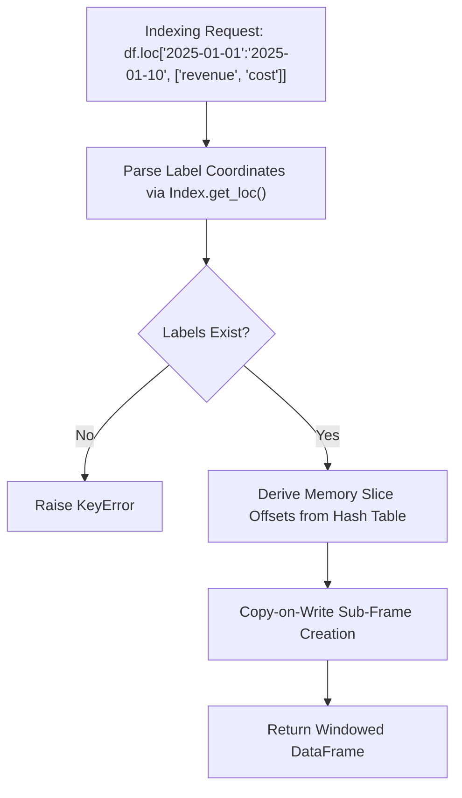
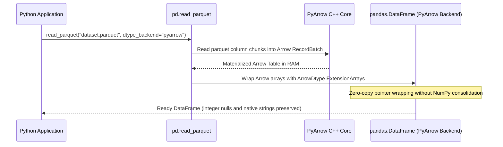
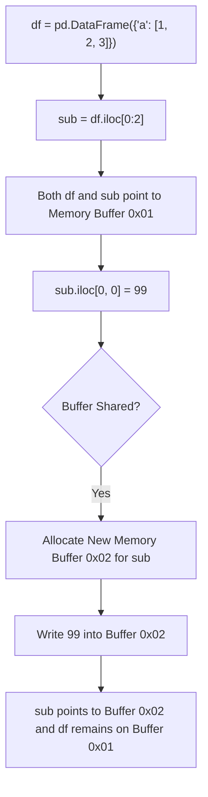
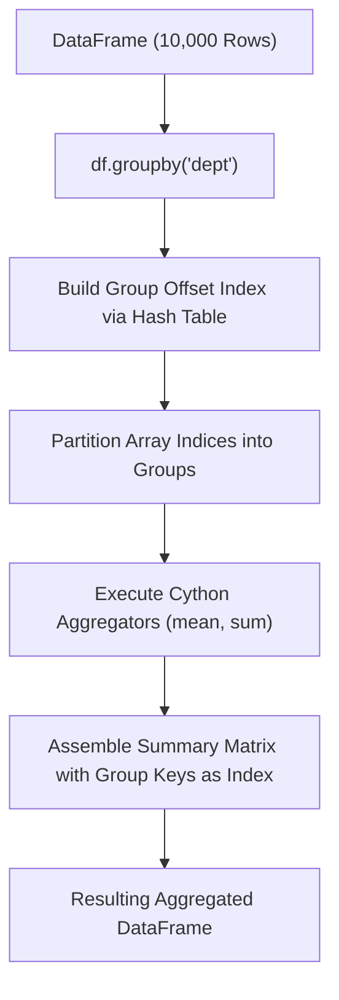
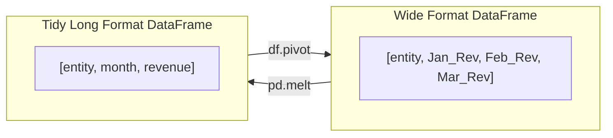
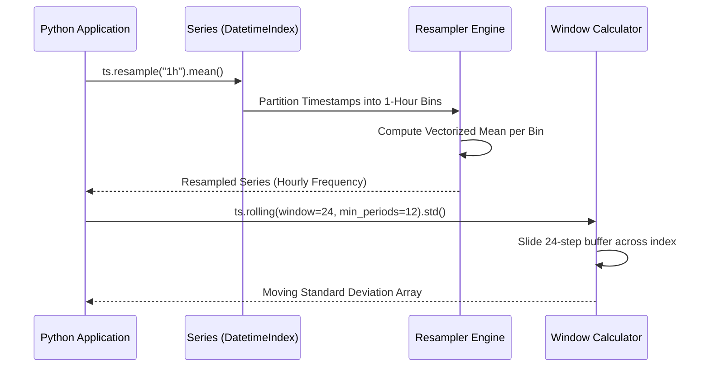

# Pandas

| Metadata      | Value                                                                 |
| ------------- | --------------------------------------------------------------------- |
| Author        | Lyzander Marciano Andrylie                                            |
| Creation Date | Nov 8, 2026                                                           |
| Last Updated  | Nov 8, 2026                                                           |
| Repositories  | [pandas-dev/pandas](https://github.com/pandas-dev/pandas) (`pandas/`) |

## References

- [Pandas Documentation](https://pandas.pydata.org/docs/): Official user guide, tutorials, and API reference
- [Pandas Internals and Architecture](https://pandas.pydata.org/docs/development/internals.html): Structural overview of BlockManager, ExtensionArrays, and series indexing
- [PyArrow Backend Integration](https://pandas.pydata.org/docs/user_guide/pyarrow.html): Apache Arrow memory structures, ArrowDtype, and zero-copy semantics
- [polars.md](./polars.md): Multi-threaded, vectorized DataFrame library written in Rust and Apache Arrow
- [pathlib.md](./pathlib.md): Object-oriented filesystem path operations used in DataFrame serialization and file I/O
- [matplotlib.md](./matplotlib.md): Foundational object-oriented 2D/3D plotting engine with native Pandas integration
- [seaborn.md](./seaborn.md): Statistical visualization library accepting tidy Pandas DataFrames
- [plotly.md](./plotly.md): Declarative interactive web graphing alternative accepting Pandas tabular structures

## Description

`pandas` is the foundational, open-source data manipulation and analysis library for Python. It provides high-performance, labeled, heterogeneous tabular data structures (`DataFrame`, `Series`) built on top of NumPy, Cython, and Apache Arrow. It exists to provide an expressive, indexed data manipulation layer for computational statistics, financial modeling, machine learning preprocessing, and ad-hoc exploratory analytics across the PyData ecosystem.

### Tabular Data Structures and Indexing Engine (`pandas.core.frame`, `pandas.core.series`, `pandas.core.indexes`)

The primary container layer providing 2D `DataFrame` and 1D `Series` objects. It coordinates label-based (`loc`) and position-based (`iloc`) data selection, hierarchical indexing (`MultiIndex`), and automatic index alignment across operations.

- [pandas.core.frame](https://pandas.pydata.org/docs/reference/api/pandas.DataFrame.html): The two-dimensional, size-mutable, potentially heterogeneous tabular data structure
- [pandas.core.series](https://pandas.pydata.org/docs/reference/api/pandas.Series.html): One-dimensional labeled array capable of holding any data type
- [pandas.core.indexes](https://pandas.pydata.org/docs/reference/indexing.html): Immutable coordinate systems managing row/column axis labels and fast hash lookups

### Memory Storage and Block Management (`pandas.core.internals.managers`, `pandas.core.arrays`)

The underlying memory allocation and column tracking engine. It transitions between NumPy-backed 2D homogeneous memory slabs (`BlockManager`) and modern 1D Arrow-backed `ExtensionArray` interfaces supporting native missing data masks.

- [pandas.core.internals](https://pandas.pydata.org/docs/development/internals.html): Memory layout manager coordinating blocks, slicing, and Copy-on-Write (CoW)
- [pandas.core.arrays](https://pandas.pydata.org/docs/reference/extensions.html): Abstractions for non-NumPy types (Arrow strings, nullable booleans, categorical data)

### Data Ingestion and Serialization Pipeline (`pandas.io`)

High-throughput parsers and writers bridging in-memory DataFrames with persistent storage formats, cloud stores, and relational databases.

- [pandas.io](https://pandas.pydata.org/docs/reference/io.html): Readers and writers for Parquet, CSV, SQL, Feather, JSON, Excel, and HDF5

### Relational Algebra and Reshaping (`pandas.core.reshape`, `pandas.core.groupby`)

The relational manipulation layer executing split-apply-combine aggregations, SQL-style joins, merges, and matrix pivot transformations.

- [pandas.core.groupby](https://pandas.pydata.org/docs/reference/groupby.html): Split-apply-combine aggregation engine supporting parallel groupings and custom reductions
- [pandas.core.reshape](https://pandas.pydata.org/docs/reference/reshaping.html): Reshaping utilities including `merge`, `concat`, `pivot_table`, `melt`, and `crosstab`

### Time Series and Temporal Arithmetic (`pandas._libs.tslibs`, `pandas.core.dtypes.dtypes`)

A high-precision time series engine providing nanosecond-to-second timestamp resolution, calendar offsets, timezone normalization, and rolling window computations.

- [pandas.tseries](https://pandas.pydata.org/docs/user_guide/timeseries.html): Frequency generators, timezone localization, and rolling/expanding statistical windows

---

## Features

### 1. Dual Indexing Architecture and Alignment Mechanics (`loc` vs `iloc`)

Pandas enforces a dual-coordinate paradigm for data access: **Label-based** indexing (`loc`) and **Integer-positional** indexing (`iloc`).

- **Automatic Index Alignment**: When executing binary operations between two `Series` or `DataFrame` instances (e.g., `s1 + s2`), Pandas automatically performs an outer join on their indices before computing values. Unmatched indices produce missing values (`NaN` or `<NA>`) rather than failing.
- **Label-Based Indexing (`loc`)**: Selects data using explicit row and column labels. Slices include **both endpoints** (`df.loc['2025-01':'2025-03']` includes March).
- **Position-Based Indexing (`iloc`)**: Selects data using 0-based integer offsets conforming to standard Python slicing semantics. Slices are **half-open** (excludes the stop boundary).
- **Hierarchical Indexing (`MultiIndex`)**: Encapsulates multiple categorical dimensions into a single axis coordinate, enabling multi-dimensional slicing via `pd.IndexSlice`.
- **Gotcha (Chained Assignment)**: Writing `df['a']['b'] = 1` evaluates two distinct getitem operations, which may return a temporary copy instead of a view. In earlier Pandas versions, this raised `SettingWithCopyWarning`; under modern Copy-on-Write, it raises a `ChainedAssignmentError` or has no effect on the original frame. Always use `df.loc[row_idx, 'b'] = 1`.

#### Indexing Protocols Summary

| Accessor       | Coordinate System                 | Slice Inclusivity                    | Missing Key Handling | Return Type (Single Selection)            |
| :------------- | :-------------------------------- | :----------------------------------- | :------------------- | :---------------------------------------- |
| `df.loc[...]`  | Axis labels / strings             | **Inclusive** of both start and stop | Raises `KeyError`    | Scalar or `Series` / `DataFrame`          |
| `df.iloc[...]` | 0-based integer positions         | **Half-open** `[start, stop)`        | Raises `IndexError`  | Scalar or `Series` / `DataFrame`          |
| `df[...]`      | Column labels or row boolean mask | Half-open if integer slice           | Raises `KeyError`    | `Series` (column) or `DataFrame` (filter) |
| `df.at[...]`   | Single label coordinate           | N/A (Scalar only)                    | Raises `KeyError`    | Raw scalar value (Fast path)              |
| `df.iat[...]`  | Single integer coordinate         | N/A (Scalar only)                    | Raises `IndexError`  | Raw scalar value (Fast path)              |

#### Interaction



```python
import numpy as np
import pandas as pd

# Multi-indexed tabular data
index = pd.MultiIndex.from_tuples(
    [("East", "Q1"), ("East", "Q2"), ("West", "Q1"), ("West", "Q2")],
    names=["Region", "Quarter"],
)
df = pd.DataFrame(
    {"Revenue": [100.5, 120.0, 85.2, 95.8], "Cost": [60.0, 70.5, 50.0, 55.2]},
    index=index,
)

# 1. Label-based hierarchical lookup via IndexSlice
idx = pd.IndexSlice
east_q1_rev = df.loc[idx["East", "Q1"], "Revenue"]
assert east_q1_rev == 100.5

# 2. Positional integer lookup (second row, first column)
q2_rev = df.iloc[1, 0]
assert q2_rev == 120.0

# 3. Safe mutation via single-index loc (avoiding chained assignment)
df.loc[idx["West", "Q2"], "Cost"] = 58.0

# 4. Fast scalar access
assert df.at[("East", "Q1"), "Revenue"] == 100.5
```

---

### 2. In-Memory Storage Architecture: BlockManager vs. Arrow ExtensionArrays

Historically, Pandas stored DataFrame columns inside the **`BlockManager`**, which consolidated multiple contiguous columns of the same NumPy dtype into single 2D NumPy arrays. Modern Pandas allows switching to the **Apache Arrow Backend**.

- **NumPy `BlockManager` Bottlenecks**:
  - Consolidation overhead: Inserting or dropping columns forces re-allocating and re-slicing entire 2D memory blocks.
  - Type-heterogeneity costs: Operations across mixed-type frames require continuous type casting.
  - Missing data limitations: NumPy lacks a native integer null indicator, forcing integers to cast to floating-point `float64` whenever `NaN` values occur.
- **PyArrow Storage Engine (`dtype_backend="pyarrow"`)**:
  - Stores each column as an independent, immutable, 1D Apache Arrow ChunkedArray.
  - Native missing data: Supports true `null` bitmasks for all types (integers, booleans, timestamps, strings).
  - String memory reduction: Apache Arrow strings use contiguous byte offsets instead of storing pointers to individual Python heap objects, reducing memory consumption by up to 70%.
  - Zero-Copy Interop: Direct shared-memory exchange with DuckDB, Polars, and PyArrow without data serialization.

#### NumPy Backend vs. PyArrow Backend

| Dimension             | NumPy Backend (Legacy Default)        | PyArrow Backend (`dtype_backend="pyarrow"`)    |
| :-------------------- | :------------------------------------ | :--------------------------------------------- |
| **Memory Allocation** | 2D homogenous blocks (`BlockManager`) | 1D columnar chunked arrays (`ArrayManager`)    |
| **Missing Values**    | `np.nan` (casts `int` to `float64`)   | Bitmask `null` (keeps native `int64[pyarrow]`) |
| **String Storage**    | Array of Python object pointers       | Contiguous Arrow UTF-8 buffer + offset array   |
| **SIMD Operations**   | Limited to NumPy vector kernels       | Hardware-accelerated Arrow compute kernels     |
| **Zero-Copy Interop** | Copies required when passing to Arrow | Zero-copy shared memory via Arrow IPC protocol |

#### Interaction



```python
import pandas as pd

# Parquet ingestion requesting the PyArrow columnar backend
data = {
    "transaction_id": [101, 102, None, 104],
    "customer": ["Alice", "Bob", "Charlie", None],
    "amount": [45.5, 92.0, 15.0, 110.2],
}
df_pyarrow = pd.DataFrame(data).convert_dtypes(dtype_backend="pyarrow")

# Verify integer column retains integer type despite containing missing values
assert str(df_pyarrow["transaction_id"].dtype) == "int64[pyarrow]"
assert str(df_pyarrow["customer"].dtype) == "string[pyarrow]"

# Missing value inspection uses unified pd.NA
assert pd.isna(df_pyarrow.loc[2, "transaction_id"])
```

---

### 3. Copy-on-Write (CoW) Memory Model

Introduced in Pandas 2.0 and established as default in modern releases, **Copy-on-Write (CoW)** fundamentally changes DataFrame mutation semantics.

- **Lazy View Sharing**: Slicing a DataFrame (e.g., `subset = df[['a', 'b']]` or `view = df.iloc[:10]`) no longer makes an immediate deep copy of the underlying memory buffer. Instead, it creates a shallow reference view pointing to the original memory array.
- **Deferred Copying on Write**: A physical copy of the underlying buffer is executed **only if and when** one of the views attempts an in-place mutation (`view.iloc[0, 0] = 999`). The mutating view receives a newly allocated buffer, while the original parent DataFrame remains unmodified.
- **Elimination of Defensive Copies**: Internal Pandas operations (such as `df.reset_index()` or `df.rename()`) return views without copying data, yielding major performance speedups and lower memory peaks.
- **Thread Safety and Predictability**: Eliminates the classic ambiguity where modifying a slice might or might not mutate the parent frame depending on whether NumPy generated a view or a copy.

#### Copy-on-Write Lifecycle Decisions

| Operation                       | Action Without CoW (Legacy)      | Action Under Copy-on-Write (CoW)                        |
| :------------------------------ | :------------------------------- | :------------------------------------------------------ |
| `subset = df[['col1', 'col2']]` | Defensive deep copy of data      | **Zero-copy view** (increments reference counter)       |
| `slice_df = df.iloc[0:100]`     | Ambiguous (may be view or copy)  | **Guaranteed zero-copy view**                           |
| `slice_df.iloc[0, 0] = 42`      | Mutated `df` if slice was a view | **Clones buffer for `slice_df`**; leaves `df` untouched |
| `df.reset_index(drop=True)`     | Full copy of all data columns    | **Zero-copy view** of data columns                      |

#### Interaction



```python
import pandas as pd

# Enable Copy-on-Write globally (or standard in Pandas 3.0+)
pd.options.mode.copy_on_write = True

# Construct initial DataFrame
original = pd.DataFrame({"metric": [10, 20, 30, 40]})

# Slice creates a view without copying the memory array
derived_view = original.iloc[0:2]

# Mutate the derived slice: triggers CoW buffer allocation
derived_view.iloc[0, 0] = 999

# Verify original DataFrame was completely shielded from mutation
assert original.iloc[0, 0] == 10
assert derived_view.iloc[0, 0] == 999
```

---

### 4. Relational Joins, Merges, and Split-Apply-Combine (`groupby`)

Pandas implements relational algebra operators for combining datasets and running partitioned aggregations.

- **Merge Mechanics (`pd.merge`)**:
  - Joins two DataFrames on arbitrary keys via hash joins (`how="inner"`, `"left"`, `"right"`, `"cross"`, `"outer"`).
  - Validation check: Setting `validate="one_to_many"`, `"one_to_one"`, or `"many_to_one"` enforces relational integrity constraints, immediately raising `MergeError` if duplicates violate the cardinality contract.
- **Split-Apply-Combine (`groupby`)**:
  - **Split**: Groups data based on one or more categorical columns or mapping functions without eagerly materializing sub-frames.
  - **Apply**: Evaluates vectorized reduction kernels (Cythonized `sum`, `mean`, `prod`, `std`) or arbitrary Python callables.
  - **Combine**: Concatenates results into a single output indexed by group keys.
- **Grouping Optimization**: Using `observed=True` on categorical columns prevents constructing empty Cartesian buckets for unobserved categories, saving substantial memory and execution time.
- **Named Aggregation**: The `agg()` method accepts keyword arguments specifying the output column name alongside a tuple of `(source_column, aggregation_function)`, producing clean, single-level column headers.

#### GroupBy Verbs Comparison

| Method                   | Target Transformation       | Output Index Shape                    | Execution Engine                  |
| :----------------------- | :-------------------------- | :------------------------------------ | :-------------------------------- |
| `grouped.agg(...)`       | Scalar reduction per group  | Collapsed to 1 row per unique key     | Vectorized Cython / Arrow kernels |
| `grouped.transform(...)` | Window broadcast            | Identical shape to input DataFrame    | Vectorized broadcasting           |
| `grouped.filter(...)`    | Boolean selection of groups | Retains rows from matching groups     | Group-level evaluation            |
| `grouped.apply(...)`     | Arbitrary DataFrame output  | Flexible (depends on function return) | Python interpreter loop (Slowest) |

#### Interaction



```python
import pandas as pd

# Source financial ledger
ledger = pd.DataFrame(
    {
        "dept": ["Engineering", "Sales", "Engineering", "Sales", "HR"],
        "employee": ["E1", "E2", "E3", "E4", "E5"],
        "salary": [120000, 95000, 140000, 110000, 85000],
        "bonus": [15000, 25000, 18000, 30000, 8000],
    }
)

# 1. Named aggregation computes multiple statistics with clean column names
summary = ledger.groupby("dept", as_index=False).agg(
    headcount=("employee", "count"),
    mean_salary=("salary", "mean"),
    total_bonus=("bonus", "sum"),
)

# 2. Window transformation: broadcast group-mean salary back to original row shape
ledger["dept_mean_salary"] = ledger.groupby("dept")["salary"].transform("mean")
ledger["above_dept_avg"] = ledger["salary"] > ledger["dept_mean_salary"]

assert ledger.loc[ledger["employee"] == "E3", "above_dept_avg"].iloc[0] is True
```

---

### 5. Reshaping, Pivoting, and Tidy Data Transformation

Pandas provides transformations to convert between **wide-format** (metrics stored across columns) and **long-format** (tidy observations stacked in rows).

- **Wide to Long (`melt`)**: Unpivots selected columns into key-value attribute rows. Essential for preparing tabular data for Seaborn or Plotly Express visualization pipelines.
- **Long to Wide (`pivot` / `pivot_table`)**: Reshapes rows into columns based on unique coordinate values. `pivot_table` allows specifying an `aggfunc` (e.g., `"mean"`, `"sum"`) to aggregate duplicate index-column combinations.
- **Stacking & Unstacking**: Rotates hierarchical MultiIndex levels between rows and columns (`df.stack()`, `df.unstack()`).
- **Frequency Cross-Tabulation (`pd.crosstab`)**: Computes pairwise contingency tables of factor frequencies, with optional margin totals (`margins=True`).

#### Reshaping Functions Comparison

| Function           | Direction                   | Aggregation Required?        | Input Format              | Output Format                  |
| :----------------- | :-------------------------- | :--------------------------- | :------------------------ | :----------------------------- |
| `pd.melt()`        | Wide $\rightarrow$ Long     | No (Eager unpivot)           | Multiple metric columns   | `id_vars`, `variable`, `value` |
| `df.pivot()`       | Long $\rightarrow$ Wide     | No (Fails on duplicate keys) | Tidy long-form rows       | Matrix with new column headers |
| `df.pivot_table()` | Long $\rightarrow$ Wide     | Yes (`aggfunc="mean"`)       | Long rows with duplicates | Summarized rectangular matrix  |
| `df.unstack()`     | Index $\rightarrow$ Columns | No                           | MultiIndex rows           | MultiIndex columns             |
| `pd.crosstab()`    | Long $\rightarrow$ Wide     | Frequency / Metric counts    | Discrete factors          | Contingency matrix             |

#### Interaction



```python
import pandas as pd

# Tidy long-form telemetry records
long_df = pd.DataFrame(
    {
        "device_id": ["D1", "D1", "D2", "D2", "D1"],
        "metric": ["temp", "humidity", "temp", "humidity", "temp"],
        "reading": [22.4, 60.1, 24.1, 55.4, 23.0],
    }
)

# 1. Pivot long-form records into wide-form summary table
wide_table = long_df.pivot_table(
    index="device_id",
    columns="metric",
    values="reading",
    aggfunc="mean",
)

# 2. Melt wide-form table back into standardized tidy format
wide_table_reset = wide_table.reset_index()
melted_df = pd.melt(
    wide_table_reset,
    id_vars=["device_id"],
    value_vars=["humidity", "temp"],
    var_name="metric",
    value_name="mean_reading",
)

assert "mean_reading" in melted_df.columns
assert len(melted_df) == 4
```

---

### 6. High-Precision Time Series and Window Operations

Pandas was originally developed for quantitative financial time series, providing temporal frequency generation, timezone conversion, and moving window calculations.

- **Temporal Coordinates**:
  - `Timestamp`: High-precision scalar moment in time (equivalent to Python `datetime.datetime` with nanosecond to second precision).
  - `DatetimeIndex`: Monotonic or arbitrary sequence of Timestamps enabling date-range slicing (`df['2025-01-01':'2025-01-31']`).
  - `TimedeltaIndex`: Duration-based coordinates for elapsed intervals.
- **Non-Nanosecond Resolution**: Modern Pandas supports `s`, `ms`, `us`, and `ns` resolutions, overcoming the previous 1677–2262 CE timestamp boundary limitation.
- **Temporal Resampling (`resample`)**: Frequency conversion and downsampling/upsampling (e.g., converting 1-minute financial ticks to 1-hour OHLC bars).
- **Moving Window Computations**:
  - `df.rolling(window=10)`: Fixed or duration-based moving windows (`window="30D"`).
  - `df.expanding(min_periods=1)`: Cumulative expanding windows.
  - `df.ewm(span=20)`: Exponentially weighted moving calculations for smoothing financial time series.

#### Common Calendar and Frequency Aliases

| Frequency Code          | Description                          | Example Target             |
| :---------------------- | :----------------------------------- | :------------------------- |
| `"D"`                   | Calendar day frequency               | Every continuous day       |
| `"B"`                   | Business day frequency               | Monday through Friday only |
| `"W-MON"`               | Weekly frequency anchored on Mondays | Weekly rollup              |
| `"ME"` / `"MS"`         | Month-End / Month-Start              | Monthly financial closes   |
| `"QE"` / `"QS"`         | Quarter-End / Quarter-Start          | Quarterly earnings cycles  |
| `"h"` / `"min"` / `"s"` | Hour / Minute / Second               | High-frequency telemetry   |

#### Interaction



```python
import numpy as np
import pandas as pd

# Synthesize 1-minute interval time series spanning 72 hours
time_index = pd.date_range("2026-01-01", periods=4320, freq="min", tz="UTC")
np.random.seed(42)
readings = 100 + np.random.randn(len(time_index)).cumsum()
sensor_series = pd.Series(readings, index=time_index, name="sensor_reading")

# 1. Downsample from minute-level to 1-hour aggregates
hourly_bars = sensor_series.resample("1h").agg(
    open="first",
    high="max",
    low="min",
    close="last",
)

# 2. Moving 24-hour rolling window on resampled data
hourly_bars["rolling_mean_24h"] = hourly_bars["close"].rolling(window=24, min_periods=12).mean()
hourly_bars["rolling_volatility"] = hourly_bars["close"].rolling(window=24, min_periods=12).std()

# 3. Timezone conversion
local_bars = hourly_bars.tz_convert("America/New_York")
assert str(local_bars.index.tz) == "America/New_York"
```
