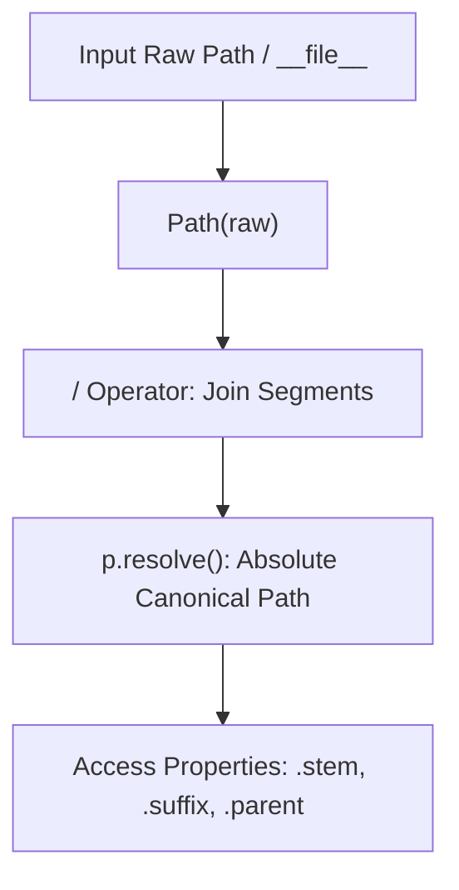
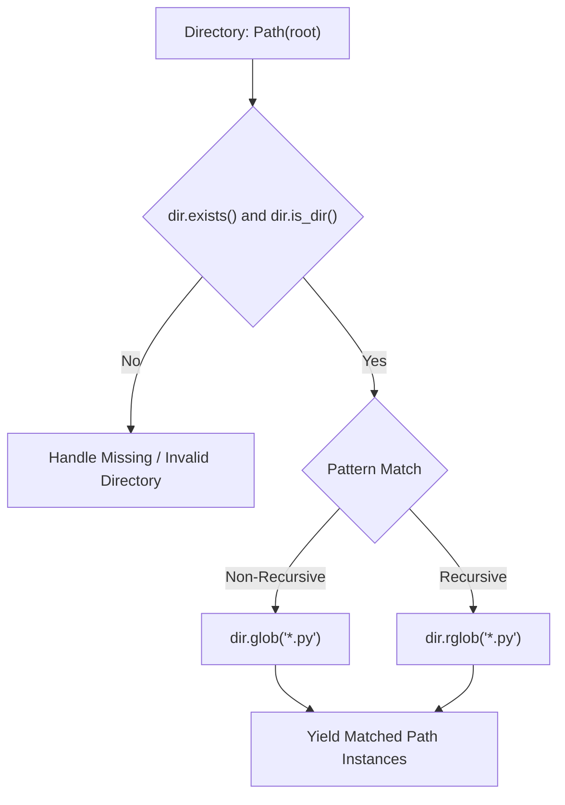
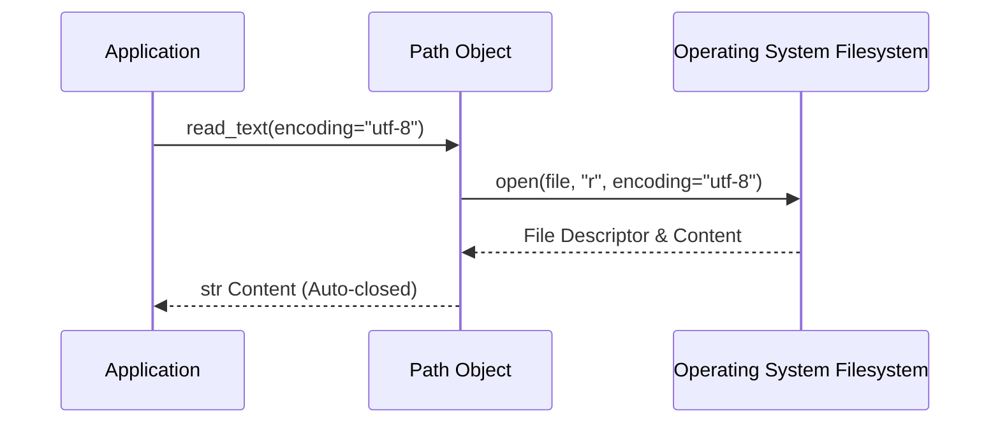
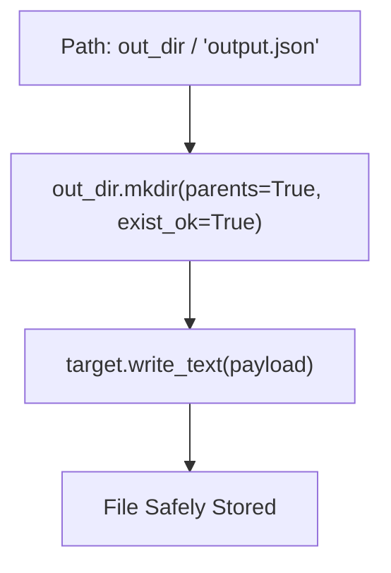

# pathlib

| Metadata      | Value                                                         |
| ------------- | ------------------------------------------------------------- |
| Author        | Lyzander Marciano Andrylie                                    |
| Creation Date | Nov 7, 2026                                                   |
| Last Updated  | Nov 8, 2026                                                   |
| Repositories  | [cpython](https://github.com/python/cpython) (`Lib/pathlib/`) |

## References

- [PEP 428 – The pathlib Module](https://peps.python.org/pep-0428/): Object-oriented filesystem paths specification and design rationale
- [PEP 519 – File System Path Protocol](https://peps.python.org/pep-0519/): `__fspath__()` and `os.PathLike` protocol definition
- [pathlib Official Documentation](https://docs.python.org/3/library/pathlib.html): Python standard library documentation for pathlib
- [os.path Official Documentation](https://docs.python.org/3/library/os.path.html): Reference for legacy procedural path operations
- [file_io.md](../../concept/python/file_io.md): Comprehensive guide to Python file I/O mechanisms, access modes, and durability
- [plotly.md](./plotly.md): Declarative interactive charting library with figure export and file serialization

## Description

`pathlib` is Python's standard library module (`Lib/pathlib/`) providing an object-oriented hierarchy for filesystem paths. It abstracts operating-system-specific path semantics (POSIX and Windows) into strongly typed classes, replacing legacy string-based manipulations in `os.path` with an ergonomic, safe, and chainable API used across modern Python applications.

### Pure Path Computation

`PurePath` and its platform-specific flavors (`PurePosixPath`, `PureWindowsPath`) handle purely computational operations on path strings without invoking system calls or accessing the filesystem.

- [PurePath](https://docs.python.org/3/library/pathlib.html#pure-paths): Base class for parsing, joining, and manipulating path representations independently of the underlying operating system

### Concrete Filesystem Operations

`Path` inherits from `PurePath` and extends it with system calls to interact directly with the OS filesystem, enabling queries, directory traversal, file metadata inspection, and disk I/O.

- [Path](https://docs.python.org/3/library/pathlib.html#concrete-paths): Concrete class instantiating `PosixPath` or `WindowsPath` based on the host operating system

### Interoperability Protocol (`os.PathLike`)

`Path` implements the `__fspath__()` protocol introduced in PEP 519, allowing path objects to be passed seamlessly to built-in functions (`open()`), standard library modules (`os`, `shutil`), and third-party libraries without explicit conversion to strings.

## Features

### 1. Path Construction, Decomposition, and os.path Equivalence

`pathlib` overloads the `/` operator to construct paths intuitively, handling OS-specific path separators automatically while avoiding repetitive `os.path.join` calls. Path components are exposed as direct properties (`name`, `stem`, `suffix`, `parent`).

- **Operator `/`**: Joins path segments; accepts strings or other `Path` instances.
- **Component Properties**:
  - `.name`: Full file or directory name (`report.tar.gz`).
  - `.stem`: Final component without its last suffix (`report.tar`).
  - `.suffix`: Final extension (`.gz`).
  - `.suffixes`: List of all extensions (`['.tar', '.gz']`).
  - `.parent`: Direct parent directory.
  - `.parents`: Immutable sequence of all ancestor directories.
- **Transformations**: `.with_name("new.txt")`, `.with_stem("base")`, `.with_suffix(".json")` return modified paths without mutating the original instance.

#### os.path vs pathlib Quick Reference

| Operation         | `os.path` / `os`                           | `pathlib`     |
| :---------------- | :----------------------------------------- | :------------ |
| Join paths        | `os.path.join(a, b)`                       | `Path(a) / b` |
| File name         | `os.path.basename(p)`                      | `p.name`      |
| Directory name    | `os.path.dirname(p)`                       | `p.parent`    |
| Stem (no ext)     | `os.path.splitext(os.path.basename(p))[0]` | `p.stem`      |
| Extension         | `os.path.splitext(p)[1]`                   | `p.suffix`    |
| Absolute path     | `os.path.abspath(p)`                       | `p.resolve()` |
| User home         | `os.path.expanduser("~")`                  | `Path.home()` |
| Working directory | `os.getcwd()`                              | `Path.cwd()`  |

#### Interaction



```python
from pathlib import Path

# Construct relative and absolute paths
base_dir = Path.cwd()
config_path = base_dir / "config" / "settings.yaml"

# Decompose path attributes
print(config_path.name)      # settings.yaml
print(config_path.stem)      # settings
print(config_path.suffix)    # .yaml
print(config_path.parent)    # /.../config

# Immutable transformation
backup_path = config_path.with_suffix(".yaml.bak")
print(backup_path.name)      # settings.yaml.bak
```

### 2. Filesystem Inspection and Globbing

`pathlib.Path` provides declarative methods to inspect filesystem node state and search directory hierarchies using glob patterns, eliminating the need to combine `os.path.exists()`, `os.path.isfile()`, and the separate `glob` module.

- **Inspection Methods**: `.exists()`, `.is_file()`, `.is_dir()`, `.is_symlink()`, `.stat()`.
- **Search & Traversal**:
  - `.iterdir()`: Yields path objects for entries in the directory (non-recursive).
  - `.glob(pattern)`: Yields paths matching the wildcard pattern within the directory.
  - `.rglob(pattern)`: Recursively yields paths matching the pattern across subdirectories (`**/*`).
- **Gotcha**: `.iterdir()`, `.glob()`, and `.rglob()` return generators; wrap in `list(...)` if repeated iterations or random access are required.

#### Interaction



```python
from pathlib import Path

workspace = Path("/path/to/project")

# Validate directory presence
if workspace.is_dir():
    # Recursive search for all Python test files
    test_files = list(workspace.rglob("test_*.py"))
    print(f"Found {len(test_files)} test suites")

    for file_path in test_files:
        stats = file_path.stat()
        print(f"{file_path.name}: {stats.st_size} bytes")
```

### 3. Integrated File I/O

`pathlib.Path` encapsulates file reading and writing routines, bypassing explicit context managers (`with open(...)`) for common single-shot operations.

- **Read Operations**:
  - `p.read_text(encoding="utf-8", errors=None)`: Reads content and returns a `str`.
  - `p.read_bytes()`: Reads raw binary content and returns `bytes`.
- **Write Operations**:
  - `p.write_text(data, encoding="utf-8", errors=None)`: Writes string data.
  - `p.write_bytes(data)`: Writes raw bytes.
- **Custom Streams**: `p.open(mode="r", ...)` delegates to standard `open()` while retaining path context.
- **Gotcha**: `.read_text()` and `.write_text()` load the entire file into memory; stream via `with p.open() as f:` for large files.

#### Interaction



```python
from pathlib import Path

log_file = Path("app.log")

# Single-shot write and read
log_file.write_text("INFO: System initialized\n", encoding="utf-8")
content = log_file.read_text(encoding="utf-8")

# Streaming large files using Path.open()
with log_file.open(mode="a", encoding="utf-8") as stream:
    stream.write("INFO: Execution completed successfully\n")
```

### 4. Directory and File Lifecycle Management

`pathlib` provides methods for directory creation, file creation, moving, and deletion with clear flag-based controls.

- **Directory Creation**: `p.mkdir(parents=True, exist_ok=True)` creates parent directories recursively without raising an error if the directory already exists (equivalent to `mkdir -p` or `os.makedirs(..., exist_ok=True)`).
- **File Creation / Timestamp**: `p.touch(exist_ok=True)` creates an empty file or updates its modification time.
- **Deletion**:
  - `p.unlink(missing_ok=True)`: Removes a file or symbolic link (Python 3.8+ `missing_ok`).
  - `p.rmdir()`: Removes an empty directory.
- **Renaming and Replacement**:
  - `p.rename(target)`: Renames file/directory to target.
  - `p.replace(target)`: Atomically renames and overwrites target if it exists.

#### Interaction



```python
from pathlib import Path

output_dir = Path("build/reports")
output_file = output_dir / "summary.json"

# Ensure directory tree exists
output_dir.mkdir(parents=True, exist_ok=True)

# Write payload
output_file.write_text('{"status": "ok"}', encoding="utf-8")

# Safe cleanup
if output_file.exists():
    output_file.unlink(missing_ok=True)
```
