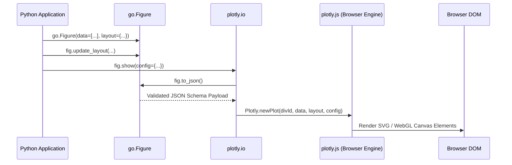
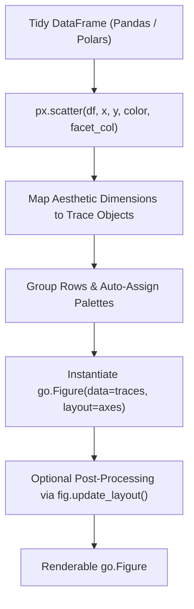
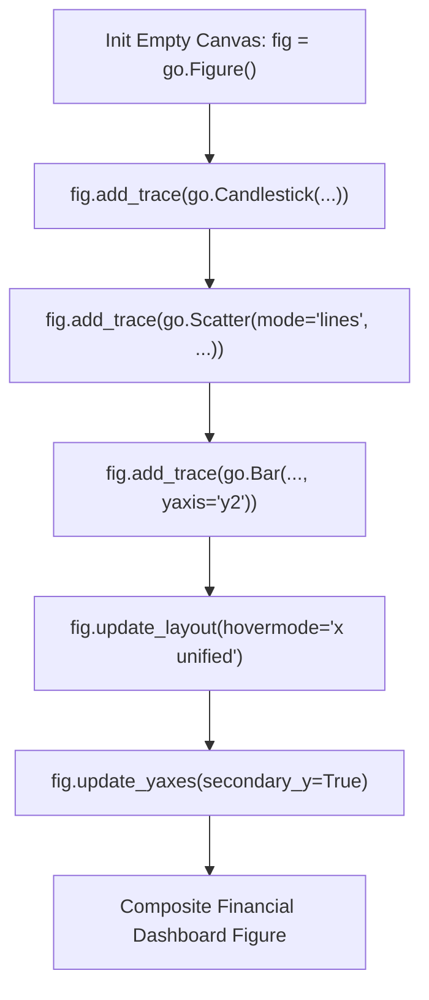
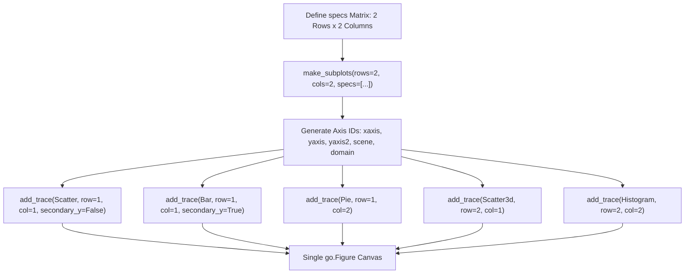
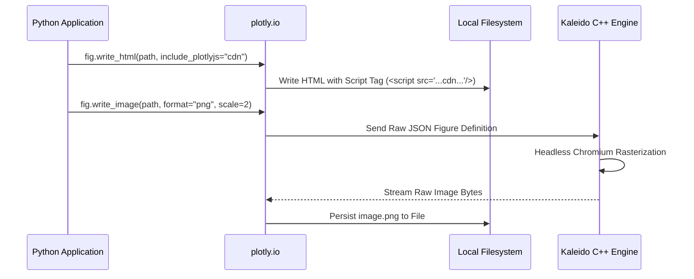

# Plotly

| Metadata      | Value                                                                        |
| ------------- | ---------------------------------------------------------------------------- |
| Author        | Lyzander Marciano Andrylie                                                   |
| Creation Date | Nov 8, 2026                                                                  |
| Last Updated  | Nov 8, 2026                                                                  |
| Repositories  | [plotly.py](https://github.com/plotly/plotly.py) (`packages/python/plotly/`) |

## References

- [Plotly Python Documentation](https://plotly.com/python/): Official guide and API documentation for `plotly.py`
- [The Figure Data Structure](https://plotly.com/python/figure-structure/): Structural specification of the `data`, `layout`, and `frames` JSON hierarchy
- [Plotly JavaScript Open Source Graphing Library](https://plotly.com/javascript/): Core declarative JavaScript rendering engine specification
- [Plotly Express API](https://plotly.com/python-api-reference/plotly.express.html): Functional API reference for high-level statistical plotting
- [plotly.graph_objects API](https://plotly.com/python-api-reference/plotly.graph_objects.html): Class hierarchy and schema validation reference
- [file_io.md](../../concept/python/file_io.md): Comprehensive guide to Python file I/O mechanisms, access modes, and durability
- [pathlib.md](./pathlib.md): Object-oriented filesystem path operations and integrated I/O helpers
- [matplotlib.md](./matplotlib.md): Foundational object-oriented 2D/3D plotting engine and Artist hierarchy
- [seaborn.md](./seaborn.md): High-level statistical visualization library built on Matplotlib
- [bokeh.md](./bokeh.md): Interactive browser-based visualization engine utilizing HTML5 Canvas and WebGL
- [pandas.md](./pandas.md): Tabular data structures integrated with Plotly Express
- [polars.md](./polars.md): Vectorized Apache Arrow DataFrame library natively accepted by Plotly Express

## Description

`plotly` (`plotly.py`) is an open-source, declarative charting library for Python that translates high-level programmatic data representations into JSON specifications rendered in the client via `plotly.js`. It exists to bridge computational Python workflows (NumPy, pandas, polars, Jupyter) with GPU/WebGL-accelerated, publication-grade interactive web graphics without requiring manual frontend coding or JavaScript boilerplate.

### Declarative Figure Schema (`data`, `layout`, `frames`)

Every visualization in Plotly resolves into a tree-structured JSON object adhering strictly to the `plotly.js` specification.

- [Figure Schema](https://plotly.com/python/figure-structure/): The foundational tripartite schema defining data series (`data`), canvas settings (`layout`), and temporal animation sequences (`frames`)

### Object-Oriented Class Hierarchy (`plotly.graph_objects`)

A typed Python object layer mapping one-to-one with the schema tree. It provides IDE autocompletion, schema validation, mutation methods (`add_trace`, `update_layout`), and attribute resolution via dot-notation and dictionary lookups.

- [plotly.graph_objects](https://plotly.com/python-api-reference/plotly.graph_objects.html): Classes subclassing `BasePlotlyType` for imperative, fine-grained figure construction

### Grammar of Graphics Wrapper (`plotly.express`)

A functional, terse API (`px`) that accepts tidy tabular data and automatically infers trace types, groupings, aesthetic color/symbol mappings, and layout coordinates before returning a fully materialized `graph_objects.Figure`.

- [plotly.express](https://plotly.com/python/plotly-express/): High-level functional entry point for rapid exploratory data analysis

### Serialization and Rendering Pipeline (`plotly.io`)

The subsystem governing figure input/output, notebook/browser display dispatch, JSON round-tripping, self-contained HTML generation, and static image rasterization via headless rendering engines.

- [plotly.io](https://plotly.com/python-api-reference/plotly.io.html): Rendering dispatchers, template registries, and image exporters (`kaleido`)

---

## Features

### 1. Underlying Figure Architecture and the Plotly.js Bridge

Every `plotly.graph_objects.Figure` is an in-memory Python tree that serializes into a standard JSON payload consumed by `plotly.js`. The JavaScript runtime calls `Plotly.newPlot(container, data, layout, config)` to render vector SVG or WebGL canvas layers in the DOM.

- **Top-Level Schema Keys**:
  - `data` (`list[dict]`): Sequence of visual traces (e.g., `scatter`, `bar`, `heatmap`). Each trace carries its own coordinates (`x`, `y`, `z`), styling (`marker`, `line`), and trace-specific flags (`mode`, `opacity`, `hoverinfo`).
  - `layout` (`dict`): Canvas-wide styling, including dimensions (`width`, `height`), coordinate systems (`xaxis`, `yaxis`, `scene`, `polar`), UI elements (`legend`, `annotations`, `shapes`), and display themes (`template`).
  - `frames` (`list[dict]`): Sequence of animated states altering `data` subsets or `layout` parameters over time.
- **Access Patterns**: Attributes can be accessed or modified via dot-notation (`fig.layout.title.text = "..."`), Python dictionary keys (`fig["layout"]["title"]["text"] = "..."`), or keyword constructors.
- **Magic Underscore Syntax**: Deeply nested keys can be assigned using snake_case double/single underscores as syntactic sugar (e.g., `title_font_size=16` equates to `title=dict(font=dict(size=16))`).
- **Configuration (`config`)**: Runtime browser behaviors passed to `plotly.js` via `show(config=...)` or `to_html(config=...)` without mutating the figure's data schema.

#### Common Plotly Runtime Configuration Options

| Config Parameter         | Type           | Default                          | Description                                                                    |
| :----------------------- | :------------- | :------------------------------- | :----------------------------------------------------------------------------- |
| `responsive`             | `bool`         | `False` / `True` (env-dependent) | Dynamically resizes plot when container DOM dimensions change                  |
| `displayModeBar`         | `bool` / `str` | `"hover"`                        | Controls mode bar visibility: `True`, `False`, or `"hover"`                    |
| `displaylogo`            | `bool`         | `True`                           | Displays the Plotly logo watermark on the mode bar                             |
| `scrollZoom`             | `bool`         | `False`                          | Enables mouse-wheel scrolling to zoom in/out on 2D axes                        |
| `modeBarButtonsToRemove` | `list[str]`    | `[]`                             | List of tool names to strip from the toolbar (e.g., `['lasso2d', 'select2d']`) |
| `toImageButtonOptions`   | `dict`         | `{}`                             | Format, dimensions, and filename when clicking the camera download icon        |

#### Interaction



#### Example

```python
import plotly.graph_objects as go

# Manual declarative construction mirrors raw JSON specification
figure_dict = {
    "data": [
        {
            "type": "scatter",
            "x": [1, 2, 3, 4],
            "y": [10, 11, 12, 13],
            "mode": "lines+markers",
            "name": "Series A",
            "line": {"color": "#1f77b4", "width": 2},
            "marker": {"size": 8, "symbol": "circle"},
        }
    ],
    "layout": {
        "title": {"text": "Declarative Architecture Demo"},
        "xaxis": {"title": {"text": "Step"}},
        "yaxis": {"title": {"text": "Value"}},
        "template": "plotly_white",
    },
}

# Instantiate figure from dictionary
fig = go.Figure(figure_dict)

# Inspect serialized JSON representation sent to plotly.js
json_payload = fig.to_json()
print('"type":"scatter"' in json_payload)  # Output: True
```

---

### 2. High-Level Statistical Plotting with Plotly Express (`px`)

`plotly.express` is a declarative, high-level interface designed for tidy (long-form) data structures where each row represents an observation and each column represents a variable.

- **Data Expectation**: Optimized for long-form `pandas.DataFrame` or `polars.DataFrame`. Wide-format data can be plotted by passing multiple column names to `y=['col_a', 'col_b']` or reshaping via `melt()`.
- **Aesthetic Mapping**: Maps tabular dimensions directly to visual properties: `color`, `symbol`, `size`, `facet_row`, `facet_col`, and `animation_frame`.
- **Automatic Output**: Every `px` function immediately returns a mutable `plotly.graph_objects.Figure`, allowing further low-level adjustments with `.update_*()` methods.
- **Customization Hooks**: `labels={'col_name': 'Display Name'}` renames axes and legend titles globally without modifying source dataframe columns.
- **Gotcha**: Using `px` on large datasets (>500,000 points) embeds all coordinates directly into the frontend JSON payload, causing browser memory bloat; downsample or switch to WebGL traces (`go.Scattergl`) for massive scale.

#### Plotly Express Visual Catalog

| Function          | Output Category    | Primary Use Case                       | Key Keyword Arguments                                |
| :---------------- | :----------------- | :------------------------------------- | :--------------------------------------------------- |
| `px.scatter()`    | 2D / 3D Points     | Correlations, clusters, bubbles        | `size`, `color`, `symbol`, `trendline`               |
| `px.line()`       | Continuous Series  | Time series, ordered trends            | `line_group`, `color`, `markers`                     |
| `px.bar()`        | Categorical Bars   | Comparisons, stacked totals            | `barmode` (`'group'`, `'stack'`, `'relative'`)       |
| `px.histogram()`  | Frequency / Bins   | Distributions, density checks          | `nbins`, `barnorm`, `histfunc`, `cumulative`         |
| `px.box()`        | Statistical Spread | Quartiles, outlier identification      | `points` (`'all'`, `'outliers'`, `False`), `notched` |
| `px.violin()`     | Density Spread     | Kernel density with box overlay        | `box=True`, `points='all'`, `violinmode`             |
| `px.imshow()`     | Matrix / Raster    | Heatmaps, correlation matrices, images | `color_continuous_scale`, `aspect`, `text_auto`      |
| `px.choropleth()` | Geographic Maps    | Regional metric shading                | `locations`, `locationmode`, `geojson`               |

#### Interaction



#### Example

```python
import pandas as pd
import plotly.express as px

# Sample tidy dataset
data = pd.DataFrame(
    {
        "quarter": ["Q1", "Q2", "Q3", "Q4"] * 3,
        "region": ["North"] * 4 + ["South"] * 4 + ["West"] * 4,
        "revenue": [120, 150, 180, 210, 90, 110, 130, 140, 200, 240, 260, 310],
        "profit_margin": [0.15, 0.18, 0.20, 0.22, 0.12, 0.14, 0.15, 0.16, 0.22, 0.25, 0.28, 0.30],
    }
)

# High-level declarative plot generation
fig = px.bar(
    data,
    x="quarter",
    y="revenue",
    color="region",
    barmode="group",
    facet_col="region",
    hover_data=["profit_margin"],
    labels={"revenue": "Revenue ($k)", "quarter": "Fiscal Quarter", "region": "Territory"},
    title="Quarterly Regional Performance",
    template="plotly_white",
)

# Chain low-level adjustment onto Plotly Express output
fig.update_yaxes(matches=None, showticklabels=True)
```

---

### 3. Imperative Composition with Graph Objects (`go`)

`plotly.graph_objects` exposes fine-grained control over individual traces and coordinate systems. It is the required API for heterogeneous composite charts (e.g., Candlestick with moving average lines and volume bars) and dynamic plotting in loops.

- **Trace Addition**: `fig.add_trace(trace)` appends a typed visual mark (`go.Scatter`, `go.Bar`, `go.Candlestick`, `go.Heatmap`) to the `data` list.
- **Bulk Trace Updates**: `fig.update_traces(patch, selector=...)` mutates attributes across all traces matching a criteria (e.g., `selector=dict(type='scatter')`).
- **Layout Updates**: `fig.update_layout(patch)` merges settings into the root `layout` dictionary without overwriting unaffected keys.
- **Axis Specific Updates**: `fig.update_xaxes()` and `fig.update_yaxes()` target one or multiple coordinate axes using selector filters.
- **In-Place Mutation**: `.update_*()` methods modify the underlying figure instance in place and return `self`, enabling functional method chaining.

#### Graph Objects Mutation Methods Reference

| Method             | Target            | Primary Purpose                     | Common Arguments                                           |
| :----------------- | :---------------- | :---------------------------------- | :--------------------------------------------------------- |
| `add_trace()`      | `data`            | Appends a single trace              | `trace`, `row=None`, `col=None`, `secondary_y=False`       |
| `add_traces()`     | `data`            | Appends a batch of traces           | `traces_list`, `rows=None`, `cols=None`                    |
| `update_traces()`  | Matching traces   | Modifies properties across traces   | `patch_dict`, `selector=dict(...)`, `row=None`, `col=None` |
| `update_layout()`  | `layout`          | Updates top-level canvas properties | `title`, `margin`, `hovermode`, `legend`, `template`       |
| `update_xaxes()`   | `layout.xaxis[N]` | Mutates 2D horizontal axes          | `title`, `range`, `showgrid`, `zeroline`, `type`           |
| `update_yaxes()`   | `layout.yaxis[N]` | Mutates 2D vertical axes            | `title`, `range`, `scaleanchor`, `secondary_y`             |
| `for_each_trace()` | Each trace        | Executes custom Python callback     | `fn` taking trace instance                                 |

#### Interaction



#### Example

```python
import plotly.graph_objects as go

# Initialize empty canvas
fig = go.Figure()

# 1. Primary financial candlestick trace
fig.add_trace(
    go.Candlestick(
        x=["2026-11-01", "2026-11-02", "2026-11-03", "2026-11-04"],
        open=[100, 104, 102, 108],
        high=[106, 107, 109, 112],
        low=[98, 101, 100, 106],
        close=[104, 102, 108, 110],
        name="Price OHLC",
    )
)

# 2. Overlay moving average trendline
fig.add_trace(
    go.Scatter(
        x=["2026-11-01", "2026-11-02", "2026-11-03", "2026-11-04"],
        y=[101, 103, 105, 107],
        mode="lines",
        line=dict(color="#ff7f0e", width=2),
        name="SMA-20",
    )
)

# 3. Fine-grained layout customisation with method chaining
fig.update_layout(
    title="Asset Price Action with Trend Overlay",
    xaxis_title="Trading Day",
    yaxis_title="Asset Price (USD)",
    xaxis_rangeslider_visible=False,
    hovermode="x unified",
    template="plotly_dark",
    legend=dict(orientation="h", yanchor="bottom", y=1.02, xanchor="right", x=1),
)
```

---

### 4. Subplots, Secondary Axes, and Multi-Panel Layouts

Complex multi-chart figures require grid coordinate systems managed by `plotly.subplots.make_subplots`. This utility allocates layout domain spaces and wires secondary or independent axis identifiers (`xaxis2`, `yaxis2`, etc.) behind the scenes.

- **1-Based Coordinate Indexing**: Subplot cells are addressed using 1-based indexing (`row=1, col=1`), not 0-based indexing.
- **Domain Coordinate Allocation**: Plotly normalizes canvas space into `[0.0, 1.0]` domain coordinates; `make_subplots` computes the `domain: [min, max]` bounding box for each row/column.
- **Heterogeneous Subplots (`specs`)**: Mixing different trace types (e.g., standard cartesian 2D, 3D scenes, polar coordinates, geographic maps, domain-bound pie charts) requires an explicit `specs` matrix.
- **Shared Axes**: Setting `shared_xaxes=True` or `shared_yaxes=True` locks zooming/panning across panels and strips redundant tick labels from interior cells.
- **Secondary Y-Axis**: Setting `{"secondary_y": True}` inside `specs` creates dual independent y-axes sharing the same x-axis domain.

#### Subplot `specs` Type Reference

| `specs` Cell Type    | Backing Coordinates    | Trace Compatibility                                | Internal Axis Keys         |
| :------------------- | :--------------------- | :------------------------------------------------- | :------------------------- |
| `"xy"` (default)     | 2D Cartesian           | `scatter`, `bar`, `histogram`, `box`               | `xaxis[N]`, `yaxis[N]`     |
| `"scene"`            | 3D Cartesian           | `scatter3d`, `surface`, `mesh3d`                   | `scene[N]`                 |
| `"polar"`            | Polar Coordinate       | `scatterpolar`, `barpolar`                         | `polar[N]`                 |
| `"ternary"`          | Ternary Triangle       | `scatterternary`                                   | `ternary[N]`               |
| `"mapbox"` / `"geo"` | Geospatial Projections | `scattermapbox`, `choropleth`                      | `mapbox[N]`, `geo[N]`      |
| `"domain"`           | Dedicated Bounding Box | `pie`, `donut`, `sunburst`, `treemap`, `indicator` | Bounded via trace `domain` |

#### Interaction



#### Example

```python
import plotly.graph_objects as go
from plotly.subplots import make_subplots

# Allocate a 2x2 grid with heterogeneous plot types
fig = make_subplots(
    rows=2,
    cols=2,
    specs=[
        [{"secondary_y": True}, {"type": "domain"}],
        [{"type": "xy"}, {"type": "xy"}],
    ],
    subplot_titles=(
        "Dual-Axis Metrics",
        "Category Breakdown",
        "Linear Regression Fit",
        "Residual Distribution",
    ),
    vertical_spacing=0.15,
    horizontal_spacing=0.12,
)

# Panel (1, 1): Primary line and secondary bar chart
fig.add_trace(
    go.Scatter(x=[1, 2, 3], y=[40, 50, 60], name="Primary Trend"),
    row=1,
    col=1,
    secondary_y=False,
)
fig.add_trace(
    go.Bar(x=[1, 2, 3], y=[1000, 1500, 1200], name="Volume", opacity=0.4),
    row=1,
    col=1,
    secondary_y=True,
)

# Panel (1, 2): Domain-type Donut chart
fig.add_trace(
    go.Pie(labels=["Alpha", "Beta", "Gamma"], values=[55, 25, 20], hole=0.4),
    row=1,
    col=2,
)

# Panel (2, 1): Standard 2D scatter
fig.add_trace(
    go.Scatter(x=[10, 20, 30], y=[15, 28, 42], mode="markers", name="Observed"),
    row=2,
    col=1,
)

# Panel (2, 2): Residual histogram
fig.add_trace(
    go.Histogram(x=[1.1, 1.2, 1.2, 1.5, 1.8, 2.0], name="Residuals"),
    row=2,
    col=2,
)

# Update layout across entire multi-panel canvas
fig.update_layout(
    height=750,
    title_text="Heterogeneous Multi-Panel Analytics Dashboard",
    template="plotly_white",
    showlegend=False,
)
```

---

### 5. Serialization, I/O, and Headless Static Export (`plotly.io`)

The `plotly.io` module handles rendering dispatch to various IDE and browser environments, serialization to/from disk or network payloads, and headless rasterization to vector/bitmap graphics via Kaleido.

- **Renderer Selection**: `pio.renderers.default` determines how `fig.show()` displays figures (e.g., `'browser'`, `'notebook'`, `'colab'`, `'vscode'`, `'json'`).
- **Interactive HTML Delivery**: `fig.write_html()` generates self-contained interactive files. The `include_plotlyjs` parameter manages bundle size vs offline portability.
- **Headless Static Export**: `fig.write_image()` utilizes `kaleido` (a Chromium-based C++ standalone executable) to render figures into `png`, `jpeg`, `svg`, `webp`, or `pdf` without requiring an active browser or X11/Wayland display server.
- **Lossless Serialization**: `fig.to_json()` and `pio.from_json()` enable lossless network transmission and database storage of exact figure states.
- **Gotcha**: Using `include_plotlyjs=True` embeds the entire ~3.5MB `plotly.js` library into every exported `.html` file. For web apps or automated report generators, set `include_plotlyjs='cdn'` to drop output sizes to tens of kilobytes.

#### Interactive HTML Export Modes (`fig.write_html`)

| `include_plotlyjs` Option | Generated File Size | Internet Access Required?        | Best Used For                                       |
| :------------------------ | :------------------ | :------------------------------- | :-------------------------------------------------- |
| `True` (default)          | ~3.5 MB             | No (Fully Offline)               | Air-gapped environments, standalone file sharing    |
| `'cdn'`                   | ~20 KB – 100 KB     | Yes (Loads `plotly.js` from CDN) | Web server static hosting, email attachments        |
| `'directory'`             | ~20 KB              | No (Loads local `plotly.min.js`) | Local documentation sites, multi-page reports       |
| `False`                   | Smallest (~10 KB)   | Depends on host page             | Embedded `<div>` snippets inside Flask/Django/React |

#### Interaction



#### Example

```python
from pathlib import Path
import plotly.graph_objects as go
import plotly.io as pio

# Construct simple figure
fig = go.Figure(data=go.Scatter(x=[1, 2, 3], y=[4, 5, 6], mode="lines+markers"))
fig.update_layout(title="Export Demonstration", template="plotly_white")

output_dir = Path("exports")
output_dir.mkdir(parents=True, exist_ok=True)

# 1. Export lightweight interactive HTML via CDN script tag
html_file = output_dir / "report.html"
fig.write_html(
    str(html_file),
    include_plotlyjs="cdn",
    full_html=True,
    config={"responsive": True, "displayModeBar": True},
)

# 2. Export lossless JSON schema for caching or REST microservice transmission
json_file = output_dir / "figure.json"
json_str = fig.to_json()
json_file.write_text(json_str, encoding="utf-8")

# Restore figure from stored JSON
restored_fig = pio.from_json(json_file.read_text(encoding="utf-8"))

# 3. Headless static image rasterization (requires 'kaleido' package)
try:
    fig.write_image(str(output_dir / "chart.png"), format="png", width=1200, height=800, scale=2)
    fig.write_image(str(output_dir / "chart.svg"), format="svg")
except ValueError as exc:
    # Kaleido package missing from current Python environment
    print(f"Static image export requires kaleido: {exc}")
```
