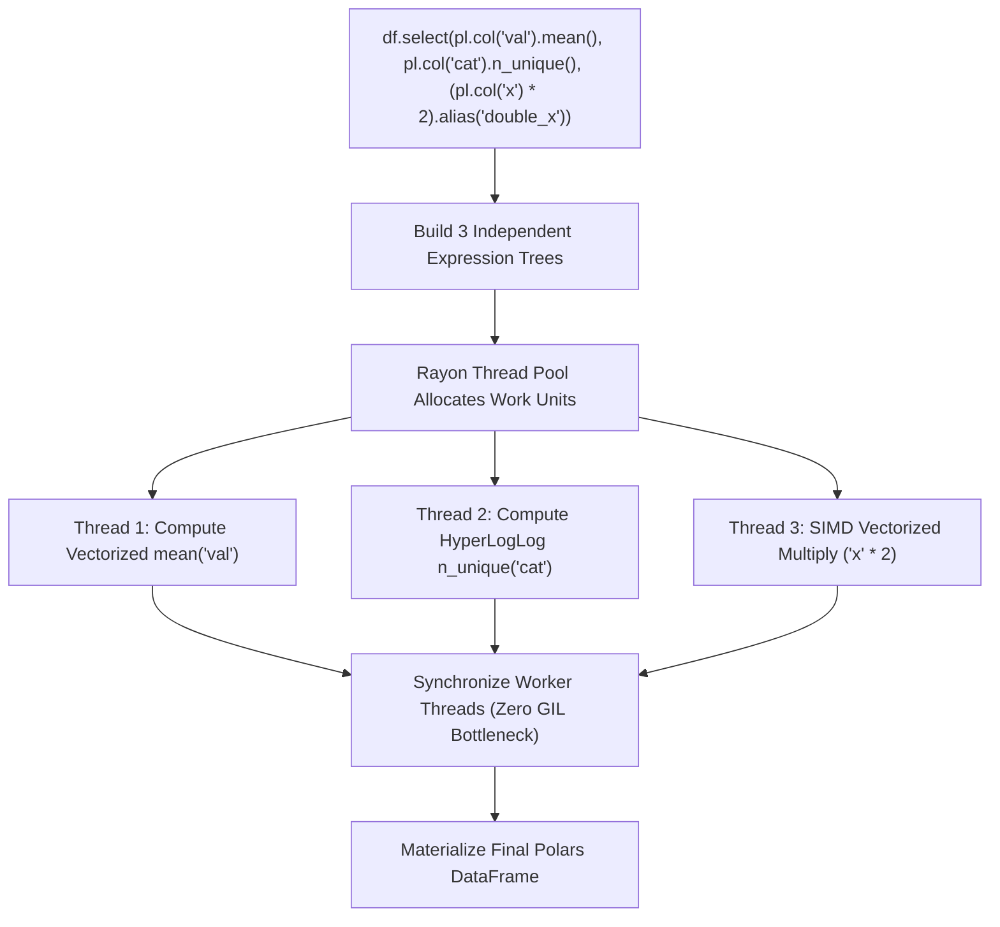
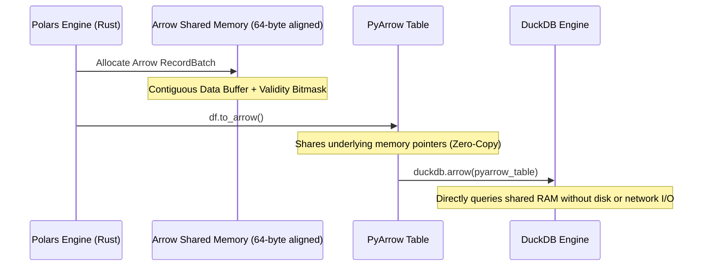
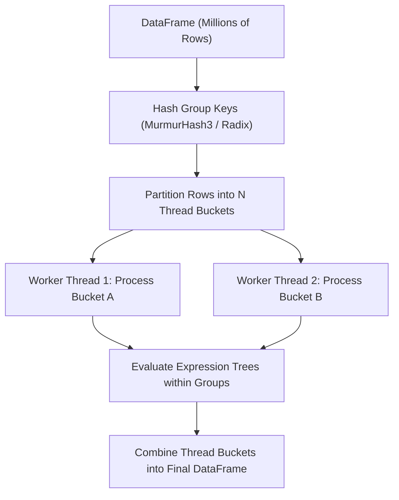
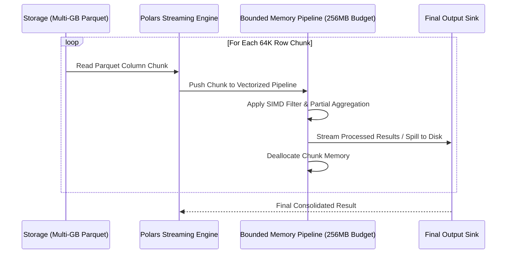
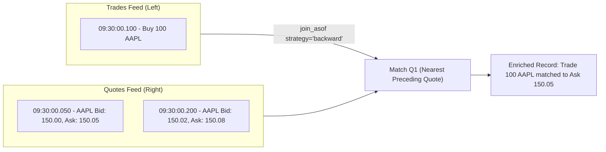

```mermaid
flowchart TD
    subgraph Unoptimized["Unoptimized User Query"]
        U1["pl.scan_parquet('100GB_dataset.parquet')"] --> U2["Load All 50 Columns & 1 Billion Rows"]
        U2 --> U3["Filter: amount > 500"]
        U3 --> U4["Select: category, amount"]
    end

    subgraph Optimized["Polars Optimized Physical Plan"]
        O1["Read Parquet Metadata (Row Groups)"] --> O2["Projection Pushdown: Read only 'amount' and 'category' columns"]
        O2 --> O3["Predicate Pushdown: Skip Parquet Row Groups where max(amount) <= 500"]
        O3 --> O4["Parallel SIMD Filter on Remaining Chunks"]
        O4 --> O5["Materialize Output (Consuming Megabytes Instead of 100GB)"]
    end
```

# Polars

| Metadata      | Value                                                              |
| ------------- | ------------------------------------------------------------------ |
| Author        | Lyzander Marciano Andrylie                                         |
| Creation Date | Nov 8, 2026                                                        |
| Last Updated  | Nov 8, 2026                                                        |
| Repositories  | [pola-rs/polars](https://github.com/pola-rs/polars) (`py-polars/`) |

## References

- [Polars User Guide](https://docs.pola.rs/): Official user guide, expression reference, and tutorials
- [Polars Rust API Documentation](https://docs.rs/polars/): Underlying Rust engine crate architecture, vector kernels, and memory model
- [Apache Arrow Columnar Format Specification](https://arrow.apache.org/docs/format/Columnar.html): Physical memory layout standard natively implemented by Polars
- [pandas.md](./pandas.md): Classical Python DataFrame library built on NumPy and BlockManager
- [duckdb.md](./duckdb.md): Embedded in-process columnar SQL OLAP database with zero-copy Arrow interop
- [pathlib.md](./pathlib.md): Object-oriented filesystem path operations used in Parquet and IPC streaming
- [plotly.md](./plotly.md): Declarative interactive graphing alternative directly accepting Polars DataFrames
- [matplotlib.md](./matplotlib.md): Foundational 2D/3D plotting engine
- [seaborn.md](./seaborn.md): Statistical visualization library

## Description

`polars` is an ultra-fast, multi-threaded DataFrame library written in Rust and built directly on the Apache Arrow Columnar Format. It operates via an advanced query engine featuring lazy evaluation, query optimization (predicate and projection pushdown), and out-of-core streaming execution. It exists to eliminate Python single-threaded CPU bottlenecks and memory explosion issues when processing multi-gigabyte to terabyte tabular datasets.

### Rust Core and Vectorized Arrow Engine (`polars-core`, `polars-arrow`)

The low-level systems layer written in Rust. It manages 64-byte aligned contiguous memory allocations, SIMD (Single Instruction, Multiple Data) vectorized kernels, and null bitmask representations matching the Apache Arrow specification.

- [polars-core](https://docs.rs/polars-core/): In-memory data structures including `DataFrame`, `Series`, and columnar `ChunkedArray`
- [polars-arrow](https://docs.rs/polars-arrow/): Direct integration with Apache Arrow arrays, memory buffers, and compute kernels

### Lazy Evaluation and Query Optimizer (`polars-lazy`, `polars-plan`)

The declarative execution planner. It translates user queries into a Directed Acyclic Graph (DAG) of logical operations (`LazyFrame`), applying multi-pass query optimization rules before executing code.

- [polars-lazy](https://docs.rs/polars-lazy/): Query compilation pipeline and logical-to-physical plan transformation
- [polars-plan](https://docs.rs/polars-plan/): Query optimization passes including predicate pushdown, projection pushdown, and common subplan elimination

### Expression Execution Engine (`polars-expr`, `polars-pipe`)

The mathematical evaluation subsystem centered around `pl.col()`. It treats data transformations as pure expression trees that compile into parallel Rayon worker threads without invoking the Python Global Interpreter Lock (GIL).

- [polars-expr](https://docs.rs/polars-expr/): Composable expression compiler and execution kernels

### Out-of-Core Streaming Engine (`polars-stream`, `polars-pipe`)

A streaming execution engine that processes datasets in bounded memory chunks. It enables scanning and aggregating datasets that exceed physical system RAM without triggering Out-Of-Memory (OOM) crashes.

- [polars-pipe](https://docs.rs/polars-pipe/): Pipelined streaming operators for chunked joins, sorts, and group-by aggregations

### Multi-Format I/O and File Scanners (`polars-io`)

High-throughput parallel readers and writers for Parquet, IPC/Arrow, CSV, and Delta Lake formats.

- [polars-io](https://docs.rs/polars-io/): Multi-threaded I/O drivers featuring cloud-native object storage integration and metadata-level row-group pruning

### Python FFI Bridge (`py-polars`)

The zero-overhead PyO3 C-ABI bridge exposing the compiled Rust engine as an idiomatic Python package with zero-copy NumPy and PyArrow sharing.

- [py-polars](https://github.com/pola-rs/polars/tree/main/py-polars): Python bindings and type hints

---

## Features

### 1. Expressions-First Architecture (`pl.col`) and Parallel Execution

Polars structures data manipulations as **Expressions** (`pl.Expr`). An expression is a declarative computation tree that produces a series of outputs given an input context.

- **Complete Decoupling of Logic and Data**: In Pandas, writing `df["a"] + df["b"]` immediately allocates an in-memory series. In Polars, `pl.col("a") + pl.col("b")` creates an abstract expression tree with zero memory allocation.
- **Horizontal Parallelism**: Every expression specified inside a `.select()` or `.with_columns()` block is embarrassingly parallel. Polars compiles expressions into independent Rayon work items executed concurrently across all available CPU threads.
- **No Row-by-Row Iteration**: Polars strictly eliminates `for` loop iteration and row-level `apply()`. All transformations are expressed through vectorized SIMD expression trees.
- **Contexts**: Expressions execute inside one of three foundational contexts:
  - **Selection (`select`, `with_columns`)**: Operates across columns independently.
  - **Filtering (`filter`)**: Evaluates a boolean expression to produce a filter mask.
  - **Aggregation (`group_by().agg()`)**: Evaluates expressions over partitions.

#### Core Polars Expression Contexts

| Context Method              | Role                                                         | Output Column Cardinality     | Parallelism                       |
| :-------------------------- | :----------------------------------------------------------- | :---------------------------- | :-------------------------------- |
| `df.select(...)`            | Projects and computes new columns; drops unmentioned columns | Length of DataFrame or scalar | Fully parallel across expressions |
| `df.with_columns(...)`      | Appends or overwrites columns; retains all existing columns  | Length of DataFrame or scalar | Fully parallel across expressions |
| `df.filter(...)`            | Filters rows based on boolean predicate expression           | Retains matching row subset   | Multi-threaded mask evaluation    |
| `df.group_by(...).agg(...)` | Aggregates expressions within categorical partitions         | One row per unique group key  | Parallel partitioned hash-table   |

#### Interaction



#### Example

```python
import polars as pl

# Instantiate Polars DataFrame directly
df = pl.DataFrame(
    {
        "transaction_id": [101, 102, 103, 104, 105],
        "category": ["electronics", "clothing", "electronics", "groceries", "clothing"],
        "amount": [299.99, 45.50, 899.00, 12.30, 85.00],
        "customer_age": [28, 45, 34, 62, 23],
    }
)

# Parallel execution across expressions with conditional logic
result = df.select(
    # Simple projection and scalar alias
    pl.col("transaction_id"),
    # Vectorized arithmetic
    (pl.col("amount") * 1.08).alias("amount_with_tax"),
    # Composable conditional expression
    pl.when(pl.col("amount") > 100)
    .then(pl.lit("High Value"))
    .otherwise(pl.lit("Standard"))
    .alias("tier"),
    # String manipulation
    pl.col("category").str.to_uppercase().alias("category_upper"),
)

print(result)
```

---

### 2. LazyFrame and Logical Query Optimization

Polars provides a dual API: eager execution (`pl.DataFrame`) and lazy execution (`pl.LazyFrame`). In lazy mode, queries are converted into an execution plan optimized prior to execution.

- **Query Optimization Passes**:
  - **Predicate Pushdown**: Moves filter operations as close to the data source as possible. When scanning Parquet files, filters are pushed directly into file metadata headers, skipping entire row groups that do not match the predicate.
  - **Projection Pushdown**: Inspects the final expression requirements and instructs file scanners to only read the necessary columns from disk, completely ignoring unneeded columns.
  - **Slice Pushdown**: Pushes `limit()` or `head()` operations into the scanner to avoid loading remaining rows.
  - **Common Subplan Elimination**: Identifies duplicate sub-trees in a query and computes them once.
- **Eager vs. Lazy Constructors**:
  - Eager: `pl.read_parquet()`, `pl.read_csv()` (loads immediately into memory).
  - Lazy: `pl.scan_parquet()`, `pl.scan_csv()` (instantaneous; returns a query plan).
- **Plan Inspection**: Developers can inspect the logical plan via `lazy_frame.explain()` to verify that filters and column projections are being pushed down to disk I/O.
- **Materialization**: Triggered only upon invoking `.collect()`.

#### Polars Query Optimization Engine Passes

| Optimization Pass       | Mechanism                                                       | Performance Impact                                             |
| :---------------------- | :-------------------------------------------------------------- | :------------------------------------------------------------- |
| **Predicate Pushdown**  | Pushes `pl.col('x') > 50` down into the storage scanner         | Skips disk I/O and deserialization for non-matching row groups |
| **Projection Pushdown** | Only loads columns explicitly referenced in downstream code     | Reduces memory footprint and disk read volume proportionally   |
| **Slice Pushdown**      | Halts scanning once requested row count (`limit(N)`) is reached | Avoids scanning entire multi-gigabyte files for small samples  |
| **Type Coercion**       | Determines minimal lossless numeric representations             | Avoids unnecessary 64-bit conversions when 32-bit suffices     |

#### Interaction



#### Example

```python
import polars as pl
from pathlib import Path

# Create temporary parquet file for demonstration
data_path = Path("telemetry_sample.parquet")
pl.DataFrame(
    {
        "device_id": [f"D{i%5}" for i in range(1000)],
        "metric_val": [i * 1.5 for i in range(1000)],
        "unused_large_col": ["placeholder_data" for _ in range(1000)],
    }
).write_parquet(data_path)

# Build Lazy query plan (Instantaneous, zero disk I/O)
lazy_query = (
    pl.scan_parquet(data_path)
    .filter(pl.col("device_id") == "D0")
    .select(["device_id", "metric_val"])
)

# Inspect query plan to confirm projection and predicate pushdown
print(lazy_query.explain())

# Materialize optimized result
collected_df = lazy_query.collect()
print(collected_df)

data_path.unlink()
```

---

### 3. Native Apache Arrow Memory Layout and Zero-Copy Interoperability

Polars stores all data in memory conforming strictly to the **Apache Arrow Columnar Format Specification**.

- **Contiguous Buffer Alignment**: Data buffers are allocated as 64-byte aligned contiguous memory slabs, optimized for modern CPU cache lines and SIMD vector instructions (AVX-512, AVX2, NEON).
- **Validity Bitmasks for Null Tracking**:
  - Missing data is tracked using a separate bitmask array (1 bit per row), completely decoupled from the data array.
  - Unlike NumPy, an integer column with missing values is **never cast to float64**. An `Int64` column with nulls remains `Int64`.
  - Polars uses a single unified `null` representation, completely avoiding the `NaN` vs. `None` ambiguity present in classical Python data tools.
- **Zero-Copy Exchange**:
  - Apache Arrow memory buffers can be shared with PyArrow, DuckDB, and other Arrow-compatible systems via the Arrow C Data Interface without copying a single byte of memory.
  - Converting non-null numerical columns to NumPy (`to_numpy()`) is a zero-copy operation that reuses the underlying pointer.

#### Memory Architecture: Polars (Arrow) vs. Pandas (NumPy)

| Dimension            | Polars (Apache Arrow)                              | Pandas (NumPy Backend)                                     |
| :------------------- | :------------------------------------------------- | :--------------------------------------------------------- |
| **Memory Standard**  | Standardized Apache Arrow Columnar Format          | Proprietary 2D NumPy ndarrays (`BlockManager`)             |
| **Missing Values**   | 1-bit validity bitmap; preserves integer dtypes    | `np.nan` IEEE floating point (casts integers to `float64`) |
| **String Storage**   | Single contiguous UTF-8 buffer + 32/64-bit offsets | Array of individual 64-bit Python `PyObject*` pointers     |
| **Memory Alignment** | 64-byte aligned (Direct SIMD execution)            | Variable memory alignment                                  |
| **Interoperability** | Zero-copy Arrow C Data Interface                   | Requires memory copying and translation                    |

#### Interaction



#### Example

```python
import polars as pl
import pyarrow as pa

# Polars DataFrame with missing values across integer and string columns
df = pl.DataFrame(
    {
        "id": [1, 2, None, 4],
        "label": ["alpha", None, "gamma", "delta"],
    }
)

# Verify schema and null count across types
print(df.schema)
# Output: OrderedDict([('id', Int64), ('label', String)])

# Zero-copy export to Apache Arrow Table and back into Polars
arrow_table = df.to_arrow()
restored_df = pl.from_arrow(arrow_table)
print(restored_df)
```

---

### 4. High-Throughput Aggregations and GroupBy Mechanics

Polars implements lock-free parallel radix hash tables for its GroupBy engine.

- **Parallel Partitioned Hash Tables**: GroupBy keys are hashed across multiple parallel threads into distinct buckets, preventing thread contention without using global mutexes.
- **Nested Expression Aggregation**: Polars allows applying arbitrary complex expression logic **inside** aggregation blocks without requiring temporary subqueries or row looping:
  ```python
  df.group_by("group").agg(
      pl.col("val").filter(pl.col("val") > 0).mean().alias("positive_mean"),
      pl.col("status").sort_by("timestamp").last().alias("latest_status"),
  )
  ```
- **Preserving Group Order**: By default, Polars uses `group_by(maintain_order=False)` for maximum parallel hash aggregation speed. If deterministic input row order must be preserved, setting `maintain_order=True` enforces sequential ordering at a slight performance cost.
- **Dynamic & Rolling Grouping**:
  - `group_by_dynamic`: Bins timestamps into non-overlapping or sliding calendar windows.
  - `group_by_rolling`: Slides a continuous window over ordered time series.

#### GroupBy Methods Comparison

| Aggregation Method         | Strategy                            | Key Parameters                              | Best Use Case                                               |
| :------------------------- | :---------------------------------- | :------------------------------------------ | :---------------------------------------------------------- |
| `df.group_by(...)`         | Parallel hash table aggregation     | `maintain_order=False`                      | Standard high-throughput discrete categorical rollups       |
| `df.group_by_dynamic(...)` | Calendar window partitioning        | `index_column`, `every`, `period`, `offset` | Temporal downsampling (e.g., 5-minute financial bars)       |
| `df.group_by_rolling(...)` | Continuous sliding window per group | `index_column`, `period`                    | Rolling statistics evaluated across non-uniform time series |

#### Interaction



#### Example

```python
import polars as pl

# Synthesize sales dataset
sales = pl.DataFrame(
    {
        "region": ["East", "West", "East", "West", "East", "West"],
        "product": ["Widget", "Widget", "Gadget", "Gadget", "Widget", "Gadget"],
        "revenue": [200.0, 150.0, 300.0, 450.0, 220.0, 100.0],
        "quantity": [10, 8, 15, 20, 11, 5],
    }
)

# Advanced multi-expression parallel group aggregation
aggregated = sales.group_by(["region", "product"]).agg(
    # Basic reductions
    pl.col("revenue").sum().alias("total_rev"),
    pl.col("quantity").mean().alias("avg_qty"),
    # Filtered aggregation evaluated directly inside the group
    pl.col("revenue").filter(pl.col("quantity") > 10).sum().alias("bulk_rev"),
    # Ratio calculation
    (pl.col("revenue").sum() / pl.col("quantity").sum()).alias("unit_price"),
)

print(aggregated)
```

---

### 5. Out-of-Core Streaming Engine for Larger-Than-RAM Datasets

Polars contains an out-of-core **Streaming Engine** that executes queries on datasets too large to fit in physical RAM.

- **Chunked Pipelining**: When invoking `.collect(streaming=True)`, Polars partitions the query execution plan into small, fixed-size batches (typically 65,536 rows per chunk).
- **Constant Memory Footprint**: Chunks are streamed through parallel operators (filters, projections, hash aggregations) without loading the entire dataset into memory.
- **Disk Spilling**: For operations that require accumulating data (such as sorts and joins), the streaming engine spills intermediate partition buckets to temporary disk files if memory usage exceeds configured limits.
- **Ideal Input Format**: Works most efficiently when combined with column-chunked file formats like **Apache Parquet**, where metadata enables parallel chunk decompression.

#### In-Memory vs. Streaming Execution

| Feature               | In-Memory (`collect()`)                                       | Streaming Engine (`collect(streaming=True)`)                    |
| :-------------------- | :------------------------------------------------------------ | :-------------------------------------------------------------- |
| **Memory Limit**      | Bound by physical system RAM                                  | Bound only by available disk space for spillover                |
| **Batch Size**        | Entire dataset materialized at once                           | Fixed pipeline batches (e.g., 64K rows)                         |
| **Max Dataset Scale** | Typically $\le \frac{1}{2}$ to $\frac{1}{3}$ of available RAM | Multi-hundred gigabytes on modest hardware                      |
| **Operator Support**  | 100% of Polars expressions and functions                      | Core relational operators (Scan, Filter, Select, GroupBy, Join) |

#### Interaction



#### Example

```python
import polars as pl
from pathlib import Path

# Setup simulated streaming dataset
parquet_file = Path("streaming_source.parquet")
pl.DataFrame(
    {
        "id": range(100_000),
        "sensor_reading": [i * 0.05 for i in range(100_000)],
        "status": ["OK" if i % 2 == 0 else "WARN" for i in range(100_000)],
    }
).write_parquet(parquet_file)

# Build query plan
streaming_pipeline = (
    pl.scan_parquet(parquet_file)
    .filter(pl.col("status") == "OK")
    .group_by("status")
    .agg(
        pl.col("sensor_reading").mean().alias("mean_reading"),
        pl.col("sensor_reading").max().alias("max_reading"),
    )
)

# Execute query using the bounded-memory streaming engine
streaming_result = streaming_pipeline.collect(streaming=True)
print(streaming_result)
parquet_file.unlink()
```

---

### 6. Fast Joins and Time-Series Windowing (As-Of Joins)

Polars features an optimized relational joining engine and specialized time-series alignment tools.

- **Hash Join Types**: `inner`, `left`, `outer`, `semi` (returns rows from left matching right without duplicating columns), `anti` (returns rows from left with no match in right), and `cross`.
- **As-Of Joins (`join_asof`)**:
  - Aligns two sorted time series on temporal proximity rather than exact key equality.
  - Matches each row in the left DataFrame with the nearest preceding or following row in the right DataFrame based on a timestamp column.
  - Supports tolerance intervals (e.g., `tolerance="50ms"`), guaranteeing that matches exceeding the threshold are assigned `null`.
  - Essential for quantitative finance (matching trade executions to the prevailing order-book quote) and IoT telemetry (synchronizing asynchronous sensor feeds).
- **Coordinated Grouping Keys**: `by=` argument in `join_asof` ensures proximity matching occurs strictly within matching categorical entities (e.g., matching trades to quotes for the same stock ticker).

#### Polars Join Types Overview

| Join Type        | Behavior                                                       | Complexity    | Primary Use Case                                       |
| :--------------- | :------------------------------------------------------------- | :------------ | :----------------------------------------------------- |
| `how="inner"`    | Retains rows matching in both frames                           | $O(N + M)$    | Strict relational intersection                         |
| `how="left"`     | Retains all left rows; fills missing right with null           | $O(N + M)$    | Standard table enrichment                              |
| `how="semi"`     | Retains left rows that have a match in right (no column merge) | $O(N + M)$    | Fast membership filtering                              |
| `how="anti"`     | Retains left rows that have NO match in right                  | $O(N + M)$    | Identifying missing records / orphan keys              |
| `join_asof(...)` | Matches nearest temporal record within tolerance window        | $O(N \log M)$ | Asynchronous sensor and financial tick synchronization |

#### Interaction



#### Example

```python
import polars as pl

# High-frequency trade events
trades = pl.DataFrame(
    {
        "time": [1000, 1050, 1200],  # Millisecond timestamps
        "ticker": ["AAPL", "AAPL", "AAPL"],
        "trade_price": [150.25, 150.30, 150.45],
    }
).sort("time")

# Asynchronous market quotes
quotes = pl.DataFrame(
    {
        "time": [980, 1040, 1150],  # Millisecond timestamps
        "ticker": ["AAPL", "AAPL", "AAPL"],
        "bid": [150.20, 150.25, 150.40],
        "ask": [150.25, 150.30, 150.45],
    }
).sort("time")

# Align trades to prevailing quotes using an As-Of Join
enriched_trades = trades.join_asof(
    quotes,
    on="time",
    by="ticker",
    strategy="backward",  # Match quote immediately preceding trade
    tolerance=100,        # Maximum allowable time delta in ms
)

print(enriched_trades)
```
