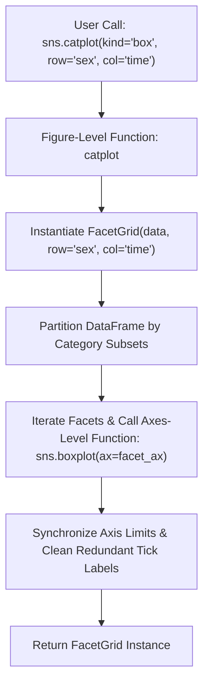
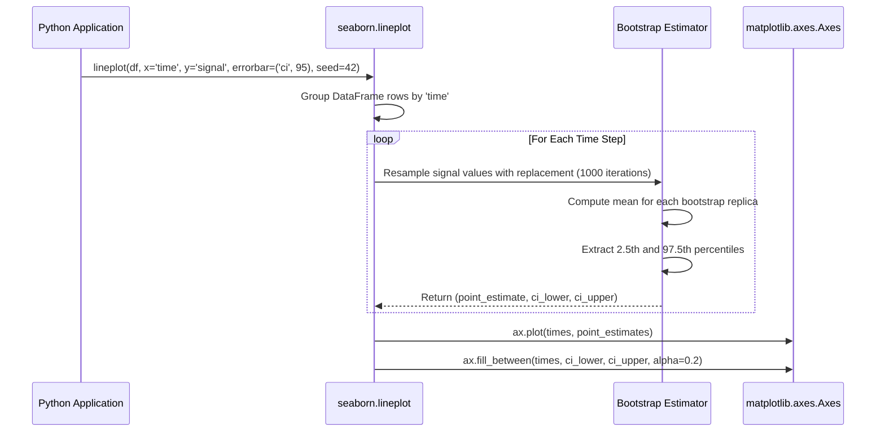
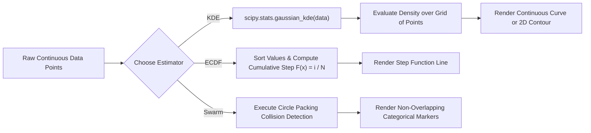
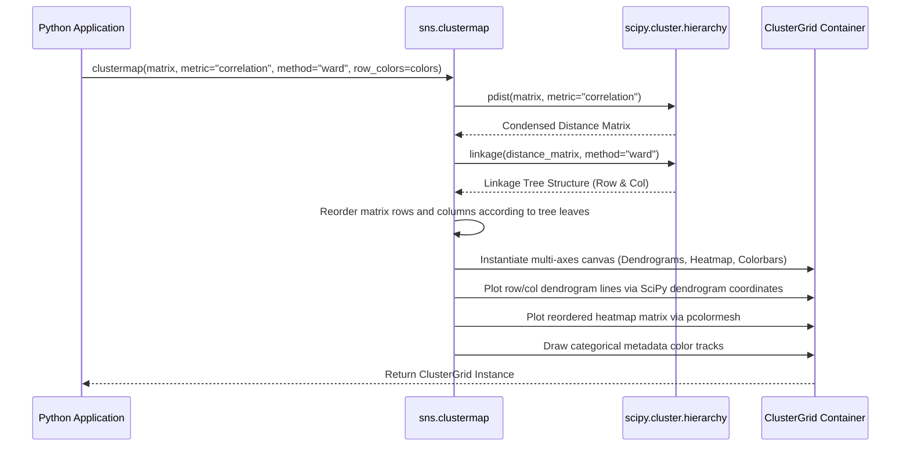
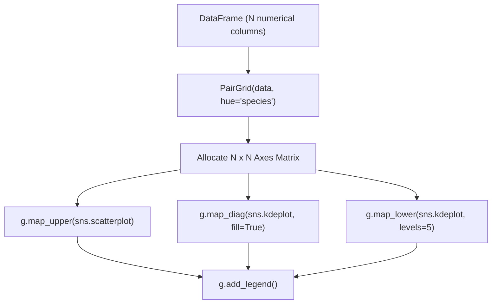
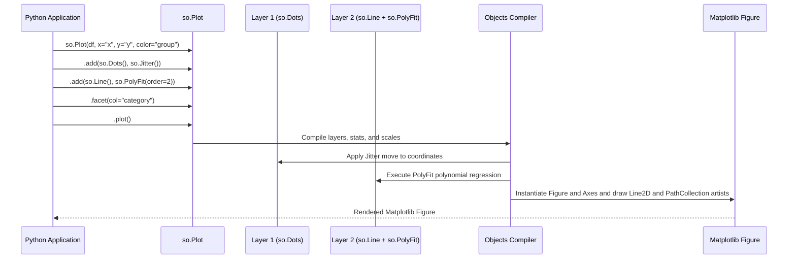

# Seaborn

| Metadata      | Value                                                              |
| ------------- | ------------------------------------------------------------------ |
| Author        | Lyzander Marciano Andrylie                                         |
| Creation Date | Nov 8, 2026                                                        |
| Last Updated  | Nov 8, 2026                                                        |
| Repositories  | [mwaskom/seaborn](https://github.com/mwaskom/seaborn) (`seaborn/`) |

## References

- [Seaborn Documentation](https://seaborn.pydata.org/): Official statistical visualization guides, tutorials, and API reference
- [Overview of Seaborn Plotting Functions](https://seaborn.pydata.org/tutorial/function_overview.html): Comprehensive architectural guide on figure-level versus axes-level paradigms
- [Statistical Estimation and Error Bars](https://seaborn.pydata.org/tutorial/error_bars.html): Reference on bootstrap confidence intervals, standard error, and parametric spread
- [The Seaborn Objects Interface](https://seaborn.pydata.org/tutorial/objects_interface.html): Declarative grammar of graphics specification for composable visualization
- [matplotlib.md](./matplotlib.md): Foundational low-level plotting engine and Artist hierarchy powering Seaborn
- [plotly.md](./plotly.md): Declarative interactive web graphing alternative powered by Plotly.js
- [bokeh.md](./bokeh.md): Interactive browser-based visualization engine utilizing HTML5 Canvas and WebGL

## Description

`seaborn` is an open-source, high-level statistical data visualization library for Python built directly on top of Matplotlib and tightly integrated with pandas DataFrames. It abstracts imperative Artist construction and manual coordinate transformations into declarative plotting functions that automatically execute statistical aggregations, compute parametric and bootstrapped confidence intervals, fit regression models, and structure complex multi-panel facet grids.

### Relational Plotting Engine (`seaborn.relational`)

Visualizes bivariate continuous relationships and longitudinal trends across semantic groupings. It provides line plots with automated bootstrap aggregation and scatter plots with multi-dimensional hue, size, and style mappings.

- [seaborn.relational](https://seaborn.pydata.org/api.html#relational-api): Core entry points including `relplot` (figure-level), `scatterplot`, and `lineplot` (axes-level)

### Distribution Plotting Engine (`seaborn.distributions`)

Analyzes univariate and bivariate data distributions through parametric, non-parametric, and empirical statistical models.

- [seaborn.distributions](https://seaborn.pydata.org/api.html#distribution-api): Implements `displot` (figure-level), `histplot`, `kdeplot`, `ecdfplot`, and `rugplot` (axes-level)

### Categorical Plotting Engine (`seaborn.categorical`)

Visualizes the relationship between numerical variables and one or more discrete categorical variables through observation scatter, distribution summaries, or central tendency point estimates.

- [seaborn.categorical](https://seaborn.pydata.org/api.html#categorical-api): Implements `catplot` (figure-level), `stripplot`, `swarmplot`, `boxplot`, `violinplot`, `pointplot`, and `barplot` (axes-level)

### Regression Modeling Engine (`seaborn.regression`)

Combines scatter visualizers with statistical linear models, polynomial fits, logistic regressions, and residual diagnostics.

- [seaborn.regression](https://seaborn.pydata.org/api.html#regression-api): Implements `lmplot` (figure-level), `regplot`, and `residplot` (axes-level) backed by `statsmodels`

### Matrix and Clustering Engine (`seaborn.matrix`)

Visualizes multi-dimensional data grids as rectangular color-encoded heatmaps and executes two-way hierarchical clustering with synchronized dendrogram trees.

- [seaborn.matrix](https://seaborn.pydata.org/api.html#matrix-api): Implements `heatmap` and the hierarchical clustering coordinator `clustermap`

### Multi-Plot Grid Framework (`seaborn.axisgrid`)

Manages subplots structured around dataset dimensions, mapping data partitions across rows, columns, and pairwise combinations.

- [seaborn.axisgrid](https://seaborn.pydata.org/api.html#grid-api): Houses grid containers including `FacetGrid`, `PairGrid`, and `JointGrid`

### Declarative Objects System (`seaborn.objects`)

A modern, functional grammar of graphics interface inspired by Leland Wilkinson's theory and ggplot2, enabling composable visualization specifications through marks, statistical transforms, and scales.

- [seaborn.objects](https://seaborn.pydata.org/api.html#objects-api): Class hierarchy centered around `Plot`, `Mark`, `Stat`, `Move`, and `Scale`

---

## Features

### 1. Dual Plotting Paradigm: Figure-Level vs. Axes-Level Functions

Seaborn organizes its traditional plotting API into a distinct two-tier hierarchy: **Figure-Level** functions and **Axes-Level** functions.

- **Axes-Level Functions** (`scatterplot`, `histplot`, `boxplot`, `regplot`):
  - Draw directly onto an existing `matplotlib.axes.Axes` instance.
  - Accept an optional `ax=` argument, allowing seamless integration into custom Matplotlib `subplot_mosaic` or `GridSpec` layouts.
  - Return the mutated `matplotlib.axes.Axes` object.
  - Sized via standard Matplotlib figure parameters (`figsize=(w, h)`).
- **Figure-Level Functions** (`relplot`, `displot`, `catplot`, `lmplot`):
  - Always instantiate and manage their own internal `FacetGrid` container.
  - Cannot be passed an existing `ax=` argument; they create their own `Figure`.
  - Provide built-in faceting across categorical dimensions via `row=` and `col=` keyword arguments.
  - Return a `seaborn.axisgrid.FacetGrid` instance holding the complete multi-axis canvas.
  - Sized using `height=` (height of each individual facet in inches) and `aspect=` (ratio of facet width to height).
- **Gotcha**: Passing `ax=` to a figure-level function raises a `TypeError`. If you need to embed a plot into a complex Matplotlib multi-axis dashboard, always use the corresponding axes-level function.

#### Functional Hierarchy Mapping

| Domain           | Figure-Level Function   | Underlying Axes-Level Functions                                                                   | Enclosing Container |
| :--------------- | :---------------------- | :------------------------------------------------------------------------------------------------ | :------------------ |
| **Relational**   | `sns.relplot(kind=...)` | `sns.scatterplot`, `sns.lineplot`                                                                 | `FacetGrid`         |
| **Distribution** | `sns.displot(kind=...)` | `sns.histplot`, `sns.kdeplot`, `sns.ecdfplot`                                                     | `FacetGrid`         |
| **Categorical**  | `sns.catplot(kind=...)` | `sns.stripplot`, `sns.swarmplot`, `sns.boxplot`, `sns.violinplot`, `sns.barplot`, `sns.pointplot` | `FacetGrid`         |
| **Regression**   | `sns.lmplot()`          | `sns.regplot`                                                                                     | `FacetGrid`         |

#### Interaction



```python
import matplotlib.pyplot as plt
import seaborn as sns

# Load canonical sample dataset
tips = sns.load_dataset("tips")

# 1. Axes-Level Usage: Embed cleanly into custom Matplotlib subplots
fig, (ax1, ax2) = plt.subplots(1, 2, figsize=(10, 4.5))

sns.boxplot(data=tips, x="day", y="total_bill", hue="smoker", ax=ax1, palette="Set2")
ax1.set_title("Axes-Level: Embedded Box Plot")

sns.regplot(data=tips, x="total_bill", y="tip", ax=ax2, color="#2e7d32")
ax2.set_title("Axes-Level: Embedded Regression")

plt.tight_layout()
plt.close(fig)

# 2. Figure-Level Usage: Autonomous FacetGrid with multi-panel splitting
g = sns.catplot(
    data=tips,
    x="day",
    y="total_bill",
    hue="smoker",
    col="time",
    row="sex",
    kind="box",
    height=3.5,
    aspect=1.2,
    palette="Set2",
)
g.set_axis_labels("Day of Week", "Total Bill ($)")
g.set_titles(col_template="Time: {col_name}", row_template="Gender: {row_name}")
g.fig.savefig("faceted_catplot.png", dpi=200)
plt.close(g.fig)
```

---

### 2. Statistical Aggregation and Bootstrap Confidence Intervals

Seaborn automatically aggregates repeated observations across continuous and categorical variables, computing central tendency estimators and uncertainty intervals.

- **Bootstrap Resampling**: Computes confidence intervals by resampling the input data with replacement $N$ times (controlled by `n_boot=1000`), calculating the estimator on each sample, and taking the percentiles of the bootstrap distribution.
- **Parametric and Non-Parametric Options**: Governed by the `errorbar=` parameter:
  - `("ci", 95)`: Non-parametric 95% bootstrap confidence interval (default).
  - `("se", 1)`: Standard error of the mean ($\pm 1 \cdot \text{SE}$).
  - `("sd", 2)`: Standard deviation ($\pm 2 \cdot \text{SD}$), representing data spread rather than estimate uncertainty.
  - `("pi", 90)`: Non-parametric percentile interval covering 90% of observed data.
- **Central Estimators**: Configured via `estimator=` (e.g., `"mean"`, `"median"`, `np.sum`, or any custom callable mapping an array to a scalar).
- **Reproducibility**: Setting `seed=42` guarantees identical bootstrap confidence bounds across runs.

#### Supported Error Bar Configurations (`errorbar=...`)

| Option Syntax | Type                | Computation Method                                                     | Interpretation                                                   |
| :------------ | :------------------ | :--------------------------------------------------------------------- | :--------------------------------------------------------------- |
| `("ci", 95)`  | Confidence Interval | Non-parametric bootstrap percentile interval                           | 95% confidence that true population parameter lies within bounds |
| `("se", n)`   | Standard Error      | $n \times \frac{s}{\sqrt{N}}$ (Standard Error of Mean)                 | Precision of the estimated mean                                  |
| `("sd", n)`   | Standard Deviation  | $n \times s$ (Sample Standard Deviation)                               | Variance/spread of raw data points around the mean               |
| `("pi", p)`   | Percentile Interval | Empirical sample quantiles $\left[\frac{1-p}{2}, \frac{1+p}{2}\right]$ | Range covering $p\%$ of observed samples                         |
| `None`        | Disabled            | No error calculation                                                   | Only point estimate line/marker is rendered                      |

#### Interaction



```python
import matplotlib.pyplot as plt
import numpy as np
import seaborn as sns

# Generate synthetic longitudinal experiment with noise
np.random.seed(42)
n_subjects = 30
timepoints = np.linspace(0, 10, 20)
records = []
for sub in range(n_subjects):
    base_slope = np.random.normal(1.5, 0.3)
    noise = np.random.normal(0, 1.0, size=len(timepoints))
    for t_idx, t in enumerate(timepoints):
        records.append({"subject": sub, "time": t, "signal": base_slope * t + noise[t_idx]})

import pandas as pd
df = pd.DataFrame(records)

fig, ax = plt.subplots(figsize=(7, 4.5))

# Automatically computes mean line and 95% bootstrap confidence band
sns.lineplot(
    data=df,
    x="time",
    y="signal",
    estimator="mean",
    errorbar=("ci", 95),
    n_boot=1000,
    seed=42,
    color="#1565c0",
    label="Mean Signal ± 95% CI (Bootstrap)",
    ax=ax,
)

# Overlay standard deviation spread for comparison
sns.lineplot(
    data=df,
    x="time",
    y="signal",
    estimator="mean",
    errorbar=("sd", 1),
    color="#d32f2f",
    linestyle="--",
    label="Mean Signal ± 1 SD (Data Spread)",
    ax=ax,
)

ax.set_title("Longitudinal Signal Aggregation")
ax.legend(frameon=True)
plt.close(fig)
```

---

### 3. Distribution Estimation and Kernel Density Modeling

Seaborn provides statistical modeling of continuous distributions via Kernel Density Estimation (KDE) and Empirical Cumulative Distribution Functions (ECDF).

- **Kernel Density Estimation (`kdeplot`)**: Fits Gaussian kernels over observations via `scipy.stats.gaussian_kde` to estimate continuous probability density functions without artificial binning bias.
- **Bandwidth Control (`bw_adjust`)**: A multiplicative factor altering the default Scott/Silverman bandwidth rule. Values $< 1.0$ expose sharp multimodality and fine features; values $> 1.0$ increase smoothing to reveal overall trend.
- **Bivariate Density Contours**: `kdeplot(x=x, y=y)` evaluates 2D Gaussian kernels and renders contour lines or continuous filled density isolines (`fill=True`). The `levels=` and `thresh=` parameters control the lowest density boundary rendered.
- **Empirical Cumulative Distribution (`ecdfplot`)**: Evaluates $F(x) = \frac{1}{n} \sum_{i=1}^n \mathbf{1}_{x_i \le x}$. Unlike histograms or KDEs, ECDFs require zero tuning parameters, never obscure outliers, and directly display sample percentiles.
- **Deterministic Beeswarm Layouts (`swarmplot`)**: Unlike random jitter scatter, `swarmplot` applies a deterministic collision-detection algorithm that offsets points along the categorical axis, visualizing true local point density without overlap.

#### Distribution Functions Comparison

| Function    | Output Representation               | Primary Tuning Arguments                                             | Best Use Case                                                            |
| :---------- | :---------------------------------- | :------------------------------------------------------------------- | :----------------------------------------------------------------------- |
| `histplot`  | Discrete binned bars / steps        | `bins`, `binwidth`, `stat` (`'count'`, `'density'`, `'probability'`) | Raw frequency counts and discrete intervals                              |
| `kdeplot`   | Continuous smoothed curve / contour | `bw_adjust`, `cut`, `fill`, `levels`, `thresh`                       | Estimating underlying population probability density                     |
| `ecdfplot`  | Monotonically non-decreasing step   | `stat` (`'proportion'`, `'count'`), `complementary`                  | Parameter-free distribution comparison and percentile lookups            |
| `swarmplot` | Non-overlapping categorical scatter | `size`, `dodge`, `warn_thresh`                                       | Inspecting every single data point in moderate sample sizes ($N < 1000$) |

#### Interaction



```python
import matplotlib.pyplot as plt
import seaborn as sns

penguins = sns.load_dataset("penguins").dropna()

fig, (ax1, ax2) = plt.subplots(1, 2, figsize=(11, 4.5))

# 1. 2D Bivariate Kernel Density Estimation with filled contour levels
sns.kdeplot(
    data=penguins,
    x="bill_length_mm",
    y="bill_depth_mm",
    hue="species",
    fill=True,
    alpha=0.4,
    levels=8,
    thresh=0.05,
    palette="viridis",
    ax=ax1,
)
ax1.set_title("Bivariate 2D KDE Contours")

# 2. Parameter-free Empirical Cumulative Distribution Function
sns.ecdfplot(
    data=penguins,
    x="flipper_length_mm",
    hue="species",
    stat="proportion",
    palette="viridis",
    ax=ax2,
)
ax2.set_title("Empirical Cumulative Distribution (ECDF)")
ax2.grid(True, linestyle=":", alpha=0.6)

plt.tight_layout()
plt.close(fig)
```

---

### 4. Hierarchical Clustering and Matrix Visualization (`clustermap`)

`seaborn.clustermap` performs hierarchical clustering and matrix visualization in a single coordinated pipeline.

- **Two-Way Clustering Pipeline**: Computes pairwise distance matrices across both rows and columns independently, derives hierarchical linkage trees via SciPy, and reorders rows and columns such that similar features and samples are clustered together.
- **Linkage Algorithms**: Configured via `method=` (`"average"`, `"complete"`, `"single"`, `"ward"`).
- **Distance Metrics**: Configured via `metric=` (`"euclidean"`, `"correlation"`, `"cosine"`, `"cityblock"`).
- **Matrix Normalization**: Built-in support for row/column standardization via `z_score=` (`0` for rows, `1` for columns) or `standard_scale=` to rescale features onto $[0, 1]$.
- **Side Color Annotations**: Accepts `row_colors=` and `col_colors=` pandas Series or DataFrames to display multi-track color strips identifying sample metadata (e.g., patient phenotype, treatment group) alongside the tree branches.
- **Gotcha**: `clustermap` creates a specialized `ClusterGrid` figure holding multiple Matplotlib axes (dendrograms, colorbars, heatmap). It cannot be embedded into an existing `ax` argument.

#### Key `clustermap` Parameters

| Parameter                     | Type                   | Default       | Description                                                              |
| :---------------------------- | :--------------------- | :------------ | :----------------------------------------------------------------------- |
| `method`                      | `str`                  | `'average'`   | SciPy linkage clustering algorithm (`'ward'`, `'complete'`, `'average'`) |
| `metric`                      | `str`                  | `'euclidean'` | Distance metric (`'euclidean'`, `'correlation'`, `'cosine'`)             |
| `z_score`                     | `int` / `None`         | `None`        | Standardizes matrix values: `0` (across rows) or `1` (across columns)    |
| `row_cluster` / `col_cluster` | `bool`                 | `True`        | Toggles clustering and dendrogram generation for rows or columns         |
| `row_colors` / `col_colors`   | `DataFrame` / `Series` | `None`        | Visual categorical metadata bars positioned along matrix borders         |
| `dendrogram_ratio`            | `float` / `tuple`      | `0.2`         | Fraction of figure size dedicated to the dendrogram tree                 |

#### Interaction



```python
import matplotlib.pyplot as plt
import numpy as np
import pandas as pd
import seaborn as sns

# Construct synthetic gene expression matrix (50 genes x 10 samples)
np.random.seed(42)
data = np.random.randn(50, 10)
data[:25, :5] += 2.5  # Distinct cluster

genes = [f"Gene_{i:02d}" for i in range(50)]
samples = [f"Sample_{j:02d}" for j in range(10)]
expr_df = pd.DataFrame(data, index=genes, columns=samples)

# Metadata color bars for samples
sample_groups = pd.Series(
    ["Treatment" if j < 5 else "Control" for j in range(10)],
    index=samples,
    name="Condition",
)
color_palette = {"Treatment": "#d32f2f", "Control": "#1976d2"}
col_colors = sample_groups.map(color_palette)

# Generate clustered heatmap with synchronized dendrograms
cg = sns.clustermap(
    expr_df,
    method="ward",
    metric="euclidean",
    z_score=0,  # Standardize rows (genes) to zero mean and unit variance
    cmap="vlag",
    center=0,
    col_colors=col_colors,
    figsize=(7, 8),
    dendrogram_ratio=(0.2, 0.15),
    cbar_pos=(0.02, 0.8, 0.04, 0.15),
)
cg.fig.suptitle("Gene Expression Hierarchical Clustering", y=0.98)
cg.savefig("clustermap_demo.png", dpi=300)
plt.close(cg.fig)
```

---

### 5. Multi-Variate Grid Layouts (`FacetGrid`, `PairGrid`, `JointGrid`)

Seaborn provides specialized grid orchestrators that build multi-axes layouts tailored to multi-dimensional data analysis.

- **`PairGrid`**: Creates an $N \times N$ matrix of subplots for pairwise exploration of all numerical columns in a dataset. Unlike Plotly's uniform scatter matrix, `PairGrid` allows mapping entirely different visual representations to different regions:
  - `g.map_upper()`: Plots upper-triangle subplots (e.g., bivariate scatter or correlation).
  - `g.map_lower()`: Plots lower-triangle subplots (e.g., bivariate KDE contours).
  - `g.map_diag()`: Plots diagonal subplots representing univariate distributions (e.g., histograms or KDE).
- **`JointGrid`**: Binds a central bivariate plot (e.g., scatter, hexbin, or KDE) with two synchronized marginal subplots along the top (X-axis) and right (Y-axis) margins. High-level wrapper: `sns.jointplot()`.
- **`FacetGrid`**: General-purpose trellis grid that splits a dataset across a regular grid of rows and columns based on discrete categorical levels, executing arbitrary plotting functions on each facet via `g.map()` or `g.map_dataframe()`.

#### Grid Classes Overview

| Grid Class  | High-Level Wrapper                        | Spatial Layout                             | Custom Mapping Hooks                                                 |
| :---------- | :---------------------------------------- | :----------------------------------------- | :------------------------------------------------------------------- |
| `PairGrid`  | `sns.pairplot()`                          | $N \times N$ symmetric matrix              | `map()`, `map_upper()`, `map_lower()`, `map_diag()`, `map_offdiag()` |
| `JointGrid` | `sns.jointplot()`                         | Central bivariate axes + 2 marginal axes   | `plot()`, `plot_joint()`, `plot_marginals()`                         |
| `FacetGrid` | `sns.relplot()`, `catplot()`, `displot()` | 1D or 2D grid defined by row/col variables | `map()`, `map_dataframe()`                                           |

#### Interaction



```python
import matplotlib.pyplot as plt
import seaborn as sns

penguins = sns.load_dataset("penguins").dropna()
numerical_cols = ["bill_length_mm", "bill_depth_mm", "flipper_length_mm"]

# Instantiate an asymmetric PairGrid
g = sns.PairGrid(penguins, vars=numerical_cols, hue="species", palette="Set1")

# Map distinct representations to each geometric region of the matrix
g.map_upper(sns.scatterplot, alpha=0.6, s=25)
g.map_diag(sns.histplot, multiple="stack", element="step")
g.map_lower(sns.kdeplot, levels=4, alpha=0.7)

g.add_legend(frameon=True)
g.fig.savefig("pairgrid_asymmetric.png", dpi=200)
plt.close(g.fig)
```

---

### 6. Modern Grammar of Graphics: The Seaborn Objects Interface (`so.Plot`)

Introduced in Seaborn v0.12, the `seaborn.objects` (`so`) interface provides an entirely declarative, object-oriented grammar of graphics system. It completely decouples data specification, visual geometry, statistical transformation, and spatial coordinate scales.

- **Core Composition Engine (`so.Plot`)**: Accepts tidy data, defines global coordinate mappings (`x`, `y`, `color`, `marker`, `pointsize`), and chains geometric layers.
- **Marks (`so.Mark`)**: Geometric visual primitives, including `so.Dots()`, `so.Line()`, `so.Bar()`, `so.Band()`, and `so.Area()`.
- **Statistical Transforms (`so.Stat`)**: Data transforms executed directly within the layer, such as `so.Agg("mean")`, `so.Hist()`, `so.KDE()`, and `so.PolyFit(order=2)`.
- **Spatial Positioning Moves (`so.Move`)**: Collision avoidance and displacement algorithms, including `so.Dodge()`, `so.Stack()`, and `so.Jitter()`.
- **Continuous and Nominal Scales (`so.Scale`)**: Explicit scale control via `.scale()`, defining custom color palettes, log transforms, and range bounds without touching Matplotlib internals.

#### Core Abstractions in `seaborn.objects`

| Component | Base Class | Example Subclasses                             | Role in Grammar of Graphics                                               |
| :-------- | :--------- | :--------------------------------------------- | :------------------------------------------------------------------------ |
| **Plot**  | `so.Plot`  | `so.Plot`                                      | Root specification declaring data, mappings, layout, and faceting         |
| **Mark**  | `so.Mark`  | `so.Dots`, `so.Line`, `so.Bar`, `so.Band`      | Visual geometric element rendered onto the canvas                         |
| **Stat**  | `so.Stat`  | `so.Agg`, `so.Hist`, `so.KDE`, `so.PolyFit`    | Statistical reduction or estimation performed on data before plotting     |
| **Move**  | `so.Move`  | `so.Dodge`, `so.Stack`, `so.Jitter`, `so.Norm` | Geometric coordinate adjustment to prevent visual collisions              |
| **Scale** | `so.Scale` | `so.Continuous`, `so.Nominal`, `so.Temporal`   | Mathematical projection from data domain to aesthetic range (color, size) |

#### Interaction



```python
import seaborn as sns
import seaborn.objects as so

tips = sns.load_dataset("tips")

# Composable Grammar of Graphics pipeline
plot = (
    so.Plot(tips, x="total_bill", y="tip", color="smoker")
    .facet(col="time")
    .add(so.Dots(alpha=0.6, pointsize=5), so.Jitter(x=0.5))  # Raw observations with jitter
    .add(so.Line(linewidth=2.5), so.PolyFit(order=2))        # Quadratic polynomial fit
    .scale(color=["#1976d2", "#e64a19"])
    .label(
        x="Total Bill ($)",
        y="Tip ($)",
        color="Smoking Status",
        title="Meal Time: {}".format,
    )
)

# Compile and export to Matplotlib figure
fig = plot.plot()._figure
fig.savefig("objects_interface_demo.png", dpi=200)
```
