# Markdown Preview Enhanced (MPE) for Visual Studio Code

| Metadata                       | Value                                                                                                                                                                                                                                                                                          |
| :----------------------------- | :--------------------------------------------------------------------------------------------------------------------------------------------------------------------------------------------------------------------------------------------------------------------------------------------- |
| **Repository**                 | [https://github.com/shd101wyy/vscode-markdown-preview-enhanced](https://github.com/shd101wyy/vscode-markdown-preview-enhanced)                                                                                                                                                                 |
| **Product Version**            | 0.8.33                                                                                                                                                                                                                                                                                         |
| **Category**                   | Visual Studio Code Extension / Markdown & Technical Documentation Tooling                                                                                                                                                                                                                      |
| **Language & Stack**           | TypeScript 5.2.2, Node.js (v16+), VS Code Extension API (^1.70.0), [crossnote 0.9.33](https://github.com/shd101wyy/crossnote), `@earendil-works/pi-ai`, `async-mutex`, `crypto-js`, `esbuild`, `gulp`, `pnpm`                                                                                  |
| **Entry Points**               | [`src/extension.ts`](code/src/extension.ts), [`src/extension-web.ts`](code/src/extension-web.ts), [`src/preview-custom-editor-provider.ts`](code/src/preview-custom-editor-provider.ts)                                                                                                        |
| **Input / Output**             | **Input**: Markdown/Quarto/Prompt documents (`.md`, `.markdown`, `.mdown`, `.mkdn`, `.mkd`, `.rmd`, `.qmd`, `.mdx`; language IDs `markdown`, `quarto`, `prompt`, `instructions`, `chatagent`, `skill`), cursor/scroll events, config (`.crossnote/`, settings). **Output**: Sandboxed Webview DOM, Note Graph View, Document Exports (HTML, PDF, PNG/JPEG, eBook, Pandoc, Markdown). |
| **Document Creation Date**     | 2026-09-13                                                                                                                                                                                                                                                                                     |
| **Document Last Updated Date** | 2026-10-18                                                                                                                                                                                                                                                                                     |

---

## 1. Overview

### Description

[Markdown Preview Enhanced (MPE)](https://github.com/shd101wyy/vscode-markdown-preview-enhanced) is a comprehensive Markdown authoring and preview extension for Visual Studio Code and VS Code for the Web (`vscode.dev`). Built as a native wrapper around the headless [crossnote](https://github.com/shd101wyy/crossnote) rendering engine, MPE transforms plain text Markdown into a dynamic, publication-grade document environment supporting mathematical typesetting, reactive diagram compilation, interactive code execution, networked knowledge graph visualization, and multi-format document exporting.

### Problem

Standard Markdown previews in modern code editors suffer from distinct architectural limitations:

1. **Static Rendering**: Inability to execute embedded code chunks (Python, R, JavaScript, Bash) or compile complex diagrams (Mermaid, PlantUML, D2, WaveDrom, Graphviz, Vega, TikZ).
2. **Mathematical Inadequacy**: Lack of comprehensive KaTeX and MathJax v4 macro environments, equation cross-referencing, and fine-grained TeX rendering.
3. **Disconnected Notes**: Standard previews treat files in isolation, lacking support for personal knowledge management (PKM) semantics such as Obsidian-style wikilinks (`[[Note]]`), block references (`^block-id`), hover transclusions, `#tag` indexing, and interactive graph topology.
4. **Restricted Export Pipeline**: Inability to produce publication-ready artifacts (eBook ePub/mobi, Prince XML PDF, Puppeteer/Chrome headless PDF/images, and Pandoc conversions) directly from the authoring interface.

### Solution

MPE resolves these problems through an isolated, multi-layered architecture:

- **Headless Core Separation**: All parsing, AST transformations, and diagram/math rendering are delegated to the cross-platform `crossnote` engine.
- **Universal Host Support**: Employs dual entry points—desktop Node.js runtime and browser Web Extension runtime—abstracting filesystem operations through the VS Code Workspace Filesystem API (`vscode.workspace.fs`).
- **Reactive Sandboxed Webview**: Renders content within a Content-Security-Policy (CSP) protected `vscode.WebviewPanel`, synchronizing scroll position bidirectionally with the editor and streaming real-time incremental updates.
- **Extensible Hooking**: Allows per-user (`~/.crossnote` on Windows, `$XDG_CONFIG_HOME/crossnote` or `~/.local/state/crossnote` on Linux/macOS, or custom `configPath`) and per-workspace (`.crossnote`) customizations via JavaScript hooks (`config.js`, `parser.js`), LESS styles (`style.less`), and HTML headers (`head.html`).
- **AI-Powered Translation**: Integrates an incremental, block-level streaming translation pipeline powered by `@earendil-works/pi-ai` with local SHA-256 disk caching.

### Usage

1. **Side-by-Side Live Preview**: Run `Markdown Preview Enhanced: Open Preview to the Side` (`Ctrl+K V` or `Cmd+K V`) to launch a live synchronized preview panel beside the active markdown editor.
2. **Dedicated / Locked Preview**: Run `Markdown Preview Enhanced: Open Locked Preview to the Side` (`Ctrl+K Shift+L` or `Cmd+K Shift+L`) to bind the single preview to a specific document, preventing it from switching as other tabs are focused.
3. **Single Preview vs. Custom Editor Mode**: Use `markdown-preview-enhanced.previewMode` to configure `Single Preview` (one shared panel), `Multiple Previews` (one panel per document), or `Previews Only` (associating Markdown extensions directly with the MPE custom editor).
4. **Knowledge Management**: Type `[[` to trigger wikilink auto-completion, hover over `[[Note#Heading]]` or `[[Note^block-id]]` for instant markdown preview overlays, or execute `Markdown Preview Enhanced: Open Graph View` to explore node connections.
5. **Interactive Execution**: Press `Shift+Enter` to run the active code chunk or `Ctrl+Shift+Enter` to execute all chunks within the document.

---

## 2. Architecture & Layering

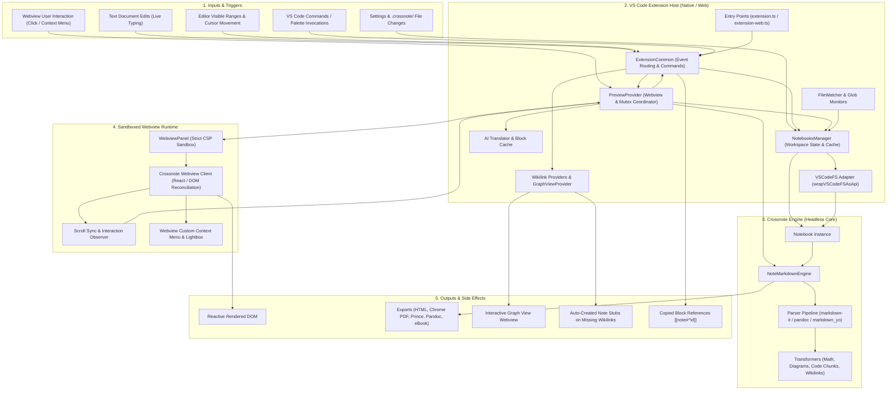

### Architecture Description

The system follows a decoupled, headless core architecture divided into five explicit operational layers:

1. **Inputs & Triggers**: Collects events from VS Code's editor lifecycle, user keybindings, configuration updates, and `postMessage` events emitted from the active preview iframe.
2. **VS Code Extension Host Layer**: The control plane running within Node.js (desktop) or Web Worker (browser). It initializes [`NotebooksManager`](code/src/notebooks-manager.ts#L24) per workspace, maintains a per-workspace concurrency mutex via [`async-mutex`](code/src/preview-provider.ts#L1), and stamps render requests with monotonic sequence counters to eliminate race conditions.
3. **Crossnote Engine Layer**: Headless core executing Markdown compilation. It accepts raw document strings, evaluates YAML front matter, invokes selected parsers (`markdown-it`, `pandoc`, or `markdown_yo`), runs macro substitutions (KaTeX/MathJax v4), compiles diagrams, and caches rendered tokens.
4. **Sandboxed Webview Runtime Layer**: A secure `vscode.Webview` operating under a strict Content Security Policy. It hosts the crossnote React client, manages DOM reconciliation, captures scroll events, and passes whitelisted commands back to the host.
5. **Outputs & Side Effects Layer**: Delivers real-time preview updates, writes compiled publication artifacts to disk, launches external viewers, updates the active knowledge graph, and copies Obsidian-compatible block reference anchors.

---

## 3. Source Code Structure

```text
code/
├── .github/workflows/       # CI/CD and release dispatch workflows
├── media/                   # Icons and assets (preview.svg, lightbox.css, etc.)
├── src/
│   ├── types/
│   │   └── pi-ai.d.ts       # Ambient typings for @earendil-works/pi-ai
│   ├── ai-translation-cache.ts          # LRU-capped disk cache for block translations
│   ├── ai-translator.ts                 # Streaming AI translation client & secret store
│   ├── backlinks-provider.ts            # Backlink reference bridge (stub)
│   ├── block-id-completion-provider.ts  # Autocomplete for [[note]], #heading, ^block, #tag
│   ├── block-id-helpers.ts              # Trigger context parsers for cursor position
│   ├── config.ts                        # MPE & crossnote config loader & schema mapping
│   ├── custom-editor-options.ts         # VS Code custom editor configuration options
│   ├── extension-common.ts              # Universal activation, event loops, & commands
│   ├── extension-web.ts                 # Web extension entry point (vscode.dev)
│   ├── extension.ts                     # Desktop Node.js extension entry point
│   ├── file-watcher.ts                  # Workspace file system watcher for note relations
│   ├── find-fragment-target-line.ts     # Re-export shim for crossnote fragment line resolver
│   ├── graph-view-provider.ts           # Interactive 2D note relation graph view
│   ├── image-helper.ts                  # Local pasting and remote image upload service
│   ├── markdown-blocks.ts               # State-machine markdown splitter and SHA256 hasher
│   ├── notebooks-manager.ts             # Workspace notebook lifecycle and config cascading
│   ├── preview-custom-editor-provider.ts# VS Code CustomTextEditorProvider adapter
│   ├── preview-provider.ts              # Webview panel coordinator, CSP, and render loop
│   ├── utils.ts                         # Environment detection, paths, & stub generator
│   ├── vscode-fs.ts                     # FileSystemApi bridge over vscode.workspace.fs
│   ├── wikilink-document-link-provider.ts# Clickable DocumentLink spans for [[wikilinks]]
│   └── wikilink-hover-provider.ts       # Rich hover preview cards for wikilinks and headings
├── test/                    # Unit test suite and runner fixtures
│   ├── markdown/            # Test markdown fixtures
│   ├── block-id-helpers.test.js
│   ├── extension.test.js
│   ├── find-fragment-target-line.test.js
│   ├── index.js
│   └── rank-by-closeness.test.js
├── build.js                 # Esbuild build orchestration (native Node CJS & Web Browser CJS)
├── gulpfile.js              # Asset distributor copying crossnote webview bundles
└── package.json             # Manifest defining commands, menus, views, & dependencies
```

| Path                                                                          | Description                                                                                     |
| :---------------------------------------------------------------------------- | :---------------------------------------------------------------------------------------------- |
| [`src/extension.ts`](code/src/extension.ts)                                   | Desktop entry point initializing local directory watchers (`globalConfigPath`) and host commands. |
| [`src/extension-web.ts`](code/src/extension-web.ts)                           | Web extension entry point initializing common services without desktop-only dependencies.       |
| [`src/extension-common.ts`](code/src/extension-common.ts)                     | Shared coordinator registering commands, editor listeners, scroll sync, and language providers. |
| [`src/preview-provider.ts`](code/src/preview-provider.ts)                     | Manages webview panels, mutex synchronization, render request sequencing, CSP, and exports.     |
| [`src/notebooks-manager.ts`](code/src/notebooks-manager.ts)                   | Creates and caches crossnote `Notebook` instances, merging VS Code settings with `.crossnote`.  |
| [`src/vscode-fs.ts`](code/src/vscode-fs.ts)                                   | Implements crossnote's `FileSystemApi` on top of `vscode.workspace.fs` for universal I/O.       |
| [`src/config.ts`](code/src/config.ts)                                         | Reads MPE settings, defines color scheme enums, and maps properties to `NotebookConfig`.        |
| [`src/graph-view-provider.ts`](code/src/graph-view-provider.ts)               | Orchestrates the webview-based note relation network visualization.                             |
| [`src/wikilink-document-link-provider.ts`](code/src/wikilink-document-link-provider.ts) | Provides clickable `DocumentLink` spans for `[[wikilinks]]` in the editor.            |
| [`src/wikilink-hover-provider.ts`](code/src/wikilink-hover-provider.ts)       | Renders rich hover previews for linked notes, headings, and block IDs.                          |
| [`src/block-id-completion-provider.ts`](code/src/block-id-completion-provider.ts) | Supplies autocomplete suggestions for notes, headings, block IDs, and body `#tags`.         |
| [`src/ai-translator.ts`](code/src/ai-translator.ts)                           | Manages LLM translation streaming via `@earendil-works/pi-ai` and secure API key storage.       |
| [`src/ai-translation-cache.ts`](code/src/ai-translation-cache.ts)             | Persists translated markdown blocks to disk with LRU eviction capped at 5,000 blocks.           |
| [`src/markdown-blocks.ts`](code/src/markdown-blocks.ts)                       | State-machine line parser that splits markdown on blank lines while preserving code fences.     |
| [`src/preview-custom-editor-provider.ts`](code/src/preview-custom-editor-provider.ts) | Hooks into the VS Code Custom Editor API to host MPE inside standard document tabs.     |

---

## 4. Public API & Interface

### Key Types & Interfaces

| Type / Interface                                                          | Location                                                                  | Description                                                                                                               |
| :------------------------------------------------------------------------ | :------------------------------------------------------------------------ | :------------------------------------------------------------------------------------------------------------------------ |
| [`MarkdownPreviewEnhancedConfig`](code/src/config.ts#L59)                 | [`src/config.ts`](code/src/config.ts)                                     | Typed representation of all VS Code configuration keys implementing crossnote's `NotebookConfig`.                         |
| [`PreviewColorScheme`](code/src/config.ts#L23)                            | [`src/config.ts`](code/src/config.ts)                                     | Enum (`selectedPreviewTheme`, `systemColorScheme`, `editorColorScheme`) controlling dark/light adaptation.                |
| [`wrapVSCodeFSAsApi` / `FileSystemApi`](code/src/vscode-fs.ts#L16)        | [`src/vscode-fs.ts`](code/src/vscode-fs.ts)                               | Factory function wrapping `vscode.workspace.fs` into crossnote's `FileSystemApi` interface (`exists`, `readFile`, etc.).  |
| [`TranslateResult`](code/src/ai-translator.ts#L91)                        | [`src/ai-translator.ts`](code/src/ai-translator.ts)                       | Result type returned by translation streams containing `{ ok: boolean, markdown?: string, error?: string }`.              |
| [`GraphViewData`](code/src/graph-view-provider.ts#L1)                     | [`src/graph-view-provider.ts`](code/src/graph-view-provider.ts) (imported from `crossnote`) | Crossnote node-link graph data interface representing document entities, cross-references, and tags across the workspace. |

### Common Usage Patterns

#### Pattern 1: Initializing and Rendering a Document Preview

```typescript
import * as vscode from "vscode";
import { PreviewProvider } from "./preview-provider";
import { getEditorActiveCursorLine } from "./utils";

async function openDocumentPreview(
  editor: vscode.TextEditor,
  context: vscode.ExtensionContext,
) {
  const uri = editor.document.uri;

  // Acquire the workspace-bound preview provider instance under mutex lock
  const previewProvider = await PreviewProvider.getPreviewContentProvider(
    uri,
    context,
  );

  // Initialize the Webview panel with CSP headers and start the compile pipeline
  await previewProvider.initPreview({
    sourceUri: uri,
    document: editor.document,
    cursorLine: getEditorActiveCursorLine(editor),
    viewOptions: {
      viewColumn: vscode.ViewColumn.Beside,
      preserveFocus: true,
    },
  });
}
// Expected output:
// Initializes or reveals a vscode.WebviewPanel beside the active editor titled
// "Preview <basename>", injects generated HTML template with CSP, and initiates
// bidirectional postMessage communication for live editing and scroll sync.
```

#### Pattern 2: Incremental Markdown Block Splitting and Hashing

```typescript
import { splitMarkdownBlocks, hashBlock } from "./markdown-blocks";

const sampleMarkdown = `---
title: Sample Document
---

# Architecture Overview
This is a introductory paragraph detailing the system architecture.

\`\`\`typescript
const port = 8080;
// Code block internal lines are preserved together
console.log(port);
\`\`\`

Final trailing paragraph with a block anchor. ^arch-summary`;

// Split document into discrete top-level syntactic blocks
const blocks = splitMarkdownBlocks(sampleMarkdown);
const hashes = blocks.map((block) => hashBlock(block));

console.log("Block Count:", blocks.length);
console.log("Hashes:", hashes);
// Expected output:
// Block Count: 4
// Hashes: [
//   "113cc3f432712f29", // YAML front matter block
//   "b5dde66eb905e88c", // Heading and introductory paragraph
//   "8142bf75f75b61d7", // Preserved fenced code block
//   "022e2658208f890f"  // Trailing paragraph with anchor
// ]
```

### API Design Philosophy

The API follows three architectural principles:

1. **Host-Agnostic Abstraction**: Crossnote requires no direct dependency on VS Code's runtime. The host adapts its environment by wrapping `vscode.workspace.fs` into a standard `FileSystemApi`.
2. **Deterministic Concurrency Control**: All asynchronous operations modifying workspace state or dispatching renders are protected by workspace-keyed mutexes (`WORKSPACE_MUTEX_MAP`) and Monotonic Request Identifiers (`initRequestSeq`, `renderRequestSeq`).
3. **Hardened Webview Boundary**: No blind command execution. Webview messages are validated against a strict whitelist ([`WEBVIEW_MESSAGE_COMMANDS`](code/src/preview-provider.ts#L81)) preventing prototype pollution or arbitrary host execution.

---

## 5. Components

### Component Dependency Matrix

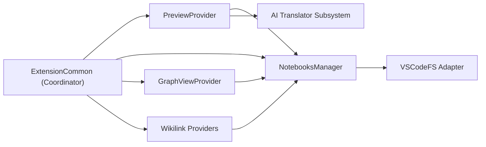

| Component                     | Depends On                                                                       | Depended On By                                            |
| :---------------------------- | :------------------------------------------------------------------------------- | :-------------------------------------------------------- |
| **`ExtensionCommon`**         | `PreviewProvider`, `NotebooksManager`, `GraphViewProvider`, `Wikilink Providers` | `src/extension.ts`, `src/extension-web.ts`                |
| **`PreviewProvider`**         | `NotebooksManager`, `AI Translator Subsystem`, `crossnote`                       | `ExtensionCommon`, `PreviewCustomEditorProvider`          |
| **`NotebooksManager`**        | `VSCodeFS Adapter`, `FileWatcher`, `crossnote`                                   | `PreviewProvider`, `ExtensionCommon`, `GraphViewProvider` |
| **`Wikilink Providers`**      | `NotebooksManager`, `VSCodeFS Adapter`, `crossnote`                              | `ExtensionCommon`                                         |
| **`AI Translator Subsystem`** | `@earendil-works/pi-ai`, `crypto-js`, `AI Translation Cache`                     | `PreviewProvider`, `ExtensionCommon`                      |

---

### Component 1: `PreviewProvider`

- **Location**: [`src/preview-provider.ts`](code/src/preview-provider.ts)
- **Responsibilities**: Manages the lifecycle of `vscode.WebviewPanel` instances, coordinates rendering passes, enforces CSP headers, prevents render race conditions, routes export commands (Chrome, Prince, Pandoc, eBook, HTML, Markdown), and validates incoming webview IPC messages.
- **Key Entities**:
  - [`PreviewProvider`](code/src/preview-provider.ts#L180): Per-workspace coordinator instance.
  - [`WORKSPACE_PREVIEW_PROVIDER_MAP`](code/src/preview-provider.ts#L72): Registry mapping workspace URI to active provider.
  - [`WEBVIEW_MESSAGE_COMMANDS`](code/src/preview-provider.ts#L81): Immutable security `Set` of whitelisted commands allowed from the webview.
- **Inputs & Outputs**:
  - **Input**: Document URIs, raw text, cursor position, webview IPC messages.
  - **Output**: Rendered HTML templates, `updateHtml` `postMessage` deltas, exported files on disk.

#### Component Interaction

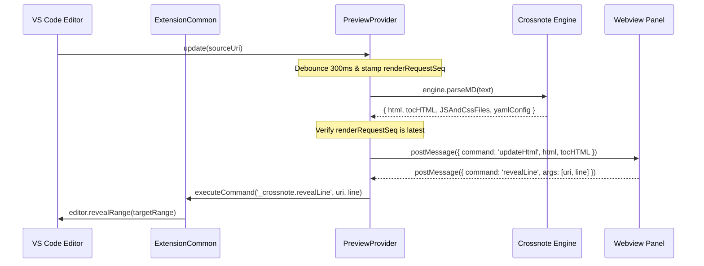

`PreviewProvider` acts as the intermediary between VS Code's editor surface and the webview iframe. It prevents UI flickering during typing by combining a 300ms debounce timer with sequence ID stamping, and validates incoming webview messages before routing them to `_crossnote.*` commands in `ExtensionCommon`.

---

### Component 2: `NotebooksManager`

- **Location**: [`src/notebooks-manager.ts`](code/src/notebooks-manager.ts)
- **Responsibilities**: Instantiates and caches crossnote `Notebook` instances per workspace, merges configuration across global (`~/.crossnote` or XDG equivalent) and workspace (`.crossnote`) directories, enforces filesystem root guards, and synchronizes editor associations when `previewMode` changes.
- **Key Entities**:
  - [`NotebooksManager`](code/src/notebooks-manager.ts#L24): Master manager holding active `notebooks: Notebook[]`.
  - [`warnIfFilesystemRoot`](code/src/notebooks-manager.ts#L94): Guard checking against indexing the root of the OS filesystem (`/` or `C:\`).
  - [`applyPreviewScripts`](code/src/notebooks-manager.ts#L197): Security policy gate enabling user scripts only when `enablePreviewScripts` is true and the workspace is trusted.
- **Inputs & Outputs**:
  - **Input**: Workspace URI, configuration updates, file watcher change notifications.
  - **Output**: Fully configured `Notebook` instance, updated `workbench.editorAssociations`.

#### Component Interaction

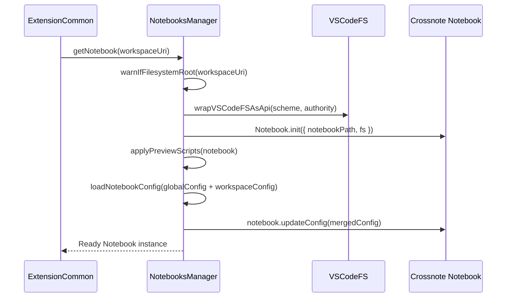

`NotebooksManager` ensures each workspace folder initializes at most one `Notebook` instance, wrapping its URI scheme and authority into a `FileSystemApi` adapter while keeping global config reads bound to the local extension host filesystem.

---

### Component 3: `ExtensionCommon`

- **Location**: [`src/extension-common.ts`](code/src/extension-common.ts)
- **Responsibilities**: Universal extension activation logic, command registration (`markdown-preview-enhanced.*` and internal `_crossnote.*`), document save/edit synchronization, selection/scroll tracking, and registration of wikilink completion/hover/document-link providers.
- **Key Entities**:
  - [`initExtensionCommon`](code/src/extension-common.ts#L45): Core initialization function executed on native and web startup.
  - [`editorScrollDelay`](code/src/extension-common.ts#L31): Latch timestamp preventing feedback loops when the editor scrolls in response to the webview.
  - [`copyBlockReference`](code/src/extension-common.ts#L173): Generates or reuses a trailing `^block-id` anchor and copies `[[note#^id]]` to the clipboard.
- **Inputs & Outputs**:
  - **Input**: `vscode.ExtensionContext`, VS Code window/workspace event streams, command invocations.
  - **Output**: Registered disposables, active language providers, quick-pick modals, and preview dispatches.

#### Component Interaction

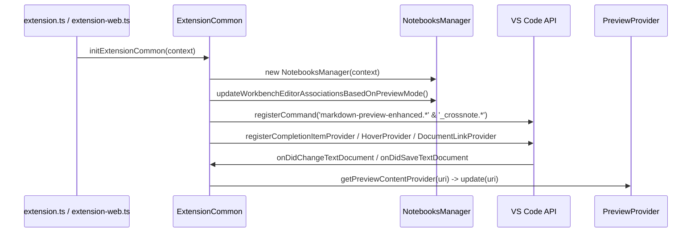

`ExtensionCommon` centralizes all platform-independent extension wiring so that desktop (`extension.ts`) and browser (`extension-web.ts`) entry points share identical command, preview, and PKM behavior.

---

### Component 4: `Wikilink & Knowledge Management`

- **Location**: [`src/wikilink-document-link-provider.ts`](code/src/wikilink-document-link-provider.ts), [`src/wikilink-hover-provider.ts`](code/src/wikilink-hover-provider.ts), [`src/block-id-completion-provider.ts`](code/src/block-id-completion-provider.ts), [`src/graph-view-provider.ts`](code/src/graph-view-provider.ts)
- **Responsibilities**: Provides Obsidian-compatible note networking. Scans `[[Note]]`, `[[Note#Heading]]`, `[[Note^block-id]]`, and `![[Embed]]` syntax, creates missing notes upon navigation, displays section/block hovers with fuzzy block-ID typo recovery, auto-completes notes/headings/blocks/tags, and visualizes workspace graph connections.
- **Key Entities**:
  - [`WikilinkCompletionProvider`](code/src/block-id-completion-provider.ts#L32): Implements `vscode.CompletionItemProvider` for `[`, `#`, and `^` trigger characters.
  - [`WikilinkHoverProvider`](code/src/wikilink-hover-provider.ts#L18): Implements `vscode.HoverProvider` with Levenshtein-based block-ID suggestion fallback ([`rankByCloseness`](code/src/wikilink-hover-provider.ts#L286)).
  - [`WikilinkDocumentLinkProvider`](code/src/wikilink-document-link-provider.ts#L31): Emits `command:_crossnote.openWikilinkTarget` links for `Alt+Click` / `Ctrl+Click` navigation.
  - [`createMissingMarkdownNote`](code/src/utils.ts#L106): Utility generating an initial `# Title\n\n` stub when an unresolved wikilink or orphan graph node is clicked.
- **Inputs & Outputs**:
  - **Input**: Document text, cursor `Position`, wikilink fragments (`#heading`, `^block-id`), workspace `Notebook` index.
  - **Output**: `CompletionItem[]`, `Hover` preview cards, `DocumentLink[]`, newly created stub `.md` files, and `GraphViewData` webview payloads.

#### Component Interaction

```mermaid
sequenceDiagram
    participant User
    participant Ed as VS Code Editor
    participant Comp as WikilinkCompletionProvider
    participant Hover as WikilinkHoverProvider
    participant Link as WikilinkDocumentLinkProvider
    participant NM as NotebooksManager

    User ->> Ed: Types "[[Note^"
    Ed ->> Comp: provideCompletionItems(doc, pos)
    Comp ->> Ed: Return ^block-id CompletionItems from target note
    User ->> Ed: Hovers over "[[Note^typo]]"
    Ed ->> Hover: provideHover(doc, pos)
    Hover ->> NM: getNotebook(uri) -> resolveWikilink()
    Hover -->> Ed: Hover card with rankByCloseness() block-id suggestions
    User ->> Ed: Ctrl+Clicks "[[NewNote]]"
    Ed ->> Link: _crossnote.openWikilinkTarget
    Link ->> Ed: createMissingMarkdownNote() & showTextDocument()
```

The PKM providers reuse crossnote's `resolveWikilink`, `extractHeadings`, `extractBlockIds`, and `findFragmentTargetLine` helpers so that editor completions, hover previews, and link navigation resolve to the exact same targets as the rendered preview.

---

### Component 5: `AI Translation Subsystem`

- **Location**: [`src/ai-translator.ts`](code/src/ai-translator.ts), [`src/ai-translation-cache.ts`](code/src/ai-translation-cache.ts), [`src/markdown-blocks.ts`](code/src/markdown-blocks.ts)
- **Responsibilities**: Performs non-blocking, streaming translations of markdown documents to Chinese. Splits text into discrete syntactic blocks, caches translated blocks by 16-char SHA-256 hash, batches consecutive changed blocks into runs, and streams results sequentially into the preview without altering original source files.
- **Key Entities**:
  - [`splitMarkdownBlocks`](code/src/markdown-blocks.ts#L24) & [`hashBlock`](code/src/markdown-blocks.ts#L159): Fenced-block and YAML-front-matter aware line parser and truncated SHA-256 hasher.
  - [`streamTranslateBlock`](code/src/ai-translator.ts#L133) & [`streamTranslateDocument`](code/src/ai-translator.ts#L108): Lazy-loads `@earendil-works/pi-ai` and streams LLM deltas.
  - [`getBlockTranslation`](code/src/ai-translation-cache.ts#L41) & [`setBlockTranslation`](code/src/ai-translation-cache.ts#L77): Disk cache capped at 5,000 `.md` files with `.meta.json` LRU eviction.
- **Inputs & Outputs**:
  - **Input**: Raw source markdown string, `aiTranslationProvider` and `aiTranslationModel` settings, API key from `ExtensionContext.secrets`, `AbortSignal`.
  - **Output**: Translated markdown string (`TranslateResult`), `<hash>.md` and `<hash>.meta.json` cache files, and `MPE AI Translation` output channel logs.

#### Component Interaction

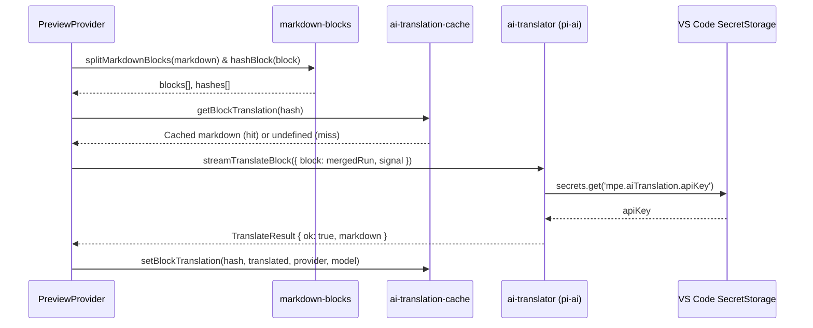

By operating at the markdown source level and feeding translated text back into `PreviewProvider` via `translatedMarkdownOverrides`, the subsystem preserves full crossnote rendering (TOC, math, diagrams, and exports) on translated content without mutating the user's file on disk.

---

## 6. Execution Flows

### Happy Path

#### Live Document Editing & Real-Time Synchronized Preview

When a user edits a Markdown document with an open preview, MPE debounces keystrokes, stamps the render request to prevent out-of-order updates, compiles the updated Markdown via Crossnote, and reconciles the Webview DOM in place.

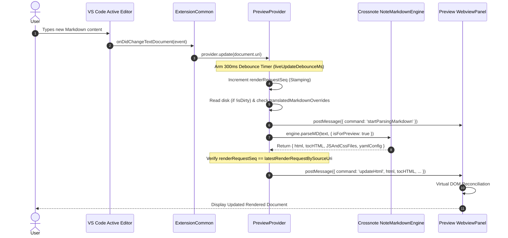

1. The user edits content in the VS Code editor, raising `vscode.workspace.onDidChangeTextDocument`.
2. `ExtensionCommon` filters for markdown files ([`isMarkdownFile`](code/src/utils.ts#L141)) and forwards the URI to [`PreviewProvider.update()`](code/src/preview-provider.ts#L1734).
3. `PreviewProvider` resets its per-URI debounce timer (`liveUpdateDebounceMs`, default 300ms).
4. Upon debounce expiration, [`updateMarkdown`](code/src/preview-provider.ts#L812) increments `renderRequestSeq` and records it in `latestRenderRequestBySourceUri`.
5. If the document has no unsaved edits (`!document.isDirty`), `PreviewProvider` reads fresh bytes from disk via `vscode.workspace.fs.readFile`; if an AI translation override is active, it substitutes the cached translation.
6. The webview is notified with `startParsingMarkdown` to present parsing indicators, and `engine.parseMD` compiles syntax extensions, math, and diagrams.
7. `PreviewProvider` verifies the request ID matches `latestRenderRequestBySourceUri`. If `JSAndCssFiles` or `isPresentationMode` changed, it triggers a full panel refresh; otherwise it dispatches `updateHtml`.
8. The webview reconciles the DOM in place, preserving scroll position and UI state.

---

### Error / Recovery Path

#### Stale Render Overrun & AI Stream Failure Fallback

When incremental per-block AI translation encounters an API error across all runs (or when no blocks are cached on first translation), MPE falls back to whole-document streaming translation with periodic partial preview updates.

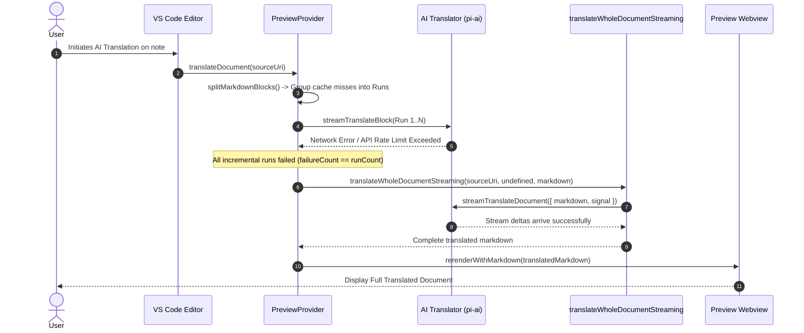

1. During incremental translation ([`translateIncrementally`](code/src/preview-provider.ts#L1092)), cache-miss blocks are grouped into contiguous runs (`MAX_RUN_BYTES = 8192`, `MAX_RUN_BLOCKS = 20`) and sent to `streamTranslateBlock`.
2. Any stream error is logged to the `MPE AI Translation` output channel and increments `failures`.
3. If every run fails (`failureCount === runCount`) or block splitting produces no blocks, MPE invokes [`translateWholeDocumentStreaming`](code/src/preview-provider.ts#L1358).
4. A single whole-document request is dispatched with a cancellable VS Code notification progress bar (`AbortController`).
5. On completion, the translated markdown is stored in `translatedMarkdownOverrides` and rendered via `rerenderWithMarkdown`; if the fallback also fails, `vscode.window.showErrorMessage` surfaces the exact error detail.

---

### Hot Path

#### Bidirectional Two-Way Scroll Synchronization

Scroll synchronization runs continuously on viewport and cursor changes, translating editor visible line ranges to webview scroll offsets and vice versa while suppressing echo loops.

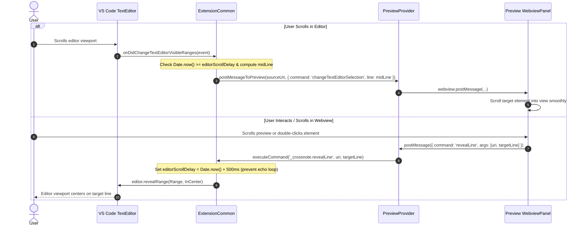

1. When the editor scrolls, `onDidChangeTextEditorVisibleRanges` in [`src/extension-common.ts`](code/src/extension-common.ts#L1135) checks `Date.now() < editorScrollDelay` to ignore echo scrolls, then calculates `midLine` from `getTopVisibleLine` and `getBottomVisibleLine`.
2. `changeTextEditorSelection` is posted via `PreviewProvider` to the webview, which interpolates its source-line map and scrolls to match.
3. Conversely, when the webview scrolls or the user clicks an element, the webview posts `{ command: 'revealLine', args: [uri, line] }` to `PreviewProvider`.
4. `PreviewProvider` verifies `revealLine` against `WEBVIEW_MESSAGE_COMMANDS` and invokes `_crossnote.revealLine` in `ExtensionCommon`, which sets `editorScrollDelay = Date.now() + 500` and calls `editor.revealRange()`.

---

## 7. Data Models & Transformations

### Transformation Pipeline

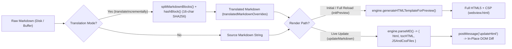

| Stage                            | Model / Entity        | Format        | Description                                                                                    |
| :------------------------------- | :-------------------- | :------------ | :--------------------------------------------------------------------------------------------- |
| **Stage 1: Ingestion**           | `vscode.TextDocument` | Plain Text    | Source buffer read from disk (when clean) or dirty editor memory.                              |
| **Stage 2: Block Chunking (AI)** | `string[]` (Blocks)   | String Array  | Top-level blocks split on blank lines while preserving YAML front matter and code fences.      |
| **Stage 3: Block Hashing (AI)**  | `BlockHash`           | Hex String    | First 16 characters of SHA-256 hash used as the key for `~/.crossnote/ai-translation-cache/`.  |
| **Stage 4: Incremental Parse**   | `ParsedResult`        | Object (HTML) | Output from `engine.parseMD()` containing `html`, `tocHTML`, `JSAndCssFiles`, and `yamlConfig`.|
| **Stage 5: Full Bootstrap**      | `HTMLDocument`        | Full HTML5    | Output from `engine.generateHTMLTemplateForPreview()` with CSP, lightbox, and bootstrap JS.    |

#### `MarkdownPreviewEnhancedConfig`

- **Location**: [`src/config.ts`](code/src/config.ts#L59)
- **Description**: Merged configuration schema implementing Crossnote's `NotebookConfig` and driving engine behavior and UI modes.
- **Key Fields**:
  - `previewMode`: Enum determining preview display strategy (`Single Preview`, `Multiple Previews`, `Previews Only`).
  - `markdownParser`: Active engine parser (`markdown-it`, `pandoc`, or `markdown_yo`; forced to `markdown-it` in web extensions).
  - `scrollSync`: Boolean flag controlling two-way scroll synchronization.
  - `enableScriptExecution`: Boolean gate controlling code chunk evaluation.
  - `enablePreviewScripts`: Application-scoped boolean gate controlling `<script src>` in `head.html` and `@import "*.js"`.
  - `enableWikiLinkSyntax`: Enables PKM wikilink parsing, hover cards, document links, and autocompletion.

---

### Persistent State

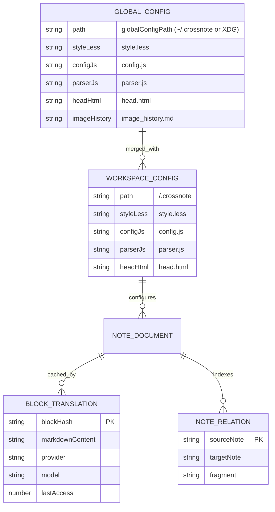

| Entity                      | Location                                                 | Lifecycle             | Description                                                                        |
| :-------------------------- | :------------------------------------------------------- | :-------------------- | :--------------------------------------------------------------------------------- |
| **Global Config**           | `~/.crossnote/` (Windows) or `$XDG_CONFIG_HOME/crossnote` / `~/.local/state/crossnote` (Unix) | Persistent | User-wide `style.less`, `config.js`, `parser.js`, `head.html`, and `image_history.md`. |
| **Workspace Config**        | `<workspace>/.crossnote/`                                | Per-Workspace         | Repository-specific overrides for `style.less`, `config.js`, `parser.js`, and `head.html`. |
| **Block Translation Cache** | `<globalConfigPath>/ai-translation-cache/blocks/`        | Persistent (LRU 5000) | Stores translated markdown chunks (`<hash>.md`) and metadata (`<hash>.meta.json`). |
| **API Key Secret**          | VS Code `SecretStorage`                                  | Persistent Secure     | Encrypted storage for AI translation API key under `mpe.aiTranslation.apiKey`.     |
| **Graph View Preferences**  | VS Code `ExtensionContext.globalState`                   | Persistent Global     | Stores `graphViewMode` (`'global' \| 'local'`) and `graphViewColorByFolder` (`boolean`). |

#### `BlockMeta` (Block Translation Cache Entry)

- **Location**: [`src/ai-translation-cache.ts`](code/src/ai-translation-cache.ts#L31)
- **Description**: Disk-persisted translation entry allowing incremental updates with zero API re-calls for unchanged paragraphs. Metadata is modeled via the `BlockMeta` interface and persisted as `<hash>.meta.json`, paired with the translated markdown content file `<hash>.md`.
- **Key Fields (`BlockMeta`)**:
  - `provider`: AI provider identifier (e.g., `openai`, `anthropic`, `google`).
  - `model`: Target LLM model name.
  - `lastAccess`: Epoch millisecond timestamp updated on read/write for LRU eviction when block count exceeds `MAX_BLOCKS` (5000).
- **Persistence**: Saved in `<globalConfigPath>/ai-translation-cache/blocks/` as `<hash>.md` and `<hash>.meta.json`, keyed by `blockHash` (16-character truncated SHA-256).

---

## 8. Key Algorithms & Methods

### 1. Incremental AI Translation with Contiguous Block-Run Merging (`translateIncrementally`)

- **Location**: [`src/preview-provider.ts`](code/src/preview-provider.ts#L1092)
- **Purpose**: Translates modified markdown documents without re-translating unchanged paragraphs, while grouping adjacent changed blocks to preserve context for the LLM.
- **Complexity**: $O(N)$ time for block parsing and hashing; $O(R)$ sequential API requests where $R \le N$ is the number of contiguous cache-miss runs.

#### How It Works

1. **Input**: Raw markdown document containing mixed modified and unmodified blocks.

   ```text
   # Introduction
   Unchanged paragraph that was previously translated.

   New paragraph added by the author that needs translation.

   Another consecutive newly added paragraph.
   ```

2. **Block Splitting & Hash Resolution**:
   - Decomposes document using `splitMarkdownBlocks()`.
   - Computes `hashBlock(b)` for each block and checks `getBlockTranslation(hash)`.
   - If all blocks miss the cache (`toTranslate.length === blocks.length`), delegates to `translateWholeDocumentStreaming` and populates per-block cache entries if block counts align.

   ```text
   Block 0: Cache Hit  -> Reuse cached translation directly.
   Block 1: Cache Miss -> Queue for translation (index 1).
   Block 2: Cache Miss -> Queue for translation (index 2).
   ```

3. **Contiguous Run Merging**:
   - Groups adjacent cache misses (`index === prevIndex + 1`) into a single run capped at `MAX_RUN_BYTES = 8192` and `MAX_RUN_BLOCKS = 20`.

   ```text
   Run 1: { startIndex: 1, indices: [1, 2], blocks: [Block 1, Block 2] }
   ```

4. **Sequential Streaming & Partial Refresh**:
   - Dispatches each run sequentially in ascending document order via `streamTranslateBlock({ block: run.blocks.join('\n\n') })`.
   - Splits the translated run back into blocks via `splitMarkdownBlocks()`. If the block count matches `run.indices.length`, aligns 1:1; otherwise places the full run translation at `run.startIndex` and blanks the remaining slots in the run.
   - Calls `refreshPreviewWithMarkdown()` via serialized promise chains (`refreshChains`) so the user sees blocks update top-to-bottom.

5. **Output**:

   ```text
   # 介绍
   先前已翻译的未更改段落。

   作者新添加的需要翻译的段落。

   另一个连续的新添加段落。
   ```

---

### 2. Levenshtein-Based Block-ID Fuzzy Suggester (`rankByCloseness`)

- **Location**: [`src/wikilink-hover-provider.ts`](code/src/wikilink-hover-provider.ts#L286)
- **Purpose**: Ranks candidate `^block-id` anchors in a target note when a user hovers over an unresolved block reference (`[[Note^missing-id]]`), powering the *"Did you mean"* suggestions in [`WikilinkHoverProvider.formatNotFound`](code/src/wikilink-hover-provider.ts#L152).
- **Complexity**: $O(K \cdot |A| \cdot |B| + K \log K)$ time across $K$ candidates of length $|B|$ against query $|A|$; $O(|B| + K)$ auxiliary memory using two-row dynamic programming.

#### How It Works

1. **Input**:
   - Target query: `wanted = "architecure"` (11 chars)
   - Candidate block IDs: `["Architecture", "architecure-v2", "Artifacts", "System_Design"]`

2. **Case-Insensitive Substring & Edit Distance Calculation**:
   - Lowercases both `wanted` and each candidate `id`.
   - Evaluates whether the candidate contains `wantedLower` as a substring (`contains = lower.includes(wantedLower) ? 0 : 1`), prioritizing substring matches over non-substring matches.
   - Computes Levenshtein edit distance using two rolling rows (`prev` and `curr` of length `b.length + 1`):

   ```text
   Candidate "architecure-v2": contains = 0, distance = 3
   Candidate "Architecture":   contains = 1, distance = 1
   Candidate "Artifacts":      contains = 1, distance = 7
   Candidate "System_Design":  contains = 1, distance = 12
   ```

3. **Multi-Key Sort Comparison**:
   - Sorts candidates by `a.contains - b.contains || a.distance - b.distance || a.id.localeCompare(b.id)`.

   ```text
   1. "architecure-v2" (contains: 0, distance: 3)
   2. "Architecture"   (contains: 1, distance: 1)
   3. "Artifacts"      (contains: 1, distance: 7)
   4. "System_Design"  (contains: 1, distance: 12)
   ```

4. **Output**:
   - Sorted suggestions: `["architecure-v2", "Architecture", "Artifacts", "System_Design"]` (sliced to top 5 in `formatNotFound`).

---

## 9. Performance & Optimization

### Optimization Strategy

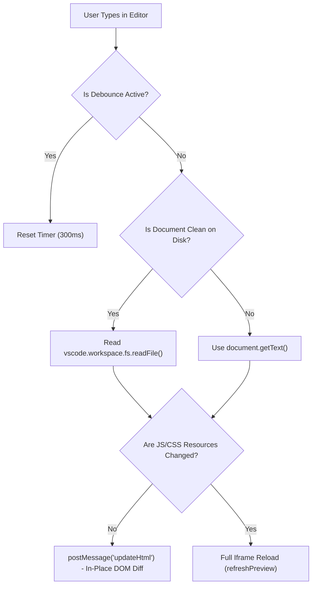

### Caching & State Management

- **Disk Block Cache**: AI translation blocks are hashed via SHA-256 and stored in `<globalConfigPath>/ai-translation-cache/blocks/`. Unchanged paragraphs incur zero network latency.
- **In-Memory Note & Tag Index**: [`NotebooksManager.getMarkdownFiles`](code/src/notebooks-manager.ts#L418) and [`getAllTags`](code/src/notebooks-manager.ts#L397) serve note and `#tag` completions directly from Crossnote's in-memory `notebook.notes` and `TagReferenceMap` indices (kept current by [`FileWatcher`](code/src/file-watcher.ts) and incremental `mtime` scans via `refreshNotesIncremental`), avoiding expensive `vscode.workspace.findFiles('**/*.md')` scans on every keystroke.
- **Image Watcher Cache**: [`WikilinkCompletionProvider`](code/src/block-id-completion-provider.ts#L32) caches workspace images (`IMAGE_GLOB`) and shares a single in-flight `imageCachePromise` across concurrent keystrokes, invalidating only when image files are created or deleted.
- **Hash-Deduplicated Graph & Backlink Updates**: [`GraphViewProvider.refreshGraphData`](code/src/graph-view-provider.ts#L196) compares `graphData.hash === GraphViewProvider.currentHash` and `showBacklinks` ([`src/extension-common.ts`](code/src/extension-common.ts#L981)) hashes backlink payloads with `SHA256` to skip redundant `postMessage` updates.
- **Render Sequence Stamping**: Every call to `initPreview` (`initRequestSeq`) and `updateMarkdown` (`renderRequestSeq`) increments a monotonic counter. Responses returning out of order due to asynchronous parser delay are discarded if overtaken by a newer request.

### Concurrency & Resource Management

- **Workspace Mutex Locking**: Uses `async-mutex` per workspace (`WORKSPACE_MUTEX_MAP` in [`src/preview-provider.ts`](code/src/preview-provider.ts#L127)). Only one `PreviewProvider` initialization executes per workspace at any given time, preventing race conditions.
- **Abortable AI Streams**: In-flight AI translation requests hold an `AbortController` per source URI (`abortControllers`). If the source document changes, is refreshed, or is restored to original, the controller aborts active HTTP streams immediately.
- **Serialized Refresh Chains**: Partial streaming updates during translation are chained through `refreshChains` per URI ([`src/preview-provider.ts`](code/src/preview-provider.ts#L1548)), guaranteeing that in-place preview refreshes execute sequentially in queue order without dropping blocks.

---

## 10. Configuration & Environment

### Configuration Resolution

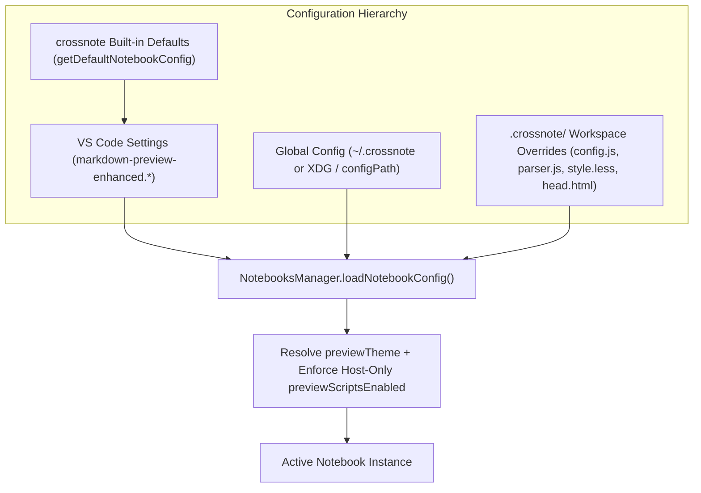

Configurations resolve through a tiered inheritance model in [`NotebooksManager.loadNotebookConfig`](code/src/notebooks-manager.ts#L121):

1. **Crossnote Defaults**: Base properties established by `getDefaultNotebookConfig()`.
2. **VS Code Settings**: Overridden by user/workspace settings under `markdown-preview-enhanced.*` via [`MarkdownPreviewEnhancedConfig.getCurrentConfig()`](code/src/config.ts#L60).
3. **Global Customizations**: Loaded from `globalConfigPath` using a local `file://` filesystem adapter so remote SSH/WSL workspaces still inherit local user styles and scripts.
4. **Workspace Customizations**: Overrides loaded from `<workspace>/.crossnote/`, with `globalCss` concatenated (`globalConfig.globalCss + workspaceConfig.globalCss`) and `previewTheme` adapted to `previewColorScheme`.
5. **Host Security Gate**: `notebook.previewScriptsEnabled` is applied separately via [`applyPreviewScripts`](code/src/notebooks-manager.ts#L197) (`vscode.workspace.isTrusted && enablePreviewScripts`), ensuring repository-controlled `.crossnote/config.js` or `.vscode/settings.json` files can never self-enable script execution.

---

### Execution Environments & Isolation

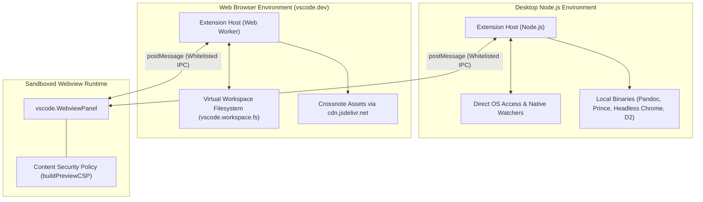

- **Execution Targets**:
  - **Desktop Node.js (`out/native/extension.js`)**: Full system access; supports external CLI processors (Pandoc, PrinceXML, Puppeteer Chrome, D2), local `node-tikzjax` WASM/TeX compilation, `markdown_yo` WASM/native binary, and direct disk caches.
  - **Web Extension (`out/web/extension.js`)**: Operates in sandboxed Web Workers (`vscode.dev` / `github.dev`); file I/O is routed through `vscode.workspace.fs`, parser defaults to `markdown-it`, PlantUML defaults to `https://kroki.io/plantuml/svg/`, and runtime webview assets load from `cdn.jsdelivr.net`.
- **Isolation Boundaries**: The webview operates under [`buildPreviewCSP`](code/src/preview-provider.ts#L149) restricting `script-src` and `style-src` to `panel.webview.cspSource` and `https:`, and locking down plugins and form submissions (`object-src 'none'`, `form-action 'none'`).
- **Cross-Environment Communication**: Communication occurs strictly over `postMessage` exchanges. Webview-to-host commands are validated against `WEBVIEW_MESSAGE_COMMANDS`, and `updateMarkdown` messages verify that the target URI matches the panel's active source URI.
- **External Dependencies**: Optional host binaries for advanced rendering and export on desktop: Chrome/Chromium (Puppeteer PDF/image export), Pandoc (`pandoc` parser & export), PrinceXML (Prince PDF export), `ebook-convert` / Calibre (eBook export), D2 CLI (`d2` diagrams), Java + `plantuml.jar` (offline PlantUML), ImageMagick, and LaTeX (`pdflatex`).

---

## 11. Extensibility & Integration

### Integration Topology

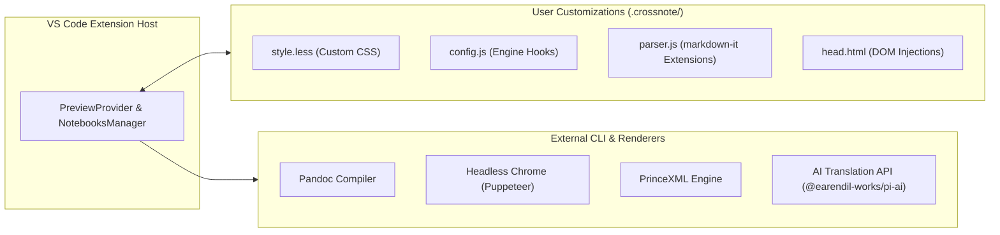

### Extensibility

1. **`style.less`**: Custom LESS stylesheets compiled into preview CSS, supporting user themes and custom fonts.
2. **`config.js`**: JavaScript configuration module for Crossnote engine settings.
3. **`parser.js`**: Hook exposing `onWillParseMarkdown`, `onDidParseMarkdown`, `onWillTransformMarkdown`, and `onDidTransformMarkdown` lifecycles plus `extendMarkdownIt` to inject custom `markdown-it` plugins.
4. **`head.html`**: Custom HTML elements injected into the `<head>` of the preview webview (external font links, stylesheets, and workspace scripts when `enablePreviewScripts` is enabled).

### APIs & Protocols

- **APIs**:
  - Public VS Code commands prefixed with `markdown-preview-enhanced.*` (29 user-facing commands in [`package.json`](code/package.json#L45-L182)).
  - Internal webview-invocable commands prefixed with `_crossnote.*` registered in [`src/extension-common.ts`](code/src/extension-common.ts) and [`src/extension.ts`](code/src/extension.ts).
  - Filesystem abstraction implementing Crossnote's `FileSystemApi` via [`wrapVSCodeFSAsApi`](code/src/vscode-fs.ts#L16).
- **Protocols**:
  - Bidirectional Webview `postMessage` IPC protocol (`updateHtml`, `startParsingMarkdown`, `changeTextEditorSelection`, `backlinks`, `graphData`, `setActiveFile`, `revealLine`, `runCodeChunk`, etc.).

---

## 12. Design & Trade-offs

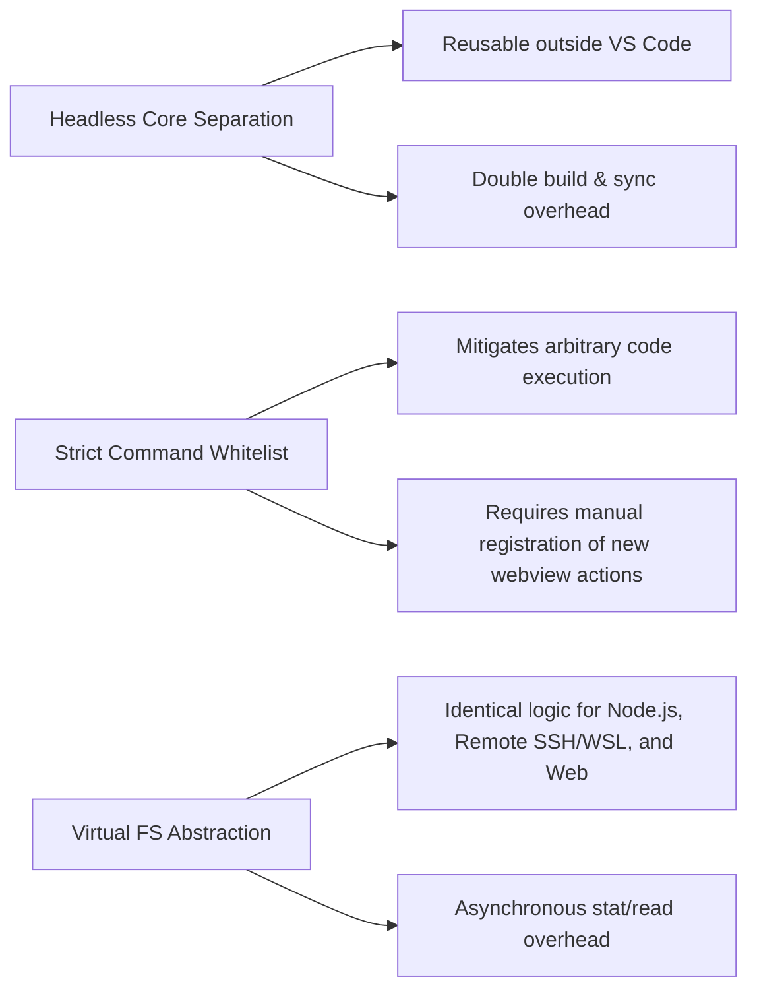

| Design / Pattern                | Benefits                                                                                            | Trade-offs                                                                                |
| :------------------------------ | :-------------------------------------------------------------------------------------------------- | :---------------------------------------------------------------------------------------- |
| **Headless Crossnote Core**     | Reuses parsing and diagram compilation across CLI, Atom, and VS Code.                               | Requires coordination between repository releases and local dependency bundling via Gulp. |
| **Strict Message Whitelisting** | Prevents blind command dispatch vulnerabilities (GHSA-83c6-hcjv-pvmg).                              | Any new UI interaction requires explicit enumeration in `WEBVIEW_MESSAGE_COMMANDS`.       |
| **Virtual Filesystem Adapter**  | Allows transparent operation across local disks, remote SSH/WSL, and virtual browser filesystems.   | Every file existence check requires asynchronous promise resolution (`await fs.stat()`).  |
| **Custom Editor Integration**   | Allows Markdown files to be viewed as rich previews directly in editor tabs (`Previews Only` mode). | Modifies global `workbench.editorAssociations` and replaces standard text editor tabs.    |

---

## 13. Error Handling & Edge Cases

### Error Types & Propagation

| Error Type                      | Source                                                                     | Propagation Strategy                                                                                         | User-Facing?                             |
| :------------------------------ | :------------------------------------------------------------------------- | :----------------------------------------------------------------------------------------------------------- | :--------------------------------------- |
| **Filesystem Root Indexing**    | [`NotebooksManager.warnIfFilesystemRoot`](code/src/notebooks-manager.ts#L94) | Guards against root directory indexing (`/` or `C:\`); warns once per root per session.                      | Yes (`vscode.window.showWarningMessage`) |
| **Stale Render Request**        | [`PreviewProvider.updateMarkdown`](code/src/preview-provider.ts#L812)      | Discards render silently when `renderRequestSeq` or `initRequestSeq` mismatch occurs.                        | No                                       |
| **AI Translation Failure**      | [`PreviewProvider.translateIncrementally`](code/src/preview-provider.ts#L1092) | Falls back to `translateWholeDocumentStreaming`; surfaces error notification if whole-doc stream also fails. | Yes (`vscode.window.showErrorMessage`)   |
| **Unresolved Block Reference**  | [`WikilinkHoverProvider.formatNotFound`](code/src/wikilink-hover-provider.ts#L152) | Uses [`rankByCloseness`](code/src/wikilink-hover-provider.ts#L286) Levenshtein ranking to show top 5 *"Did you mean"* `^block-id` suggestions. | Yes (Markdown hover card) |
| **Unresolved Wikilink Note**    | [`WikilinkHoverProvider.resolveNoteUri`](code/src/wikilink-hover-provider.ts#L214) | Falls back from `notebook.resolveWikilink()` to same-directory `stat` and workspace-wide `findFiles` by basename. | Yes (`*Note not found:*` hover card) |

### Recovery Mechanisms

- **External File Modification Recovery**: When files are edited outside VS Code (e.g., via Notepad or Git checkout across WSL), `updateMarkdown` and `refreshPreviewPanel` detect `!document.isDirty` and re-read content directly from disk via `vscode.workspace.fs.readFile`.
- **Orphan Wikilink Auto-Creation**: Clicking an unresolved `[[MissingNote]]` in the editor, preview, or Graph View invokes [`createMissingMarkdownNote`](code/src/utils.ts#L106) to create a stub document (`# MissingNote\n\n`) before opening it.
- **Remote Authority Preservation**: [`clickTagA`](code/src/extension-common.ts#L703) decodes hex-encoded authorities (`file+<encoded-authority>.vscode-resource.vscode-cdn.net`) back into proper UNC/remote URIs so links work across WSL and SSH-Remote workspaces.

### Known Limitations & Edge Cases

- **Web Extension Export Limitations**: CLI-based exports (Pandoc, PrinceXML, Headless Chrome, eBook) and `openInBrowser` are unsupported in browser environments (`vscode.dev`) and surface `"Not supported in MPE web extension."`.
- **Web Extension AI Translation Cache**: `ai-translation-cache.ts` uses `node:fs` (polyfilled in the web bundle) inside `try/catch` blocks, so persistent disk caching of translated blocks is a no-op in pure browser contexts.
- **Filesystem Root Traversal**: Opening `/` or `C:\` as a workspace disables note relation indexing to prevent recursive `stat` operations across the entire operating system.

---

## 14. Dependencies & Ecosystem

### Key Dependencies

| Dependency                                                                                 | Role                                    | Why Chosen                                                                                                      |
| :----------------------------------------------------------------------------------------- | :-------------------------------------- | :-------------------------------------------------------------------------------------------------------------- |
| [`crossnote`](https://github.com/shd101wyy/crossnote) (`0.9.33`)                           | Markdown parsing and compilation engine | Core rendering library unifying diagram parsers, math engines, PKM indexing, and document exporters.            |
| [`@earendil-works/pi-ai`](https://www.npmjs.com/package/@earendil-works/pi-ai) (`^0.83.0`) | Multi-provider LLM client               | Lightweight, ESM-compatible client providing unified streaming interfaces across OpenAI, Anthropic, and Google. |
| [`async-mutex`](https://www.npmjs.com/package/async-mutex) (`^0.4.0`)                      | Concurrency control                     | Serializes asynchronous preview provider initializations per workspace to eliminate race conditions.            |
| [`crypto-js`](https://www.npmjs.com/package/crypto-js) (`^4.2.0`)                          | Cryptographic hashing                   | Generates SHA-256 hashes across both Node.js and browser web extension environments without `node:crypto`.      |
| [`esbuild`](https://www.npmjs.com/package/esbuild) (`^0.25.0`)                             | Fast bundler                            | Produces optimized, tree-shaken CJS bundles for desktop (`node16`) and web (`es2020`).                          |

### Ecosystem & Community

- **Package Registry**: Published to the Visual Studio Code Marketplace and Open VSX Registry under publisher `shd101wyy`.
- **Plugin / Extension Ecosystem**: Extensible through `.crossnote/parser.js` (`markdown-it` plugins and pre/post-parse hooks), `.crossnote/style.less` (custom themes), and external diagram/export engines (Mermaid, PlantUML, Kroki, D2, Pandoc, PrinceXML, Puppeteer).
- **Related Projects**: Built atop [crossnote](https://github.com/shd101wyy/crossnote) (the standalone headless engine and CLI/API library extracted from MPE) and compatible with Obsidian-style wikilink/block-ID conventions and Quarto (`.qmd`) documents.
- **Release Automation**: Automated GitHub Actions workflow (`.github/workflows/release.yml`) handling changelog updates, tag creation, asset compilation, and VSIX deployment.

---

## 15. Build & Distribution

### Build Pipeline

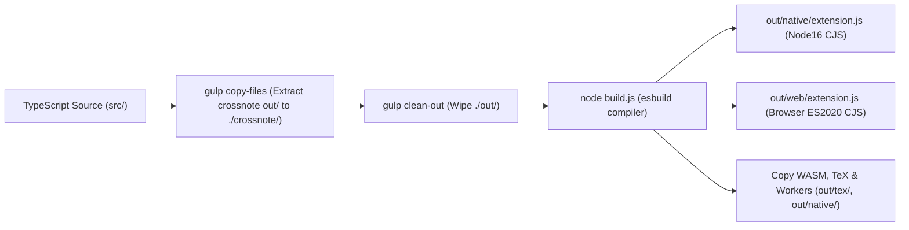

The extension uses a combined Gulp ([`gulpfile.js`](code/gulpfile.js)) and esbuild ([`build.js`](code/build.js)) pipeline:

1. `gulp copy-files`: Deletes `./crossnote` and copies prebuilt webview bundles, styles, and dependencies from `node_modules/crossnote/out/{dependencies,styles,webview}` into `./crossnote/`.
2. `gulp clean-out`: Deletes `./out` to remove stale compilation artifacts.
3. `node build.js`: Runs `esbuild` in parallel to compile native (`platform: 'node'`, `target: 'node16'`, `format: 'cjs'`) and web (`platform: 'browser'`, `target: 'es2020'`, `format: 'cjs'`, with `esbuild-plugin-polyfill-node`) bundles, then runs three post-build asset copy steps:
   - `copyTikzjaxTexFiles()`: Copies `node-tikzjax/tex` data files to `out/tex/`.
   - `copyXhrSyncWorker()`: Copies `jsdom`'s `xhr-sync-worker.js` to `out/native/xhr-sync-worker.js`.
   - `copyMarkdownYoWasm()`: Copies `markdown_yo`'s `markdown_yo_wasm_api.wasm` to `out/native/markdown_yo_wasm_api.wasm`.

### Packaging & Distribution

- **Distribution Channels**: Visual Studio Marketplace, Open VSX Registry, and direct GitHub Releases (`.vsix` artifacts).
- **Artifacts**: Packaged `.vsix` containing `out/native/extension.js` (plus WASM/worker assets), `out/web/extension.js`, `out/tex/`, `./crossnote/` runtime webview assets, localization bundles (`package.nls.*.json`), and extension manifests.

---

## Appendix

### A. Monetization & Feature Gating

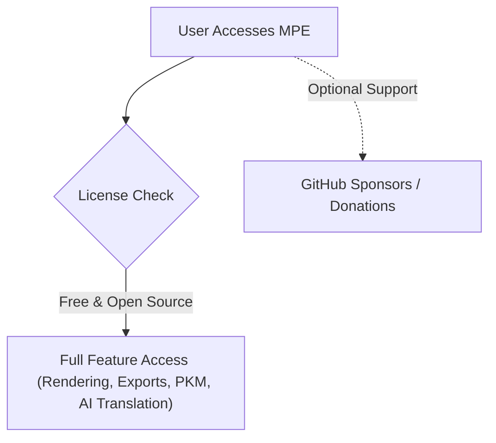

- **Model**: Completely Free and Open Source Software (FOSS) licensed under the NCSA (University of Illinois/NCSA Open Source License).
- **Gating Mechanism**: No premium feature gating or telemetry. Users can optionally support development via GitHub Sponsors (`https://github.com/sponsors/shd101wyy/`).

---

### B. Anti-patterns

#### 1. Blind Webview Command Dispatch

- **What it looks like**: Passing webview `postMessage` commands directly into `vscode.commands.executeCommand()` without argument validation or command name whitelisting.
- **Why it's wrong**: Compromised or untrusted markdown content running in a webview could execute arbitrary internal commands, modifying workspace settings or overwriting files on the host system (GHSA-83c6-hcjv-pvmg).
- **Correct approach**: Validate commands against an immutable `Set` of approved commands (`WEBVIEW_MESSAGE_COMMANDS`) and ensure source URIs match active targets.

```typescript
// ❌ Bad: Blind dispatch of untrusted webview message
panel.webview.onDidReceiveMessage((msg) => {
  vscode.commands.executeCommand(msg.command, ...msg.args);
});
// Expected output:
// Security vulnerability: Allows arbitrary VS Code command execution from webview.

// ✅ Good: Whitelisted dispatch with source validation
panel.webview.onDidReceiveMessage((msg) => {
  if (
    typeof msg?.command !== "string" ||
    !WEBVIEW_MESSAGE_COMMANDS.has(msg.command)
  ) {
    return;
  }
  if (!Array.isArray(msg?.args)) {
    return;
  }
  vscode.commands.executeCommand(`_crossnote.${msg.command}`, ...msg.args);
});
// Expected output:
// Safe dispatch: Only verified, whitelisted commands can be invoked.
```

#### 2. Direct Node Filesystem Calls in Shared Extension Logic

- **What it looks like**: Using `import * as fs from 'fs'` directly inside providers shared between native and web builds.
- **Why it's wrong**: Causes failure or no-op polyfill behavior when executed in browser-based VS Code (`vscode.dev`) or virtual workspaces, where Node's native `fs` module cannot access the workspace filesystem.
- **Correct approach**: Route all workspace filesystem checks through `vscode.workspace.fs` or the `wrapVSCodeFSAsApi` wrapper.

```typescript
// ❌ Bad: Native node fs breaking in web contexts
import * as fs from "fs";
function checkExists(filePath: string): boolean {
  return fs.existsSync(filePath);
}
// Expected output:
// Fails in vscode.dev browser environments and remote virtual filesystems.

// ✅ Good: Abstracted filesystem access via VS Code API
import * as vscode from "vscode";
async function checkExists(uri: vscode.Uri): Promise<boolean> {
  try {
    await vscode.workspace.fs.stat(uri);
    return true;
  } catch {
    return false;
  }
}
// Expected output:
// Resolves true or false universally across desktop, SSH remote, and browser environments.
```
